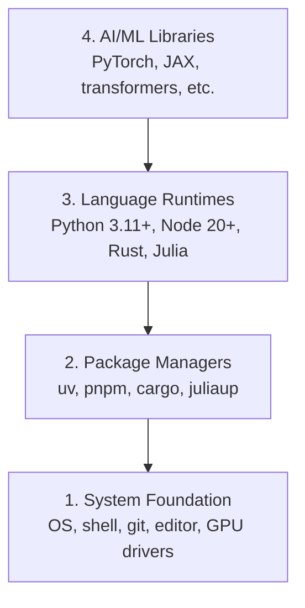

<!-- local-zh-machine-draft: English source is canonical; prose translated automatically, code/math preserved. -->

<a id="dev-environment"></a>

# 开发环境

> 你的工具塑造你的思维。设置一次，然后正确设置。

**类型：** 构建
**语言：** Python、Node.js、Rust
**先决条件：** 无
**时间：** ~45分钟

<a id="learning-objectives"></a>

## 学习目标

- 从头开始设置 Python 3.11+、Node.js 20+ 和 Rust 工具链
- 为reproducible builds配置虚拟环境和包管理器
- 使用 CUDA/MPS 验证 GPU 访问并运行测试 tensor 操作
- 了解四层堆栈：系统、包、运行时、AI 库

<a id="the-problem"></a>

## 问题

您将使用 Python、TypeScript、Rust 和 Julia 通过 500 多节课程学习 AI 工程。如果您的环境被破坏，那么每一节课都会变成与工具的斗争，而不是学习。

大多数人都会跳过环境设置。然后他们花了几个小时调试 import errors、版本冲突以及缺少 CUDA 驱动程序。我们将正确地执行此操作一次。

<a id="the-concept"></a>

## 概念

人工智能工程环境有四层：



我们自下而上安装。每一层都依赖于它下面的一层。

```figure
s0-env-stack
```

<a id="build-it"></a>

## 动手实现

<a id="step-1-system-foundation"></a>

### 第1步：系统基础

检查您的系统并安装基础知识。

```bash
# macOS
xcode-select --install
brew install git curl wget

# Ubuntu/Debian
sudo apt update && sudo apt install -y build-essential git curl wget unzip

# Windows (use WSL2)
wsl --install -d Ubuntu-24.04
```

<a id="step-2-python-with-uv"></a>

### 步骤2：Python带uv

我们使用 `uv` — 它比 pip 快 10-100 倍，并自动处理虚拟环境。

```bash
curl -LsSf https://astral.sh/uv/install.sh | sh

uv python install 3.12

uv venv
source .venv/bin/activate  # or .venv\Scripts\activate on Windows

uv pip install numpy matplotlib jupyter
```

验证：

```python
import sys
print(f"Python {sys.version}")

import numpy as np
print(f"NumPy {np.__version__}")
a = np.array([1, 2, 3])
print(f"Vector: {a}, dot product with itself: {np.dot(a, a)}")
```

<a id="step-3-nodejs-with-pnpm"></a>

### 步骤 3：使用 pnpm 的 Node.js

对于 TypeScript 课程（agents、MCP 服务器、Web 应用程序）。

```bash
curl -fsSL https://fnm.vercel.app/install | bash
fnm install 22
fnm use 22

npm install -g pnpm

node -e "console.log('Node', process.version)"
```

fnm 安装程序首先检查 `unzip`，如果不存在，则以 `Not installing fnm due to missing dependencies.` 退出：在 Linux 上，它解压 zip 存档，在 macOS 上，它通过 Homebrew 安装。 macOS 发布 `unzip`； Ubuntu、Debian 和 WSL2 从第 1 步 apt 行获取它（如果您跳过该步骤，则为 `sudo apt install -y unzip`）。

**macOS / Apple Silicon (M1/M2/M3/M4):** 如果安装程序以 `Error: Cannot install under Rosetta 2 in ARM default prefix (/opt/homebrew)` 停止，则您的终端在 Homebrew 时在 Rosetta 2 下运行（`arch` 打印 `i386`）是原生的arm64构建。安装 fnm 强制 arm64，将其连接到 shell，然后从 `fnm install 22` 重新运行上面的命令：

```bash
arch -arm64 brew install fnm
echo 'eval "$(fnm env --use-on-cd)"' >> ~/.zshrc
source ~/.zshrc
```

<a id="step-4-rust"></a>

### 步骤4：Rust

对于性能关键课程（inference，系统）。

```bash
curl --proto '=https' --tlsv1.2 -sSf https://sh.rustup.rs | sh

rustc --version
cargo --version
```

<a id="step-5-julia-optional"></a>

### 步骤5：Julia（可选）

对于数学密集的课程，Julia 表现出色。

```bash
curl -fsSL https://install.julialang.org | sh

julia -e 'println("Julia ", VERSION)'
```

<a id="step-6-gpu-setup-if-you-have-one"></a>

### 第 6 步：GPU 设置（如果有）

**NVIDIA (Linux / Windows):**

```bash
nvidia-smi

# Install PyTorch with CUDA
uv pip install torch torchvision torchaudio --index-url https://download.pytorch.org/whl/cu124
```

**macOS / Apple Silicon (M1/M2/M3/M4):** Mac 上没有 CUDA — 这是预期的，而不是故障。是否 **not** 通过 `--index-url .../cuXXX` （这些轮子仅适用于 Linux/Windows，因此安装失败）。安装普通版本，其中包括Apple的MPS（金属）GPU后端：

```bash
uv pip install torch torchvision torchaudio
```

验证（适用于任何平台）：

```python
import torch
print(f"CUDA available: {torch.cuda.is_available()}")           # False on macOS — expected
print(f"MPS available:  {torch.backends.mps.is_available()}")   # True on Apple Silicon
if torch.cuda.is_available():
    print(f"GPU: {torch.cuda.get_device_name(0)}")
```

没有GPU吗？没问题。大多数课程都适用于 CPU。对于训练量较大的课程，请使用 Google Colab 或云 GPUs。

<a id="step-7-verify-the-route-you-want-to-start"></a>

### 第 7 步：验证您要启动的路线

从存储库根（该目录）运行本课程中的每个命令
包含 `README.md` 和 `phases/`。预检仅检查您需要的内容
启动选定的路线。默认情况下它会跳过后面的工具，以便新学习者看到
一个明确的答案，而不是一堵警告墙。

开始完整的初学者序列：

```bash
python3 phases/00-setup-and-tooling/01-dev-environment/code/verify.py --route beginner
```

或者仅检查您想要的路线：

```bash
python3 phases/00-setup-and-tooling/01-dev-environment/code/verify.py --route ml-foundations
python3 phases/00-setup-and-tooling/01-dev-environment/code/verify.py --route llm-engineering
python3 phases/00-setup-and-tooling/01-dev-environment/code/verify.py --route agents
python3 phases/00-setup-and-tooling/01-dev-environment/code/verify.py --route mcp
python3 phases/00-setup-and-tooling/01-dev-environment/code/verify.py --route agent-skills
python3 phases/00-setup-and-tooling/01-dev-environment/code/verify.py --route certification
```

当您希望使用相同的预检来检查可选工具时，请添加 `--show-later`
以及后面课程使用的依赖关系。丢失的后续工具永远不会阻止
选定的路线。

每个失败的必需检查包括检测到的路径或 import error 和
准确的纠正命令。 Agent Skills和认证路线也显示
手动主机检查，因为 Python 脚本无法证明 AI 主机已
发现一项技能或您选择的技能范围是可写的。

当初学者预检通过时，它会打印确切的第一个可运行课程：

```text
Ready to start Beginner course.
Next: python3 phases/01-math-foundations/01-linear-algebra-intuition/code/vectors.py
```

<a id="use-it"></a>

## 实际应用

您的环境已准备好启动您检查的路线。安装后续工具
当一堂课要求他们而不是阻碍你的第一堂课时
堆栈。以下是您将在整个课程中使用的内容：

| 语言 | 用于 | 包管理器 |
|----------|---------|-----------------|
| Python | 阶段 1-12（ML、DL、NLP、视觉、音频、LLMs） | 紫外线 |
| TypeScript | 阶段 13-17（工具，Agents，Swarms，基础设施） | pnpm |
| Rust | 阶段 12、15-17（性能关键系统） | 货物 |
| Julia | 第一阶段（数学基础） | 包装 |

<a id="ship-it"></a>

## 交付成果

本课程生成一个验证脚本，任何人都可以运行该脚本来检查其设置。

请参阅 `outputs/prompt-env-check.md`，了解可帮助 AI 助手诊断环境问题的 prompt。

<a id="exercises"></a>

## 练习

1. 运行验证脚本并修复任何失败
2. 为本课程创建Python虚拟环境并安装PyTorch
3. 用所有四种语言编写“hello world”并运行每种语言
