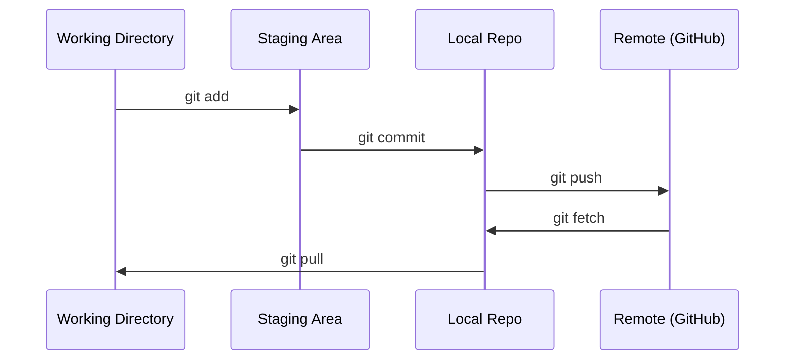

<!-- local-zh-machine-draft: English source is canonical; prose translated automatically, code/math preserved. -->

<a id="git--collaboration"></a>

# Git & 协作

> 版本控制不是可选的。您在这里构建的每个实验、每个模型、每个课程都会被跟踪。

**类型：** 了解
**语言：** --
**先决条件：** 第 0 阶段，第 01 课
**时间：** ~30分钟

<a id="learning-objectives"></a>

## 学习目标

- 配置git身份并使用add、commit、push的日常工作流程
- 创建并合并 branches 以进行独立实验，而不会破坏主要功能
- 编写一个 `.gitignore` ，排除模型 checkpoints 和大型二进制文件
- 使用 `git log` 浏览 commit 历史记录，了解项目演变

<a id="the-problem"></a>

## 问题

您即将跨 20 个阶段编写数百个代码文件。如果没有版本控制，您将失去工作，破坏无法撤消的事情，并且无法与他人协作。

Git 是工具。 GitHub 是代码所在的位置。本课程涵盖了本课程所需的内容，仅此而已。

<a id="the-concept"></a>

## 概念



要记住三件事：
1. 经常保存（`git commit`）
2. 推送到远程（`git push`）
3. Branch 用于实验（`git checkout -b experiment`）

```figure
s0-commit-dag
```

<a id="build-it"></a>

## 动手实现

<a id="step-1-configure-git"></a>

### 步骤1：配置git

```bash
git config --global user.name "Your Name"
git config --global user.email "you@example.com"
```

<a id="step-2-the-daily-workflow"></a>

### 第二步：日常工作流程

```bash
git status
git add file.py
git commit -m "Add perceptron implementation"
git push origin main
```

<a id="step-3-branching-for-experiments"></a>

### 第 3 步：实验分支

```bash
git checkout -b experiment/new-optimizer

# ... make changes, commit ...

git checkout main
git merge experiment/new-optimizer
```

<a id="step-4-working-with-this-course-repo"></a>

### 第 4 步：使用此课程存储库

您无法推送到课程存储库本身 - 只有维护人员具有写入权限。首先在 GitHub 上分叉（分叉按钮，右上角），因此 `origin` 指向您自己的副本：

```bash
git clone https://github.com/YOUR-USERNAME/ai-engineering-from-scratch.git
cd ai-engineering-from-scratch

git checkout -b my-progress
# work through lessons, commit your code
git push origin my-progress
```

<a id="use-it"></a>

## 实际应用

对于本课程，您需要以下命令：

| 命令 | 当 |
|---------|------|
| `git clone` | 获取课程存储库 |
| `git add` + `git commit` | 保存您的工作 |
| `git push` | 备份至GitHub |
| `git checkout -b` | 在不破坏 main 的情况下尝试一些东西 |
| `git log --oneline` | 看看你做了什么 |

就是这样。本课程不需要 rebase、cherry-pick 或子模块。

<a id="exercises"></a>

## 练习

1. fork这个repo，克隆你的fork，创建一个名为`my-progress`的branch，创建一个文件，commit它，推送它
2. 创建排除模型 checkpoint 文件的 `.gitignore`（`.pt`、`.pth`、`.safetensors`）
3. 使用 `git log --oneline` 查看此存储库的 commit 历史记录，并了解如何添加课程

<a id="key-terms"></a>

## 关键术语

| 术语 | 人们怎么说 | 它实际上意味着什么 |
|------|----------------|----------------------|
| Commit | “节省” | 整个项目在某个时间点的快照 |
| Branch | “一份” | 指向 commit 的指针，在您工作时向前移动 |
| 合并 | “组合代码” | 从一处进行更改branch并将它们应用到另一个 |
| 远程 | “云” | 托管在其他地方的存储库副本（GitHub，GitLab） |
