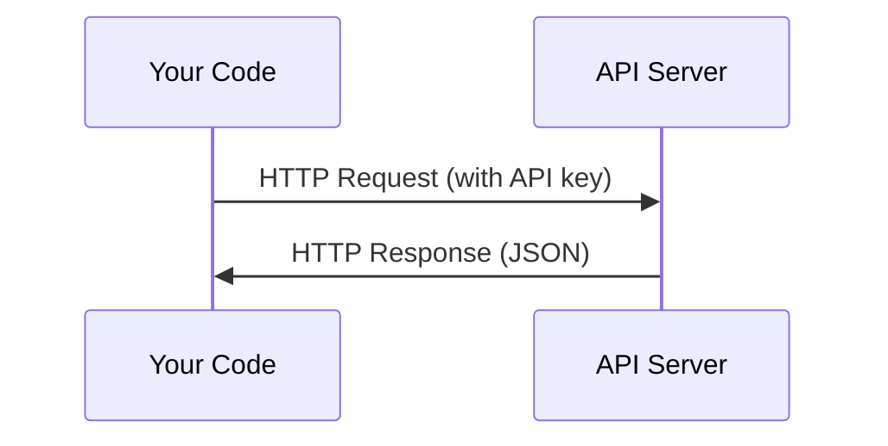

<!-- local-zh-machine-draft: English source is canonical; prose translated automatically, code/math preserved. -->

<a id="apis--keys"></a>

# APIs 与密钥

> 每个AI API 的工作方式都相同：发送请求，获得响应。细节改变，但模式不变。

**类型：** 构建
**语言：** Python、TypeScript
**先决条件：** 第 0 阶段，第 01 课
**时间：** ~30分钟

<a id="learning-objectives"></a>

## 学习目标

- 使用环境变量和 `.env` 文件安全地存储 API 密钥
- 使用 Anthropic Python SDK 和原始 HTTP 进行 LLM API 调用
- 比较基于 SDK 和原始 HTTP 请求/响应格式以进行调试
- 识别并处理常见的 API 错误，包括身份验证和 rate limits

<a id="the-problem"></a>

## 问题

从第 11 阶段开始，您将调用 LLM APIs（Anthropic、OpenAI、Google）。在阶段 13-16 中，您将构建在循环中使用这些 APIs 的 agents。您需要了解 API 密钥的工作原理、如何安全存储它们以及如何进行第一个 API 调用。

<a id="the-concept"></a>

## 概念



每个 API 调用都有：
1. 端点（URL）
2. API 密钥（认证）
3. 请求正文（你想要的）
4. 响应正文（您返回的内容）

```figure
s0-secret-inject
```

<a id="build-it"></a>

## 动手实现

<a id="step-1-store-api-keys-safely"></a>

### 步骤1：安全存储API密钥

切勿将 API 密钥放入代码中。使用环境变量。

```bash
export ANTHROPIC_API_KEY="sk-ant-..."
export OPENAI_API_KEY="sk-..."
```

或者使用 `.env` 文件（将其添加到 `.gitignore`）：

```
ANTHROPIC_API_KEY=sk-ant-...
OPENAI_API_KEY=sk-...
```

<a id="step-2-first-api-call-python"></a>

### 步骤2：首先调用API（Python）

```python
import os

import anthropic

client = anthropic.Anthropic()

MODEL = os.environ.get("LLM_MODEL", "claude-sonnet-5")

response = client.messages.create(
    model=MODEL,
    max_tokens=256,
    messages=[{"role": "user", "content": "What is a neural network in one sentence?"}]
)

print(response.content[0].text)
```

`LLM_MODEL` 选择 Anthropic 型号 id，默认为未注明日期的 Sonnet 别名。其他提供商（OpenAI、Google 等）遵循相同的密钥加模型 ID 模式，但每个提供商都有自己的 SDK、端点和请求/响应架构。

<a id="step-3-first-api-call-typescript"></a>

### 步骤3：首先调用API（TypeScript）

```typescript
import Anthropic from "@anthropic-ai/sdk";

const client = new Anthropic();

const MODEL = process.env.LLM_MODEL ?? "claude-sonnet-5";

const response = await client.messages.create({
  model: MODEL,
  max_tokens: 256,
  messages: [{ role: "user", content: "What is a neural network in one sentence?" }],
});

console.log(response.content[0].text);
```

<a id="step-4-raw-http-no-sdk"></a>

### 步骤4：原始HTTP（无SDK）

```python
import os
import urllib.request
import json

url = "https://api.anthropic.com/v1/messages"
headers = {
    "Content-Type": "application/json",
    "x-api-key": os.environ["ANTHROPIC_API_KEY"],
    "anthropic-version": "2023-06-01",
}
body = json.dumps({
    "model": os.environ.get("LLM_MODEL", "claude-sonnet-5"),
    "max_tokens": 256,
    "messages": [{"role": "user", "content": "What is a neural network in one sentence?"}],
}).encode()

req = urllib.request.Request(url, data=body, headers=headers, method="POST")
with urllib.request.urlopen(req) as resp:
    result = json.loads(resp.read())
    print(result["content"][0]["text"])
```

这就是 SDKs 在幕后所做的事情。了解原始 HTTP 调用有助于调试。

<a id="use-it"></a>

## 实际应用

对于本课程：

| API | 当你需要的时候 | 免费套餐 |
|-----|-----------------|-----------|
| Anthropic (Claude) | 阶段 11-16（agents，工具） | 注册时可获得 5 美元赠金 |
| OpenAI | 第11阶段（比较） | 注册时可获得 5 美元赠金 |
| 抱脸 | 阶段 4-10（模型、数据集） | 免费 |

您现在不需要所有这些。当课程需要时设置它们。

<a id="ship-it"></a>

## 交付成果

本课产生：
- `outputs/prompt-api-troubleshooter.md` - 诊断常见的 API 错误

<a id="exercises"></a>

## 练习

1. 获取 Anthropic API 密钥并拨打您的第一个 API 电话
2. 尝试原始 HTTP 版本并将响应格式与 SDK 版本进行比较
3. 故意使用错误的 API 密钥并阅读错误消息

<a id="key-terms"></a>

## 关键术语

| 术语 | 人们怎么说 | 它实际上意味着什么 |
|------|----------------|----------------------|
| API 密钥 | “API 的密码” | 标识您的帐户并授权请求的唯一字符串 |
| Rate limit | “他们在限制我” | 每分钟/小时的最大请求数，以防止滥用并确保公平使用 |
| Token | “一句话”（在API上下文中） | 计费单位：输入和输出tokens分开计数计费 |
| Streaming | “实时响应” | 逐字获取回复，而不是等待完整回复 |
