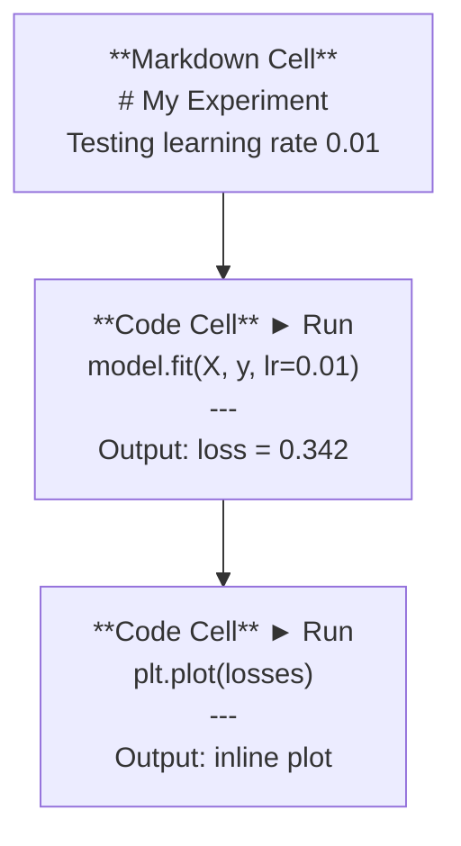
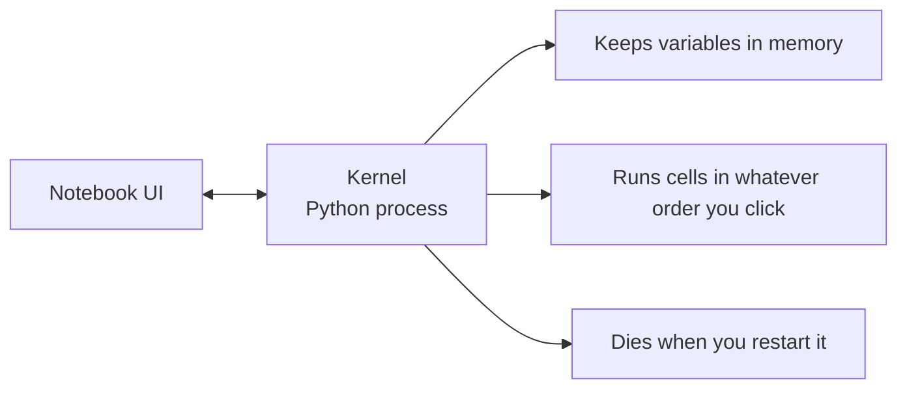

<!-- local-zh-machine-draft: English source is canonical; prose translated automatically, code/math preserved. -->

<a id="jupyter-notebooks"></a>

# Jupyter 笔记本

> 笔记本电脑是人工智能工程的实验台。您可以在这里制作原型，然后将有效的内容投入生产。

**类型：** 构建
**语言：** Python
**先决条件：** 第 0 阶段，第 01 课
**时间：** ~30分钟

<a id="learning-objectives"></a>

## 学习目标

- 安装并启动 JupyterLab、Jupyter Notebook 或带有 Jupyter 扩展的 VS Code
- 使用魔法命令（`%timeit`、`%%time`、`%matplotlib inline`）进行内联基准测试和可视化
- 区分何时使用笔记本和脚本，并应用“在笔记本中探索，在脚本中发布”工作流程
- 识别并避免常见的笔记本陷阱：乱序执行、隐藏状态和内存泄漏

<a id="the-problem"></a>

## 问题

每一篇 AI 论文、教程和 Kaggle 比赛都使用 Jupyter 笔记本。它们让您可以分段运行代码，查看内联输出，将代码与解释混合在一起，并快速迭代。如果你尝试在没有笔记本的情况下学习人工智能，那么你就是在没有草稿纸的情况下做数学作业。

但笔记本电脑确实存在陷阱。人们用它们做任何事情，包括他们不擅长的事情。知道何时使用笔记本以及何时使用脚本将使您免于以后的调试噩梦。

<a id="the-concept"></a>

## 概念

笔记本是单元格列表。每个单元格要么是代码，要么是文本。



内核是一个在后台运行的Python进程。当你运行一个单元时，它会将代码发送到内核，内核执行它并返回结果。所有单元共享相同的内核，因此单元之间存在变量。



“无论你点击什么命令”部分既是超能力也是脚枪。

```figure
s0-cell-order
```

<a id="build-it"></a>

## 动手实现

<a id="step-1-pick-your-interface"></a>

### 第 1 步：选择您的界面

三种选项，一种格式：

| 接口 | 安装 | 最适合 |
|-----------|---------|----------|
| Jupyter实验室 | `pip install jupyterlab` 然后 `jupyter lab` | 完整的 IDE 体验、多个选项卡、文件浏览器、终端 |
| Jupyter笔记本 | `pip install notebook` 然后 `jupyter notebook` | 简单、轻便，一次一个笔记本 |
| VS Code | 安装“Jupyter”扩展 | 已经在您的编辑器中，git 集成、调试 |

所有三个都读取和写入相同的 `.ipynb` 文件。选择你喜欢的任何东西。 JupyterLab 是 AI 工作中最常见的。

```bash
pip install jupyterlab
jupyter lab
```

<a id="step-2-keyboard-shortcuts-that-matter"></a>

### 第 2 步：重要的键盘快捷键

您可以以两种模式进行操作。按 `Escape` 进入命令模式（左侧蓝色条），按 `Enter` 进入编辑模式（绿色条）。

**命令模式（最常用）：**

| 钥匙 | 动作 |
|-----|--------|
| `Shift+Enter` | 运行单元格，移至下一个 |
| `A` | 在上方插入单元格 |
| `B` | 在下面插入单元格 |
| `DD` | 删除单元格 |
| `M` | 转换为 markdown |
| `Y` | 转换为代码 |
| `Z` | 撤消单元格操作 |
| `Ctrl+Shift+H` | 显示所有快捷方式 |

**编辑模式：**

| 钥匙 | 动作 |
|-----|--------|
| `Tab` | 自动完成 |
| `Shift+Tab` | 显示函数签名 |
| `Ctrl+/` | 切换评论 |

`Shift+Enter` 是您每天会使用一千次的一款。先学一下吧。

<a id="step-3-cell-types"></a>

### 第 3 步：细胞类型

**代码单元**运行Python并显示输出：

```python
import numpy as np
data = np.random.randn(1000)
data.mean(), data.std()
```

输出：`(0.0032, 0.9987)`

**Markdown 单元格** 渲染格式化文本。用它们来记录你正在做什么以及为什么这样做。支持标题、粗体、斜体、LaTeX 数学 (`$E = mc^2$`)、表格和图像。

<a id="step-4-magic-commands"></a>

### 第四步：魔法命令

这些不是 Python。它们是 Jupyter 特定命令，以 `%`（线条魔术）或 `%%`（单元魔术）开头。

**计时您的代码：**

```python
%timeit np.random.randn(10000)
```

输出：`45.2 us +/- 1.3 us per loop`

```python
%%time
model.fit(X_train, y_train, epochs=10)
```

输出：`Wall time: 2.34 s`

`%timeit` 多次运行代码并取平均值。 `%%time` 运行一次。使用 `%timeit` 进行微基准测试，使用 `%%time` 进行训练运行。

**启用内联绘图：**

```python
%matplotlib inline
```

每个 `plt.plot()` 或 `plt.show()` 现在直接在笔记本中渲染。

** 无需离开笔记本即可安装软件包：**

```python
!pip install scikit-learn
```

`!` 前缀运行任何 shell 命令。

**检查环境变量：**

```python
%env CUDA_VISIBLE_DEVICES
```

<a id="step-5-display-rich-output-inline"></a>

### 第 5 步：内联显示丰富的输出

笔记本自动显示单元格中的最后一个表达式。但你可以控制它：

```python
import pandas as pd

df = pd.DataFrame({
    "model": ["Linear", "Random Forest", "Neural Net"],
    "accuracy": [0.72, 0.89, 0.94],
    "training_time": [0.1, 2.3, 45.6]
})
df
```

这会呈现格式化的 HTML 表，而不是文本转储。与情节相同：

```python
import matplotlib.pyplot as plt

plt.figure(figsize=(8, 4))
plt.plot([1, 2, 3, 4], [1, 4, 2, 3])
plt.title("Inline Plot")
plt.show()
```

该图出现在单元格的正下方。这就是笔记本电脑主导人工智能工作的原因。您可以同时看到数据、图表和代码。

对于图像：

```python
from IPython.display import Image, display
display(Image(filename="architecture.png"))
```

<a id="step-6-google-colab"></a>

### 第 6 步：谷歌 Colab

Colab 是云中的免费 Jupyter 笔记本。它为您提供 GPU、预装库和 Google Drive 集成。无需设置。

1. 转到 [colab.research.google.com](https://colab.research.google.com)
2. 上传本课程中的任何 `.ipynb` 文件
3. 运行时 > 更改运行时类型 > T4 GPU（免费）

Colab与本地Jupyter的差异：
- 文件在会话之间不会保留（保存到云端硬盘或下载）
- 预装：numpy、pandas、matplotlib、torch、tensorflow、sklearn
- `from google.colab import files` 上传/下载文件
- `from google.colab import drive; drive.mount('/content/drive')` 用于持久存储
- 90 分钟不活动后会话超时（免费套餐）

<a id="use-it"></a>

## 实际应用

<a id="notebooks-vs-scripts-when-to-use-which"></a>

### 笔记本与脚本：何时使用哪个

| 使用笔记本进行 | 使用脚本用于 |
|-------------------|-----------------|
| 探索数据集 | 训练管道 |
| 制作模型原型 | 可重复使用的实用程序 |
| 结果可视化 | 任何带有 `if __name__` 的东西 |
| 解释你的工作 | 按计划运行的代码 |
| 快速实验 | 生产代码 |
| 课程练习 | 包和库 |

规则：** 在笔记本中探索，在脚本中发布**。

AI 中的常见工作流程：
1. 探索笔记本中的数据
2. 在笔记本中制作模型原型
3. 工作完成后，将代码移至 `.py` 文件
4. 将这些 `.py` 文件导入回笔记本中以进行进一步实验

<a id="common-traps"></a>

### 常见陷阱

** 乱序执行。** 您运行单元 5，然后运行单元 2，然后运行单元 7。笔记本可以在您的计算机上运行，​​但当有人从上到下运行它时会损坏。修复：共享之前内核 > 重新启动并运行全部。

**H隐藏状态。** 您删除了一个单元格，但它创建的变量仍在内存中。笔记本看起来很干净，但依赖于幽灵单元格。修复：定期重启内核。

**内存泄漏。** 加载4GB数据集，训练模型，加载另一个数据集。什么都没有被释放。修复：`del variable_name` 和 `gc.collect()`，或者重新启动内核。

<a id="ship-it"></a>

## 交付成果

本课产生：
- `outputs/prompt-notebook-helper.md` 用于调试笔记本问题

<a id="exercises"></a>

## 练习

1. 打开 JupyterLab，创建一个笔记本，然后使用 `%timeit` 比较列表理解与 numpy 创建 100,000 个随机数的数组
2. 创建一个包含 markdown 和代码单元的笔记本，用于加载 CSV、显示数据帧并绘制图表。然后运行 Kernel > Restart & Run All 以验证它从上到下是否正常工作
3. 从 `code/notebook_tips.py` 中获取代码，将其粘贴到 Colab 笔记本中，并使用免费的 GPU 运行它

<a id="key-terms"></a>

## 关键术语

| 术语 | 人们怎么说 | 它实际上意味着什么 |
|------|----------------|----------------------|
| 内核 | “运行我的代码的东西” | 一个单独的 Python 进程，用于执行单元格并将变量保存在内存中 |
| 细胞 | “一个代码块” | 笔记本中可独立运行的单元，代码或 markdown |
| 魔法指令 | “Jupyter技巧” | 以 `%` 或 `%%` 为前缀的控制笔记本环境的特殊命令 |
| `.ipynb` | “笔记本文件” | 包含单元格、输出和元数据的 JSON 文件。代表 IPython 笔记本 |

<a id="further-reading"></a>

## 进一步阅读

- [JupyterLab 文档](https://jupyterlab.readthedocs.io/) 完整的 feature 集
- [Google Colab 常见问题解答](https://research.google.com/colaboratory/faq.html)（针对 Colab 特定限制）和 features
- [28 Jupyter 笔记本提示](https://www.dataquest.io/blog/jupyter-notebook-tips-tricks-shortcuts/) 用于高级用户快捷方式
