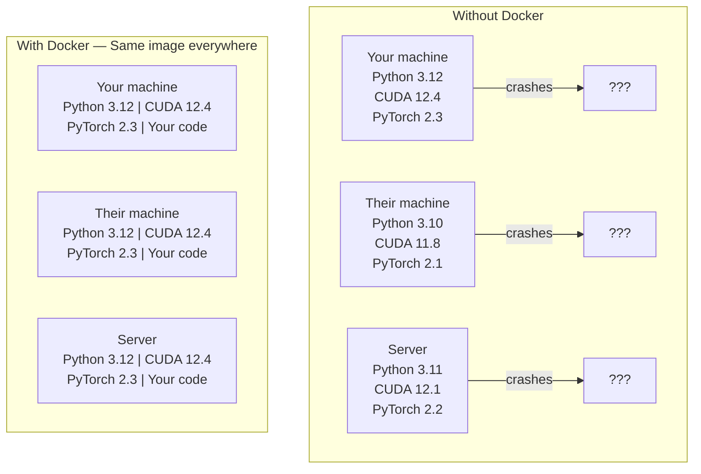

<!-- local-zh-machine-draft: English source is canonical; prose translated automatically, code/math preserved. -->

<a id="docker-for-ai"></a>

# 用于 AI 的 Docker

> 容器使“在我的机器上运行”成为过去。

**类型：** 构建
**语言：** Docker
**先决条件：** 第 0 阶段，第 01 课和第 03 课
**时间：** ~60 分钟

<a id="learning-objectives"></a>

## 学习目标

- 使用 CUDA、PyTorch 和来自 Dockerfile 的 AI 库构建启用 GPU 的 Docker 映像
- 将主机目录挂载为卷，以在容器重建过程中保留模型、数据集和代码
- 配置 NVIDIA Container Toolkit 以在容器内公开 GPUs
- 使用 Docker Compose 编排多服务 AI 应用（inference 服务器 + vector database）

<a id="the-problem"></a>

## 问题

您使用 PyTorch 2.3、CUDA 12.4 和 Python 3.12 在笔记本电脑上训练了模型。您的同事有 PyTorch 2.1、CUDA 11.8 和 Python 3.10。你的模型在他们的机器上崩溃了。您的 Dockerfile 对两者都适用。

人工智能项目是依赖噩梦。典型的堆栈包括 Python、PyTorch、CUDA 驱动程序、cuDNN、系统级 C 库以及需要精确编译器版本的专用包（如 flash-attn）。 Docker 将所有这些打包到一个在任何地方都相同运行的映像中。

<a id="the-concept"></a>

## 概念

Docker 将您的代码、运行时、库和系统工具包装到一个称为容器的隔离单元中。将其视为一个轻量级虚拟机，只不过它共享主机操作系统内核而不是运行自己的内核，因此它可以在几秒钟而不是几分钟内启动。



<a id="why-ai-projects-need-docker-more-than-most"></a>

### 为什么人工智能项目比大多数项目更需要 Docker

1. **GPU 驱动程序很脆弱。** CUDA 12.4 代码无法在 CUDA 11.8 上运行。 Docker 将 CUDA 工具包隔离在容器内，同时通过 NVIDIA Container Toolkit 共享主机 GPU 驱动程序。

2. **型号 weights 很大。** A 7B parameter 型号在 fp16 中为 14 GB。您不想每次重建时都重新下载它。 Docker 卷允许您从主机挂载模型目录。

3. **多服务架构很常见。** 真正的AI应用不仅仅是一个Python脚本。它是一个 inference 服务器，一个 vector database for RAG，也许是一个 Web 前端。 Docker Compose 通过一个命令协调所有这些。

<a id="key-vocabulary"></a>

### 密钥 vocabulary

| 术语 | 这意味着什么 |
|------|---------------|
| 图片 | 只读模板。你的食谱。从 Dockerfile 构建。 |
| 集装箱 | 图像的运行实例。你的厨房。 |
| Dockerfile | 构建图像的说明。一层又一层。 |
| 体积 | 在容器重新启动后仍然存在的持久存储。 |
| docker-撰写 | YAML中定义多容器应用程序的工具。 |

<a id="common-container-patterns-in-ai"></a>

### AI 中常见的容器模式

```
Dev Container
  Full toolkit. Editor support. Jupyter. Debugging tools.
  Used during development and experimentation.

Training Container
  Minimal. Just the training script and dependencies.
  Runs on GPU clusters. No editor, no Jupyter.

Inference Container
  Optimized for serving. Small image. Fast cold start.
  Runs behind a load balancer in production.
```

```figure
s0-image-layers
```

<a id="build-it"></a>

## 动手实现

<a id="step-1-install-docker"></a>

### 步骤1：安装Docker

```bash
# macOS
brew install --cask docker
open /Applications/Docker.app

# Ubuntu
curl -fsSL https://get.docker.com | sh
sudo usermod -aG docker $USER
# Log out and back in for group change to take effect
```

验证：

```bash
docker --version
docker run hello-world
```

<a id="step-2-install-nvidia-container-toolkit-linux-with-nvidia-gpu"></a>

### 步骤 2：安装 NVIDIA 容器工具包（带有 NVIDIA GPU 的 Linux）

这允许 Docker 容器访问您的 GPU。 macOS 和 Windows (WSL2) 用户可以跳过此操作； Docker Desktop 在这些平台上以不同方式处理 GPU 直通。

```bash
distribution=$(. /etc/os-release;echo $ID$VERSION_ID)
curl -fsSL https://nvidia.github.io/libnvidia-container/gpgkey | sudo gpg --dearmor -o /usr/share/keyrings/nvidia-container-toolkit-keyring.gpg
curl -s -L https://nvidia.github.io/libnvidia-container/$distribution/libnvidia-container.list | \
    sed 's#deb https://#deb [signed-by=/usr/share/keyrings/nvidia-container-toolkit-keyring.gpg] https://#g' | \
    sudo tee /etc/apt/sources.list.d/nvidia-container-toolkit.list

sudo apt-get update
sudo apt-get install -y nvidia-container-toolkit
sudo nvidia-ctk runtime configure --runtime=docker
sudo systemctl restart docker
```

测试容器内的 GPU 访问：

```bash
docker run --rm --gpus all nvidia/cuda:12.4.1-base-ubuntu22.04 nvidia-smi
```

如果您看到 GPU 信息，则该工具包正在运行。

<a id="step-3-understand-base-images"></a>

### 第 3 步：了解基础镜像

选择正确的基础映像可以节省数小时的调试时间。

```
nvidia/cuda:12.4.1-devel-ubuntu22.04
  Full CUDA toolkit. Compilers included.
  Use for: building packages that need nvcc (flash-attn, bitsandbytes)
  Size: ~4 GB

nvidia/cuda:12.4.1-runtime-ubuntu22.04
  CUDA runtime only. No compilers.
  Use for: running pre-built code
  Size: ~1.5 GB

pytorch/pytorch:2.6.0-cuda12.4-cudnn9-runtime
  PyTorch pre-installed on top of CUDA.
  Use for: skipping the PyTorch install step
  Size: ~6 GB

python:3.12-slim
  No CUDA. CPU only.
  Use for: inference on CPU, lightweight tools
  Size: ~150 MB
```

<a id="step-4-write-a-dockerfile-for-ai-development"></a>

### 第4步：编写用于AI开发的Dockerfile

这是 `code/Dockerfile` 中的 Dockerfile。浏览一下它：

```dockerfile
FROM --platform=linux/amd64 nvidia/cuda:12.4.1-devel-ubuntu22.04

ENV DEBIAN_FRONTEND=noninteractive
ENV PYTHONUNBUFFERED=1

RUN apt-get update && apt-get install -y --no-install-recommends \
    software-properties-common \
    git \
    curl \
    build-essential \
    && add-apt-repository -y ppa:deadsnakes/ppa \
    && apt-get update && apt-get install -y --no-install-recommends \
    python3.12 \
    python3.12-venv \
    python3.12-dev \
    && rm -rf /var/lib/apt/lists/*

RUN update-alternatives --install /usr/bin/python python /usr/bin/python3.12 1

RUN curl -sSL https://raw.githubusercontent.com/pypa/get-pip/3b73145063be545b649ad9ca83ea8da5fc915a4f/public/get-pip.py -o /tmp/get-pip.py \
    && echo "a341e1a43e38001c551a1508a73ff23636a11970b61d901d9a1cad2a18f57055  /tmp/get-pip.py" | sha256sum -c - \
    && python /tmp/get-pip.py \
    && rm /tmp/get-pip.py \
    && update-alternatives --install /usr/bin/pip pip /usr/local/bin/pip3.12 1

RUN python -m pip install --no-cache-dir --upgrade pip setuptools wheel

RUN python -m pip install --no-cache-dir \
    torch==2.6.0+cu124 \
    torchvision==0.21.0+cu124 \
    torchaudio==2.6.0+cu124 \
    --index-url https://download.pytorch.org/whl/cu124

RUN python -m pip install --no-cache-dir \
    numpy \
    pandas \
    scikit-learn \
    matplotlib \
    jupyter \
    transformers \
    datasets \
    accelerate \
    safetensors

WORKDIR /workspace

VOLUME ["/workspace", "/models"]

EXPOSE 8888

CMD ["python"]
```

构建它：

```bash
docker build -t ai-dev -f phases/00-setup-and-tooling/07-docker-for-ai/code/Dockerfile .
```

第一次需要一段时间（下载 CUDA 基础镜像 + PyTorch）。后续构建使用缓存层。

**macOS / Apple Silicon (M1/M2/M3/M4):** `FROM` 系列上的 `--platform=linux/amd64` 使此构建在 Mac 上取得成功。 CUDA 基础镜像还附带了一个 arm64 变体，Docker Desktop 在 Apple Silicon 上自动选择它，但 PyTorch 发布了仅适用于 x86_64 的 `cu124` 轮子，因此`pip install torch==2.6.0+cu124` 层失败，并显示 `No matching distribution found for torch==2.6.0+cu124`。固定平台会拉取 x86_64 映像并在仿真下运行它：构建速度较慢，并且容器没有 GPU（无论哪种方式，Mac 上都没有 CUDA）。在 Mac 上从下面的 `docker run` 命令中删除 `--gpus all`。对于 Apple Silicon 上的 GPU 工作，请使用第 01 课中的 MPS 构建本机运行课程，并为具有 NVIDIA GPU 的 x86_64 Linux 主机保留此映像。

运行：

```bash
docker run --rm -it --gpus all \
    -v $(pwd):/workspace \
    -v ~/models:/models \
    ai-dev python -c "import torch; print(f'PyTorch {torch.__version__}, CUDA: {torch.cuda.is_available()}')"
```

在容器内运行 Jupyter：

```bash
docker run --rm -it --gpus all \
    -v $(pwd):/workspace \
    -v ~/models:/models \
    -p 8888:8888 \
    ai-dev jupyter notebook --ip=0.0.0.0 --port=8888 --no-browser --allow-root
```

<a id="step-5-volume-mounts-for-data-and-models"></a>

### 步骤 5：数据和模型的卷挂载

卷安装对于 AI 工作至关重要。如果没有它们，当容器停止时，您的 14 GB 模型下载就会消失。

```bash
# Mount your code
-v $(pwd):/workspace

# Mount a shared models directory
-v ~/models:/models

# Mount datasets
-v ~/datasets:/data
```

在训练脚本中，从安装的路径加载：

```python
from transformers import AutoModel

model = AutoModel.from_pretrained("/models/llama-7b")
```

该模型位于您的主机文件系统上。您可以根据需要多次重建容器，而无需重新下载。

<a id="step-6-docker-compose-for-multi-service-ai-apps"></a>

### 步骤 6：Docker 为多服务 AI 应用程序撰写

一个真正的RAG应用程序需要一个inference服务器和一个vector database。 Docker Compose 使用一个命令运行这两者。

参见`code/docker-compose.yml`：

```yaml
services:
  ai-dev:
    build:
      context: .
      dockerfile: Dockerfile
    deploy:
      resources:
        reservations:
          devices:
            - driver: nvidia
              count: all
              capabilities: [gpu]
    volumes:
      - ../../../:/workspace
      - ~/models:/models
      - ~/datasets:/data
    ports:
      - "8888:8888"
    stdin_open: true
    tty: true
    command: jupyter notebook --ip=0.0.0.0 --port=8888 --no-browser --allow-root

  qdrant:
    image: qdrant/qdrant:v1.12.5
    ports:
      - "6333:6333"
      - "6334:6334"
    volumes:
      - qdrant_data:/qdrant/storage

volumes:
  qdrant_data:
```

开始一切：

```bash
cd phases/00-setup-and-tooling/07-docker-for-ai/code
docker compose up -d
```

现在，您的 AI 开发容器可以通过服务名称到达 `http://qdrant:6333` 处的 vector database。 Docker Compose 自动创建共享网络。

从 AI 容器内部测试连接：

```python
from qdrant_client import QdrantClient

client = QdrantClient(host="qdrant", port=6333)
print(client.get_collections())
```

停止一切：

```bash
docker compose down
```

添加 `-v` 以同时删除 qdrant 卷：

```bash
docker compose down -v
```

<a id="step-7-useful-docker-commands-for-ai-work"></a>

### 第7步：对AI工作有用的Docker命令

```bash
# List running containers
docker ps

# List all images and their sizes
docker images

# Remove unused images (reclaim disk space)
docker system prune -a

# Check GPU usage inside a running container
docker exec -it <container_id> nvidia-smi

# Copy a file from container to host
docker cp <container_id>:/workspace/results.csv ./results.csv

# View container logs
docker logs -f <container_id>
```

<a id="use-it"></a>

## 实际应用

您现在拥有一个可复制的 AI 开发环境。对于本课程的rest：

- 使用`docker compose up`一起启动您的开发环境和vector database
- 将代码、模型和数据安装为卷，以便在重建之间不会丢失任何内容
- 当课程需要新的 Python 包时，将其添加到 Dockerfile 并重建
- 与队友分享您的 Dockerfile。他们获得完全相同的环境。

<a id="no-gpu"></a>

### 没有GPU吗？

删除 `--gpus all` 标志和 NVIDIA 部署块。该容器仍然适用于基于 CPU 的课程。 PyTorch 检测到 CUDA 不存在并自动回退到 CPU。

<a id="exercises"></a>

## 练习

1. 构建 Dockerfile 并在容器内运行 `python -c "import torch; print(torch.__version__)"`
2. 启动 docker-compose 堆栈并验证 Qdrant 是否可以从位于 `http://qdrant:6333/collections` 的 AI 容器访问
3. 将 `flask` 添加到 Dockerfile，重建并在端口 5000 上运行简单的 API 服务器。使用 `-p 5000:5000` 映射端口
4. 使用 `docker images` 测量图像尺寸。尝试将基础映像从 `devel` 切换到 `runtime` 并比较大小

<a id="key-terms"></a>

## 关键术语

| 术语 | 人们怎么说 | 它实际上意味着什么 |
|------|----------------|----------------------|
| 集装箱 | “轻量级虚拟机” | 使用主机内核的隔离进程，具有自己的文件系统和网络 |
| 图像层 | “缓存步骤” | 每个 Dockerfile 指令都会创建一个层。未更改的图层会被缓存，因此重建速度很快。 |
| NVIDIA 容器工具包 | “GPU在Docker” | 一个运行时钩子，通过 `--gpus` 标志将主机 GPUs 暴露给容器 |
| 卷安装 | “共享文件夹” | 映射到容器的主机上的目录。容器停止后更改仍然存在。 |
| 基础镜像 | “起点” | Dockerfile 构建于其之上的 `FROM` 映像。确定预安装的内容。 |
