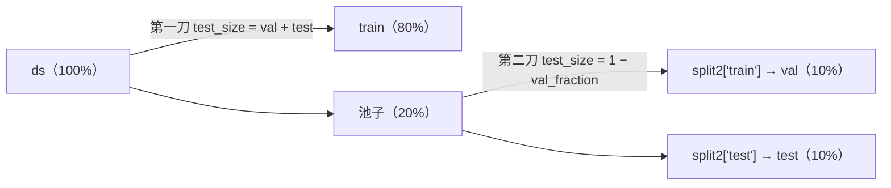

# 代码讲解 · data_utils.py

> **所属小节**：阶段 00 · 环境搭建与工具 · 第 09 节 数据管理 ｜ 讲义：[../docs/zh.md](../docs/zh.md) ｜ 测验：[../quiz/quiz.md](../quiz/quiz.md)
>
> **运行方式**：`python data_utils.py`（无命令行参数；需要联网访问 Hugging Face Hub） ｜ **依赖**：`datasets`、`huggingface_hub`（第三方，`pip install datasets huggingface_hub`）；其余为标准库 `sys`、`json`、`hashlib`、`pathlib`

---

## 1. 这份代码在考察什么

这是一份"数据工具箱"脚本：把讲义里零散的代码片段封装成可复用的函数，再在 `__main__` 里串成一条完整的小管线。它要你掌握：

1. **加载与流式加载**：`load_dataset` 的普通模式（返回 `Dataset`）和 `streaming=True` 模式（返回 `IterableDataset`）分别怎么用。
2. **格式转换与对比**：同一份数据导出成 CSV / JSON / Parquet，用真实文件大小感受"Parquet 更小"。
3. **可复现的三分切分**：用两次 `train_test_split` + 固定 `seed` 得到 train / val / test，并理解第二次切分的比例换算。
4. **模型文件下载与缓存**：`hf_hub_download` 下载单个文件，文件落在 HF 缓存里。
5. **数据"身份证"**：用 SHA-256 给数据做指纹，以及统计缓存目录占用了多少空间。

> 一句话：**把"找数据 → 下载 → 转格式 → 切分 → 校验"这条每个项目都要走的路，固化成一组函数**，下次直接 `from data_utils import make_splits` 即可。

---

## 2. 整体结构一览

| 组成部分 | 类型 | 作用 | 对应概念 |
|---------|------|------|---------|
| 顶部两个 `try/except ImportError` | 依赖检查 | 缺库时给出安装提示并退出 | 友好的失败方式 |
| `CACHE_DIR` | 模块常量 | HF 数据集缓存目录 `~/.cache/huggingface/datasets` | 本地缓存 |
| `load_and_inspect` | 函数 | 加载一个 split 并打印行数、列、features、第一行 | 加载与探查 |
| `stream_dataset` | 函数 | 流式读取前 `max_rows` 行 | streaming / `IterableDataset` |
| `convert_format` | 函数 | 导出 CSV/JSON/Parquet 并对比文件大小 | 格式取舍 |
| `make_splits` | 函数 | 按比例做 train/val/test 三分 | 数据切分、种子 |
| `download_model_file` | 函数 | 从 Hub 下载单个模型文件并打印路径和大小 | 模型缓存 |
| `cache_summary` | 函数 | 统计数据集缓存目录下的文件数和总大小 | 缓存管理 |
| `load_from_parquet/csv/json` | 3 个函数 | 从本地文件读回 `Dataset` | 格式互转 |
| `fingerprint` | 函数 | 对前 N 行做 SHA-256，得到 16 位指纹 | 数据版本校验 |
| `if __name__ == "__main__":` | 演示入口 | 按 1→8 的顺序演示上面所有功能 | — |

数据流：`load_and_inspect` 得到 `ds`（rotten_tomatoes 训练集）→ 取前 500 行 `small_ds` → `convert_format` 写三种文件 → `make_splits` 切分 → `load_from_parquet` 读回 → 下载模型配置 → 对完整 `ds` 做指纹 → 统计缓存。

---

## 3. 逐段精讲

### 3.1 依赖检查：缺库时"好好说话"再退出

```python
try:
    from datasets import load_dataset, Dataset
except ImportError:
    print("Install the datasets library: pip install datasets")
    sys.exit(1)
```

- 如果直接 `from datasets import ...` 而库没装，用户会看到一大段 `ModuleNotFoundError` 堆栈。这里捕获 `ImportError`，打印**一句可以直接照做的安装命令**，再以退出码 `1` 结束（非 0 表示失败，shell 脚本和 CI 能据此判断）。
- `ModuleNotFoundError` 是 `ImportError` 的子类，所以 `except ImportError` 能同时接住"模块不存在"和"模块里没有这个名字"两种情况。
- ⚠️ 简化：两个库分开检查，只缺第二个时第一次运行才会发现。可以一次性收集缺失列表再统一提示。

### 3.2 `load_and_inspect`：用字典拼参数

```python
def load_and_inspect(dataset_name: str, config: str = None, split: str = "train"):
    kwargs = {"path": dataset_name}
    if config:
        kwargs["name"] = config
    if split:
        kwargs["split"] = split

    ds = load_dataset(**kwargs)
    print(f"Dataset: {dataset_name}")
    print(f"  Split: {split}")
    print(f"  Rows: {len(ds)}")
    print(f"  Columns: {ds.column_names}")
    print(f"  Features: {ds.features}")
    print(f"  First row: {ds[0]}")
    return ds
```

- **为什么先拼字典再 `**kwargs` 展开**：可选参数只在"真的有值"时才传给 `load_dataset`，没有值就完全不出现，保持库函数自己的默认行为。这是封装第三方 API 的常见写法。
- `config` 对应 `load_dataset` 的 `name` 参数，即数据集的子配置（例如 `glue` 下的 `mrpc`）。
- `features` 是比 `column_names` 更丰富的 schema：不仅有列名，还有每列的类型，比如分类标签会显示为 `ClassLabel`（带类别名列表），这对理解 `label=0/1` 的含义很关键。
- ⚠️ 边界问题：签名允许 `split=None`，但此时 `load_dataset` 返回的是 `DatasetDict`（按 split 名分组的字典），`len(ds)` 变成 split 个数，`ds[0]` 会因为没有键 `0` 而失败。测验 Q10 给出了修复。
- ⚠️ 类型注解 `config: str = None` 自相矛盾（类型是 `str`，默认值却是 `None`），规范写法是 `config: str | None = None`。

### 3.3 `stream_dataset`：流式读前几行

```python
def stream_dataset(dataset_name: str, config: str = None, max_rows: int = 5):
    kwargs = {"path": dataset_name, "split": "train", "streaming": True}
    if config:
        kwargs["name"] = config

    ds = load_dataset(**kwargs)
    rows = []
    for i, example in enumerate(ds):
        rows.append(example)
        if i >= max_rows - 1:
            break
```

- `streaming=True` 时 `load_dataset` 不会先下载完整数据，而是返回一个**可迭代对象**，`for` 循环每走一步才去取下一行——这就是讲义说的"内存占用与数据集大小无关"。
- 流式数据集不能 `ds[0]`、也没有 `len(ds)`（因为根本不知道总共有多少行），所以只能用 `enumerate` 计数、够数就 `break`。
- 每一行 `example` 是一个普通 `dict`，例如 `{"text": "...", "label": 1}`，主程序用 `row['text'][:80]` 截取前 80 个字符打印。
- ⚠️ 差一错误：先 `append` 后判断，`max_rows=0` 时仍会返回 1 行。用 `list(itertools.islice(ds, max_rows))` 更简洁也更不容易错。
- ⚠️ split 被写死成 `"train"`，有的数据集流式读取时你可能想要 `"validation"`。

### 3.4 `convert_format`：同一份数据，三种文件

```python
    output_path = Path(output_dir)
    output_path.mkdir(parents=True, exist_ok=True)

    csv_path = output_path / f"{name}.csv"
    # ...
    ds.to_csv(str(csv_path))
    ds.to_json(str(json_path))
    ds.to_parquet(str(parquet_path))

    csv_size = csv_path.stat().st_size
    # ...
    print(f"  CSV:     {csv_size:>10,} bytes")
    # ...
    print(f"  Parquet is {csv_size / parquet_size:.1f}x smaller than CSV")
```

- `Path(output_dir) / f"{name}.csv"`：`pathlib` 重载了 `/` 运算符来拼路径，跨平台（Windows 反斜杠也没问题），比字符串拼接安全。
- `mkdir(parents=True, exist_ok=True)`：父目录不存在就一并创建；目录已存在也不报错——让函数可以**反复运行**（幂等）。
- `stat().st_size` 读取真实的字节数，用**测量**代替"听说 Parquet 更小"。
- `{csv_size:>10,}`：右对齐、宽度 10、千分位逗号，让三行数字竖直对齐，便于肉眼比较。
- 为什么 Parquet 小：列式存储 + 每列独立压缩和编码；CSV 是纯文本，每个数字、每个引号都占字节。
- ⚠️ `ds.to_json` 默认写出的是 **JSON Lines**（每行一个 JSON 对象），不是一个大 JSON 数组。文件名叫 `.json`，但用 `json.load()` 一次性读会失败，应该逐行读或用 `Dataset.from_json` / `pandas.read_json(..., lines=True)`。
- ⚠️ 只有 500 行短文本时，Parquet 的固定开销（schema、元数据）占比较大，压缩优势会比大数据集上小。想看到明显差距，就用完整数据集测试。

### 3.5 `make_splits`：两段式三分切分（本文件的核心）

```python
def make_splits(ds, train_ratio: float = 0.8, val_ratio: float = 0.1, seed: int = 42):
    test_ratio = 1.0 - train_ratio - val_ratio
    assert test_ratio > 0, "train_ratio + val_ratio must be less than 1.0"

    test_size = val_ratio + test_ratio
    split1 = ds.train_test_split(test_size=test_size, seed=seed)
    train_ds = split1["train"]

    val_fraction = val_ratio / test_size
    split2 = split1["test"].train_test_split(test_size=(1.0 - val_fraction), seed=seed)
    val_ds = split2["train"]
    test_ds = split2["test"]
```

`train_test_split` 一次只能切成两份，所以三分要切两刀：



- **比例换算**：第二刀是在"池子"里切的，所以比例要换算成"池子内的占比"：`val_fraction = val_ratio / (val_ratio + test_ratio) = 0.1 / 0.2 = 0.5`。
- **为什么是 `1.0 - val_fraction`、为什么取 `split2["train"]`**：`train_test_split` 的输出只有 `"train"` 和 `"test"` 两个键。作者把"`train` 那一份"当作验证集，所以传入的 `test_size` 必须是**测试集**在池子里的占比，即 `1 - val_fraction`。写法正确，但名字和角色交叉，读的时候容易绕晕。
- **为什么两刀都传同一个 `seed`**：保证整个切分过程完全确定，重复运行得到逐行相同的三份数据。
- 和讲义 Step 5 的对比：讲义示例是先切 0.2 再在剩下的 80% 里切 0.125，得到的是 **70/10/20**；这里先切出 20% 再对半分，得到的才是 **80/10/10**。
- 打印部分 `{len(train_ds)/total:.1%}`：`%` 格式符会自动乘以 100 并加百分号，`0.8 → 80.0%`。
- ⚠️ **浮点陷阱**：`assert test_ratio > 0` 用浮点比较。`train_ratio=0.7, val_ratio=0.3` 时 `1.0 - 0.7 - 0.3 = 5.55e-17`，大于 0，`assert` 不触发；第二刀的 `test_size` 约为 `2.2e-16`，`datasets` 对浮点比例向上取整，结果测试集只有 1 行——程序不报错，悄悄给出错误的划分。修复办法是先换算成**整数行数**再传给 `test_size`（整数表示行数），详见测验 Q9。
- ⚠️ `assert` 在 `python -O` 下会被整体跳过，参数校验应该用 `if ...: raise ValueError(...)`。

### 3.6 `download_model_file` 与 `cache_summary`：模型和缓存

```python
def download_model_file(repo_id: str, filename: str):
    path = hf_hub_download(repo_id=repo_id, filename=filename)
    size = Path(path).stat().st_size
```

```python
CACHE_DIR = Path.home() / ".cache" / "huggingface" / "datasets"
# ...
    for f in cache_path.rglob("*"):
        if f.is_file():
            total_size += f.stat().st_size
            file_count += 1
```

- `hf_hub_download` 返回的是**本地缓存里的路径**（位于 `~/.cache/huggingface/hub/` 下）。第二次调用直接命中缓存，不会重新下载。主程序只下载 `all-MiniLM-L6-v2` 的 `config.json`，几百字节，几乎瞬间完成，适合作为联网测试。
- `rglob("*")` 递归遍历所有子目录（`r` = recursive），`is_file()` 过滤掉目录，累加字节数后换算成 MB（`/ (1024 * 1024)`）。
- `if not cache_path.exists(): ... return`：**提前返回**（guard clause），避免后面嵌套一层 `if`。
- ⚠️ `CACHE_DIR` 写死了默认路径。如果设置了环境变量 `HF_HOME` 或 `HF_DATASETS_CACHE`，真实缓存在别处，这个函数会误报"No HF cache found yet."。另外它只统计**数据集缓存**，模型缓存 `~/.cache/huggingface/hub/` 不在统计范围内。
- ⚠️ 大缓存目录下 `rglob` 会逐个 `stat` 成千上万个文件，可能要几秒；生产中常用 `du -sh` 或 `huggingface-cli scan-cache`。

### 3.7 三个 `load_from_*`：从本地文件读回

```python
def load_from_parquet(path: str):
    ds = Dataset.from_parquet(path)
    print(f"Loaded {len(ds)} rows from {path}")
    return ds
```

- `Dataset.from_parquet / from_csv / from_json` 是**类方法式的构造器**：不经过 Hub，直接把本地文件转成 Arrow 格式的 `Dataset`，之后就能用 `map`、`filter`、`train_test_split` 等全部功能。
- 主程序只演示了 Parquet 读回，并打印列名，验证"写出去再读回来，schema 没丢"。Parquet 自带类型信息，读回后 `label` 仍是整数；CSV 读回则要靠推断类型，`ClassLabel` 这类语义信息会丢失。

### 3.8 `fingerprint`：给数据做个"身份证"

```python
def fingerprint(ds, num_rows: int = 100):
    sample = ds.select(range(min(num_rows, len(ds))))
    content = json.dumps([row for row in sample], default=str).encode()
    digest = hashlib.sha256(content).hexdigest()[:16]
```

- `ds.select(range(...))` 按下标取子集；`min(num_rows, len(ds))` 防止数据集不足 100 行时越界。
- `json.dumps(..., default=str)`：遇到 JSON 不支持的类型（如日期、numpy 数值）时，用 `str()` 兜底转换，而不是抛 `TypeError`。
- `.encode()` 把字符串转成字节，因为哈希函数只接受字节；`hexdigest()[:16]` 取十六进制摘要的前 16 位，短一些方便记录在日志里。
- 用途：每次实验把指纹写进日志，下次结果对不上时，先比指纹——指纹不同，说明数据变了。
- ⚠️ 只看前 100 行：第 5000 行被改了也发现不了；它是"快速抽检"，不是完整的数据版本号。完整版本见测验 Q11。

### 3.9 演示入口

主程序依次调用 8 个步骤，并用 `"=" * 60` 画分隔线。值得注意的两个细节：

- 格式转换和切分用的是 `ds.select(range(500))` 的**小样本**，保证演示几秒内完成；指纹却作用在**完整** `ds` 上（但只看前 100 行）。
- 输出目录写死为 `/tmp/data_utils_demo`，在 Windows 上没有 `/tmp`，会被解析为当前盘符根目录下的 `\tmp`。更好的做法是 `tempfile.mkdtemp()` 或参数化。

---

## 4. 为什么这样设计（设计取舍总结）

| 设计选择 | 原因 | 代价 / 生产中会怎么做 |
|---------|------|---------------------|
| 一组小函数 + `__main__` 演示 | 既能直接运行验证环境，又能被其他脚本导入复用 | 生产中会拆成模块、加命令行参数和测试 |
| 用 `kwargs` 字典拼参数 | 可选参数缺省时不传，尊重库的默认行为 | 类型检查器看不出参数名拼写错误 |
| 演示用 500 行小样本 | 运行快、占用小 | 小样本上的大小对比不能代表大数据集 |
| 两次 `train_test_split` 做三分 | 复用库函数，代码短 | 浮点比例有取整误差；生产中用整数行数、分层切分，或按时间 / 分组切分 |
| `assert` 做参数校验 | 写起来最短 | `-O` 下失效、浮点比较不可靠；应 `raise ValueError` 并带容差 |
| 指纹只哈希前 100 行 | 快 | 检测不到后面的修改；生产中对全量内容或文件做哈希，并配合 DVC / 数据集 revision |
| 缓存路径写死 | 简单直观 | 应读取 `HF_HOME` 等环境变量，或用官方的缓存扫描工具 |

---

## 5. Python 语法小课堂

| 语法 | 本文件中的例子 | 说明 |
|------|--------------|------|
| `try / except ImportError` | 顶部导入 `datasets` | 捕获"库没装"的异常，给出友好提示 |
| `sys.exit(1)` | 缺依赖时退出 | 以非 0 退出码结束程序，表示失败 |
| 模块级常量 | `CACHE_DIR = Path.home() / ...` | 全大写命名表示"不要修改"的配置值 |
| 类型注解 + 默认值 | `max_rows: int = 5` | 给读者和类型检查器看的提示，运行时不强制 |
| 字典与 `**` 展开 | `load_dataset(**kwargs)` | 把字典的键值对展开成关键字参数 |
| `enumerate` | `for i, example in enumerate(ds)` | 同时拿到序号和元素 |
| `break` | `if i >= max_rows - 1: break` | 提前结束循环 |
| 列表推导式 | `[row for row in sample]` | 把可迭代对象转成列表 |
| `range` + `min` | `range(min(num_rows, len(ds)))` | 生成下标序列，并防止越界 |
| f-string 格式符 | `{csv_size:>10,}`、`{x:.1%}`、`{r:.1f}` | `>10` 右对齐宽 10，`,` 千分位，`.1%` 百分比一位小数，`.1f` 一位小数 |
| 字符串重复 | `"=" * 60` | 生成 60 个等号的分隔线 |
| `pathlib.Path` | `Path.home()`、`path / "x.csv"`、`mkdir`、`stat().st_size`、`rglob`、`exists`、`is_file` | 面向对象的路径操作，跨平台 |
| `assert` | `assert test_ratio > 0, "..."` | 条件不满足时抛 `AssertionError`；`python -O` 下会被跳过 |
| 字典作为返回值 | `return {"train": ..., "val": ..., "test": ...}` | 用键名返回多个结果，比元组更可读 |
| `json.dumps(default=str)` | `fingerprint` 中 | 序列化为 JSON 字符串，遇到不支持的类型用 `str` 兜底 |
| `hashlib` | `hashlib.sha256(content).hexdigest()[:16]` | 计算 SHA-256 摘要，切片取前 16 位 |
| `.encode()` | `json.dumps(...).encode()` | 字符串 → 字节，哈希函数只接受字节 |
| `if __name__ == "__main__":` | 文件末尾 | 直接运行时才执行演示，被导入时不执行 |

---

## 6. 运行结果解读

在临时副本中实际运行了一次：

```text
$ python3 data_utils.py
Install the datasets library: pip install datasets
exit=1
```

**未能完整运行（当前环境缺少 `datasets`、`huggingface_hub`，且演示需要联网下载数据集和模型文件）**。上面这次运行恰好验证了 3.1 节的依赖检查：没有堆栈，只有一句安装提示，退出码为 1。

在装好依赖、能访问 Hugging Face Hub 的机器上，根据代码可以预期看到：

```text
============================================================
Data Management Utility
============================================================

--- 1. Load and inspect a dataset ---
Dataset: cornell-movie-review-data/rotten_tomatoes
  Split: train
  Rows: 8530                              ← rotten_tomatoes 训练集行数
  Columns: ['text', 'label']
  Features: {...'label': ClassLabel(names=['neg', 'pos'])...}   ← 具体打印格式随 datasets 版本不同
  First row: {'text': 'the rock is destined to be ...', 'label': 1}

--- 2. Stream a dataset ---
Streamed 3 rows from cornell-movie-review-data/rotten_tomatoes
  <前三条影评，每条截取 80 字符>...

--- 3. Convert formats ---
Format comparison for rotten_tomatoes_sample:
  CSV:     <字节数> bytes
  JSON:    <字节数> bytes                 ← JSON Lines 每行重复键名，通常比 CSV 大
  Parquet: <字节数> bytes
  Parquet is <N>x smaller than CSV         ← 500 行短文本，倍数不会很大

--- 4. Create train/val/test splits ---
Splits (seed=42):
  Train:    400 (80.0%)
  Val:       50 (10.0%)
  Test:      50 (10.0%)                    ← 500 行按 80/10/10 切分

--- 5. Reload from Parquet ---
Loaded 500 rows from /tmp/data_utils_demo/rotten_tomatoes_sample.parquet
  Columns: ['text', 'label']

--- 6. Download a model file ---
Downloaded config.json from sentence-transformers/all-MiniLM-L6-v2
  Path: ~/.cache/huggingface/hub/models--sentence-transformers--all-MiniLM-L6-v2/snapshots/<commit>/config.json
  Size: <几百> bytes

--- 7. Dataset fingerprint ---
Dataset fingerprint (first 100 rows): <16 位十六进制>   ← 同一份数据每次运行都一样

--- 8. Cache summary ---
HF Dataset Cache: ~/.cache/huggingface/datasets
  Files: <N>
  Total size: <X> MB
```

解读要点：

- 第 4 步的 400 / 50 / 50 是按 `datasets` 的取整规则（测试份向上取整）推算的；比例恰好整除，所以没有误差。
- 第 7 步的指纹在任何机器上重复运行都应相同——如果不同，说明上游数据变了，这正是指纹的用途。
- 第 8 步只统计数据集缓存；第 6 步下载的模型文件在 `hub/` 目录下，不计入这里的统计。

---

## 7. 动手改一改

1. 给 `stream_dataset` 加一个 `split` 参数，并用 `itertools.islice` 重写取前 N 行的逻辑，验证 `max_rows=0` 时返回空列表。
2. 把 `make_splits` 改为整数行数版本（测验 Q9 的参考答案），分别用 80/10/10、70/15/15、70/30 三组参数测试：前两组行数精确，第三组应该抛出 `ValueError`。
3. 给 `make_splits` 增加 `stratify_by_column` 参数并传给 `train_test_split`，打印每个 split 中正负样本的比例，与不分层的结果比较。
4. 让 `cache_summary` 优先读取环境变量 `HF_DATASETS_CACHE`、其次 `HF_HOME`，最后才用默认路径；再加一个参数，可以同时统计 `hub/` 模型缓存。
5. 把 `convert_format` 改成用完整的 rotten_tomatoes 训练集（8530 行），再用 IMDB（25000 行）试一次，观察 Parquet 相对 CSV 的压缩倍数如何随数据量变化。
6. 实现测验 Q11 的 `full_fingerprint`，然后对数据集 `shuffle(seed=1)` 前后各算一次，观察它对顺序的敏感性；再思考如何做一个"与顺序无关"的指纹。

---

## 8. 常见坑

- **浮点比例做切分**：`1.0 - 0.7 - 0.3` 不等于 0，带比例的切分可能出现差一行甚至只有 1 行的测试集。能用整数行数就用整数。
- **`.json` 其实是 JSON Lines**：`to_json` 默认一行一个对象，用 `json.load()` 读整个文件会报错。
- **`split=None` 得到的是 `DatasetDict`**：它像字典一样按 split 名索引，`ds[0]` 不成立。
- **流式数据集不能随机访问**：没有 `len()`、不能 `ds[i]`，只能顺序迭代；打乱也只能用缓冲区近似打乱。
- **缓存路径不止一个**：数据集在 `~/.cache/huggingface/datasets/`，模型在 `~/.cache/huggingface/hub/`，而且都可以被 `HF_HOME` 等环境变量改掉。磁盘满了先去这两个地方找。
- **种子不等于数据版本**：同样的 `seed`，上游数据一变，切分就变；要可复现，得同时锁定数据版本（revision / DVC）并记录指纹。
