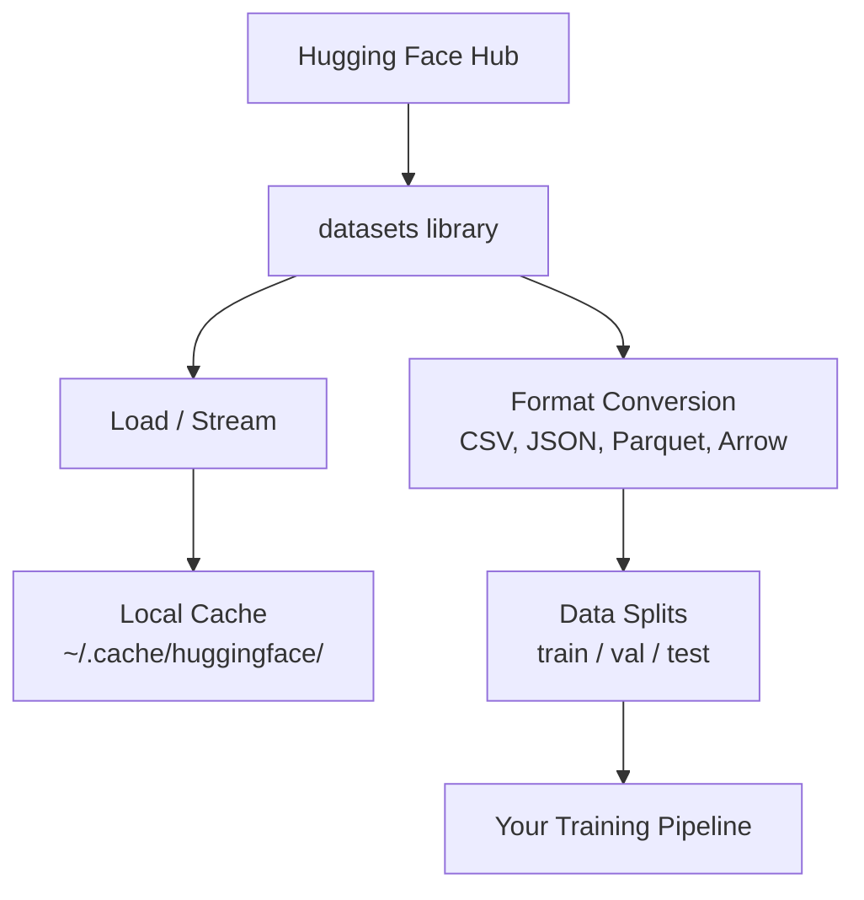

<!-- local-zh-machine-draft: English source is canonical; prose translated automatically, code/math preserved. -->

<a id="data-management"></a>

# 数据管理

> 数据是燃料。你如何管理它决定了你走得有多快。

**类型：** 构建
**语言：** Python
**先决条件：** 第 0 阶段，第 01 课
**时间：** ~45分钟

<a id="learning-objectives"></a>

## 学习目标

- 使用 Hugging Face `datasets` 库加载、流式传输和缓存数据集
- 在 CSV、JSON、Parquet 和 Arrow 格式之间进行转换并解释它们的权衡
- 使用固定随机种子创建可重复的训练/验证/测试分割
- 使用 `.gitignore`、Git LFS 或 DVC 管理大型模型和数据集文件

<a id="the-problem"></a>

## 问题

每个人工智能项目都从数据开始。您需要找到数据集，下载它们，在格式之间进行转换，将它们拆分以进行训练和 evaluation，并对它们进行版本控制，以便实验可以重现。每次都手动执行此操作既缓慢又容易出错。您需要一个可重复的工作流程。

<a id="the-concept"></a>

## 概念



Hugging Face `datasets` 库是加载 AI 工作数据的标准方式。它处理下载、缓存、格式转换和开箱即用的 streaming。

```figure
s0-data-pipeline
```

<a id="build-it"></a>

## 动手实现

<a id="step-1-install-the-datasets-library"></a>

### 第1步：安装数据集库

```bash
pip install datasets huggingface_hub
```

<a id="step-2-load-a-dataset"></a>

### 第 2 步：加载数据集

```python
from datasets import load_dataset

dataset = load_dataset("stanfordnlp/imdb")
print(dataset)
print(dataset["train"][0])
```

这将下载 IMDB 电影评论数据集。第一次下载后，它从 `~/.cache/huggingface/datasets/` 的缓存加载。

<a id="step-3-stream-large-datasets"></a>

### 第 3 步：流式传输大型数据集

有些数据集太大，无法容纳在磁盘上。 Streaming 逐行加载它们，而不下载完整的东西。

```python
dataset = load_dataset("wikimedia/wikipedia", "20231101.en", split="train", streaming=True)

for i, example in enumerate(dataset):
    print(example["title"])
    if i >= 4:
        break
```

Streaming 给您一个 `IterableDataset`。您可以在行到达时对其进行处理。无论数据集大小如何，内存使用量都保持不变。

<a id="step-4-dataset-formats"></a>

### 第 4 步：数据集格式

`datasets` 库在底层使用 Apache Arrow。您可以根据管道的需要转换为其他格式。

```python
dataset = load_dataset("stanfordnlp/imdb", split="train")

dataset.to_csv("imdb_train.csv")
dataset.to_json("imdb_train.json")
dataset.to_parquet("imdb_train.parquet")
```

格式对比：

| 格式 | 尺寸 | 读取速度 | 最适合 |
|--------|------|-----------|----------|
| CSV | 大号 | 慢 | 人类可读性、电子表格 |
| JSON | 大号 | 慢 | APIs，嵌套数据 |
| 实木复合地板 | 小号 | 快 | 分析、列式查询 |
| 箭头 | 小号 | 最快 | 内存中处理（`datasets`内部使用的） |

对于 AI 工作，Parquet 是最好的存储格式。箭头是你在内存中使用的东西。 CSV 和 JSON 用于互换。

<a id="step-5-data-splits"></a>

### 第 5 步：数据拆分

每个 ML 项目都需要三个拆分：

- **Train**：模型从中学习（通常为80%）
- **Validation**：您在训练期间检查进度（通常为 10%）
- **Test**：训练完成后最终的evaluation（通常为10％）

有些数据集是预先分割的。如果没有，请自行拆分：

```python
dataset = load_dataset("stanfordnlp/imdb", split="train")

split = dataset.train_test_split(test_size=0.2, seed=42)
train_val = split["train"].train_test_split(test_size=0.125, seed=42)

train_ds = train_val["train"]
val_ds = train_val["test"]
test_ds = split["test"]

print(f"Train: {len(train_ds)}, Val: {len(val_ds)}, Test: {len(test_ds)}")
```

始终为可重复性设置种子。相同的种子每次都会产生相同的分裂。

<a id="step-6-download-and-cache-models"></a>

### 第 6 步：下载并缓存模型

模型是大文件。 `huggingface_hub` 库处理下载和缓存。

```python
from huggingface_hub import hf_hub_download, snapshot_download

model_path = hf_hub_download(
    repo_id="sentence-transformers/all-MiniLM-L6-v2",
    filename="config.json"
)
print(f"Cached at: {model_path}")

model_dir = snapshot_download("sentence-transformers/all-MiniLM-L6-v2")
print(f"Full model at: {model_dir}")
```

模型缓存至 `~/.cache/huggingface/hub/`。下载后，它们会在后续运行时立即加载。

<a id="step-7-handle-large-files"></a>

### 第 7 步：处理大文件

模型 weights 和大型数据集不应进入 git。三个选项：

**选项A：.gitignore（最简单）**

```
*.bin
*.safetensors
*.pt
*.onnx
data/*.parquet
data/*.csv
models/
```

**选项B：Git LFS（跟踪git中的大文件）**

```bash
git lfs install
git lfs track "*.bin"
git lfs track "*.safetensors"
git add .gitattributes
```

Git LFS 将指针存储在您的存储库中，并将实际文件存储在单独的服务器上。 GitHub 为您提供 1 GB 免费空间。

**选项C：DVC（数据版本控制）**

```bash
pip install dvc
dvc init
dvc add data/training_set.parquet
git add data/training_set.parquet.dvc data/.gitignore
git commit -m "Track training data with DVC"
```

DVC 创建指向您的数据的小 `.dvc` 文件。数据本身位于 S3、GCS 或其他远程存储后端中。

| 方法 | 复杂性 | 最适合 |
|----------|-----------|----------|
| .gitignore | 低 | 个人项目，下载的数据可以重新获取 |
| Git LFS | 中等 | 团队通过 git 共享模型 weights |
| 数字化VC | 高 | 可重复的实验、大型数据集、团队 |

对于本课程，`.gitignore` 就足够了。当您需要跨机器重现精确实验时，请使用 DVC。

<a id="step-8-storage-patterns"></a>

### 第 8 步：存储模式

**本地存储**适用于~10 GB以下的数据集。 HF 缓存会自动处理此问题。

**云存储** 适用于任何更大或跨机器共享的内容：

```python
import os

local_path = os.path.expanduser("~/.cache/huggingface/datasets/")

# s3_path = "s3://my-bucket/datasets/"
# gcs_path = "gs://my-bucket/datasets/"
```

DVC 直接与 S3 和 GCS 集成：

```bash
dvc remote add -d myremote s3://my-bucket/dvc-store
dvc push
```

对于本课程来说，本地存储就足够了。当您在远程 GPU 实例上进行微调时，云存储变得重要。

<a id="datasets-used-in-this-course"></a>

## 本课程中使用的数据集

| 数据集 | 教训 | 尺寸 | 它教什么 |
|---------|---------|------|----------------|
| 互联网数据库 | Tokenization，分类 | 84MB | 文本分类基础知识 |
| 维基文本 | 语言建模 | 181MB | 下一篇-token预测 |
| 小队 | 质量保证系统 | 35MB | 问答、跨度 |
| 常见爬行（子集） | Embeddings | 各不相同 | 大规模文本处理 |
| MNIST | 视觉基础知识 | 21MB | 图像分类基础知识 |
| 可可（子集） | 多式联运 | 各不相同 | 图文对 |

您现在不需要下载所有这些。每节课都指定它需要什么。

<a id="use-it"></a>

## 实际应用

运行实用程序脚本以验证一切正常：

```bash
python code/data_utils.py
```

这会下载一个小数据集，对其进行转换、分割并打印摘要。

<a id="ship-it"></a>

## 交付成果

本课产生：
- `code/data_utils.py` - 可重用的数据加载和缓存实用程序
- `outputs/prompt-data-helper.md` - prompt 用于为任务查找正确的数据集

<a id="exercises"></a>

## 练习

1. 使用 `mrpc` 配置加载 `glue` 数据集并检查前 5 个示例
2. 流式传输 `c4` 数据集并计算 10 秒内可以处理的示例数量
3. 将数据集转换为 Parquet 并将文件大小与 CSV 进行比较
4. 使用固定种子创建 70/15/15 训练/验证/测试拆分并验证大小

<a id="key-terms"></a>

## 关键术语

| 术语 | 人们怎么说 | 它实际上意味着什么 |
|------|----------------|----------------------|
| Dataset split | 「训练数据」 | 在机器学习生命周期的不同阶段使用的命名子集（训练/验证/测试） |
| Streaming | “懒惰地加载” | 逐行处理来自远程源的数据，无需下载完整数据集 |
| 实木复合地板 | “压缩的 CSV” | 针对分析查询和存储效率进行优化的列式文件格式 |
| 箭头 | “快速数据框” | 数据集库内部使用的内存中柱状格式，用于零拷贝读取 |
| Git LFS | “Git 适用于大文件” | 一个扩展，可在 git 存储库之外存储大文件，同时将指针保留在版本控制中 |
| 数字化VC | “Git 数据” | 与云存储集成的数据集和模型的版本控制系统 |
| 缓存 | “已经下载了” | 先前获取的数据的本地副本，默认存储在 ~/.cache/huggingface/ |
