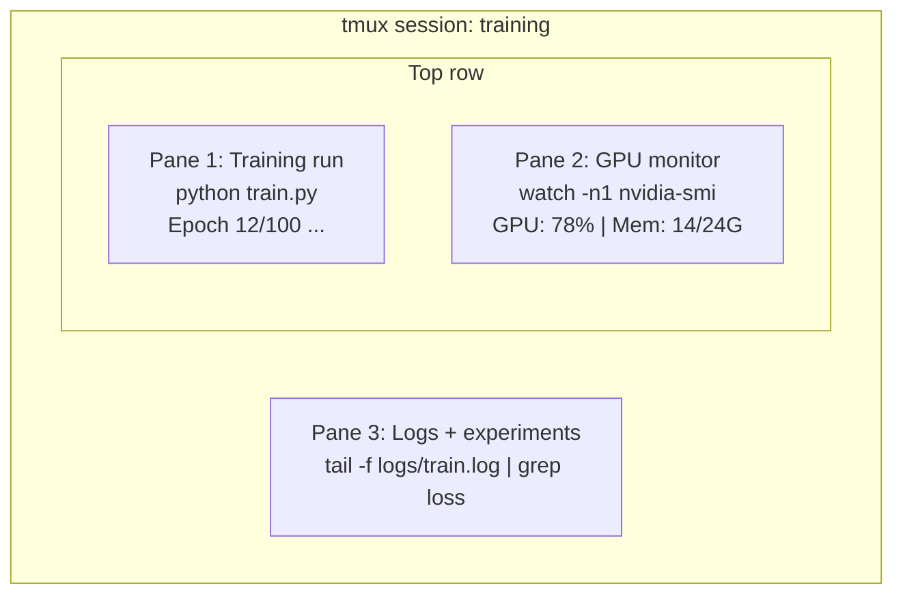

<!-- local-zh-machine-draft: English source is canonical; prose translated automatically, code/math preserved. -->

<a id="terminal--shell"></a>

# 终端与 Shell

> 终端是 AI 工程师日常工作的主要场所。先熟悉这里的操作。

**类型：**学习
**语言：** --
**先决条件：** 第 0 阶段，第 01 课
**时间：** ~35分钟

<a id="learning-objectives"></a>

## 学习目标

- 使用管道、重定向和 `grep` 从命令行过滤和处理训练日志
- 创建具有多个窗格的持久 tmux 会话，以进行并发训练和 GPU 监控
- 使用 `htop`、`nvtop` 和 `nvidia-smi` 监控系统和 GPU 资源
- 使用SSH、`scp`和`rsync`在本地和远程机器之间传输文件

<a id="the-problem"></a>

## 问题

与任何编辑器相比，你会在终端中投入更多时间：启动训练任务、监控 GPU、实时跟踪日志、连接远程 SSH 会话，以及管理环境。每个 AI 工作流都会用到 Shell；这里操作不熟练，其他工作也会受影响。

本课介绍 AI 工作中需要的终端技能。不讲 Unix 历史，也不深入讨论 Bash 脚本，只介绍实际所需的操作。

<a id="the-concept"></a>

## 概念



三项任务同时运行，共用一个终端。你可以暂时脱离会话，回家后通过 SSH 登录，再重新接入会话；训练始终在后台继续运行。

```figure
s0-shell-pipeline
```

<a id="build-it"></a>

## 动手实现

<a id="step-1-know-your-shell"></a>

### 第 1 步：了解你的 Shell

检查当前使用的 Shell：

```bash
echo $SHELL
```

大多数系统使用 `bash` 或 `zsh`。两者都工作正常。本课程中的命令适用于任一情况。

需要了解的关键事项：

```bash
# Move around
cd ~/projects/ai-engineering-from-scratch
pwd
ls -la

# History search (most useful shortcut you'll learn)
# Ctrl+R then type part of a previous command
# Press Ctrl+R again to cycle through matches

# Clear terminal
clear   # or Ctrl+L

# Cancel a running command
# Ctrl+C

# Suspend a running command (resume with fg)
# Ctrl+Z
```

<a id="step-2-piping-and-redirects"></a>

### 第 2 步：管道和重定向

管道把多个命令串联起来，可用于处理日志、筛选输出，并把不同工具组合成处理流程。你会经常使用它。

```bash
# Count how many times "loss" appears in a log
cat train.log | grep "loss" | wc -l

# Extract just the loss values from training output
grep "loss:" train.log | awk '{print $NF}' > losses.txt

# Watch a log file update in real time, filtering for errors
tail -f train.log | grep --line-buffered "ERROR"

# Sort experiments by final accuracy
grep "final_accuracy" results/*.log | sort -t= -k2 -n -r

# Redirect stdout and stderr to separate files
python train.py > output.log 2> errors.log

# Redirect both to the same file
python train.py > train_full.log 2>&1
```

您需要的三个重定向：

| 符号 | 它的作用 |
|--------|-------------|
| `>` | 将标准输出写入文件（覆盖） |
| `>>` | 把标准输出追加到文件末尾 |
| `2>` | 把标准错误输出写入文件 |
| `2>&1` | 把标准错误输出发送到标准输出当前指向的位置 |
| `\|` | 把前一个命令的标准输出，作为后一个命令的标准输入 |

<a id="step-3-background-processes"></a>

### 第3步：后台进程

训练任务通常持续数小时，你不会希望这期间一直保持终端打开。

```bash
# Run in background (output still goes to terminal)
python train.py &

# Run in background, immune to hangup (closing terminal won't kill it)
nohup python train.py > train.log 2>&1 &

# Check what's running in background
jobs
ps aux | grep train.py

# Bring a background job to foreground
fg %1

# Kill a background process
kill %1
# or find its PID and kill that
kill $(pgrep -f "train.py")
```

`&`、`nohup`、`screen`/`tmux`的区别：

| 方法 | 关闭终端后仍能运行吗？ | 可以重新接入会话吗？ |
|--------|-------------------------|---------------|
| `command &` | 否 | 否 |
| `nohup command &` | 是的 | 否（检查日志文件） |
| `screen` / `tmux` | 是的 | 是的 |

任务只要需要运行超过几分钟，就使用 tmux。

<a id="step-4-tmux"></a>

### 第四步：tmux

tmux 可以创建持久的终端会话，并把窗口分成多个窗格。它是管理训练任务最有用的工具。

```bash
# Install
# macOS
brew install tmux
# Ubuntu
sudo apt install tmux

# Start a named session
tmux new -s training

# Split horizontally
# Ctrl+B then "

# Split vertically
# Ctrl+B then %

# Navigate between panes
# Ctrl+B then arrow keys

# Detach (session keeps running)
# Ctrl+B then d

# Reattach
tmux attach -t training

# List sessions
tmux ls

# Kill a session
tmux kill-session -t training
```

典型的 AI 工作流程会话：

```bash
tmux new -s train

# Pane 1: start training
python train.py --epochs 100 --lr 1e-4

# Ctrl+B, " to split, then run GPU monitor
watch -n1 nvidia-smi

# Ctrl+B, % to split vertically, tail the logs
tail -f logs/experiment.log

# Now detach with Ctrl+B, d
# SSH out, go get coffee, come back
# tmux attach -t train
```

<a id="step-5-monitoring-with-htop-and-nvtop"></a>

### 第5步：使用htop和nvtop进行监控

```bash
# System processes (better than top)
htop

# GPU processes (if you have NVIDIA GPU)
# Install: sudo apt install nvtop (Ubuntu) or brew install nvtop (macOS)
nvtop

# Quick GPU check without nvtop
nvidia-smi

# Watch GPU usage update every second
watch -n1 nvidia-smi

# See which processes are using the GPU
nvidia-smi --query-compute-apps=pid,name,used_memory --format=csv
```

你会用到的 `htop` 快捷键：
- `F6` 或 `>` 按列排序（按内存排序以查找内存泄漏）
- `F5` 切换树视图（查看子进程）
- 按 `F9` 终止进程
- `/` 搜索进程名

<a id="step-6-ssh-for-remote-gpu-boxes"></a>

### 第 6 步：通过 SSH 连接远程 GPU 服务器

当您租用云 GPU（Lambda、RunPod、Vast.ai）时，您可以通过 SSH 进行连接。

```bash
# Basic connection
ssh user@gpu-box-ip

# With a specific key
ssh -i ~/.ssh/my_gpu_key user@gpu-box-ip

# Copy files to remote
scp model.pt user@gpu-box-ip:~/models/

# Copy files from remote
scp user@gpu-box-ip:~/results/metrics.json ./

# Sync a whole directory (faster for many files)
rsync -avz ./data/ user@gpu-box-ip:~/data/

# Port forward (access remote Jupyter/TensorBoard locally)
ssh -L 8888:localhost:8888 user@gpu-box-ip
# Now open localhost:8888 in your browser

# SSH config for convenience
# Add to ~/.ssh/config:
# Host gpu
#     HostName 192.168.1.100
#     User ubuntu
#     IdentityFile ~/.ssh/gpu_key
#
# Then just:
# ssh gpu
```

<a id="step-7-useful-aliases-for-ai-work"></a>

### 第 7 步：对 AI 工作有用的别名

将这些添加到您的 `~/.bashrc` 或 `~/.zshrc` 中：

```bash
source phases/00-setup-and-tooling/10-terminal-and-shell/code/shell_aliases.sh
```

或者复制你想要的。关键别名：

```bash
# GPU status at a glance
alias gpu='nvidia-smi --query-gpu=index,name,utilization.gpu,memory.used,memory.total,temperature.gpu --format=csv,noheader'

# Kill all Python training processes
alias killtraining='pkill -f "python.*train"'

# Quick virtual environment activate
alias ae='source .venv/bin/activate'

# Watch training loss
alias watchloss='tail -f logs/*.log | grep --line-buffered "loss"'
```

全套请参见 `code/shell_aliases.sh`。

<a id="step-8-common-ai-terminal-patterns"></a>

### 第 8 步：AI 工作中常见的终端操作模式

这些在实践中反复出现：

```bash
# Run training, log everything, notify when done
python train.py 2>&1 | tee train.log; echo "DONE" | mail -s "Training complete" you@email.com

# Compare two experiment logs side by side
diff <(grep "accuracy" exp1.log) <(grep "accuracy" exp2.log)

# Find the largest model files (clean up disk space)
find . -name "*.pt" -o -name "*.safetensors" | xargs du -h | sort -rh | head -20

# Download a model from Hugging Face
wget https://huggingface.co/model/resolve/main/model.safetensors

# Untar a dataset
tar xzf dataset.tar.gz -C ./data/

# Count lines in all Python files (see how big your project is)
find . -name "*.py" | xargs wc -l | tail -1

# Check disk space (training data fills disks fast)
df -h
du -sh ./data/*

# Environment variable check before training
env | grep -i cuda
env | grep -i torch
```

<a id="use-it"></a>

## 实际应用

在本课程中，各工具通常用于以下场景：

| 工具 | 使用场景 |
|------|----------------|
| tmux | 每一次训练任务（第 3 阶段及以后） |
| `tail -f` + `grep` | 监控训练日志 |
| `nohup` / `&` | 运行短时间的后台任务 |
| `htop` / `nvtop` | 排查训练缓慢和 OOM（内存不足）错误 |
| SSH + `rsync` | 在云端 GPUs 上工作 |
| 管道+重定向 | 处理实验结果 |
| 别名 | 节省重复命令的时间 |

<a id="exercises"></a>

## 练习

1. 安装 tmux，创建包含三个窗格的会话：一个窗格运行 `htop`，另一个运行 `watch -n1 date`，第三个运行 Python 脚本。练习暂时脱离会话，再重新接入。
2. 将 `code/shell_aliases.sh` 中的别名添加到 shell 配置中，并使用 `source ~/.zshrc` （或 `~/.bashrc`）重新加载。
3. 使用 `for i in $(seq 1 100); do echo "epoch $i loss: $(echo "scale=4; 1/$i" | bc)"; sleep 0.1; done > fake_train.log` 创建假训练日志，然后使用 `grep`、`tail` 和 `awk` 仅提取损失值。
4. 为您有权访问的服务器设置 SSH 配置条目（或使用 `localhost` 练习语法）。

<a id="key-terms"></a>

## 关键术语

| 术语 | 人们怎么说 | 它实际上意味着什么 |
|------|----------------|----------------------|
| Shell | “终端” | 解释命令的程序（bash、zsh、fish） |
| tmux | “终端多路复用器” | 可在一个窗口内运行多个终端会话，并支持暂时脱离会话后重新接入的程序 |
| 管道（Pipe） | “那个竖线符号” | `\|` 运算符，把一个命令的输出作为另一个命令的输入 |
| PID | “进程ID” | 分配给每个正在运行的进程的唯一编号，用于监视或终止它 |
| nohup | “忽略挂断信号” | 让命令不受挂断信号影响，因此关闭终端也不会终止它 |
| SSH | “连接到服务器” | Secure Shell，一种用于在远程计算机上运行命令的加密协议 |
