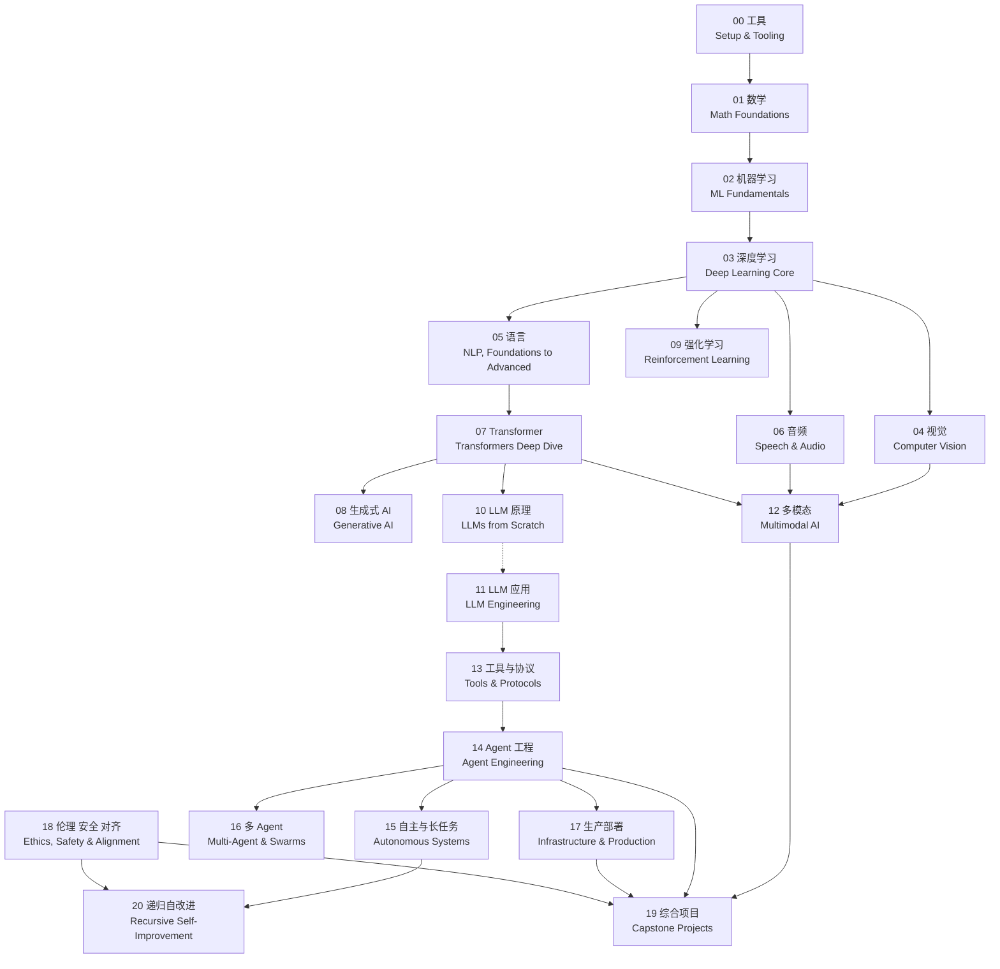

# AI Engineering from Scratch 总目录

这里按实际文件夹的“阶段 → 编号小节”组织课程，共 **21 个阶段、543 个小节**，覆盖 Phase 00–20。先看下面的知识关系和章节入口，再进入某章查看逐节的掌握目标、课程衔接、用途与生态位置，以及建议练习。

## 怎样使用这个目录

每章开头说明本章目标、与其他章节的关系和一次综合练习。阶段名和小节名都在中文后保留原始英文标题。每个小节保留原编号，分别说明“掌握、衔接、为什么有用、建议练习”；其中“为什么有用”解释它在 AI/ML 或大模型系统中的位置、解决的问题与使用场景。小节标题可直接打开英文教材；另列中文教材、代码和实际存在的练习入口。

学习时先读教材，再用小例子解释核心机制，然后完成一项建议练习。能说明输入、输出、失败条件，并在小改动后重新验证，才算有了这一节的掌握证据。目录中的建议练习是围绕主题设计的小任务，具体原课实验和题包合同仍以对应材料为准。

## 课程之间的关系

基础主线是 **工具 → 数学 → 机器学习 → 深度学习**。视觉、语言、音频在深度学习之后分支展开；Transformer 又把这些表示连接到大模型与多模态系统。应用主线是 **LLM 工程 → 工具与协议 → Agent 工程 → 可靠运行与部署**。

生成模型和强化学习是可按目标补充的分支。伦理、安全与对齐贯穿模型训练和系统执行；综合项目用于把多个章节拼成可验收的成果。递归自改进是建立在长任务 Agent、评估和控制之上的研究扩展。



图中展示主要知识衔接，各节的具体前置要求见教材。虚线表示模型原理对应用的支持；具备开发基础后，可以先做 11 的应用，再按需补 07、10。04、05、06 和 09 是不同分支，15、16、17 也可以按任务需要选择。

## 全部章节入口

| 阶段 | 章节目录 | 小节数 | 本章要解决的问题 |
| --- | --- | ---: | --- |
| 00 | [环境与工具准备 — Setup & Tooling](00-环境与工具准备.md) | 12 | 让代码、依赖、数据和运行环境可用且可复现。 |
| 01 | [数学基础 — Math Foundations](01-数学基础.md) | 22 | 看懂模型里的向量、梯度、概率和数值计算。 |
| 02 | [机器学习基础 — ML Fundamentals](02-机器学习基础.md) | 18 | 建立基线，正确划分数据、训练和评估模型。 |
| 03 | [深度学习核心 — Deep Learning Core](03-深度学习核心.md) | 13 | 从前向与反向传播理解网络怎样学习。 |
| 04 | [计算机视觉 — Computer Vision](04-计算机视觉.md) | 28 | 处理图像、视频与三维中的识别、定位和生成。 |
| 05 | [自然语言处理 — NLP, Foundations to Advanced](05-自然语言处理.md) | 29 | 把文本变成表示、检索、抽取、生成与对话状态。 |
| 06 | [语音与音频 — Speech & Audio](06-语音与音频.md) | 17 | 理解声音、转写、合成与实时语音交互。 |
| 07 | [深入 Transformer — Transformers Deep Dive](07-深入%20Transformer.md) | 16 | 理解注意力、位置、模型结构与推理效率。 |
| 08 | [生成式 AI — Generative AI](08-生成式%20AI.md) | 15 | 比较生成目标、条件控制和生成质量。 |
| 09 | [强化学习 — Reinforcement Learning](09-强化学习.md) | 12 | 从奖励和环境反馈中学习价值与策略。 |
| 10 | [从零构建大语言模型 — LLMs from Scratch](10-从零构建大语言模型.md) | 24 | 串起分词、预训练、对齐、评估和高效推理。 |
| 11 | [LLM 应用工程 — LLM Engineering](11-LLM%20应用工程.md) | 17 | 把模型调用变成带检索、工具和评估的应用。 |
| 12 | [多模态 AI — Multimodal AI](12-多模态%20AI.md) | 25 | 让图、文、声音、视频和动作共同进入模型。 |
| 13 | [工具与协议 — Tools & Protocols](13-工具与协议.md) | 31 | 让模型以明确合同使用工具、服务和技能。 |
| 14 | [Agent 工程 — Agent Engineering](14-Agent%20工程.md) | 54 | 让 Agent 有状态、能恢复、可验证并能交接。 |
| 15 | [自主与长任务系统 — Autonomous Systems](15-自主与长任务系统.md) | 22 | 控制自主长任务与自改进过程的执行边界。 |
| 16 | [多智能体与群体系统 — Multi-Agent & Swarms](16-多智能体与群体系统.md) | 25 | 判断何时拆分 Agent，以及如何通信和协调。 |
| 17 | [基础设施与生产 — Infrastructure & Production](17-基础设施与生产.md) | 28 | 管理推理服务的容量、延迟、成本和可靠性。 |
| 18 | [伦理、安全与对齐 — Ethics, Safety & Alignment](18-伦理、安全与对齐.md) | 30 | 分析目标偏离、系统攻击、伦理影响与治理。 |
| 19 | [综合项目与分步构建 — Capstone Projects](19-综合项目与分步构建.md) | 85 | 选择完整项目，并沿组件路线做出可验收成果。 |
| 20 | [递归自改进 — Recursive Self-Improvement](20-递归自改进.md) | 20 | 分清真正的改进、评分投机与自改进反馈。 |

## 按学习目标选择路线

- **补全基础**：00 → 01 → 02 → 03，再根据兴趣进入 04、05、06。遇到数学或训练机制不清楚时，回到对应基础节补齐。
- **构建 LLM 应用**：具备 Python、API 和基本评估能力后，从 11 开始；遇到模型内部机制再查 07、10。随后按需求补 12 多模态和 13 工具接口。
- **构建 Agent**：11 → 13 → 14。先完成有停止条件和验证方式的单 Agent，再按任务需要读 15 长任务、16 多 Agent 和 17 生产部署。
- **提高编码 Agent 的工作可靠性**：14 的 31–42 建工作台，43–46 处理任务、计划、委派与纠正；47–54 帮助判断该做什么、如何验证价值。
- **学习 MCP**：以 13 为主，先读 01–10 建立工具与协议基础，再进入任务、授权、可靠性与治理；具体协议版本和实现合同按课内材料核对。
- **编写 Agent Skills**：13.22 → 13.24 → 13.25 → 13.26 → 13.27，按合同、发现、调用、权限、评估的顺序学习。
- **研究模型训练或自改进**：训练路线以 07 → 10 为主，补 09 的策略优化；自改进路线先读 15 的研究案例和 18 的相关风险，再进入 20。
- **做作品与综合实践**：先看 19 的 01–17 选题，再选择一条组件路线。安全相关的 18 与生产相关的 17 随项目需要同步补充。

## 教材与练习怎样配合

| 材料 | 主要用途 | 使用方式 |
| --- | --- | --- |
| `docs/en.md` | 原课概念、前置要求与完整实践说明 | 点击小节标题进入；留意训练、模拟和真实集成的范围。 |
| `docs/zh.md` | 辅助中文阅读 | 与英文对照使用；遇到术语、数字或语句不通时查原文。 |
| `code/` | 原课实现与演示 | 先理解再运行，检查依赖、模型、设备和凭证要求。 |
| `coderpad/` | 范围受限的独立编码练习 | 阅读 `README.md` 和 `PROMPT.md`，在指定 starter 完成实际合同。 |
| `exam/` | 实际存在的分关结对练习 | 按各自 README 逐关进行，确认测试解锁及起始代码位置。 |
| `quiz/quiz.md` 或 `quiz.json` | 概念与代码理解自测 | 先作答，再对照解释，记录没有理解的机制。 |

所有 543 个小节都有 CoderPad 入口，但题包可能复用基础 kernel，只覆盖该课适合现场实现的切面；它们不能替代完整模型训练、项目集成或部署验证。分关练习仅在实际存在的 06、11、13、14、16 阶段逐节显示。

在选定的 `coderpad/` 目录中，可按题包说明使用：

```bash
python3 run_tests.py --list
python3 run_tests.py --core
python3 run_tests.py --bonus
```

`--list` 只列出测试；`--core` 和 `--bonus` 才运行相应测试。独立练习期间先关闭 `solution/` 与面试官材料，结束后再复盘。`--solution` 验证的是参考答案，不能作为自己的完成记录。分关题中的全部 skipped 也不代表完成。

## 阶段练完后的自查

1. 能否用一个小例子解释本章最重要的机制？
2. 能否指出输入、输出、依赖条件和至少一种失败情况？
3. 能否对现有实现做一个小修改，并说明验证结果？
4. 能否解释本章产物会被哪一章复用，以及它解决了什么问题？

## 其他学习入口

- [中文教材索引](../中文教程索引.md)：直接浏览已有中文教材。
- [全课程 CoderPad 索引](../../CODERPAD_INDEX.md)：查看题包范围与练习说明。
- [个人学习笔记](../2026%20-%20学习笔记/README.md)：回顾已保存的问答与自测。
- [阶段 10–19 勘误清单](../勘误清单-阶段10-19.md)：遇到讲义与代码不一致时对照；其中待核实项仍需独立确认。

目录按 2026-11-06 的本地课程结构整理，保留原有编号间隔。Phase 20 的 09–12 当前没有正文，已单独标注并链接到现存代码；这四节的英文标题采用课程主索引中的原始名称。
