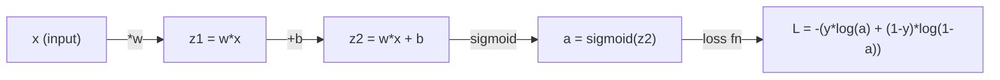
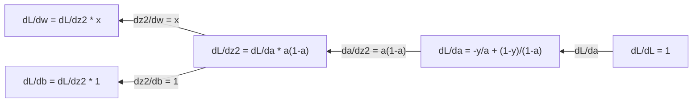
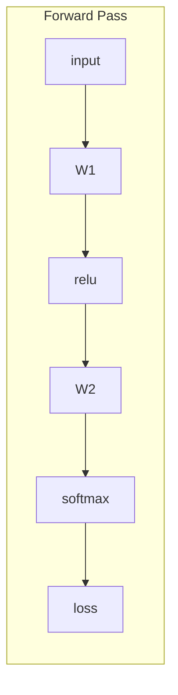
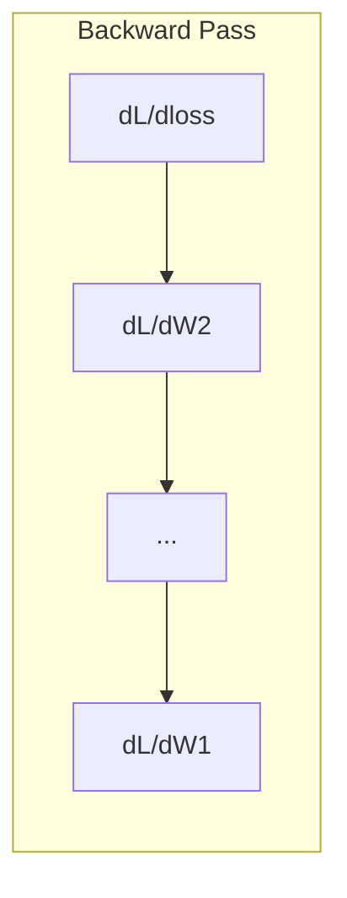

<!-- local-zh-machine-draft: English source is canonical; prose translated automatically, code/math preserved. -->

<a id="calculus-for-machine-learning"></a>

# 机器学习微积分

> 导数告诉你哪个方向是下坡方向。神经网络只需利用这一信息，就能进行学习。

**类型：** 了解
**语言：** Python
**先决条件：** 第 1 阶段，课程 01-03
**时间：** ~60 分钟

<a id="learning-objectives"></a>

## 学习目标

- 计算常见 ML 函数的数值导数和解析导数（x^2、sigmoid、cross-entropy）
- 从头开始实现 gradient descent 以最小化 1D 和 2D 中的 loss function
- 导出线性回归模型的 gradient 并通过手动 weight 更新对其进行训练
- 解释 Hessian 矩阵、泰勒级数近似及其与优化方法的联系

<a id="the-problem"></a>

## 问题

您有一个包含数百万个 weights 的神经网络。每个weight都是一个旋钮。您需要弄清楚每个旋钮的旋转方向，以使模型稍微减少错误。微积分给你这个方向。

如果没有微积分，训练神经网络就意味着尝试随机变化并希望得到最好的结果。通过导数，您可以准确地知道每个 weight 如何影响误差。您每次都以正确的方式转动每个旋钮。

<a id="the-concept"></a>

## 概念

<a id="what-is-a-derivative"></a>

### 什么是导数？

导数衡量变化率。对于函数 y = f(x)，导数 f'(x) 会告诉您：如果将 x 微移一点，y 会改变多少？

在几何上，导数是一点的切线的斜率。

**f(x) = x^2:**

| x | f(x) | f'(x)（斜率） |
|---|------|---------------|
| 0 | 0    | 0（平坦，位于底部） |
| 1 | 1    | 2 |
| 2 | 4    | 4（此时切线斜率） |
| 3 | 9    | 6 |

在 x=2 处，斜率为 4。如果将 x 向右增加一个很小的量，y 的增量约为该增量的 4 倍。在 x=0 处，斜率为 0，此时位于碗形曲线的底部。

正式定义：

```
f'(x) = lim   f(x + h) - f(x)
        h->0  -----------------
                     h
```

在代码中，不直接求极限，而是使用一个很小的 h。这就是数值求导。

<a id="partial-derivatives-one-variable-at-a-time"></a>

### 偏导数：一次一个变量

实际函数往往有多个输入。神经网络的损失取决于数千个 weights。计算偏导数时，固定其余所有变量，只对其中一个变量求导。

```
f(x, y) = x^2 + 3xy + y^2

df/dx = 2x + 3y     (treat y as a constant)
df/dy = 3x + 2y     (treat x as a constant)
```

每个偏导数的答案是：如果我只推动这个 weight，损失会如何变化？

<a id="the-gradient-vector-of-all-partial-derivatives"></a>

### gradient：所有偏导数的向量

gradient 将每个偏导数收集到一个向量中。对于函数 f(x, y, z)，gradient 为：

```
grad f = [ df/dx, df/dy, df/dz ]
```

gradient 指向最陡上升的方向。要最小化函数，请朝相反的方向进行。

** f(x,y) = x^2 + y^2 的等值线图：**

该函数形成一个以同心圆为轮廓线的碗形。最小值位于 (0, 0)。

| 点 | 毕业生 | -grad f（下降方向） |
|-------|--------|----------------------------|
| (1, 1) | [2、2]（上坡点，远离最小值） | [-2, -2]（下坡点，朝向最小值） |
| (0, 0) | [0、0]（平坦，至少） | [0, 0] |

这是图片中的gradient descent。计算gradient，将其取反，采取一步。

<a id="the-connection-to-optimization"></a>

### 与优化的联系

训练神经网络就是优化。您有一个 loss function L(w1, w2, ..., wn) 来衡量模型的错误程度。你想最小化它。

```
Gradient descent update rule:

  w_new = w_old - learning_rate * dL/dw

For every weight:
  1. Compute the partial derivative of loss with respect to that weight
  2. Subtract a small multiple of it from the weight
  3. Repeat
```

learning rate 控制步长。过大容易越过目标，过小则推进缓慢。

**损失景观（1D切片）：**

当weight w变化时，loss function L(w)形成具有峰和谷的曲线。

| Feature | 描述 |
|---------|-------------|
| 全局最小值 | 整条曲线上的最低点——最佳方案 |
| 局部最小值 | 比邻近的山谷低但总体上不是最低的山谷 |
| 斜率 | Gradient descent 从任意起点跟随斜坡下坡 |

Gradient descent 顺坡下坡。它可能会陷入局部最小值，但在高维空间（数百万 weights）中，这很少是一个实际问题。

<a id="numerical-vs-analytical-derivatives"></a>

### 数值导数与解析导数

有两种计算导数的方法。

解析方法：手动应用微积分规则。对于 f(x) = x^2，导数为 f'(x) = 2x。结果精确，计算快速。

数值：使用定义进行近似。计算一个微小的 h 的 f(x+h) 和 f(x-h)，然后使用差值。

```
Numerical (central difference):

f'(x) ~= f(x + h) - f(x - h)
          -----------------------
                  2h

h = 0.0001 works well in practice
```

数值导数速度较慢，但适用于任何函数。解析导数速度很快，但需要您推导公式。神经网络框架使用第三种方法：自动微分，它机械地计算精确导数。您将在第三阶段看到这一点。

<a id="derivatives-by-hand-for-simple-functions"></a>

### 手动计算简单函数的导数

以下这些导数会在 ML 中反复出现。

```
Function        Derivative       Used in
--------        ----------       -------
f(x) = x^2     f'(x) = 2x      Loss functions (MSE)
f(x) = wx + b  f'(w) = x        Linear layer (gradient w.r.t. weight)
                f'(b) = 1        Linear layer (gradient w.r.t. bias)
                f'(x) = w        Linear layer (gradient w.r.t. input)
f(x) = e^x     f'(x) = e^x     Softmax, attention
f(x) = ln(x)   f'(x) = 1/x     Cross-entropy loss
f(x) = 1/(1+e^-x)  f'(x) = f(x)(1-f(x))   Sigmoid activation
```

对于 f(x) = x^2：

```
f(x) = x^2    f'(x) = 2x

  x    f(x)   f'(x)   meaning
  -2    4      -4      slope tilts left (decreasing)
  -1    1      -2      slope tilts left (decreasing)
   0    0       0      flat (minimum!)
   1    1       2      slope tilts right (increasing)
   2    4       4      slope tilts right (increasing)
```

对于 f(w) = wx + b，其中 x=3，b=1：

```
f(w) = 3w + 1    f'(w) = 3

The derivative with respect to w is just x.
If x is big, a small change in w causes a big change in output.
```

<a id="the-chain-rule"></a>

### chain rule

当函数相互复合时，chain rule 告诉你如何求导。

```
If y = f(g(x)), then dy/dx = f'(g(x)) * g'(x)

Example: y = (3x + 1)^2
  outer: f(u) = u^2       f'(u) = 2u
  inner: g(x) = 3x + 1    g'(x) = 3
  dy/dx = 2(3x + 1) * 3 = 6(3x + 1)
```

神经网络是函数链：输入 -> 线性 -> 激活 -> 线性 -> 激活 -> 损失。 Backpropagation 是从输出到输入重复应用的 chain rule。这就是整个算法。

<a id="the-hessian-matrix"></a>

### Hessian 矩阵

gradient 告诉您斜率。 Hessian 告诉您曲率。

Hessian 是二阶偏导数矩阵。对于函数 f(x1, x2, ..., xn)，Hessian 的条目 (i, j) 为：

```
H[i][j] = d^2f / (dx_i * dx_j)
```

对于 2 变量函数 f(x, y)：

```
H = | d^2f/dx^2    d^2f/dxdy |
    | d^2f/dydx    d^2f/dy^2 |
```

** Hessian 在关键点（其中 gradient = 0）告诉您什么：**

| Hessian 属性 | 含义 | 示例表面 |
|-----------------|---------|-----------------|
| 正定（全部 eigenvalues > 0） | 局部最小值 | 碗朝上 |
| 负定（全部 eigenvalues < 0） | 局部最大值 | 碗朝下 |
| 不定（混合eigenvalues） | 鞍点 | 马鞍形状 |

**示例：** f(x, y) = x^2 - y^2（鞍函数）

```
df/dx = 2x       df/dy = -2y
d^2f/dx^2 = 2    d^2f/dy^2 = -2    d^2f/dxdy = 0

H = | 2   0 |
    | 0  -2 |

Eigenvalues: 2 and -2 (one positive, one negative)
--> Saddle point at (0, 0)
```

与 f(x, y) = x^2 + y^2 （一个碗）比较：

```
H = | 2  0 |
    | 0  2 |

Eigenvalues: 2 and 2 (both positive)
--> Local minimum at (0, 0)
```

**为什么 Hessian 在 ML 中很重要：**

牛顿方法使用 Hessian 采取比 gradient descent 更好的优化步骤。它不只是遵循斜率，而是考虑曲率：

```
Newton's update:    w_new = w_old - H^(-1) * gradient
Gradient descent:   w_new = w_old - lr * gradient
```

牛顿方法收敛得更快，因为 Hessian“重新调整”了 gradient——陡峭的方向获得更小的步长，平坦的方向获得更大的步长。

问题是：对于具有 N parameters 的神经网络，Hessian 是 N x N。具有 100 万个 parameters 的模型将需要 1 万亿个条目的矩阵。这就是我们使用近似值的原因。

| 方法 | 它的用途 | 成本 | 收敛性 |
|--------|-------------|------|-------------|
| Gradient descent | 仅一阶导数 | 每步 O(N) | 慢（线性） |
| 牛顿法 | 完整 Hessian | 每步 O(N^3) | 快速（二次） |
| L-BFGS | 来自 gradient 历史的近似 Hessian | 每步 O(N) | 中（超线性） |
| Adam | 每 parameter 自适应速率（对角线 Hessian 约） | 每步 O(N) | 中等 |
| 天然 gradient | Fisher信息矩阵（统计Hessian） | 每步 O(N^2) | 快 |

实际上，Adam 是深度学习的默认 optimizer。它通过跟踪每个 parameter 的 gradients 的运行均值和方差来廉价地近似二阶信息。

<a id="taylor-series-approximation"></a>

### 泰勒级数逼近

任何平滑函数都可以用多项式局部逼近：

```
f(x + h) = f(x) + f'(x)*h + (1/2)*f''(x)*h^2 + (1/6)*f'''(x)*h^3 + ...
```

包含的项越多，近似值就越好——但仅限于 x 点附近。

**为什么泰勒级数对ML很重要：**

- **一阶泰勒 = gradient descent.** 当您使用 f(x + h) ~ f(x) + f'(x)*h 时，您正在进行线性近似。 Gradient descent 最小化此线性模型以选择 h = -lr * f'(x)。

- **二阶泰勒 = 牛顿法。** 使用 f(x + h) ~ f(x) + f'(x)*h + (1/2)*f''(x)*h^2，你得到一个二次模型。最小化它给出 h = -f'(x)/f''(x)——牛顿步。

- **Loss function 设计。** MSE 和 cross-entropy 是平滑的，这意味着它们的泰勒展开表现良好。这并非偶然。平滑损失使优化可预测。

```
Approximation order    What it captures    Optimization method
-------------------    -----------------   -------------------
0th order (constant)   Just the value      Random search
1st order (linear)     Slope               Gradient descent
2nd order (quadratic)  Curvature           Newton's method
Higher orders          Finer structure     Rarely used in ML
```

关键见解：所有基于 gradient 的优化实际上都是在本地逼近 loss function 并逐步达到该逼近的最小值。

<a id="integrals-in-ml"></a>

### 机器学习中的积分

导数描述变化率，积分计算累积量，也就是曲线下的面积。

在机器学习中，您很少手动计算积分，但这个概念无处不在：

**Probability.** 对于密度为 p(x) 的连续随机变量：
```
P(a < X < b) = integral from a to b of p(x) dx
```
 a和b之间的概率密度曲线下的面积是落在该范围内的概率。

** 期望值。** 按概率加权的平均结果：
```
E[f(X)] = integral of f(x) * p(x) dx
```
数据分布上的期望损失是一个积分。训练最小化的是它的经验近似。

**KL 散度。** 测量两个分布的差异程度：
```
KL(p || q) = integral of p(x) * log(p(x) / q(x)) dx
```
用于VAEs、knowledge distillation和贝叶斯inference。

**Normalization 常数。** 在贝叶斯 inference 中：
```
p(w | data) = p(data | w) * p(w) / integral of p(data | w) * p(w) dw
```
分母是所有可能的 parameter 值的积分。它通常很棘手，这就是为什么我们使用 MCMC 和变分 inference 等近似值。

| 积分的概念 | 它在 ML 中出现的位置 |
|-----------------|----------------------|
| 曲线下面积 | 密度函数的概率 |
| 期望值 | Loss functions，风险最小化 |
| KL散度 | VAEs，策略优化，蒸馏 |
| Normalization | 贝叶斯后验，softmax 分母 |
| 边际可能性 | 模型比较，证据下限 (ELBO) |

<a id="multivariable-chain-rule-in-a-computation-graph"></a>

### 计算图中的多变量 Chain Rule

chain rule 不仅适用于串联的标量函数。在神经网络中，变量会分叉并汇合。下面展示导数如何沿一个简单的 forward pass 传播：



backward pass 从右到左计算 gradients：



每个箭头乘以局部导数。任何 parameter 的 gradient 是从损失到 parameter 的路径上所有局部导数的乘积。当路径 branch 并合并时，您可以对贡献求和（多元 chain rule）。

这就是 backpropagation 的全部：chain rule 通过计算图系统地应用，从输出到输入。

<a id="the-jacobian-matrix"></a>

### Jacobian 矩阵

当函数将向量映射到向量（如神经网络层）时，其导数是矩阵。 Jacobian 包含每个输出相对于每个输入的每个偏导数。

对于 f: R^n -> R^m，Jacobian J 是 m x n 矩阵：

| | x1 | x2 | ... | xn |
|---|---|---|---|---|
| f1 | df1/dx1 | df1/dx2 | ... | df1/dxn |
| f2 | df2/dx1 | df2/dx2 | ... | df2/dxn |
| ... | ... | ... | ... | ... |
| 调频 | dfm/dx1 | dfm/dx2 | ... | dfm/dxn |

您不会为神经网络手动计算 Jacobians。 PyTorch 处理它。但知道它的存在可以帮助您理解 backpropagation 中的形状：如果一个层将 R^n 映射到 R^m，则其 Jacobian 是 m x n。 gradient 通过该矩阵的转置向后流动。

<a id="why-this-matters-for-neural-networks"></a>

### 为什么这对神经网络很重要

神经网络中的每个 weight 都有对应的 gradient。gradient 告诉你如何调整该 weight，以降低损失。





每次weight更新：
- `W1 = W1 - lr * dL/dW1`
- `W2 = W2 - lr * dL/dW2`

forward pass 计算预测值和损失。backward pass 计算损失关于每个 weight 的 gradient。随后，每个 weight 都沿下坡方向迈出一小步。重复数百万步，这就是深度学习。

```figure
derivative-tangent
```

<a id="build-it"></a>

## 动手实现

<a id="step-1-numerical-derivative-from-scratch"></a>

### 第 1 步：从零实现数值求导

```python
def numerical_derivative(f, x, h=1e-7):
    return (f(x + h) - f(x - h)) / (2 * h)

def f(x):
    return x ** 2

for x in [-2, -1, 0, 1, 2]:
    numerical = numerical_derivative(f, x)
    analytical = 2 * x
    print(f"x={x:2d}  f'(x) numerical={numerical:.6f}  analytical={analytical:.1f}")
```

数值导数与解析导数在小数点后多位上相吻合。

<a id="step-2-partial-derivatives-and-gradients"></a>

### 步骤2：偏导数和gradients

```python
def numerical_gradient(f, point, h=1e-7):
    gradient = []
    for i in range(len(point)):
        point_plus = list(point)
        point_minus = list(point)
        point_plus[i] += h
        point_minus[i] -= h
        partial = (f(point_plus) - f(point_minus)) / (2 * h)
        gradient.append(partial)
    return gradient

def f_multi(point):
    x, y = point
    return x**2 + 3*x*y + y**2

grad = numerical_gradient(f_multi, [1.0, 2.0])
print(f"Numerical gradient at (1,2): {[f'{g:.4f}' for g in grad]}")
print(f"Analytical gradient at (1,2): [2*1+3*2, 3*1+2*2] = [{2*1+3*2}, {3*1+2*2}]")
```

<a id="step-3-gradient-descent-to-find-the-minimum-of-fx--x2"></a>

### 步骤3：Gradient descent 求f(x) = x^2的最小值

```python
x = 5.0
lr = 0.1
for step in range(20):
    grad = 2 * x
    x = x - lr * grad
    print(f"step {step:2d}  x={x:8.4f}  f(x)={x**2:10.6f}")
```

从 x=5 开始，每一步都更接近 x=0（最小值）。

<a id="step-4-gradient-descent-on-a-2d-function"></a>

### 步骤 4：2D 函数上的 Gradient descent

```python
def f_2d(point):
    x, y = point
    return x**2 + y**2

point = [4.0, 3.0]
lr = 0.1
for step in range(30):
    grad = numerical_gradient(f_2d, point)
    point = [p - lr * g for p, g in zip(point, grad)]
    loss = f_2d(point)
    if step % 5 == 0 or step == 29:
        print(f"step {step:2d}  point=({point[0]:7.4f}, {point[1]:7.4f})  f={loss:.6f}")
```

<a id="step-5-comparing-numerical-and-analytical-derivatives"></a>

### 第 5 步：比较数值导数和解析导数

```python
import math

test_functions = [
    ("x^2",      lambda x: x**2,          lambda x: 2*x),
    ("x^3",      lambda x: x**3,          lambda x: 3*x**2),
    ("sin(x)",   lambda x: math.sin(x),   lambda x: math.cos(x)),
    ("e^x",      lambda x: math.exp(x),   lambda x: math.exp(x)),
    ("1/x",      lambda x: 1/x,           lambda x: -1/x**2),
]

x = 2.0
print(f"{'Function':<12} {'Numerical':>12} {'Analytical':>12} {'Error':>12}")
print("-" * 50)
for name, f, df in test_functions:
    num = numerical_derivative(f, x)
    ana = df(x)
    err = abs(num - ana)
    print(f"{name:<12} {num:12.6f} {ana:12.6f} {err:12.2e}")
```

<a id="step-6-computing-the-hessian-numerically"></a>

### 步骤6：计算Hessian的数值

```python
def hessian_2d(f, x, y, h=1e-5):
    fxx = (f(x + h, y) - 2 * f(x, y) + f(x - h, y)) / (h ** 2)
    fyy = (f(x, y + h) - 2 * f(x, y) + f(x, y - h)) / (h ** 2)
    fxy = (f(x + h, y + h) - f(x + h, y - h) - f(x - h, y + h) + f(x - h, y - h)) / (4 * h ** 2)
    return [[fxx, fxy], [fxy, fyy]]

def saddle(x, y):
    return x ** 2 - y ** 2

def bowl(x, y):
    return x ** 2 + y ** 2

H_saddle = hessian_2d(saddle, 0.0, 0.0)
H_bowl = hessian_2d(bowl, 0.0, 0.0)
print(f"Saddle Hessian: {H_saddle}")  # [[2, 0], [0, -2]] -- mixed signs
print(f"Bowl Hessian:   {H_bowl}")    # [[2, 0], [0, 2]]  -- both positive
```

鞍点函数的Hessian有eigenvalues 2和-2（混合符号，确认鞍点）。碗上有 eigenvalues 2 和 2（均为正数，确认最小值）。

<a id="step-7-taylor-approximation-in-action"></a>

### 步骤 7：泰勒近似的实际应用

```python
import math

def taylor_approx(f, f_prime, f_double_prime, x0, h, order=2):
    result = f(x0)
    if order >= 1:
        result += f_prime(x0) * h
    if order >= 2:
        result += 0.5 * f_double_prime(x0) * h ** 2
    return result

x0 = 0.0
for h in [0.1, 0.5, 1.0, 2.0]:
    true_val = math.sin(h)
    t1 = taylor_approx(math.sin, math.cos, lambda x: -math.sin(x), x0, h, order=1)
    t2 = taylor_approx(math.sin, math.cos, lambda x: -math.sin(x), x0, h, order=2)
    print(f"h={h:.1f}  sin(h)={true_val:.4f}  order1={t1:.4f}  order2={t2:.4f}")
```

在 x0=0 附近，sin(x) ~ x（一阶 Taylor 近似）。当 h 较小时，近似非常准确；h 较大时则失效。因此，gradient descent 在采用较小的 learning rates 时效果最好——每一步都假设线性近似足够准确。

<a id="step-8-why-this-matters-for-a-neural-network"></a>

### 第 8 步：为什么这对神经网络很重要

```python
import random

random.seed(42)

w = random.gauss(0, 1)
b = random.gauss(0, 1)
lr = 0.01

xs = [1.0, 2.0, 3.0, 4.0, 5.0]
ys = [3.0, 5.0, 7.0, 9.0, 11.0]

for epoch in range(200):
    total_loss = 0
    dw = 0
    db = 0
    for x, y in zip(xs, ys):
        pred = w * x + b
        error = pred - y
        total_loss += error ** 2
        dw += 2 * error * x
        db += 2 * error
    dw /= len(xs)
    db /= len(xs)
    total_loss /= len(xs)
    w -= lr * dw
    b -= lr * db
    if epoch % 40 == 0 or epoch == 199:
        print(f"epoch {epoch:3d}  w={w:.4f}  b={b:.4f}  loss={total_loss:.6f}")

print(f"\nLearned: y = {w:.2f}x + {b:.2f}")
print(f"Actual:  y = 2x + 1")
```

每个基于 gradient 的训练循环都遵循以下模式：预测、计算损失、计算 gradients、更新 weights。

<a id="use-it"></a>

## 实际应用

使用NumPy，同样的操作更快更简洁：

```python
import numpy as np

x = np.array([1, 2, 3, 4, 5], dtype=float)
y = np.array([3, 5, 7, 9, 11], dtype=float)

w, b = np.random.randn(), np.random.randn()
lr = 0.01

for epoch in range(200):
    pred = w * x + b
    error = pred - y
    loss = np.mean(error ** 2)
    dw = np.mean(2 * error * x)
    db = np.mean(2 * error)
    w -= lr * dw
    b -= lr * db

print(f"Learned: y = {w:.2f}x + {b:.2f}")
```

您刚刚从头开始构建了 gradient descent。 PyTorch 自动执行 gradient 计算，但更新循环是相同的。

<a id="exercises"></a>

## 练习

1. 使用 `numerical_derivative` 调用两次来实现 `numerical_second_derivative(f, x)`。验证 x^3 在 x=2 处的二阶导数是否为 12。
2. 使用 gradient descent 求 f(x, y) = (x - 3)^2 + (y + 1)^2 的最小值。从 (0, 0) 开始。答案应该收敛于 (3, -1)。
3. 向 gradient descent 循环添加动量：维持累积超过 gradients 的速度矢量。比较 f(x) = x^4 - 3x^2 上有动量和无动量的收敛速度。

<a id="key-terms"></a>

## 关键术语

| 术语 | 人们怎么说 | 它实际上意味着什么 |
|------|----------------|----------------------|
| 导数 | “斜率” | 函数在某一点的变化率。告诉您输入每发生单位变化，输出会发生多少变化。 |
| 偏导数 | “一个变量的导数” | 当所有其他变量保持不变时，相对于一个变量的导数。 |
| Gradient | “最陡上升方向” | 所有偏导数的向量。指向函数增加最快的方向。 |
| Gradient descent | “走下坡路吧” | 从 parameters 中减去 gradient 与 learning rate 的乘积，以降低损失。这是神经网络训练的核心。 |
| Learning rate | “步长” | 控制每个 gradient descent 步骤大小的标量。太大：发散。太小：收敛缓慢。 |
| Chain rule | “乘以导数” | 复合函数的求导法则：df/dx = df/dg * dg/dx。这是 backpropagation 的数学基础。 |
| Jacobian | “导数矩阵” | 当函数将向量映射到向量时，Jacobian 是输出相对于输入的所有偏导数的矩阵。 |
| 数值导数 | "Finite differences" | 在相邻的两个点上计算函数值，再求两点之间的割线斜率，以此近似导数。 |
| Backpropagation | “反向模式 autodiff” | 使用chain rule从输出到输入逐层计算gradients。神经网络如何学习。 |
| Hessian | “二阶导数矩阵” | 所有二阶偏导数的矩阵。描述函数的曲率。临界点正定 Hessian 表示局部极小值。 |
| 泰勒级数 | “多项式逼近” | 使用导数逼近一点附近的函数： f(x+h) ~ f(x) + f'(x)h + (1/2)f''(x)h^2 + ... 理解为什么 gradient descent 和牛顿方法有效的基础。 |
| 积分 | “曲线下面积” | 一定范围内数量的累积。在 ML 中，积分定义概率、期望值和 KL 散度。 |

<a id="further-reading"></a>

## 进一步阅读

- [3Blue1Brown：微积分的本质](https://www.3blue1brown.com/topics/calculus) - 导数、积分和chain rule的视觉直觉
- [Stanford CS231n：Backpropagation](https://cs231n.github.io/optimization-2/) - gradients如何流经神经网络层
