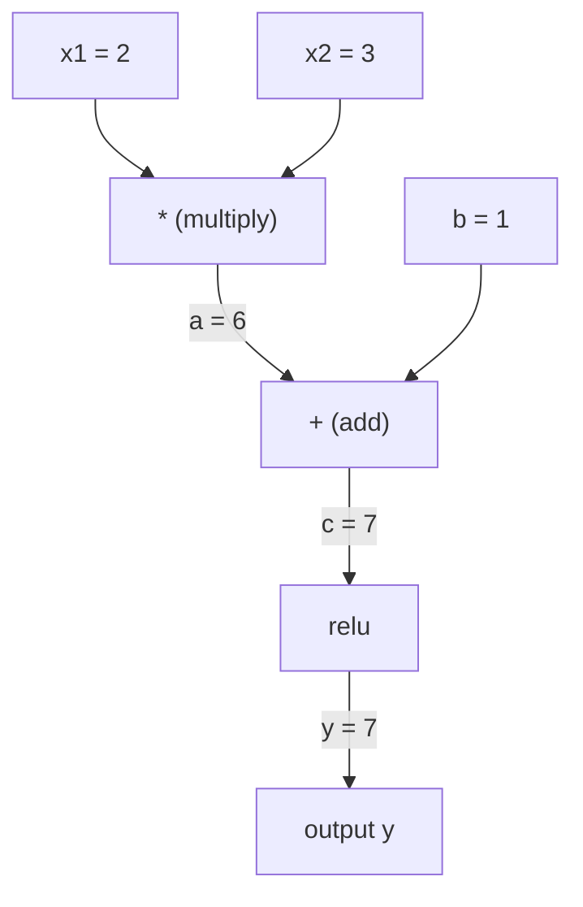
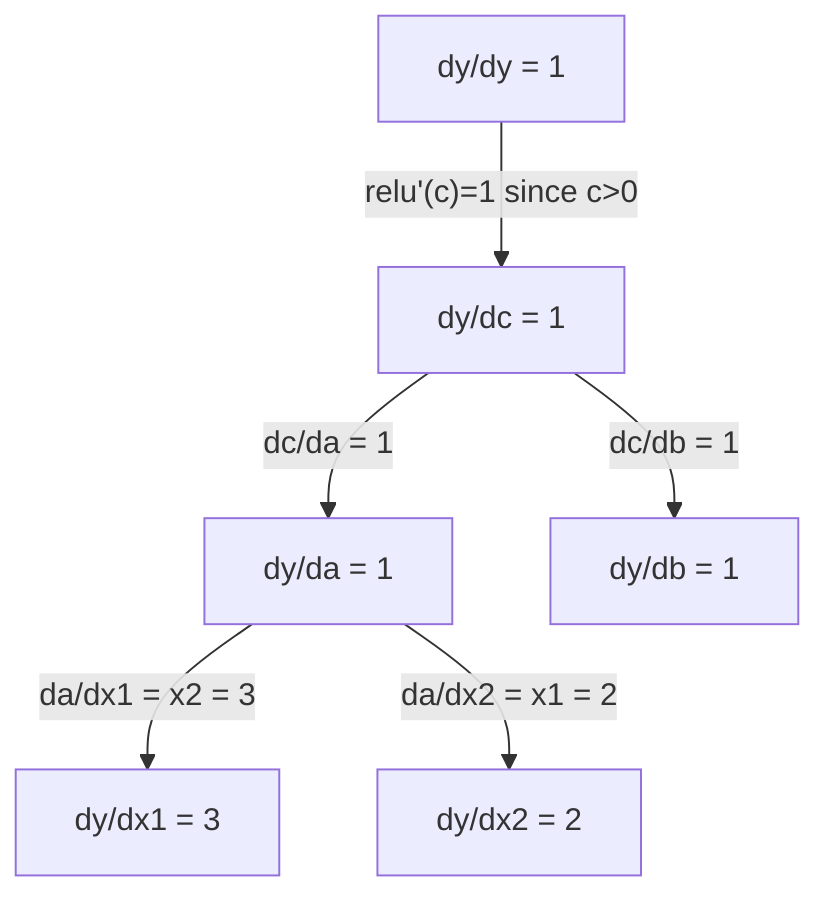

<!-- local-zh-machine-draft: English source is canonical; prose translated automatically, code/math preserved. -->

<a id="chain-rule--automatic-differentiation"></a>

# Chain Rule & 自动微分

> chain rule 是每个学习神经网络背后的引擎。

**类型：** 构建
**语言：** Python
**先决条件：** 第 1 阶段，第 04 课（衍生品和 Gradients）
**时间：** ~90 分钟

<a id="learning-objectives"></a>

## 学习目标

- 构建一个最小的 autograd 引擎（Value 类），通过反向模式 autodiff 记录操作并计算 gradients
- 使用拓扑排序通过计算图实现前向和 backward passes
- 仅使用从头开始的 autograd 引擎构建和训练 XOR 上的多层感知器
- 使用 gradient 对照数字 finite differences 检查来验证 autodiff 的正确性

<a id="the-problem"></a>

## 问题

您可以计算简单函数的导数。但神经网络并不是一个简单的函数。它由数百个函数组成：矩阵乘法、添加偏置、应用激活、再次矩阵乘法、softmax、cross-entropy 损失。输出是函数的函数的函数。

要训练网络，您需要相对于每个 weight 的损失 gradient。对于数百万 parameters 来说，手动完成此操作是不可能的。以数字方式执行（finite differences）太慢了。

chain rule 为您提供数学计算。自动微分为您提供算法。它们一起让您可以通过与单个 forward pass 成比例的时间函数的任意组合来计算精确的 gradients。

这就是 PyTorch、TensorFlow 和 JAX 的工作原理。您将从头开始构建一个微型版本。

<a id="the-concept"></a>

## 概念

<a id="the-chain-rule"></a>

### Chain Rule

若为`y = f(g(x))`，则`y`相对于`x`的导数为：

```
dy/dx = dy/dg * dg/dx = f'(g(x)) * g'(x)
```

沿链乘以导数。每个链接都贡献其本地导数。

示例：`y = sin(x^2)`

```
g(x) = x^2       g'(x) = 2x
f(g) = sin(g)     f'(g) = cos(g)

dy/dx = cos(x^2) * 2x
```

对于更深层次的作品，链条延伸：

```
y = f(g(h(x)))

dy/dx = f'(g(h(x))) * g'(h(x)) * h'(x)
```

神经网络中的每一层都是这条链条中的一个环节。

<a id="computational-graphs"></a>

### 计算图

计算图使 chain rule 可视化。每个操作都成为一个节点。数据在图表中向前流动。 Gradients 回流。

**Forward pass（计算值）：**



**Backward pass（计算gradients）：**



backward pass 在每个节点应用 chain rule，将 gradients 从输出传播到输入。

<a id="forward-mode-vs-reverse-mode"></a>

### 正向模式与反向模式

通过图表应用 chain rule 有两种方法。

**正向模式**从输入开始并向前推动导数。它计算 `dx/dx = 1` 并通过每个操作进行传播。当你的输入很少而输出很多时，这很好。

```
Forward mode: seed dx/dx = 1, propagate forward

  x = 2       (dx/dx = 1)
  a = x^2     (da/dx = 2x = 4)
  y = sin(a)  (dy/dx = cos(a) * da/dx = cos(4) * 4 = -2.615)
```

**反向模式**在输出处启动并将gradients向后拉。它计算 `dy/dy = 1` 并反向传播每个操作。当您有很多输入和很少输出时，这很好。

```
Reverse mode: seed dy/dy = 1, propagate backward

  y = sin(a)  (dy/dy = 1)
  a = x^2     (dy/da = cos(a) = cos(4) = -0.654)
  x = 2       (dy/dx = dy/da * da/dx = -0.654 * 4 = -2.615)
```

神经网络有数百万个输入（weights）和一个输出（损失）。反向模式将所有 gradients 计算在一个 backward pass 中。这就是backpropagation使用反向模式的原因。

| 模式 | 种子 | 方向 | 最佳时间 |
|------|------|-----------|-----------|
| 前进 | `dx_i/dx_i = 1` | 输入到输出 | 输入少，输出多 |
| 反向 | `dy/dy = 1` | 输出到输入 | 输入多，输出少（神经网络） |

<a id="dual-numbers-for-forward-mode"></a>

### Dual Numbers 转发模式

转发模式可以通过 dual numbers 优雅地实现。 dual number 的格式为 `a + b*epsilon`，其中 `epsilon^2 = 0`。

```
Dual number: (value, derivative)

(2, 1) means: value is 2, derivative w.r.t. x is 1

Arithmetic rules:
  (a, a') + (b, b') = (a+b, a'+b')
  (a, a') * (b, b') = (a*b, a'*b + a*b')
  sin(a, a')         = (sin(a), cos(a)*a')
```

用导数 1 作为输入变量的种子。导数在每个操作中自动传播。

<a id="building-an-autograd-engine"></a>

### 构建 Autograd 引擎

autograd 引擎需要三样东西：

1. **Value 包装。** 将每个数字包装在存储其值和 gradient 的对象中。
2. **图形记录。** 每个操作都会记录其输入和本地 gradient 函数。
3. **Backward pass.** 对图进行拓扑排序，然后反向遍历，在每个节点应用 chain rule。

这正是 PyTorch 的 `autograd` 所做的。 `torch.Tensor` 类包装值，在 `requires_grad=True` 时记录操作，并在调用 `.backward()` 时计算 gradients。

<a id="how-pytorch-autograd-works-under-the-hood"></a>

### PyTorch Autograd 的幕后工作原理

当您编写PyTorch代码时：

```python
x = torch.tensor(2.0, requires_grad=True)
y = x ** 2 + 3 * x + 1
y.backward()
print(x.grad)  # 7.0 = 2*x + 3 = 2*2 + 3
```

PyTorch 内部：

1. 使用 `requires_grad=True` 为 `x` 创建 `Tensor` 节点
2. 每次操作（`**`、`*`、`+`）都会创建一个新节点并记录向后函数
3. `y.backward()` 通过记录图触发反向模式 autodiff
4. 每个节点的`grad_fn`计算本地的gradients并将其传递给父节点
5. Gradients 通过加法（而不是替换）在 `.grad` 属性中累积

该图是动态的（按运行定义）。每个 forward pass 上都会构建一个新图。这就是为什么 PyTorch 支持模型内部的控制流（if/else、循环）。

```figure
chain-rule
```

<a id="build-it"></a>

## 动手实现

<a id="step-1-the-value-class"></a>

### 第 1 步：值类

```python
class Value:
    def __init__(self, data, children=(), op=''):
        self.data = data
        self.grad = 0.0
        self._backward = lambda: None
        self._prev = set(children)
        self._op = op

    def __repr__(self):
        return f"Value(data={self.data:.4f}, grad={self.grad:.4f})"
```

每个 `Value` 都存储其数值数据、gradient（初始为零）、向后函数以及指向生成它的子节点的指针。

<a id="step-2-arithmetic-operations-with-gradient-tracking"></a>

### 步骤2：与gradient跟踪的算术运算

```python
    def __add__(self, other):
        other = other if isinstance(other, Value) else Value(other)
        out = Value(self.data + other.data, (self, other), '+')
        def _backward():
            self.grad += out.grad
            other.grad += out.grad
        out._backward = _backward
        return out

    def __mul__(self, other):
        other = other if isinstance(other, Value) else Value(other)
        out = Value(self.data * other.data, (self, other), '*')
        def _backward():
            self.grad += other.data * out.grad
            other.grad += self.data * out.grad
        out._backward = _backward
        return out

    def relu(self):
        out = Value(max(0, self.data), (self,), 'relu')
        def _backward():
            self.grad += (1.0 if out.data > 0 else 0.0) * out.grad
        out._backward = _backward
        return out
```

每个操作都会创建一个闭包，该闭包知道如何计算本地 gradients 并乘以上游 gradient (`out.grad`)。 `+=` 处理在多个操作中使用一个值的情况。

<a id="step-3-the-backward-pass"></a>

### 步骤3：backward pass

```python
    def backward(self):
        topo = []
        visited = set()
        def build_topo(v):
            if v not in visited:
                visited.add(v)
                for child in v._prev:
                    build_topo(child)
                topo.append(v)
        build_topo(self)

        self.grad = 1.0
        for v in reversed(topo):
            v._backward()
```

拓扑排序确保每个节点的 gradient 在传播到其子节点之前都已完全计算。种子 gradient 为 1.0 (dy/dy = 1)。

<a id="step-4-more-operations-for-a-complete-engine"></a>

### 步骤 4：完整引擎的更多操作

基本 Value 类处理加法、乘法和 relu。真正的 autograd 引擎需要更多。以下是构建神经网络所需的操作：

```python
    def __neg__(self):
        return self * -1

    def __sub__(self, other):
        return self + (-other)

    def __radd__(self, other):
        return self + other

    def __rmul__(self, other):
        return self * other

    def __rsub__(self, other):
        return other + (-self)

    def __pow__(self, n):
        out = Value(self.data ** n, (self,), f'**{n}')
        def _backward():
            self.grad += n * (self.data ** (n - 1)) * out.grad
        out._backward = _backward
        return out

    def __truediv__(self, other):
        return self * (other ** -1) if isinstance(other, Value) else self * (Value(other) ** -1)

    def exp(self):
        import math
        e = math.exp(self.data)
        out = Value(e, (self,), 'exp')
        def _backward():
            self.grad += e * out.grad
        out._backward = _backward
        return out

    def log(self):
        import math
        out = Value(math.log(self.data), (self,), 'log')
        def _backward():
            self.grad += (1.0 / self.data) * out.grad
        out._backward = _backward
        return out

    def tanh(self):
        import math
        t = math.tanh(self.data)
        out = Value(t, (self,), 'tanh')
        def _backward():
            self.grad += (1 - t ** 2) * out.grad
        out._backward = _backward
        return out
```

**为什么每个操作都很重要：**

| 操作 | 落后规则 | 用于 |
|-----------|--------------|---------|
| `__sub__` | 重复使用加+负 | 损失计算（pred - 目标） |
| `__pow__` | n * x^(n-1) | 多项式激活，MSE（误差^2） |
| `__truediv__` | 重用 mul + pow(-1) | Normalization、learning rate 缩放 |
| `exp` | exp(x) * upstream | Softmax，对数似然 |
| `log` | (1/x) * upstream | Cross-entropy 损失，对数概率 |
| `tanh` | (1 - tanh^2) * upstream | 经典activation function |

巧妙的部分：`__sub__`和`__truediv__`是根据现有操作定义的。他们免费获得正确的 gradients，因为 chain rule 通过底层的 add/mul/pow 操作组成。

<a id="step-5-mini-mlp-from-scratch"></a>

### 第 5 步：从头开始迷你 MLP

有了完整的 Value 类，您就可以构建神经网络。没有 PyTorch。没有 NumPy。只是价值观和 chain rule。

```python
import random

class Neuron:
    def __init__(self, n_inputs):
        self.w = [Value(random.uniform(-1, 1)) for _ in range(n_inputs)]
        self.b = Value(0.0)

    def __call__(self, x):
        act = sum((wi * xi for wi, xi in zip(self.w, x)), self.b)
        return act.tanh()

    def parameters(self):
        return self.w + [self.b]

class Layer:
    def __init__(self, n_inputs, n_outputs):
        self.neurons = [Neuron(n_inputs) for _ in range(n_outputs)]

    def __call__(self, x):
        return [n(x) for n in self.neurons]

    def parameters(self):
        return [p for n in self.neurons for p in n.parameters()]

class MLP:
    def __init__(self, sizes):
        self.layers = [Layer(sizes[i], sizes[i+1]) for i in range(len(sizes)-1)]

    def __call__(self, x):
        for layer in self.layers:
            x = layer(x)
        return x[0] if len(x) == 1 else x

    def parameters(self):
        return [p for layer in self.layers for p in layer.parameters()]
```

`Neuron` 计算 `tanh(w1*x1 + w2*x2 + ... + b)`。 `Layer` 是神经元列表。 `MLP` 堆叠各层。每个 weight 都是一个 `Value`，因此调用 `loss.backward()` 会将 gradients 传播到每个 parameter。

**异或训练：**

```python
random.seed(42)
model = MLP([2, 4, 1])  # 2 inputs, 4 hidden neurons, 1 output

xs = [[0, 0], [0, 1], [1, 0], [1, 1]]
ys = [-1, 1, 1, -1]  # XOR pattern (using -1/1 for tanh)

for step in range(100):
    preds = [model(x) for x in xs]
    loss = sum((p - y) ** 2 for p, y in zip(preds, ys))

    for p in model.parameters():
        p.grad = 0.0
    loss.backward()

    lr = 0.05
    for p in model.parameters():
        p.data -= lr * p.grad

    if step % 20 == 0:
        print(f"step {step:3d}  loss = {loss.data:.4f}")

print("\nPredictions after training:")
for x, y in zip(xs, ys):
    print(f"  input={x}  target={y:2d}  pred={model(x).data:6.3f}")
```

这是微梯度。纯 Python 中的完整神经网络训练循环，具有自动微分功能。每个商业深度学习框架都大规模地做同样的事情。

<a id="step-6-gradient-checking"></a>

### 第6步：Gradient检查

你怎么知道你的autodiff是正确的？将其与数值导数进行比较。这是 gradient 检查。

```python
def gradient_check(build_expr, x_val, h=1e-7):
    x = Value(x_val)
    y = build_expr(x)
    y.backward()
    autodiff_grad = x.grad

    y_plus = build_expr(Value(x_val + h)).data
    y_minus = build_expr(Value(x_val - h)).data
    numerical_grad = (y_plus - y_minus) / (2 * h)

    diff = abs(autodiff_grad - numerical_grad)
    return autodiff_grad, numerical_grad, diff
```

在复杂的表达式上测试它：

```python
def expr(x):
    return (x ** 3 + x * 2 + 1).tanh()

ad, num, diff = gradient_check(expr, 0.5)
print(f"Autodiff:  {ad:.8f}")
print(f"Numerical: {num:.8f}")
print(f"Difference: {diff:.2e}")
# Difference should be < 1e-5
```

Gradient 检查在实施新操作时至关重要。如果您的 backward pass 有错误，数字检查会捕获它。每个严肃的深度学习实现都会在开发过程中运行 gradient 检查。

**何时使用 gradient 检查：**

| 情况 | gradient检查吗？ |
|-----------|-------------------|
| 向您的 autograd 添加新操作 | 是的，总是 |
| 调试不会收敛的训练循环 | 是的，先检查gradients |
| 生产培训 | 不，太慢（每个 parameter 2x forward passes） |
| autograd 代码的单元测试 | 是的，自动化它 |

<a id="step-7-verify-against-manual-calculation"></a>

### 第 7 步：对照手动计算进行验证

```python
x1 = Value(2.0)
x2 = Value(3.0)
a = x1 * x2          # a = 6.0
b = a + Value(1.0)    # b = 7.0
y = b.relu()          # y = 7.0

y.backward()

print(f"y = {y.data}")          # 7.0
print(f"dy/dx1 = {x1.grad}")   # 3.0 (= x2)
print(f"dy/dx2 = {x2.grad}")   # 2.0 (= x1)
```

手动检查：`y = relu(x1*x2 + 1)`。由于`x1*x2 + 1 = 7 > 0`，relu是身份。
`dy/dx1 = x2 = 3`。 `dy/dx2 = x1 = 2`。发动机匹配。

<a id="use-it"></a>

## 实际应用

<a id="verify-against-pytorch"></a>

### 对照 PyTorch 进行验证

```python
import torch

x1 = torch.tensor(2.0, requires_grad=True)
x2 = torch.tensor(3.0, requires_grad=True)
a = x1 * x2
b = a + 1.0
y = torch.relu(b)
y.backward()

print(f"PyTorch dy/dx1 = {x1.grad.item()}")  # 3.0
print(f"PyTorch dy/dx2 = {x2.grad.item()}")  # 2.0
```

相同gradients。您的引擎计算出与 PyTorch 相同的结果，因为数学是相同的：通过 chain rule 的反向模式 autodiff。

<a id="a-more-complex-expression"></a>

### 更复杂的表达

```python
a = Value(2.0)
b = Value(-3.0)
c = Value(10.0)
f = (a * b + c).relu()  # relu(2*(-3) + 10) = relu(4) = 4

f.backward()
print(f"df/da = {a.grad}")  # -3.0 (= b)
print(f"df/db = {b.grad}")  #  2.0 (= a)
print(f"df/dc = {c.grad}")  #  1.0
```

<a id="ship-it"></a>

## 交付成果

本课产生：
- `outputs/skill-autodiff.md` -- 构建和调试 autograd 系统的技能
- `code/autodiff.py` -- 可扩展的最小 autograd 引擎

这里构建的 Value 类是第 3 阶段神经网络训练循环的基础。

<a id="exercises"></a>

## 练习

1. 将 `__pow__` 添加到 Value 类，以便您可以计算 `x ** n`。验证 `x=2` 处的 `d/dx(x^3)` 是否等于 `12.0`。

2. 将 `tanh` 添加为 activation function。验证 `tanh'(0) = 1` 和 `tanh'(2) = 0.0707`（大约）。

3. 构建单个神经元的计算图：`y = relu(w1*x1 + w2*x2 + b)`。计算所有五个 gradients 并对照 PyTorch 进行验证。

4. 使用 dual numbers 实现转发模式 autodiff。创建一个 `Dual` 类并验证它提供与反向模式引擎相同的导数。

<a id="key-terms"></a>

## 关键术语

| 术语 | 人们怎么说 | 它实际上意味着什么 |
|------|----------------|----------------------|
| Chain rule | “乘以导数” | 组合函数的导数等于每个函数的局部导数的乘积，在正确的点求值 |
| 计算图 | 「网络图」 | 有向无环图，其中节点是操作，边携带值（向前）或 gradients（向后） |
| 前进模式 | “推动衍生品向前发展” | Autodiff 将导数从输入传播到输出。每个输入变量一次。 |
| 反转模式 | "Backpropagation" | Autodiff 将 gradients 从输出传播到输入。每个输出变量一次传递。 |
| Autograd | “自动gradients” | 一个记录值操作、构建图表并通过 chain rule 计算精确 gradients 的系统 |
| Dual numbers | “价值加衍生品” | a + b*epsilon (epsilon^2 = 0) 形式的数字通过算术携带导数信息 |
| 拓扑排序 | “依赖顺序” | 对图节点进行排序，以便每个节点都位于其所有依赖项之后。正确的 gradient 传播所需。 |
| Gradient accumulation | “添加，不要替换” | 当一个值馈入多个操作时，其 gradient 是所有传入 gradient 贡献的总和 |
| 动态图 | “通过运行定义” | 在每个 forward pass 上重建计算图，允许 Python 控制模型内部的流程（PyTorch 风格） |
| Gradient 检查 | 「数值验证」 | 将 autodiff gradients 与数值有限差分 gradients 进行比较以验证正确性。对于调试至关重要。 |
| 多层线性规划 | 《多层感知器》 | 一种具有一个或多个隐藏神经元层的神经网络。每个神经元计算加权和加上偏差，然后应用 activation function。 |
| 神经元 | “加权和+激活” | 基本单位：输出 = 激活(w1*x1 + w2*x2 + ... + b)。 weights 和偏差是可学习的 parameters。 |

<a id="further-reading"></a>

## 进一步阅读

- [3Blue1Brown：Backpropagation演算](https://www.youtube.com/watch?v=tIeHLnjs5U8)——神经网络中chain rule的可视化解释
- [PyTorch Autograd 机制](https://pytorch.org/docs/stable/notes/autograd.html) -- 真实系统如何工作
- [Baydin 等人，机器学习中的自动微分：调查](https://arxiv.org/abs/1502.05767) -- 综合参考
