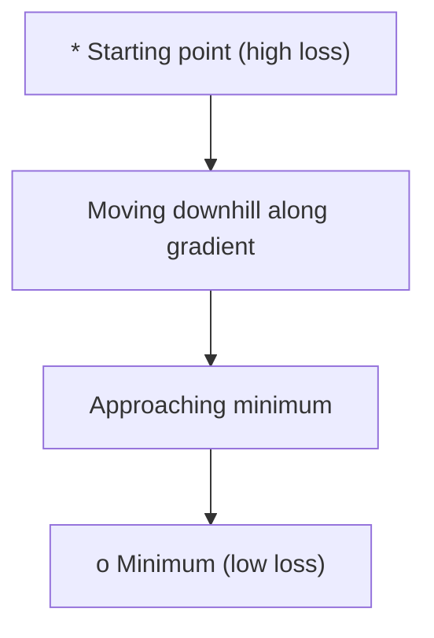
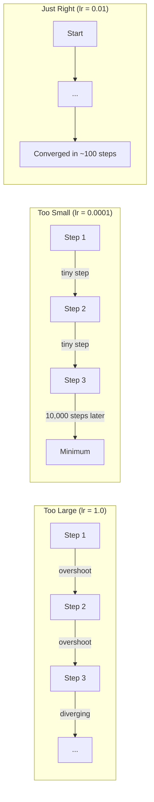
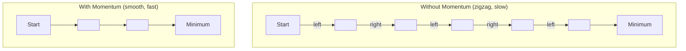
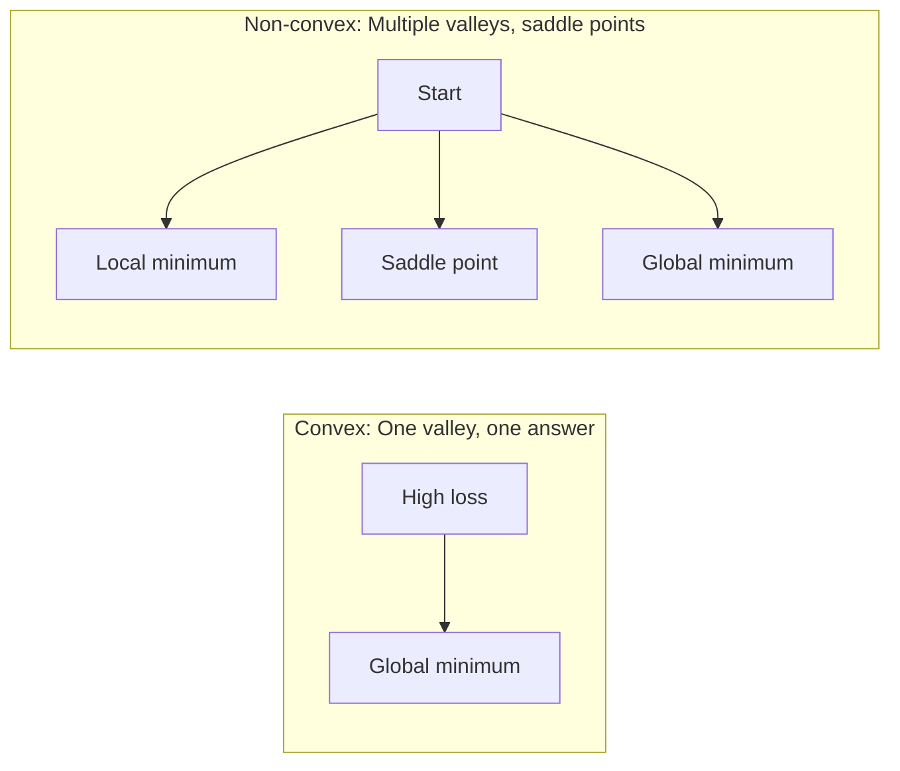
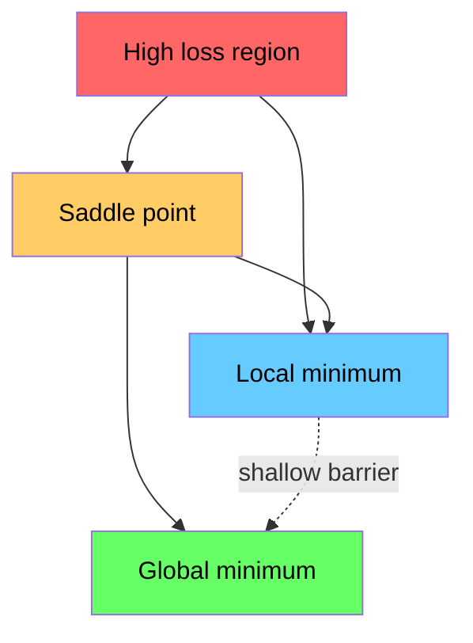

<!-- local-zh-machine-draft: English source is canonical; prose translated automatically, code/math preserved. -->

<a id="optimization"></a>

# 优化

> 训练神经网络无非就是找到山谷的底部。

**类型：** 构建
**语言：** Python
**先决条件：** 第 1 阶段，第 04-05 课（衍生品，Gradients）
**时间：** ~75分钟

<a id="learning-objectives"></a>

## 学习目标

- 从头开始实施普通 gradient descent、带有动量的 SGD 和 Adam
- 比较 optimizer 在 Rosenbrock 函数上的收敛性，并解释为什么 Adam 适应每个 weight learning rates
- 区分凸损失和非凸损失景观并解释鞍点在高维度中的作用
- 配置 learning rate schedules（步进衰减、余弦退火、warmup）以实现训练稳定性

<a id="the-problem"></a>

## 问题

您有一个 loss function。它告诉您您的模型有多么错误。您有 gradients。他们告诉你哪个方向会让损失更严重。现在你需要一个下坡的策略。

天真的方法很简单：向 gradient 的相反方向移动。按称为 learning rate 的某个数字缩放步长。重复。这是 gradient descent，它可以工作。但“作品”有一些警告。如果 learning rate 太大，你就会完全越过山谷，在墙壁之间弹跳。太小了，你就会通过数千个不必要的步骤慢慢地寻找答案。到达鞍点后，即使您没有找到最小值，您也会停止移动。

深度学习中的每一个optimizer都在回答同一个问题：如何更快、更可靠地到达谷底？

<a id="the-concept"></a>

## 概念

<a id="what-optimization-means"></a>

### 优化意味着什么

优化是找到最小化（或最大化）函数的输入值。在机器学习中，函数就是损失。输入是模型的 weights。训练就是优化。

```
minimize L(w) where:
  L = loss function
  w = model weights (could be millions of parameters)
```

<a id="gradient-descent-vanilla"></a>

### Gradient descent（原版）

最简单的optimizer。计算每个 weight 的损失 gradient。将每个 weight 沿其 gradient 的相反方向移动。按 learning rate 缩放步长。

```
w = w - lr * gradient
```

这就是整个算法。一行。



<a id="learning-rate-the-most-important-hyperparameter"></a>

### Learning rate：最重要的hyperparameter

learning rate 控制步长。它决定了关于收敛的一切。



没有正确的learning rate的公式。你可以通过实验找到它。常用起点：Adam 为 0.001，带动量的 SGD 为 0.01。

<a id="sgd-vs-batch-vs-mini-batch"></a>

### SGD vs 批量 vs 小批量

Vanilla gradient descent 在采取一步之前计算整个数据集的 gradient。这称为批次 gradient descent。它很稳定但很慢。

Stochastic gradient descent (SGD) 在单个随机样本上计算 gradient 并立即执行步骤。它很吵但是速度很快。

小批量 gradient descent 平分了差异。在小批量（32、64、128、256 个样本）上计算 gradient，然后单步执行。这是大家实际使用的。

| 变体 | Batch size | Gradient 品质 | 每步速度 | 噪音 |
|---------|-----------|-----------------|---------------|-------|
| 批量GD | 整个数据集 | 准确 | 慢 | 无 |
| 新加坡元 | 1 个样品 | 很吵 | 快 | 高 |
| 小批量 | 32-256 | 不错的估计 | 平衡 | 中等 |

SGD 和小批量中的噪声不是错误。它有助于避开浅的局部极小值和鞍点。

<a id="momentum-the-ball-rolling-downhill"></a>

### 动量：球滚下坡

Vanilla gradient descent 只查看当前的 gradient。如果 gradient 呈之字形（常见于狭窄的山谷），则进展缓慢。动量通过将过去的 gradients 累加到速度项中来解决这个问题。

```
v = beta * v + gradient
w = w - lr * v
```

打个比方：一个球滚下坡。它不会在每次颠簸时停止并重新启动。它可以在一致的方向上增加速度并抑制振荡。



`beta`（通常为 0.9）控制要保留的历史记录量。较高的贝塔值意味着更大的动量、更平滑的路径，但对方向变化的响应更慢。

<a id="adam-adaptive-learning-rates"></a>

### Adam：自适应learning rates

不同的weights需要不同的learning rates。很少会变大的 weight 当 gradients 最终变大时，应该采取更大的步骤。不断获得巨大 gradients 的 weight 应该采取较小的步骤。

Adam（自适应力矩估计）根据 weight 跟踪两件事：

1. 第一时刻（m）：gradients的运行平均值（如动量）
2. 二阶矩 (v)：gradients 平方的运行平均值（gradient 幅度）

```
m = beta1 * m + (1 - beta1) * gradient
v = beta2 * v + (1 - beta2) * gradient^2

m_hat = m / (1 - beta1^t)    bias correction
v_hat = v / (1 - beta2^t)    bias correction

w = w - lr * m_hat / (sqrt(v_hat) + epsilon)
```

`sqrt(v_hat)` 的划分是关键的见解。 Weights 与大 gradients 被除以一个大数（小有效步长）。 Weights 与小 gradients 除以一个较小的数字（较大的有效步长）。每个 weight 都有自己的自适应 learning rate。

默认hyperparameters：`lr=0.001, beta1=0.9, beta2=0.999, epsilon=1e-8`。这些默认值适用于大多数问题。

<a id="learning-rate-schedules"></a>

### Learning rate schedules

固定的 learning rate 是一种折衷方案。在训练的早期，您希望迈出大步以取得快速进步。在训练后期，您需要小步进行微调以接近最小值。

常见时间表：

| 时间表 | 公式 | 应用场景 |
|----------|---------|----------|
| 阶跃衰减 | lr = lr * 每 N epoch 因子 | 简单的手动控制 |
| 指数衰减 | lr = lr_0 * decay^t | 平滑还原 |
| 余弦退火 | lr = lr_min + 0.5 * (lr_max - lr_min) * (1 + cos(pi * t / T)) | Transformers，现代培训 |
| Warmup + 衰减 | 线性上升，然后衰减 | 大型模型，防止早期不稳定 |

<a id="convex-vs-non-convex"></a>

### 凸与非凸

凸函数有一个最小值。 Gradient descent 总能找到它。像 `f(x) = x^2` 这样的二次方程是凸的。

神经网络 loss functions 是非凸的。它们有许多局部最小值、鞍点和平坦区域。



实际上，高维神经网络中的局部极小值很少成为问题。大多数局部最小值的损失值接近全局最小值。鞍点（在某些方向上平坦，在其他方向上弯曲）是真正的障碍。小批量的动量和噪音有助于逃避它们。

<a id="loss-landscape-visualization"></a>

### 损失景观可视化

损失是所有 weights 的函数。对于具有 100 万个 weights 的模型，损失景观存在于 1,000,001 维空间中。我们通过在 weight 空间中选择两个随机方向并绘制沿这些方向的损失来可视化它，生成一个 2D 表面。



尖锐的最小值概括性较差。平坦最小值可以很好地概括。这是动量 SGD 在最终测试精度方面通常优于 Adam 的原因之一：它的噪声可以防止陷入急剧的最小值。

```figure
gradient-descent
```

<a id="build-it"></a>

## 动手实现

<a id="step-1-define-a-test-function"></a>

### 第 1 步：定义测试函数

Rosenbrock 函数是经典的优化基准。它的最小值位于狭窄弯曲山谷内的 (1, 1)，很容易找到但很难跟踪。

```
f(x, y) = (1 - x)^2 + 100 * (y - x^2)^2
```

```python
def rosenbrock(params):
    x, y = params
    return (1 - x) ** 2 + 100 * (y - x ** 2) ** 2

def rosenbrock_gradient(params):
    x, y = params
    df_dx = -2 * (1 - x) + 200 * (y - x ** 2) * (-2 * x)
    df_dy = 200 * (y - x ** 2)
    return [df_dx, df_dy]
```

<a id="step-2-vanilla-gradient-descent"></a>

### 第2步：原版gradient descent

```python
class GradientDescent:
    def __init__(self, lr=0.001):
        self.lr = lr

    def step(self, params, grads):
        return [p - self.lr * g for p, g in zip(params, grads)]
```

<a id="step-3-sgd-with-momentum"></a>

### 第 3 步：势头强劲的 SGD

```python
class SGDMomentum:
    def __init__(self, lr=0.001, momentum=0.9):
        self.lr = lr
        self.momentum = momentum
        self.velocity = None

    def step(self, params, grads):
        if self.velocity is None:
            self.velocity = [0.0] * len(params)
        self.velocity = [
            self.momentum * v + g
            for v, g in zip(self.velocity, grads)
        ]
        return [p - self.lr * v for p, v in zip(params, self.velocity)]
```

<a id="step-4-adam"></a>

### 步骤4：Adam

```python
class Adam:
    def __init__(self, lr=0.001, beta1=0.9, beta2=0.999, epsilon=1e-8):
        self.lr = lr
        self.beta1 = beta1
        self.beta2 = beta2
        self.epsilon = epsilon
        self.m = None
        self.v = None
        self.t = 0

    def step(self, params, grads):
        if self.m is None:
            self.m = [0.0] * len(params)
            self.v = [0.0] * len(params)

        self.t += 1

        self.m = [
            self.beta1 * m + (1 - self.beta1) * g
            for m, g in zip(self.m, grads)
        ]
        self.v = [
            self.beta2 * v + (1 - self.beta2) * g ** 2
            for v, g in zip(self.v, grads)
        ]

        m_hat = [m / (1 - self.beta1 ** self.t) for m in self.m]
        v_hat = [v / (1 - self.beta2 ** self.t) for v in self.v]

        return [
            p - self.lr * mh / (vh ** 0.5 + self.epsilon)
            for p, mh, vh in zip(params, m_hat, v_hat)
        ]
```

<a id="step-5-run-and-compare"></a>

### 第5步：运行并比较

```python
def optimize(optimizer, func, grad_func, start, steps=5000):
    params = list(start)
    history = [params[:]]
    for _ in range(steps):
        grads = grad_func(params)
        params = optimizer.step(params, grads)
        history.append(params[:])
    return history

start = [-1.0, 1.0]

gd_history = optimize(GradientDescent(lr=0.0005), rosenbrock, rosenbrock_gradient, start)
sgd_history = optimize(SGDMomentum(lr=0.0001, momentum=0.9), rosenbrock, rosenbrock_gradient, start)
adam_history = optimize(Adam(lr=0.01), rosenbrock, rosenbrock_gradient, start)

for name, history in [("GD", gd_history), ("SGD+M", sgd_history), ("Adam", adam_history)]:
    final = history[-1]
    loss = rosenbrock(final)
    print(f"{name:6s} -> x={final[0]:.6f}, y={final[1]:.6f}, loss={loss:.8f}")
```

预期输出：Adam 收敛速度最快。势头强劲的 SGD 走的是更平稳的道路。 Vanilla GD 沿着狭窄的山谷缓慢前进。

<a id="use-it"></a>

## 实际应用

实际上，请使用 PyTorch 或 JAX optimizers。它们处理 parameter 组、weight decay、gradient clipping 和 GPU 加速。

```python
import torch

model = torch.nn.Linear(784, 10)

sgd = torch.optim.SGD(model.parameters(), lr=0.01, momentum=0.9)
adam = torch.optim.Adam(model.parameters(), lr=0.001)
adamw = torch.optim.AdamW(model.parameters(), lr=0.001, weight_decay=0.01)

scheduler = torch.optim.lr_scheduler.CosineAnnealingLR(adam, T_max=100)
```

经验法则：

- 从 Adam (lr=0.001) 开始。它无需调整即可解决大多数问题。
- 当您需要最佳的最终精度并且可以承受更多调整时，请切换到动量 SGD（lr=0.01，动量=0.9）。
- 使用 AdamW（Adam 与解耦的 weight decay）作为 transformers。
- 始终使用 learning rate schedule 进行超过几个 epoch 的训练。
- 如果训练不稳定，请减少learning rate。如果训练太慢，请增加训练量。

<a id="ship-it"></a>

## 交付成果

本课程生成一个 prompt，用于选择正确的 optimizer。参见 `outputs/prompt-optimizer-guide.md`。

当我们从头开始训练神经网络时，此处构建的 optimizer 类会在第 3 阶段重新出现。

<a id="exercises"></a>

## 练习

1. **Learning rate 扫描。** 使用 learning rates 在 Rosenbrock 函数上运行普通 gradient descent [0.0001， 0.0005、0.001、0.005、0.01]。绘制或打印每个步骤 5000 步后的最终损失。找到仍然收敛的最大的 learning rate。

2. **动量比较。** 在 Rosenbrock 函数上使用动量值 [0.0、0.5、0.9、0.99] 运行 SGD。跟踪每一步的损失。哪个动量值收敛得最快？哪个超调了？

3. **鞍点逃逸。** 定义函数`f(x, y) = x^2 - y^2`（原点处的鞍点）。从 (0.01, 0.01) 开始。比较普通 GD、带动量的 SGD 和 Adam 的行为。哪个逃脱了鞍点？

4. **实现 learning rate 衰减。** 将指数衰减时间表添加到 GradientDescent 类：`lr = lr_0 * 0.999^step`。比较 Rosenbrock 函数有和没有衰减的收敛性。

<a id="key-terms"></a>

## 关键术语

| 术语 | 人们怎么说 | 它实际上意味着什么 |
|------|----------------|----------------------|
| Gradient descent | “走下坡路吧” | 通过减去由 learning rate 缩放的 gradient 来更新 weights。最基本的optimizer。 |
| Learning rate | “步长” | 控制每次更新将 weights 移动多远的标量。太大会导致发散。太小会浪费计算。 |
| 势头 | “继续滚动” | 将过去的 gradients 累加到速度向量中。抑制振荡并加速一致方向的运动。 |
| 新加坡元 | “随机sampling” | Stochastic gradient descent。在随机子集而不是完整数据集上计算 gradient。在实践中几乎总是意味着小批量 SGD。 |
| 小批量 | “一大块数据” | 用于估计 gradient 的一小部分训练数据（32-256 个样本）。平衡速度和 gradient 精度。 |
| Adam | “默认optimizer” | 自适应矩估计。跟踪 weight 的 gradients 的运行平均值并平方 gradients，为每个 weight 提供自己的 learning rate。 |
| 偏差校正 | “修复冷启动” | Adam的第一和第二时刻被初始化为零。偏差校正除以 (1 - beta^t) 以在早期步骤中进行补偿。 |
| Learning rate schedule | “随着时间的推移改变lr” | 在训练过程中调整 learning rate 的功能。早迈大步，晚迈小步。 |
| 凸函数 | 《一谷》 | 任何局部最小值都是全局最小值的函数。 Gradient descent 总能找到。神经网络损失不是凸的。 |
| 鞍点 | “持平但不是最低限度” | gradient 为零但在某些方向上为最小值而在其他方向上为最大值的点。常见于高维度。 |
| 损失景观 | 「地形」 | loss function 在 weight 空间上绘制。通过沿两个随机方向切片来可视化。 |
| 收敛性 | “到达那里” | optimizer 已经达到了进一步的措施并不能有效减少损失的地步。 |

<a id="further-reading"></a>

## 进一步阅读

- [Sebastian Ruder：gradient descent优化算法概述](https://ruder.io/optimizing-gradient-descent/) - 全面概述所有主要optimizers
- [为什么动量确实有效（蒸馏）](https://distill.pub/2017/momentum/) - 动量动力学的交互式可视化
- [Adam：随机优化方法（Kingma & Ba，2014）](https://arxiv.org/abs/1412.6980) - 原始 Adam 论文，可读且简短
- [可视化神经网络的损失景观（Li et al., 2018）](https://arxiv.org/abs/1712.09913) - 显示尖锐与平坦最小值的论文
