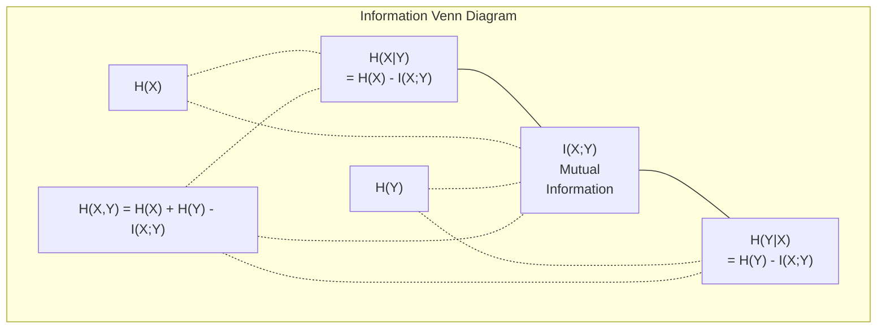

<!-- local-zh-machine-draft: English source is canonical; prose translated automatically, code/math preserved. -->

<a id="information-theory"></a>

# 信息论

> 信息论衡量惊喜。 Loss functions 是在其上构建的。

**类型：** 了解
**语言：** Python
**先决条件：** 第 1 阶段，第 06 课（概率）
**时间：** ~60 分钟

<a id="learning-objectives"></a>

## 学习目标

- 从头开始计算熵、cross-entropy 和 KL 散度并解释它们的关系
- 推导为什么最小化 cross-entropy 损失相当于最大化对数似然
- 计算features和目标之间的互信息，对feature重要性进行排名
- 将 perplexity 解释为语言模型选择的有效 vocabulary 大小

<a id="the-problem"></a>

## 问题

您在训练的每个分类模型中调用 `CrossEntropyLoss()`。您在每篇语言模型论文中都会看到“perplexity”。您在 VAEs、蒸馏和 RLHF 中了解了 KL 散度。这些并不是互不相关的概念。他们都有同样的想法，但戴着不同的帽子。

信息论为您提供了推理不确定性、压缩和预测的语言。 Claude Shannon于1948年发明它来解决通信问题。事实证明，训练神经网络是一个通信问题：模型试图通过学习到的 weights 的噪声通道传输正确的标签。

本课程从头开始构建每个公式，以便您了解它们的来源以及它们的工作原理。

<a id="the-concept"></a>

## 概念

<a id="information-content-surprise"></a>

### 信息内容（惊喜）

当不太可能发生的事情发生时，它会携带更多信息。硬币落地头？并不奇怪。买彩票中奖了？非常令人惊讶。

概率为p的事件的信息内容为：

```
I(x) = -log(p(x))
```

使用以 2 为底的对数可以得到位。使用自然对数可以得到 nat。相同的想法，不同的单位。

```
Event              Probability    Surprise (bits)
Fair coin heads    0.5            1.0
Rolling a 6        0.167          2.58
1-in-1000 event    0.001          9.97
Certain event      1.0            0.0
```

某些事件携带零信息。你已经知道它们会发生。

<a id="entropy-average-surprise"></a>

### 熵（平均惊喜）

熵是分布的所有可能结果的预期惊喜。

```
H(P) = -sum( p(x) * log(p(x)) )  for all x
```

一枚公平的硬币对于二进制变量来说具有最大熵：1 位。有偏差的硬币（99% 正面）的熵较低：0.08 位。你已经知道会发生什么，所以每次翻转几乎什么也没有告诉你。

```
Fair coin:    H = -(0.5 * log2(0.5) + 0.5 * log2(0.5)) = 1.0 bit
Biased coin:  H = -(0.99 * log2(0.99) + 0.01 * log2(0.01)) = 0.08 bits
```

熵衡量分布中不可约的不确定性。您无法压缩到低于它。

<a id="cross-entropy-the-loss-function-you-use-every-day"></a>

### Cross-Entropy（您每天使用的Loss Function）

Cross-entropy 测量当您使用分布 Q 对实际来自分布 P 的事件进行编码时的平均惊喜。

```
H(P, Q) = -sum( p(x) * log(q(x)) )  for all x
```

P 是真实分布（标签）。 Q 是模型的预测。如果 Q 与 P 完美匹配，则 cross-entropy 等于熵。任何不匹配都会使其变大。

在分类中，P 是一个 one-hot 向量（真实类别的概率为 1，其他均为 0）。这将 cross-entropy 简化为：

```
H(P, Q) = -log(q(true_class))
```

这就是整个cross-entropy分类损失公式。最大化正确类别的预测概率。

<a id="kl-divergence-distance-between-distributions"></a>

### KL 散度（分布之间的距离）

KL 散度衡量使用 Q 而不是 P 会带来多少额外的惊喜。

```
D_KL(P || Q) = sum( p(x) * log(p(x) / q(x)) )  for all x
             = H(P, Q) - H(P)
```

Cross-entropy 是熵加上 KL 散度。由于真实分布的熵在训练期间是恒定的，因此最小化 cross-entropy 与最小化 KL 散度相同。您正在将模型的分布推向真实分布。

KL 散度不对称：D_KL(P || Q) != D_KL(Q || P）。它不是真正的距离度量。

<a id="mutual-information"></a>

### 互信息

互信息衡量的是对一个变量的了解程度能告诉你多少关于另一个变量的信息。

```
I(X; Y) = H(X) - H(X|Y)
        = H(X) + H(Y) - H(X, Y)
```

如果 X 和 Y 独立，则互信息为零。了解其中一个并不能告诉你关于另一个的任何信息。如果它们完全相关，则互信息等于任一变量的熵。

在feature选择中，feature和目标之间的高互信息意味着feature是有用的。互信息低意味着它是噪音。

<a id="conditional-entropy"></a>

### 条件熵

H(Y|X) 衡量在观察 X 后 Y 还剩下多少不确定性。

```
H(Y|X) = H(X,Y) - H(X)
```

两个极端：
- 如果X完全决定Y，则H(Y|X) = 0。知道 X 就消除了有关 Y 的所有不确定性。示例：X = temperature（摄氏度），Y = temperature（华氏度）。
- 如果 X 没有告诉你任何关于 Y 的信息，那么 H(Y|X) = H(Y)。了解 X 根本不会减少你的不确定性。示例：X = 抛硬币，Y = 明天的天气。

条件熵始终为非负且永远不会超过 H(Y)：

```
0 <= H(Y|X) <= H(Y)
```

在机器学习中，条件熵出现在决策树中。在每次分割时，算法都会选择 feature X 来最小化 H(Y|X)——feature，消除了标签 Y 的最大不确定性。

<a id="joint-entropy"></a>

### 联合熵

H(X,Y) 是 X 和 Y 的联合分布的熵。

```
H(X,Y) = -sum sum p(x,y) * log(p(x,y))   for all x, y
```

关键属性：

```
H(X,Y) <= H(X) + H(Y)
```

当 X 和 Y 独立时，相等成立。如果它们共享信息，则联合熵小于个体熵之和。 “缺失”的熵正是互信息。



关系：
- H(X,Y) = H(X) + H(Y|X) = H(Y) + H(X|是）
- I(X;Y) = H(X) - H(X|Y) = H(Y) - H(Y|十)
- H(X,Y) = H(X) + H(Y) - I(X;Y)

<a id="mutual-information-deep-dive"></a>

### 互信息（深入探讨）

互信息 I(X;Y) 量化了了解一个变量可以在多大程度上减少另一个变量的不确定性。

```
I(X;Y) = H(X) - H(X|Y)
       = H(Y) - H(Y|X)
       = H(X) + H(Y) - H(X,Y)
       = sum sum p(x,y) * log(p(x,y) / (p(x) * p(y)))
```

属性：
- I(X;Y) 始终 >= 0。观察某事永远不会丢失信息。
- 当且仅当 X 和 Y 独立时，I(X;Y) = 0。
- I(X;Y) = I(Y;X)。与 KL 散度不同，它是对称的。
- I(X;X) = H(X)。变量与自身共享所有信息。

** feature 选择的相互信息。** 在 ML 中，您需要 features 提供有关目标的信息。互信息为您提供了对 features 进行排名的原则性方法：

1. 对于每个 feature X_i，计算 I(X_i; Y)，其中 Y 是目标变量。
2. 按 MI 分数对 features 进行排名。
3. 保留顶部k features。

这适用于 feature 和目标之间的任何关系——线性、非线性、单调或非单调。相关性仅捕获线性关系。 MI 抓住了一切。

| 方法 | 检测到 | 计算成本 | 处理分类？ |
|--------|---------|-------------------|---------------------|
| 皮尔逊相关系数 | 线性关系 | O(n) | 否 |
| 斯皮尔曼相关系数 | 单调关系 | O(n log n) | 否 |
| 互信息 | 任何统计依赖性 | O(n log n) 带分箱 | 是的 |

<a id="label-smoothing-and-cross-entropy"></a>

### 标签平滑和 Cross-Entropy

标准分类使用硬目标：[0,0,1,0]。真实类别的概率为 1，其他类别的概率为 0。标签平滑将这些概率替换为软目标：

```
soft_target = (1 - epsilon) * hard_target + epsilon / num_classes
```

当 epsilon = 0.1 和 4 个类别时：
- 硬目标：[0,0,1,0]
- 软目标：[0.025、0.025、0.925、0.025]

从信息论的角度来看，标签平滑增加了目标分布的熵。硬独热目标的熵为 0——不存在不确定性。软目标具有正熵。

为什么这有帮助：
- 防止模型将 logits 驱动到极值（需要无限的 logits 才能完美匹配 cross-entropy 下的单热目标）
- 充当正则化：模型不能 100% 置信
- 改进calibration：预测概率更好地反映真实的不确定性
- 减少训练和 inference 行为之间的差距

标签平滑后的 cross-entropy 损失变为：

```
L = (1 - epsilon) * CE(hard_target, prediction) + epsilon * H_uniform(prediction)
```

第二项惩罚远不统一的预测——对置信度的直接正则化。

<a id="why-cross-entropy-is-the-classification-loss"></a>

### 为什么Cross-Entropy是分类损失

三种视角，同一个结论。

**信息论视图。** Cross-entropy 通过使用模型的分布而不是真实的分布来测量浪费了多少位。最小化它使您的模型成为现实中最高效的 encoder。

**最大似然视图。** 对于具有真实类别的 N 个训练样本 y_i：

```
Likelihood     = product( q(y_i) )
Log-likelihood = sum( log(q(y_i)) )
Negative log-likelihood = -sum( log(q(y_i)) )
```

最后一行是 cross-entropy 损失。最小化 cross-entropy = 最大化模型下训练数据的可能性。

**Gradient view.** cross-entropy 的 gradient 相对于 logits 很简单（预测 - 正确）。干净、稳定且计算速度快。这就是为什么它与 softmax 完美搭配。

<a id="bits-vs-nats"></a>

### 比特 vs 纳兹

唯一的区别是对数基数。

```
log base 2   -> bits      (information theory tradition)
log base e   -> nats      (machine learning convention)
log base 10  -> hartleys  (rarely used)
```

1 nat = 1/ln(2) 位 = 1.4427 位。 PyTorch 和 TensorFlow 默认使用自然对数（nats）。

<a id="perplexity"></a>

### Perplexity

Perplexity 是 cross-entropy 的指数。它告诉您模型不确定的同等可能选择的有效数量。

```
Perplexity = 2^H(P,Q)   (if using bits)
Perplexity = e^H(P,Q)   (if using nats)
```

平均而言，具有 perplexity 50 的语言模型会很混乱，就好像它必须从下一个可能的 50 个 tokens 中统一选择一样。越低越好。

GPT-2 在通用基准测试中达到了 perplexity ~30。对于代表性良好的领域，现代模型都是个位数。

```figure
entropy-kl
```

<a id="build-it"></a>

## 动手实现

<a id="step-1-information-content-and-entropy"></a>

### 步骤1：信息内容和熵

```python
import math

def information_content(p, base=2):
    if p <= 0 or p > 1:
        return float('inf') if p <= 0 else 0.0
    return -math.log(p) / math.log(base)

def entropy(probs, base=2):
    return sum(
        p * information_content(p, base)
        for p in probs if p > 0
    )

fair_coin = [0.5, 0.5]
biased_coin = [0.99, 0.01]
fair_die = [1/6] * 6

print(f"Fair coin entropy:   {entropy(fair_coin):.4f} bits")
print(f"Biased coin entropy: {entropy(biased_coin):.4f} bits")
print(f"Fair die entropy:    {entropy(fair_die):.4f} bits")
```

<a id="step-2-cross-entropy-and-kl-divergence"></a>

### 步骤2：Cross-entropy与KL散度

```python
def cross_entropy(p, q, base=2):
    total = 0.0
    for pi, qi in zip(p, q):
        if pi > 0:
            if qi <= 0:
                return float('inf')
            total += pi * (-math.log(qi) / math.log(base))
    return total

def kl_divergence(p, q, base=2):
    return cross_entropy(p, q, base) - entropy(p, base)

true_dist = [0.7, 0.2, 0.1]
good_model = [0.6, 0.25, 0.15]
bad_model = [0.1, 0.1, 0.8]

print(f"Entropy of true dist:     {entropy(true_dist):.4f} bits")
print(f"CE (good model):          {cross_entropy(true_dist, good_model):.4f} bits")
print(f"CE (bad model):           {cross_entropy(true_dist, bad_model):.4f} bits")
print(f"KL divergence (good):     {kl_divergence(true_dist, good_model):.4f} bits")
print(f"KL divergence (bad):      {kl_divergence(true_dist, bad_model):.4f} bits")
```

<a id="step-3-cross-entropy-as-classification-loss"></a>

### 步骤3：Cross-entropy作为分类损失

```python
def softmax(logits):
    max_logit = max(logits)
    exps = [math.exp(z - max_logit) for z in logits]
    total = sum(exps)
    return [e / total for e in exps]

def cross_entropy_loss(true_class, logits):
    probs = softmax(logits)
    return -math.log(probs[true_class])

logits = [2.0, 1.0, 0.1]
true_class = 0

probs = softmax(logits)
loss = cross_entropy_loss(true_class, logits)

print(f"Logits:      {logits}")
print(f"Softmax:     {[f'{p:.4f}' for p in probs]}")
print(f"True class:  {true_class}")
print(f"Loss:        {loss:.4f} nats")
print(f"Perplexity:  {math.exp(loss):.2f}")
```

<a id="step-4-cross-entropy-equals-negative-log-likelihood"></a>

### 步骤 4：Cross-entropy 等于负对数似然

```python
import random

random.seed(42)

n_samples = 1000
n_classes = 3
true_labels = [random.randint(0, n_classes - 1) for _ in range(n_samples)]
model_logits = [[random.gauss(0, 1) for _ in range(n_classes)] for _ in range(n_samples)]

ce_loss = sum(
    cross_entropy_loss(label, logits)
    for label, logits in zip(true_labels, model_logits)
) / n_samples

nll = -sum(
    math.log(softmax(logits)[label])
    for label, logits in zip(true_labels, model_logits)
) / n_samples

print(f"Cross-entropy loss:      {ce_loss:.6f}")
print(f"Negative log-likelihood: {nll:.6f}")
print(f"Difference:              {abs(ce_loss - nll):.2e}")
```

<a id="step-5-mutual-information"></a>

### 第五步：互信息

```python
def mutual_information(joint_probs, base=2):
    rows = len(joint_probs)
    cols = len(joint_probs[0])

    margin_x = [sum(joint_probs[i][j] for j in range(cols)) for i in range(rows)]
    margin_y = [sum(joint_probs[i][j] for i in range(rows)) for j in range(cols)]

    mi = 0.0
    for i in range(rows):
        for j in range(cols):
            pxy = joint_probs[i][j]
            if pxy > 0:
                mi += pxy * math.log(pxy / (margin_x[i] * margin_y[j])) / math.log(base)
    return mi

independent = [[0.25, 0.25], [0.25, 0.25]]
dependent = [[0.45, 0.05], [0.05, 0.45]]

print(f"MI (independent): {mutual_information(independent):.4f} bits")
print(f"MI (dependent):   {mutual_information(dependent):.4f} bits")
```

<a id="use-it"></a>

## 实际应用

使用 NumPy 的相同概念，您将在实践中使用它们的方式：

```python
import numpy as np

def np_entropy(p):
    p = np.asarray(p, dtype=float)
    mask = p > 0
    result = np.zeros_like(p)
    result[mask] = p[mask] * np.log(p[mask])
    return -result.sum()

def np_cross_entropy(p, q):
    p, q = np.asarray(p, dtype=float), np.asarray(q, dtype=float)
    mask = p > 0
    return -(p[mask] * np.log(q[mask])).sum()

def np_kl_divergence(p, q):
    return np_cross_entropy(p, q) - np_entropy(p)

true = np.array([0.7, 0.2, 0.1])
pred = np.array([0.6, 0.25, 0.15])
print(f"Entropy:    {np_entropy(true):.4f} nats")
print(f"Cross-ent:  {np_cross_entropy(true, pred):.4f} nats")
print(f"KL div:     {np_kl_divergence(true, pred):.4f} nats")
```

您从头开始构建了 `torch.nn.CrossEntropyLoss()` 内部所做的事情。现在您知道为什么损失在训练期间下降了：您的模型的预测分布越来越接近真实分布（以浪费信息的 nat 来衡量）。

<a id="exercises"></a>

## 练习

1. 假设均匀分布（26 个字母），计算英语字母表的熵。然后使用实际字母频率来估计它。哪个更高，为什么？

2. 对于具有真实类别 1 的样本，模型输出 logits [5.0、2.0、0.5]。手动计算 cross-entropy 损失，然后使用 `cross_entropy_loss` 函数进行验证。 logits 会带来零损失吗？

3. 证明 KL 散度不是对称的。选择两个分布 P 和 Q 并计算 D_KL(P || Q) 和 D_KL(Q || P）。解释为什么它们不同。

4. 构建一个函数，为 token 预测序列计算 perplexity。给定 (true_token_index,predicted_logits) 对列表，返回序列的 perplexity。

<a id="key-terms"></a>

## 关键术语

| 术语 | 人们怎么说 | 它实际上意味着什么 |
|------|----------------|----------------------|
| 信息内容 | “惊喜” | 编码事件所需的位数（或 nats）：-log(p) |
| 熵 | “随机性” | 分布的所有结果的平均惊喜。衡量不可约的不确定性。 |
| Cross-entropy | “loss function” | 使用模型分布 Q 对来自真实分布 P 的事件进行编码时的平均惊讶程度。 |
| KL散度 | “分布之间的距离” | 使用 Q 而不是 P 会浪费额外的比特。等于 cross-entropy 减去熵。不对称。 |
| 互信息 | “X 和 Y 的相关性如何” | 通过了解 Y 可以减少 X 的不确定性。零意味着独立。 |
| Softmax | “将 logits 转化为概率” | 求幂并标准化。将任何实值向量映射到有效的概率分布。 |
| Perplexity | “模型有多混乱” | cross-entropy 的指数。模型在每一步中选择的有效 vocabulary 尺寸。 |
| 位 | “香农单位” | 信息以对数为底 2 测量。一位解决了一次公平的硬币翻转问题。 |
| 纳茨 | “ML的单位” | 用自然对数测量的信息。默认由 PyTorch 和 TensorFlow 使用。 |
| 负对数似然 | “NLL 损失” | 与 One-hot 标签的 cross-entropy 损失相同。最小化它可以最大化正确预测的概率。 |

<a id="further-reading"></a>

## 进一步阅读

- [Shannon 1948：通信的数学理论](https://people.math.harvard.edu/~ctm/home/text/others/shannon/entropy/entropy.pdf) - 原始论文，仍然可读
- [视觉信息理论（Chris Olah）](https://colah.github.io/posts/2015-09-Visual-Information/) - 熵和KL散度的最佳视觉解释
- [PyTorch CrossEntropyLoss 文档](https://pytorch.org/docs/stable/generated/torch.nn.CrossEntropyLoss.html) - 框架如何实现您刚刚构建的内容
