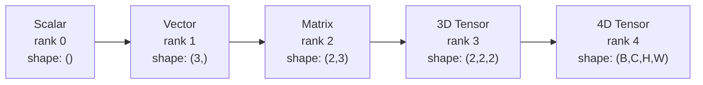
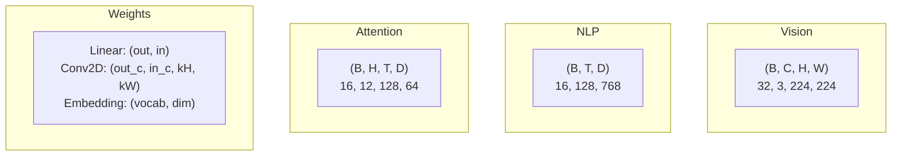
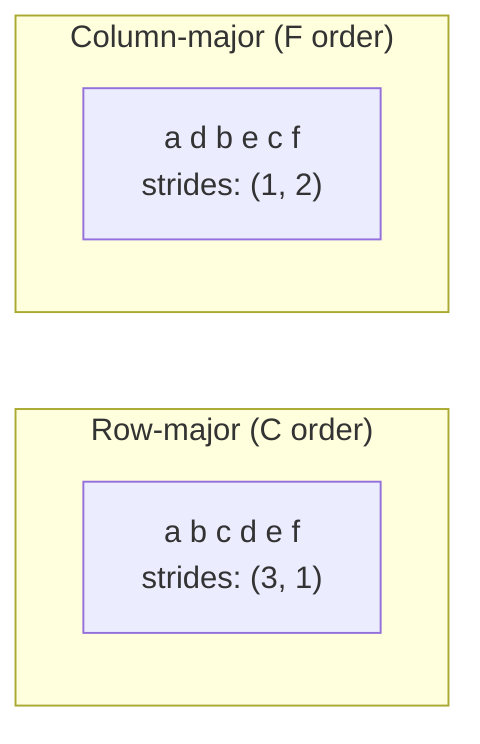
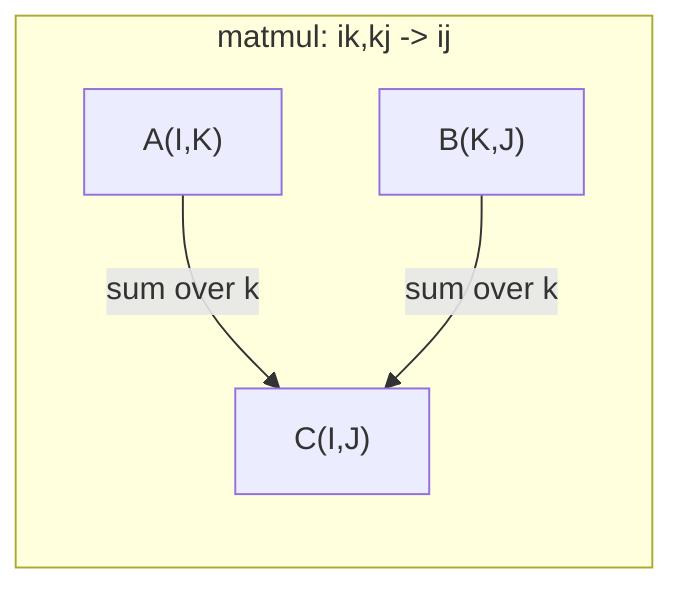

<!-- local-zh-machine-draft: English source is canonical; prose translated automatically, code/math preserved. -->

<a id="tensor-operations"></a>

# Tensor 操作

> Tensors是数据和深度学习之间的通用语言。每一张图片，每一句话，每一个gradient都流经它们。

**类型：** 构建
**语言：** Python
**先决条件：** 第 1 阶段，第 01 课（线性代数直觉）、第 02 课（向量、矩阵和运算）
**时间：** ~90 分钟

<a id="learning-objectives"></a>

## 学习目标

- 从头开始实现具有形状、跨步、重塑、转置和逐元素操作的 tensor 类
- 应用广播规则对不同形状的tensors进行操作，无需复制数据
- 为点积、矩阵乘法、外积和批量运算编写 einsum 表达式
- Trace 多头 attention 每一步的精确 tensor 形状

<a id="the-problem"></a>

## 问题

您构建了一个 transformer。 forward pass 看起来很干净。运行它并得到：`RuntimeError: mat1 and mat2 shapes cannot be multiplied (32x768 and 512x768)`。你盯着形状。你尝试一下转置。现在显示 `Expected 4D input (got 3D input)`。您添加一个解压。其他东西坏了。

形状错误是深度学习代码中最常见的错误。它们在概念上并不难——每个操作都有一个形状契约——但它们繁殖得很快。 transformer 有数十个链接在一起的重塑、转置和广播。一个错误的轴会导致错误级联。更糟糕的是，一些形状错误根本不会引发错误。它们通过沿着错误的维度广播或在错误的轴上求和来默默地产生垃圾。

矩阵处理两组事物之间的成对关系。真实数据不适合二维。一批 32 张 224x224 的 RGB 图像是 4D tensor：`(32, 3, 224, 224)`。 12个头的Self-attention也是4D：`(batch, heads, seq_len, head_dim)`。您需要一个可泛化到任意数量维度的数据结构，并且其操作可以在所有维度上清晰地组合。该结构是 tensor。掌握其操作，形状错误变得可以轻松调试。

<a id="the-concept"></a>

## 概念

<a id="what-a-tensor-is"></a>

### tensor 是什么

tensor 是具有统一数据类型的多维数字数组。维度数为 **rank**（或 **order**）。每个维度都是一个 **axis**。 **shape** 是一个列出沿每个轴的尺寸的元组。



总元素 = 所有大小的乘积。形状 `(2, 3, 4)` 包含 `2 * 3 * 4 = 24` 元素。

<a id="tensor-shapes-in-deep-learning"></a>

### Tensor 深度学习中的形状

按照惯例，不同的数据类型映射到特定的 tensor 形状。



PyTorch 使用 NCHW（通道优先）。 TensorFlow 默认为 NHWC（通道最后）。不匹配的布局会导致无声的速度减慢或错误。

<a id="how-memory-layout-works"></a>

### 内存布局如何工作

内存中的二维数组是一维字节序列。 **Strides** 告诉您要跳过多少个元素才能沿每个轴移动一步。



转置不移动数据。它交换了步幅，使得 tensor ** 不连续 ** ——行的元素在内存中不再相邻。

<a id="broadcasting-rules"></a>

### 播出规则

广播可以让您对不同形状的 tensors 进行操作，而无需复制数据。从右侧对齐形状。当两个维度相等或其中一个维度为 1 时，它们是兼容的。较少的维度会在左侧用 1 填充。

```
Tensor A:     (8, 1, 6, 1)
Tensor B:        (7, 1, 5)
Padded B:     (1, 7, 1, 5)
Result:       (8, 7, 6, 5)
```

<a id="einsum-the-universal-tensor-operation"></a>

### Einsum：通用tensor操作

爱因斯坦求和用字母标记每个轴。输入中的轴而不是输出中的轴被求和。两者中的轴都被保留。



关键模式：`i,i->`（点积）、`i,j->ij`（外积）、`ii->`（trace）、`ij->ji`（转置）、`bij,bjk->bik`（批量） matmul），`bhtd,bhsd->bhts`（attention 分数）。

```figure
tensor-broadcast
```

<a id="build-it"></a>

## 动手实现

该代码位于 `code/tensors.py` 中。每个步骤都引用那里的实现。

<a id="step-1-tensor-storage-and-strides"></a>

### 步骤1：Tensor存储和跨步

tensor 存储数字和形状元数据的平面列表。步幅告诉索引逻辑如何将多维索引映射到平面位置。

```python
class Tensor:
    def __init__(self, data, shape=None):
        if isinstance(data, (list, tuple)):
            self._data, self._shape = self._flatten_nested(data)
        elif isinstance(data, np.ndarray):
            self._data = data.flatten().tolist()
            self._shape = tuple(data.shape)
        else:
            self._data = [data]
            self._shape = ()

        if shape is not None:
            total = reduce(lambda a, b: a * b, shape, 1)
            if total != len(self._data):
                raise ValueError(
                    f"Cannot reshape {len(self._data)} elements into shape {shape}"
                )
            self._shape = tuple(shape)

        self._strides = self._compute_strides(self._shape)

    @staticmethod
    def _compute_strides(shape):
        if len(shape) == 0:
            return ()
        strides = [1] * len(shape)
        for i in range(len(shape) - 2, -1, -1):
            strides[i] = strides[i + 1] * shape[i + 1]
        return tuple(strides)
```

对于形状 `(3, 4)`，步长为 `(4, 1)`——跳过 4 个元素前进一行，跳过 1 个元素前进一列。

<a id="step-2-reshape-squeeze-unsqueeze"></a>

### 第 2 步：重塑、挤压、松开

Reshape 改变形状而不改变元素顺序。元素总数必须保持不变。使用 `-1` 作为一维来推断其大小。

```python
t = Tensor(list(range(12)), shape=(2, 6))
r = t.reshape((3, 4))
r = t.reshape((-1, 3))
```

挤压会移除尺寸为 1 的轴。松开会插入尺寸为 1 的轴。解压缩对于广播至关重要——添加到批次 `(B, T, D)` 的偏置向量 `(D,)` 需要解压缩到 `(1, 1, D)`。

```python
t = Tensor(list(range(6)), shape=(1, 3, 1, 2))
s = t.squeeze()
v = Tensor([1, 2, 3])
u = v.unsqueeze(0)
```

<a id="step-3-transpose-and-permute"></a>

### 步骤 3：转置和排列

转置交换两个轴。 Permute 对所有轴重新排序。这就是 NCHW 和 NHWC 之间的转换方式。

```python
mat = Tensor(list(range(6)), shape=(2, 3))
tr = mat.transpose(0, 1)

t4d = Tensor(list(range(24)), shape=(1, 2, 3, 4))
perm = t4d.permute((0, 2, 3, 1))
```

转置或置换后，tensor 在内存中不连续。在 PyTorch 中，`view` 在非连续 tensors 上失败 - 使用 `reshape` 或首先调用 `.contiguous()`。

<a id="step-4-element-wise-operations-and-reductions"></a>

### 步骤 4：逐元素运算和约简

逐元素运算（加、乘、减）独立应用于每个元素并保留形状。缩减（总和、平均值、最大值）会折叠一个或多个轴。

```python
a = Tensor([[1, 2], [3, 4]])
b = Tensor([[10, 20], [30, 40]])
c = a + b
d = a * 2
s = a.sum(axis=0)
```

CNN 中的全局平均池化：`(B, C, H, W).mean(axis=[2, 3])` 生成 `(B, C)`。 NLP 中的序列均值池化：`(B, T, D).mean(axis=1)` 生成 `(B, D)`。

<a id="step-5-broadcasting-with-numpy"></a>

### 步骤5：使用NumPy进行广播

`tensors.py` 中的 `demo_broadcasting_numpy()` 函数显示了核心模式。

```python
activations = np.random.randn(4, 3)
bias = np.array([0.1, 0.2, 0.3])
result = activations + bias

images = np.random.randn(2, 3, 4, 4)
scale = np.array([0.5, 1.0, 1.5]).reshape(1, 3, 1, 1)
result = images * scale

a = np.array([1, 2, 3]).reshape(-1, 1)
b = np.array([10, 20, 30, 40]).reshape(1, -1)
outer = a * b
```

通过广播的成对距离：将 `(M, 2)` 重塑为 `(M, 1, 2)`，并将 `(N, 2)` 重塑为 `(1, N, 2)`，沿最后一个轴相减、平方、求和，取平方根。结果：`(M, N)`。

<a id="step-6-einsum-operations"></a>

### 步骤 6：Einsum 运算

`demo_einsum()` 和 `demo_einsum_gallery()` 函数遍历每个常见模式。

```python
a = np.array([1.0, 2.0, 3.0])
b = np.array([4.0, 5.0, 6.0])
dot = np.einsum("i,i->", a, b)

A = np.array([[1, 2], [3, 4], [5, 6]], dtype=float)
B = np.array([[7, 8, 9], [10, 11, 12]], dtype=float)
matmul = np.einsum("ik,kj->ij", A, B)

batch_A = np.random.randn(4, 3, 5)
batch_B = np.random.randn(4, 5, 2)
batch_mm = np.einsum("bij,bjk->bik", batch_A, batch_B)
```

收缩的计算成本是所有索引大小（保留并求和）的乘积。对于 B=32、I=128、J=64、K=128 的 `bij,bjk->bik`：`32 * 128 * 64 * 128 = 33,554,432` 乘加。

<a id="step-7-attention-mechanism-via-einsum"></a>

### 步骤7：通过einsum的Attention机制

`demo_attention_einsum()`函数实现了多头attention端到端。

```python
B, H, T, D = 2, 4, 8, 16
E = H * D

X = np.random.randn(B, T, E)
W_q = np.random.randn(E, E) * 0.02

Q = np.einsum("bte,ek->btk", X, W_q)
Q = Q.reshape(B, T, H, D).transpose(0, 2, 1, 3)

scores = np.einsum("bhtd,bhsd->bhts", Q, K) / np.sqrt(D)
weights = softmax(scores, axis=-1)
attn_output = np.einsum("bhts,bhsd->bhtd", weights, V)

concat = attn_output.transpose(0, 2, 1, 3).reshape(B, T, E)
output = np.einsum("bte,ek->btk", concat, W_o)
```

每一步都是 tensor 操作：投影（通过 einsum 进行 matmul）、头部分割（reshape + 转置）、attention 分数（通过 einsum 进行批量 matmul）、加权和（通过 einsum 进行批量 matmul）、头部合并（通过 einsum 进行 matmul）、输出投影（通过 einsum 进行 matmul）。

<a id="use-it"></a>

## 实际应用

<a id="scratch-vs-numpy"></a>

### Scratch 与 NumPy

| 操作 | 划痕（Tensor类） | NumPy |
|---|---|---|
| 创建 | `Tensor([[1,2],[3,4]])` | `np.array([[1,2],[3,4]])` |
| 重塑 | `t.reshape((3,4))` | `a.reshape(3,4)` |
| 转置 | `t.transpose(0,1)` | `a.T` 或 `a.transpose(0,1)` |
| 挤压 | `t.squeeze(0)` | `np.squeeze(a, 0)` |
| 总和 | `t.sum(axis=0)` | `a.sum(axis=0)` |
| 埃因苏姆 | 不适用 | `np.einsum("ij,jk->ik", a, b)` |

<a id="scratch-vs-pytorch"></a>

### 划痕与 PyTorch

```python
import torch

t = torch.tensor([[1, 2, 3], [4, 5, 6]], dtype=torch.float32)
t.shape
t.stride()
t.is_contiguous()

t.reshape(3, 2)
t.unsqueeze(0)
t.transpose(0, 1)
t.transpose(0, 1).contiguous()

torch.einsum("ik,kj->ij", A, B)
```

PyTorch 添加了 autograd、GPU 支持以及优化的 BLAS 内核。形状语义是相同的。如果您了解暂存版本，PyTorch 形状错误将变得可读。

<a id="every-neural-network-layer-as-a-tensor-operation"></a>

### 每个神经网络层作为 tensor 操作

| 操作 | Tensor表格 | 埃因苏姆 |
|---|---|---|
| 线性层 | `Y = X @ W.T + b` | `"bd,od->bo"` + 偏置 |
| Attention QKV | `Q = X @ W_q` | `"btd,dh->bth"` |
| Attention 分数 | `Q @ K.T / sqrt(d)` | `"bhtd,bhsd->bhts"` |
| Attention 输出 | `softmax(scores) @ V` | `"bhts,bhsd->bhtd"` |
| 批量归一化 | `(X - mu) / sigma * gamma` | 逐元素+广播 |
| Softmax | `exp(x) / sum(exp(x))` | 逐元素+归约 |

<a id="ship-it"></a>

## 交付成果

本课产生两个可重复使用的prompts：

1. **`outputs/prompt-tensor-shapes.md`** -- 用于调试 tensor 形状不匹配的系统 prompt。包括每个常见操作的决策表（matmul、broadcast、cat、Linear、Conv2d、BatchNorm、softmax）和修复查找表。

2. **`outputs/prompt-tensor-debugger.md`** -- 当形状错误阻碍您时，将逐步调试 prompt 粘贴到任何 AI 助手中。向其提供错误消息和 tensor 形状，获取准确的修复结果。

<a id="exercises"></a>

## 练习

1. **Easy -- 重塑往返。** 取形状为 `(2, 3, 4)` 的 tensor。将其重新整形为 `(6, 4)`，然后整形为 `(24,)`，然后返回 `(2, 3, 4)`。通过打印平面数据来验证每一步都保留了元素顺序。

2. **Medium -- 实现广播。** 使用 `broadcast_to(shape)` 方法扩展 `Tensor` 类，该方法扩展大小为 1 的维度以匹配目标形状。然后修改`_elementwise_op`为操作前自动广播。使用形状 `(3, 1)` 和 `(1, 4)` 进行测试，生成 `(3, 4)`。

3. **Hard -- 从头开始构建 einsum。** 实现基本的 `einsum(subscripts, *tensors)` 函数，至少处理：点积 (`i,i->`)、矩阵乘法 (`ij,jk->ik`)、外积（`i,j->ij`），并转置（`ij->ji`）。解析下标字符串，识别收缩索引，并循环遍历所有索引组合。将您的结果与 `np.einsum` 进行比较。

4. **Hard -- Attention 形状跟踪器。** 编写一个函数，采用 `batch_size`、`seq_len`、`embed_dim` 和`num_heads` 作为输入，并在多头 attention 的每一步打印精确形状：输入、Q/K/V 投影、头部分割、attention 分数、softmax weights、加权和、头部合并、输出投影。根据 `demo_attention_einsum()` 输出进行验证。

<a id="key-terms"></a>

## 关键术语

| 术语 | 人们怎么说 | 它实际上意味着什么 |
|---|---|---|
| Tensor | “一个矩阵，但有更多维度” | 具有统一类型和定义形状、步长和操作的多维数组 |
| 排名 | “维数” | 轴的数量。矩阵的秩为 2，但秩不等于其矩阵的秩 |
| 形状 | “tensor 的尺寸” | 列出沿每个轴的尺寸的元组。 `(2, 3)`表示2行3列 |
| 跨步 | 《记忆是如何排列的》 | 沿每个轴前进一个位置时要跳过的元素数量 |
| 广播 | “当形状不同时它才起作用” | 一组严格的规则：从右对齐、维度必须相等或其中一个必须为 1 |
| 连续的 | “tensor 正常” | 元素按顺序存储在内存中，没有间隙或从逻辑布局重新排序 |
| 埃因苏姆 | “一种编写 matmul 的奇特方式” | 一种通用符号，表示任何 tensor 收缩、外积、trace 或一行中的转置 |
| 查看 | “与重塑相同” | tensor 共享相同的内存缓冲区，但具有不同的形状/步幅元数据。对非连续数据失败 |
| 收缩 | “对索引求和” | tensors 之间的共享索引相乘并求和的一般操作，产生较低等级的结果 |
| 国家卫生委员会 / 国家卫生委员会 | “PyTorch 与 TensorFlow 格式” | 图像 tensors 的内存布局约定。 NCHW 将通道置于空间暗淡之前，NHWC 将通道置于空间暗淡之后 |

<a id="further-reading"></a>

## 进一步阅读

- [NumPy Broadcasting](https://numpy.org/doc/stable/user/basics.broadcasting.html) -- 带有可视化示例的规范规则
- [PyTorch Tensor 视图](https://pytorch.org/docs/stable/tensor_view.html) -- 视图何时工作以及何时复制
- [einops](https://github.com/arogozhnikov/einops) -- 使 tensor 重塑可读且安全的库
- [插图Transformer](https://jalammar.github.io/illustrated-transformer/) -- 可视化流经attention的tensor形状
- [Einstein NumPy](https://numpy.org/doc/stable/reference/generated/numpy.einsum.html) 中的求和 -- 带有示例的完整 einsum 文档
