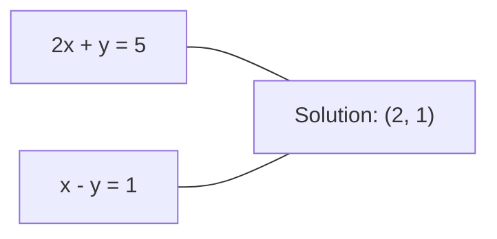
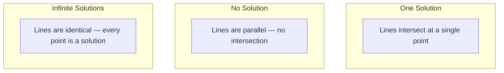

<!-- local-zh-machine-draft: English source is canonical; prose translated automatically, code/math preserved. -->

<a id="linear-systems"></a>

# 线性系统

> 求解 Ax = b 是神经网络中最古老的数学问题。

**类型：** 构建
**语言：** Python
**先决条件：** 第 1 阶段，第 01 课（线性代数直觉）、02（向量和矩阵）、03（矩阵变换）
**时间：** ~120 分钟

<a id="learning-objectives"></a>

## 学习目标

- 使用高斯消去法以及部分旋转和反向替换来求解 Ax = b
- 使用 LU、QR 和 Cholesky 分解对矩阵进行因子分解，并解释每种分解何时适用
- 导出最小二乘法的正规方程并将其连接到线性回归和岭回归
- 使用条件数诊断病态系统并应用正则化来稳定它们

<a id="the-problem"></a>

## 问题

每次训练线性回归时，您都会求解线性系统。每次计算最小二乘拟合时，您都会求解线性系统。每次神经网络层计算 `y = Wx + b` 时，它都会评估线性系统的一侧。当您添加正则化时，您就修改了系统。当您使用高斯过程时，您会分解一个矩阵。当您反转马哈拉诺比斯距离的协方差矩阵时，您可以求解线性系统。

方程 Ax = b 随处可见。 A 是已知系数的矩阵。 b 是已知输出的向量。 x 是您要查找的未知数向量。在线性回归中，A 是数据矩阵，b 是目标向量，x 是 weight 向量。整个模型简化为：找到x使得Ax尽可能接近b。

本课程从头开始构建了求解该方程的所有主要方法。您将理解为什么有些方法快速而另一些方法稳定，为什么有些方法仅适用于平方系统而其他方法处理超定系统，以及为什么矩阵的条件数决定您的答案是否有意义。

<a id="the-concept"></a>

## 概念

<a id="what-ax--b-means-geometrically"></a>

### Ax = b 的几何意义

线性方程组具有几何解释。每个方程定义一个超平面。解是所有超平面相交的点（或点集）。

```
2x + y = 5          Two lines in 2D.
x - y  = 1          They intersect at x=2, y=1.
```



可能会发生三件事：



在矩阵形式中，“一个解”意味着 A 是可逆的。 “无解”意味着系统不一致。 “无限解”意味着 A 具有零空间。大多数机器学习问题属于“无精确解”类别，因为方程（数据点）多于未知数 (parameters)。这就是最小二乘法的用武之地。

<a id="column-picture-vs-row-picture"></a>

### 列图与行图

Ax = b 有两种读法。

**Row 图片。** A 的每一行定义一个方程。每个方程都是一个超平面。解决方案就是它们的交叉点。

**列图。** A的每一列都是一个向量。问题是：A 的列的什么线性组合会产生 b？

```
A = | 2  1 |    b = | 5 |
    | 1 -1 |        | 1 |

Row picture: solve 2x + y = 5 and x - y = 1 simultaneously.

Column picture: find x1, x2 such that:
  x1 * [2, 1] + x2 * [1, -1] = [5, 1]
  2 * [2, 1] + 1 * [1, -1] = [4+1, 2-1] = [5, 1]   check.
```

专栏图片更为基础。如果b位于A的列空间中，则系统有解。如果 b 不存在，则在列空间中找到最近的点。最接近的点就是最小二乘解。

<a id="gaussian-elimination"></a>

### 高斯消去法

高斯消去法将 Ax = b 转换为上三角方程组 Ux = c，您可以通过回代来求解。这是最直接的方法。

算法：

```
1. For each column k (the pivot column):
   a. Find the largest entry in column k at or below row k (partial pivoting).
   b. Swap that row with row k.
   c. For each row i below k:
      - Compute multiplier m = A[i][k] / A[k][k]
      - Subtract m times row k from row i.
2. Back substitute: solve from the last equation upward.
```

示例：

```
Original:
| 2  1  1 | 8 |       R2 = R2 - (2)R1     | 2  1   1 |  8 |
| 4  3  3 |20 |  -->  R3 = R3 - (1)R1 --> | 0  1   1 |  4 |
| 2  3  1 |12 |                            | 0  2   0 |  4 |

                       R3 = R3 - (2)R2     | 2  1   1 |  8 |
                                       --> | 0  1   1 |  4 |
                                           | 0  0  -2 | -4 |

Back substitute:
  -2 * x3 = -4    -->  x3 = 2
  x2 + 2  = 4     -->  x2 = 2
  2*x1 + 2 + 2 = 8 --> x1 = 2
```

高斯消元法的运算成本为 O(n^3)。对于 1000x1000 系统，这大约是十亿次浮点运算。速度很快，但如果您需要使用相同的 A 求解多个系统，您可以做得更好。

<a id="partial-pivoting-why-it-matters"></a>

### 部分旋转：为什么重要

如果没有旋转，高斯消除可能会失败或产生垃圾。如果主元元素为零，则除以零。如果它很小，则会放大舍入误差。

```
Bad pivot:                       With partial pivoting:
| 0.001  1 | 1.001 |            Swap rows first:
| 1      1 | 2     |            | 1      1 | 2     |
                                 | 0.001  1 | 1.001 |
m = 1/0.001 = 1000              m = 0.001/1 = 0.001
R2 = R2 - 1000*R1               R2 = R2 - 0.001*R1
| 0.001  1     | 1.001   |      | 1      1     | 2     |
| 0     -999   | -999.0  |      | 0      0.999 | 0.999 |

x2 = 1.000 (correct)            x2 = 1.000 (correct)
x1 = (1.001 - 1)/0.001          x1 = (2 - 1)/1 = 1.000 (correct)
   = 0.001/0.001 = 1.000        Stable because the multiplier is small.
```

在精度有限的浮点运算中，未旋转的版本可能会丢失有效数字。部分枢轴总是选择最大的可用枢轴以最小化误差放大。

<a id="lu-decomposition"></a>

### LU分解

LU 分解将 A 分解为下三角矩阵 L 和上三角矩阵 U：A = LU。 L 矩阵存储高斯消元法的乘数。 U矩阵是消除的结果。

```
A = L @ U

| 2  1  1 |   | 1  0  0 |   | 2  1   1 |
| 4  3  3 | = | 2  1  0 | @ | 0  1   1 |
| 2  3  1 |   | 1  2  1 |   | 0  0  -2 |
```

为什么要分解而不是仅仅消除？因为一旦有了 L 和 U，针对任何新的 b 求解 Ax = b 的成本仅为 O(n^2)：

```
Ax = b
LUx = b
Let y = Ux:
  Ly = b    (forward substitution, O(n^2))
  Ux = y    (back substitution, O(n^2))
```

O(n^3) 成本在分解过程中支付一次。随后的每个求解都是 O(n^2)。如果您需要求解 1000 个具有相同 A 但不同 b 向量的系统，LU 可节省总工作量 1000/3。

通过部分旋转，您可以得到 PA = LU，其中 P 是记录行交换的置换矩阵。

<a id="qr-decomposition"></a>

### QR分解

QR 分解将 A 分解为正交矩阵 Q 和上三角矩阵 R：A = QR。

正交矩阵具有 Q^T Q = I 的属性。它的列是正交向量。乘以 Q 保留长度和角度。

```
A = Q @ R

Q has orthonormal columns: Q^T Q = I
R is upper triangular

To solve Ax = b:
  QRx = b
  Rx = Q^T b    (just multiply by Q^T, no inversion needed)
  Back substitute to get x.
```

在解决最小二乘问题时，QR 在数值上比 LU 更稳定。 Gram-Schmidt 过程逐列构建 Q：

```
Given columns a1, a2, ... of A:

q1 = a1 / ||a1||

q2 = a2 - (a2 . q1) * q1        (subtract projection onto q1)
q2 = q2 / ||q2||                (normalize)

q3 = a3 - (a3 . q1) * q1 - (a3 . q2) * q2
q3 = q3 / ||q3||

R[i][j] = qi . aj    for i <= j
```

每一步都会删除沿所有先前 q 向量的分量，仅留下新的正交方向。

<a id="cholesky-decomposition"></a>

### 乔列斯基分解

当 A 是对称 (A = A^T) 且正定（所有 eigenvalues 为正）时，您可以将其分解为 A = L L^T，其中 L 是下三角。这就是 Cholesky 分解。

```
A = L @ L^T

| 4  2 |   | 2  0 |   | 2  1 |
| 2  5 | = | 1  2 | @ | 0  2 |

L[i][i] = sqrt(A[i][i] - sum(L[i][k]^2 for k < i))
L[i][j] = (A[i][j] - sum(L[i][k]*L[j][k] for k < j)) / L[j][j]    for i > j
```

Cholesky 的速度是 LU 的两倍，并且需要一半的存储空间。它仅适用于对称正定矩阵，但这些矩阵不断出现：

- 协方差矩阵是对称正半定矩阵（带正则化的正定矩阵）。
- 高斯过程中的核矩阵是对称正定的。
- 凸函数的 Hessian 至少是对称正定的。
- A^T A 始终是对称正半定的。

在高斯过程中，您可以使用 Cholesky 对核矩阵 K 进行因式分解，然后求解 K alpha = y 以获得预测平均值。 Cholesky 因子还为您提供边际似然的对数行列式：log det(K) = 2 * sum(log(diag(L)))。

<a id="least-squares-when-ax--b-has-no-exact-solution"></a>

### 最小二乘：当 Ax = b 时无精确解

如果 A 为 m x n，且 m > n（方程多于未知数），则系统是超定的。没有确切的解决方案。相反，您可以最小化平方误差：

```
minimize ||Ax - b||^2

This is the sum of squared residuals:
  sum((A[i,:] @ x - b[i])^2 for i in range(m))
```

最小化器满足正规方程：

```
A^T A x = A^T b
```

推导：展开 ||斧头-b||^2 = (Ax - b)^T (Ax - b) = x^T A^T A x - 2 x^T A^T b + b^T b。取关于 x 的 gradient，将其设置为零：2 A^T A x - 2 A^T b = 0。

```
Original system (overdetermined, 4 equations, 2 unknowns):
| 1  1 |         | 3 |
| 1  2 | x     = | 5 |       No exact x satisfies all 4 equations.
| 1  3 |         | 6 |
| 1  4 |         | 8 |

Normal equations:
A^T A = | 4  10 |    A^T b = | 22 |
        | 10 30 |            | 63 |

Solve: x = [1.5, 1.7]

This is linear regression. x[0] is the intercept, x[1] is the slope.
```

<a id="normal-equations--linear-regression"></a>

### 正规方程 = 线性回归

连接是准确的。在线性回归中，数据矩阵 X 每个样本一行，每个 feature 一列。您的目标向量 y 每个样本有一个条目。 weight向量w满足：

```
X^T X w = X^T y
w = (X^T X)^(-1) X^T y
```

这是线性回归的封闭式解。每次调用 `sklearn.linear_model.LinearRegression.fit()` 都会计算此值（或通过 QR 或 SVD 进行等效计算）。

将正则化项 lambda * I 添加到矩阵中，即可得到岭回归：

```
(X^T X + lambda * I) w = X^T y
w = (X^T X + lambda * I)^(-1) X^T y
```

正则化使矩阵得到更好的调节（更容易精确求逆），并通过将 weights 缩小为零来防止 overfitting。当 lambda > 0 时，矩阵 X^T X + lambda * I 始终是对称正定的，因此可以使用 Cholesky 来求解。

<a id="pseudoinverse-moore-penrose"></a>

### 伪逆（Moore-Penrose）

伪逆 A+ 将矩阵求逆推广到非方阵和奇异矩阵。对于任意矩阵 A：

```
x = A+ b

where A+ = V Sigma+ U^T    (computed via SVD)
```

Sigma+ 是通过取每个非零奇异值的倒数并将结果转置而形成的。如果 A = U Sigma V^T，则 A+ = V Sigma+ U^T。

```
A = U Sigma V^T        (SVD)

Sigma = | 5  0 |       Sigma+ = | 1/5  0  0 |
        | 0  2 |                | 0  1/2  0 |
        | 0  0 |

A+ = V Sigma+ U^T
```

伪逆给出最小范数最小二乘解。如果系统有：
- 一种解决方案：A+b 给出。
- 无解：A+b 给出最小二乘解。
- 无限解：A+b 给出最小的一个 ||x||.

NumPy的`np.linalg.lstsq`和`np.linalg.pinv`内部都使用了SVD。

<a id="condition-number"></a>

### 条件号

条件数衡量解决方案对输入的微小变化的敏感程度。对于矩阵 A，条件数为：

```
kappa(A) = ||A|| * ||A^(-1)|| = sigma_max / sigma_min
```

其中 sigma_max 和 sigma_min 是最大和最小奇异值。

```
Well-conditioned (kappa ~ 1):        Ill-conditioned (kappa ~ 10^15):
Small change in b -->                Small change in b -->
small change in x                    huge change in x

| 2  0 |   kappa = 2/1 = 2          | 1   1          |   kappa ~ 10^15
| 0  1 |   safe to solve            | 1   1+10^(-15) |   solution is garbage
```

经验法则：
- kappa < 100：安全，溶液准确。
- kappa ~ 10^k：浮点运算会损失大约 k 位精度。
- kappa ~ 10^16（对于 float64）：该解没有意义。该矩阵实际上是奇异的。

在 ML 中，当 features 几乎共线时，就会发生病态条件。正则化（添加 lambda * I）将条件数从 sigma_max / sigma_min 改进为 (sigma_max + lambda) / (sigma_min +拉姆达）。

<a id="iterative-methods-conjugate-gradient"></a>

### 迭代方法：共轭gradient

对于非常大的稀疏系统（数百万个未知数），像 LU 或 Cholesky 这样的直接方法过于昂贵。迭代方法通过改进多次迭代的猜测来近似解决方案。

当 A 是对称正定时，共轭 gradient (CG) 求解 Ax = b。它在最多 n 次迭代中找到精确解（以精确算术形式），但如果 A 的 eigenvalues 聚类，则通常收敛得更快。

```
Algorithm sketch:
  x0 = initial guess (often zero)
  r0 = b - A x0           (residual)
  p0 = r0                 (search direction)

  For k = 0, 1, 2, ...:
    alpha = (rk . rk) / (pk . A pk)
    x_{k+1} = xk + alpha * pk
    r_{k+1} = rk - alpha * A pk
    beta = (r_{k+1} . r_{k+1}) / (rk . rk)
    p_{k+1} = r_{k+1} + beta * pk
    if ||r_{k+1}|| < tolerance: stop
```

CG 用于：
- 大规模优化（Newton-CG方法）
- 求解 PDE 离散化
- 核矩阵太大而无法分解的核方法
- 其他迭代求解器的预处理

收敛速度取决于条件数。条件越好的系统收敛得越快，这是正则化有帮助的另一个原因。

<a id="the-full-picture-which-method-when"></a>

### 全图：什么时候使用哪种方法

| 方法 | 要求 | 成本 | 应用场景 |
|--------|-------------|------|----------|
| 高斯消去法 | 正方形，非奇异 A | O(n^3) | 平方系统的一次性求解 |
| LU分解 | 正方形，非奇异 A | O(n^3) 因子 + O(n^2) 求解 | 使用相同的 A 进行多次求解 |
| QR分解 | 任意 A (m >= n) | O(mn^2) | 最小二乘法，数值稳定 |
| 乔列斯基 | 对称正定 A | O(n^3/3) | 协方差矩阵、高斯过程、岭回归 |
| 正规方程 | 超定 (m > n) | O(mn^2 + n^3) | 线性回归（小n） |
| SVD / 伪逆 | 任意A | O(mn^2) | 秩亏系统、最小范数解 |
| 共轭 gradient | 对称正定、稀疏 A | O(n * k * nnz) | 大型稀疏系统，k = 迭代次数 |

<a id="connection-to-ml"></a>

### 连接机器学习

本课程中的每个方法都出现在生产 ML 中：

**线性回归。** 闭式解求解正规方程 X^T X w = X^T y。这是通过 Cholesky（如果 n 很小）或 QR（如果数值稳定性很重要）或 SVD（如果矩阵可能缺乏秩）来完成的。

**Ridge回归。** 将 lambda * I 添加到 X^T X。正则化系统 (X^T X + lambda * I) w = X^T y 始终可通过 Cholesky 求解，因为 X^T X + lambda * I 是 lambda > 0 的对称正定。

**高斯过程。** 预测平均值需要求解 K alpha = y，其中 K 是核矩阵。 K 的乔列斯基分解是标准方法。对数边际似然使用 log det(K) = 2 sum(log(diag(L)))。

**神经网络初始化。** 正交初始化使用 QR 分解来创建 weight 矩阵，其列是正交的。这可以防止深层网络中的信号崩溃。

**Preconditioning.** 大规模 optimizers 使用不完全 Cholesky 或不完全 LU 作为共轭 gradient 求解器的预处理器。

**Feature Engineering.** X^T X 的条件数告诉您 features 是否共线。如果 kappa 很大，则删除 features 或添加正则化。

```figure
linear-system-conditioning
```

<a id="build-it"></a>

## 动手实现

<a id="step-1-gaussian-elimination-with-partial-pivoting"></a>

### 步骤 1：部分旋转的高斯消除

```python
import numpy as np

def gaussian_elimination(A, b):
    n = len(b)
    Ab = np.hstack([A.astype(float), b.reshape(-1, 1).astype(float)])

    for k in range(n):
        max_row = k + np.argmax(np.abs(Ab[k:, k]))
        Ab[[k, max_row]] = Ab[[max_row, k]]

        if abs(Ab[k, k]) < 1e-12:
            raise ValueError(f"Matrix is singular or nearly singular at pivot {k}")

        for i in range(k + 1, n):
            m = Ab[i, k] / Ab[k, k]
            Ab[i, k:] -= m * Ab[k, k:]

    x = np.zeros(n)
    for i in range(n - 1, -1, -1):
        x[i] = (Ab[i, -1] - Ab[i, i+1:n] @ x[i+1:n]) / Ab[i, i]

    return x
```

<a id="step-2-lu-decomposition"></a>

### 步骤2：LU分解

```python
def lu_decompose(A):
    n = A.shape[0]
    L = np.eye(n)
    U = A.astype(float).copy()
    P = np.eye(n)

    for k in range(n):
        max_row = k + np.argmax(np.abs(U[k:, k]))
        if max_row != k:
            U[[k, max_row]] = U[[max_row, k]]
            P[[k, max_row]] = P[[max_row, k]]
            if k > 0:
                L[[k, max_row], :k] = L[[max_row, k], :k]

        for i in range(k + 1, n):
            L[i, k] = U[i, k] / U[k, k]
            U[i, k:] -= L[i, k] * U[k, k:]

    return P, L, U

def lu_solve(P, L, U, b):
    n = len(b)
    Pb = P @ b.astype(float)

    y = np.zeros(n)
    for i in range(n):
        y[i] = Pb[i] - L[i, :i] @ y[:i]

    x = np.zeros(n)
    for i in range(n - 1, -1, -1):
        x[i] = (y[i] - U[i, i+1:] @ x[i+1:]) / U[i, i]

    return x
```

<a id="step-3-cholesky-decomposition"></a>

### 步骤 3：Cholesky 分解

```python
def cholesky(A):
    n = A.shape[0]
    L = np.zeros_like(A, dtype=float)

    for i in range(n):
        for j in range(i + 1):
            s = A[i, j] - L[i, :j] @ L[j, :j]
            if i == j:
                if s <= 0:
                    raise ValueError("Matrix is not positive definite")
                L[i, j] = np.sqrt(s)
            else:
                L[i, j] = s / L[j, j]

    return L
```

<a id="step-4-least-squares-via-normal-equations"></a>

### 第 4 步：通过正规方程求最小二乘法

```python
def least_squares_normal(A, b):
    AtA = A.T @ A
    Atb = A.T @ b
    return gaussian_elimination(AtA, Atb)

def ridge_regression(A, b, lam):
    n = A.shape[1]
    AtA = A.T @ A + lam * np.eye(n)
    Atb = A.T @ b
    L = cholesky(AtA)
    y = np.zeros(n)
    for i in range(n):
        y[i] = (Atb[i] - L[i, :i] @ y[:i]) / L[i, i]
    x = np.zeros(n)
    for i in range(n - 1, -1, -1):
        x[i] = (y[i] - L.T[i, i+1:] @ x[i+1:]) / L.T[i, i]
    return x
```

<a id="step-5-condition-number"></a>

### 第5步：条件编号

```python
def condition_number(A):
    U, S, Vt = np.linalg.svd(A)
    return S[0] / S[-1]
```

<a id="use-it"></a>

## 实际应用

将这些部分放在一起，对真实数据进行线性回归和岭回归：

```python
np.random.seed(42)
X_raw = np.random.randn(100, 3)
w_true = np.array([2.0, -1.0, 0.5])
y = X_raw @ w_true + np.random.randn(100) * 0.1

X = np.column_stack([np.ones(100), X_raw])

w_ols = least_squares_normal(X, y)
print(f"OLS weights (ours):    {w_ols}")

w_np = np.linalg.lstsq(X, y, rcond=None)[0]
print(f"OLS weights (numpy):   {w_np}")
print(f"Max difference: {np.max(np.abs(w_ols - w_np)):.2e}")

w_ridge = ridge_regression(X, y, lam=1.0)
print(f"Ridge weights (ours):  {w_ridge}")

from sklearn.linear_model import Ridge
ridge_sk = Ridge(alpha=1.0, fit_intercept=False)
ridge_sk.fit(X, y)
print(f"Ridge weights (sklearn): {ridge_sk.coef_}")
```

<a id="ship-it"></a>

## 交付成果

本课产生：
- `code/linear_systems.py` 包含高斯消除、LU 分解、Cholesky 分解、最小二乘和岭回归的从头实现
- 正常方程和 sklearn 的 LinearRegression 产生相同的 weights 的工作演示

<a id="exercises"></a>

## 练习

1. 使用高斯消元法、LU 求解器和 `np.linalg.solve` 求解系统 `[[1,2,3],[4,5,6],[7,8,10]] x = [6, 15, 27]`。验证所有三个在浮点容差范围内给出相同的答案。

2. 生成 50x5 随机矩阵 X 和目标 y = X @ w_true + 噪声。使用正规方程、QR（通过 `np.linalg.qr`）、SVD（通过 `np.linalg.svd`）和 `np.linalg.lstsq` 求解 w。比较所有四种解决方案。测量 X^T X 的条件数并解释它如何影响您信任的方法。

3. 通过使两列几乎相同来创建几乎奇异的矩阵（例如，第 2 列 = 第 1 列 + 1e-10 * 噪声）。计算其条件数。使用和不使用正则化求解 Ax = b（添加 0.01 * I）。比较解和残差。解释为什么正则化有帮助。

4. 为 100x100 随机对称正定矩阵实现共轭 gradient 算法。计算需要多少次迭代才能收敛到容差 1e-8。与 n 次迭代的理论最大值进行比较。

5. 在大小为 10、50、200、500 的对称正定矩阵上对 Cholesky 求解器、LU 求解器与 `np.linalg.solve` 进行计时。绘制结果。验证 Cholesky 大约比 LU 快 2 倍。

<a id="key-terms"></a>

## 关键术语

| 术语 | 人们怎么说 | 它实际上意味着什么 |
|------|----------------|----------------------|
| 线性系统 | “解出x” | 一组线性方程 Ax = b。找到 x 意味着找到在变换 A 下产生输出 b 的输入。 |
| 高斯消去法 | “行减少” | 使用行运算系统地将对角线以下的条目归零，生成可通过回代替换解决的上三角系统。 O(n^3)。 |
| 部分旋转 | “交换行以保持稳定” | 在消除第 k 列之前，将该列中绝对值最大的行交换到枢轴位置。防止被小数除法。 |
| LU分解 | “因式分解为三角形” | 写入 A = LU，其中 L 是下三角（存储乘数），U 是上三角（消除矩阵）。分摊多个求解的 O(n^3) 成本。 |
| QR分解 | “正交因式分解” | 写 A = QR，其中 Q 具有正交列，R 是上三角。对于最小二乘法，比 LU 更稳定。 |
| 乔列斯基分解 | “矩阵的平方根” | 对于对称正定 A，写为 A = LL^T。 LU的一半费用。用于协方差矩阵、核矩阵和岭回归。 |
| 最小二乘法 | “当精确不可能时，最好的选择” | 最小化残差平方和 ||斧头-b||^2 当系统超定时（方程多于未知数）。 |
| 正规方程 | “微积分捷径” | A^T A x = A^T b.设置gradient ||斧头-b||^2 为零。这是线性回归的封闭式解。 |
| 伪逆 | “非方阵的求逆” | A+ = V Sigma+ U^T 通过 SVD。给出任何矩阵（正方形或矩形，奇异或非奇异）的最小范数最小二乘解。 |
| 条件号 | “这个答案有多可信” | kappa = sigma_max / sigma_min。测量对输入扰动的敏感度。损失大约 log10(kappa) 位精度。 |
| 岭回归 | “正则化最小二乘法” | 求解 (X^T X + lambda I) w = X^T y。添加 lambda I 可以改善调节并将 weights 缩小到零。防止 overfitting。 |
| 共轭 gradient | “对于大矩阵，迭代 Ax=b” | 对称正定系统的迭代求解器。最多n步收敛。对于分解成本太高的大型稀疏系统非常实用。 |
| 超定系统 | “比 parameters 更多的数据” | 在 m×n 系统中，m > n。不存在精确的解决方案。最小二乘法找到最佳近似值。这就是每个回归问题。 |
| 回替 | “自下而上解决” | 给定一个上三角系统，首先求解最后一个方程，然后向后代入。 O(n^2)。 |
| 正向替代 | “自上而下解决” | 给定一个下三角系统，首先求解第一个方程，然后向前代入。 O(n^2)。用于 LU 求解的 L 步骤。 |

<a id="further-reading"></a>

## 进一步阅读

- [MIT 18.06：线性代数](https://ocw.mit.edu/courses/18-06-linear-algebra-spring-2010/)（吉尔伯特·斯特朗）——线性系统和矩阵分解的权威课程
- [数值线性代数](https://people.maths.ox.ac.uk/trefethen/text.html) (Trefethen & Bau)——理解数值稳定性、调节以及算法失败原因的标准参考
- [Matrix Computations](https://www.press.jhu.edu/books/title/10678/matrix-computations) (Golub & Van Loan) -- 每个矩阵算法的百科全书参考
- [3Blue1Brown：逆矩阵](https://www.3blue1brown.com/lessons/inverse-matrices)——求解 Ax = b 的几何意义的视觉直觉
