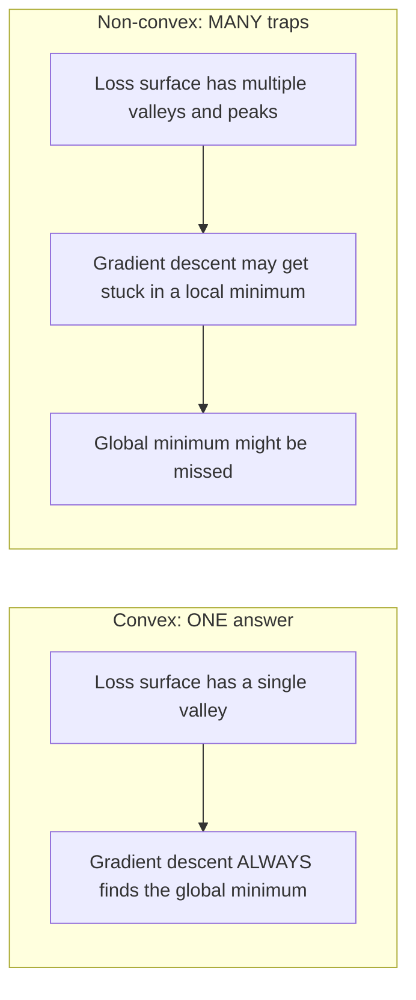
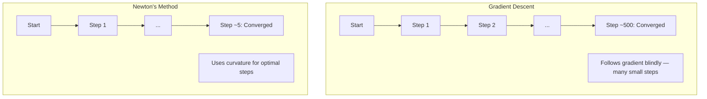
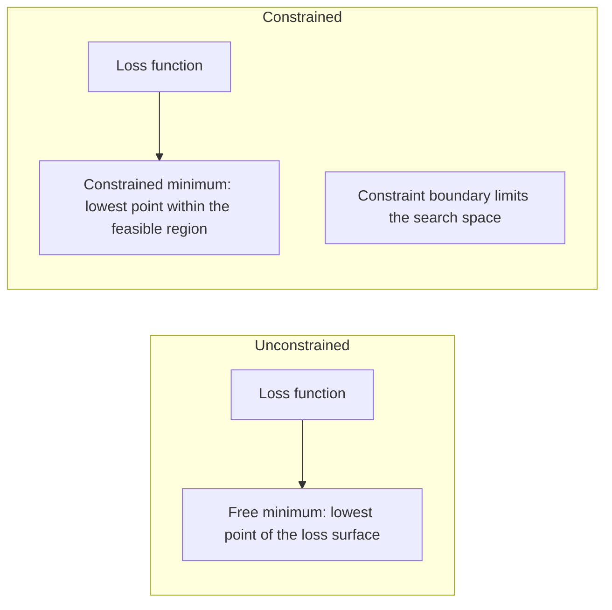
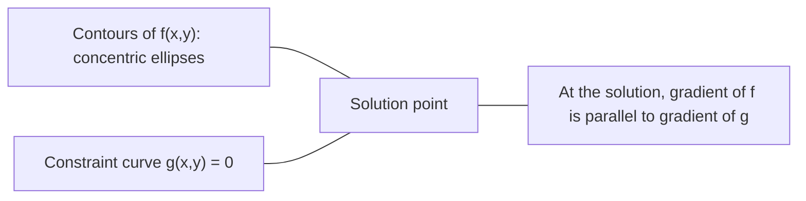

<!-- local-zh-machine-draft: English source is canonical; prose translated automatically, code/math preserved. -->

<a id="convex-optimization"></a>

# 凸优化

> 凸问题有一个谷。神经网络有数百万个。了解差异很重要。

**类型：** 构建
**语言：** Python
**先决条件：** 第 1 阶段，第 04 课（ML 微积分）、08（优化）
**时间：** ~90 分钟

<a id="learning-objectives"></a>

## 学习目标

- 使用定义、二阶导数和 Hessian 条件测试函数是否凸
- 实现牛顿法并将其二次收敛性与 gradient descent 进行比较
- 使用拉格朗日乘子解决约束优化问题并解释 KKT 条件
- 解释为什么神经网络损失情况是非凸的，但 SGD 仍然能找到好的解决方案

<a id="the-problem"></a>

## 问题

第08课教了你gradient descent、动量和Adam。这些 optimizers 在任何表面上都可以下坡。但它们并没有任何保证。非凸景观上的 Gradient descent 可能会落在糟糕的局部最小值处，卡在鞍点上，或者永远振荡。无论如何你都使用了它，因为神经网络是非凸的并且没有其他选择。

但机器学习中的许多问题都是凸的。线性回归、逻辑回归、SVM、LASSO、岭回归。对于这些，存在更强大的东西：具有数学保证的优化。凸问题只有一个谷。任何走下坡路的算法都会达到全局最小值。无需重新启动。没有 learning rate schedules。没有祈祷。

理解凸性可以做三件事。首先，它告诉您问题何时容易（凸）与困难（非凸）。其次，它为您提供了更快的工具，例如解决凸问题的牛顿法。第三，它解释了整个 ML 中出现的概念：作为约束的正则化、SVM 中的对偶性，以及为什么深度学习尽管违反了凸性所提供的每一个良好属性，仍然有效。

<a id="the-concept"></a>

## 概念

<a id="convex-sets"></a>

### 凸集

如果对于 S 中的任意两点，它们之间的线段也完全位于 S 中，则集合 S 是凸的。

| 凸集 | 不凸 |
|---|---|
| **矩形**：内部任意两点可以通过留在内部的线段连接 | **星/月形状**：两个内点之间的线可以穿过集合之外 |
| **Triangle**：相同的属性适用于所有内部点 | **Donut/annulus**：该孔表示某些线段离开集合 |
| 任意两点之间的线段保持在集合内 | 某些点对之间的线段退出集合 |

正式测试：对于S中的任意点x、y和[0、1]中的任意t，点tx + (1-t)y也在S中。

凸集的例子：
- 一条线，一个平面，R^n 的全部
- 球（圆、球体、超球体）
- 半空间：{x : a^T x <= b}
- 任意数量的凸集的交集

非凸集的示例：
- 甜甜圈（环形）
- 两个不相交圆的并集
- 任何带有“凹痕”或“孔”的套件

<a id="convex-functions"></a>

### 凸函数

如果函数 f 的定义域是凸集，并且对于其定义域中的任意两点 x、y 以及 [0、1] 中的任意 t，则函数 f 是凸函数：

```
f(tx + (1-t)y) <= t*f(x) + (1-t)*f(y)
```

几何上：图形上任意两点之间的线段位于图形上方或图形上。

| 财产 | 凸函数 | 非凸函数 |
|---|---|---|
| **线段测试** | 图表上任意两点之间的直线位于 ** 上方或 ** 曲线上 | 图表上某些点之间的线下降 ** 低于 ** 曲线 |
| **形状** | 单碗/谷向上弯曲 | 具有混合曲率的多个峰和谷 |
| **局部最小值** | 每个局部最小值都是全局最小值 | 不同高度可能存在多个局部最小值 |

常见的凸函数：
- f(x) = x^2（抛物线）
- f(x) = |x| （绝对值）
- f(x) = e^x（指数）
- f(x) = max(0, x) （ReLU，虽然分段线性）
- f(x) = -log(x) 对于 x > 0（负对数）
- 任何线性函数 f(x) = a^T x + b （凸函数和凹函数）

<a id="testing-for-convexity"></a>

### 凸性测试

三个实际测试，从最简单到最严格。

** 测试 1：二阶导数测试 (1D)。** 如果对于所有 x，f''(x) >= 0，则 f 是凸的。

- f(x) = x^2: f''(x) = 2 >= 0。凸。
- f(x) = x^3: f''(x) = 6x。 x < 0 为负。非凸。
- f(x) = e^x: f''(x) = e^x > 0。凸。

**测试 2：Hessian 测试（多变量）。** 如果 Hessian 矩阵 H(x) 对于所有 x 都是半正定的，则 f 是凸的。 Hessian 是二阶偏导数矩阵。

**测试3：定义测试。** 直接检查不等式f(tx + (1-t)y) <= t*f(x) + (1-t)*f(y)。对于导数难以计算的函数很有用。

<a id="why-convexity-matters"></a>

### 为什么凸性很重要

凸优化中心定理：

**对于凸函数，每个局部最小值都是全局最小值。**

这意味着gradient descent不会被困住。任何下坡路都会得出相同的答案。保证算法收敛到最优解。



后果：
- 无需随机重启
- 无需复杂 learning rate schedules
- 可以进行收敛证明（速率取决于函数属性）
- 解决方案是唯一的（直到平坦区域）

<a id="convex-vs-non-convex-in-ml"></a>

### 机器学习中的凸与非凸

| 问题 | 凸？ | 为什么 |
|---------|---------|-----|
| 线性回归（MSE） | 是的 | weights 中损失是二次方 |
| 逻辑回归 | 是的 | weights 中的对数损失是凸的 |
| SVM（铰链损失） | 是的 | 线性函数的最大值 |
| LASSO（L1 回归） | 是的 | 凸函数之和是凸函数 |
| 岭回归 (L2) | 是的 | 二次+二次=凸 |
| 神经网络（任何损失） | 否 | 非线性激活创建非凸景观 |
| k-均值聚类 | 否 | 离散分配步骤 |
| 矩阵分解 | 否 | 未知数的乘积 |

具有凸损失的线性模型是凸的。当您添加具有非线性激活的隐藏层时，凸性就会破裂。

<a id="the-hessian-matrix"></a>

### Hessian 矩阵

函数 f: R^n -> R 的 Hessian H 是二阶偏导数的 n x n 矩阵。

```
H[i][j] = d^2 f / (dx_i dx_j)
```

对于 f(x, y) = x^2 + 3xy + y^2：

```
df/dx = 2x + 3y       d^2f/dx^2 = 2      d^2f/dxdy = 3
df/dy = 3x + 2y       d^2f/dydx = 3      d^2f/dy^2 = 2

H = [ 2  3 ]
    [ 3  2 ]
```

Hessian 告诉您有关曲率的信息：
- Eigenvalues 均为正：函数在各个方向向上弯曲（在该点为凸）
- Eigenvalues 全部为负：在每个方向上向下弯曲（凹，局部最大值）
- 混合迹象：鞍点（在某些方向向上弯曲，在其他方向向下弯曲）
- 零 eigenvalue：在该方向平坦（退化）

对于凸性，Hessian 在任何地方都必须是半正定的（所有 eigenvalues >= 0），而不仅仅是在某一点。

<a id="newtons-method"></a>

### 牛顿法

Gradient descent 使用一阶信息（gradient）。牛顿法使用二阶信息（Hessian）。它在当前点拟合二次近似，并直接跳转到该二次的最小值。

```
Update rule:
  x_new = x - H^(-1) * gradient

Compare to gradient descent:
  x_new = x - lr * gradient
```

牛顿法将标量 learning rate 替换为逆 Hessian。这会根据局部曲率自动调整步长和方向。



优点：
- 接近最小值的二次收敛（误差平方每一步）
- 没有 learning rate 来调整
- 尺度不变（无论您如何参数化问题都有效）

缺点：
- 计算 Hessian 需要 O(n^2) 内存和 O(n^3) 反转
- 对于具有 100 万个 weights 的神经网络，即 10^12 个条目和 10^18 个操作
- 对于深度学习来说不实用

<a id="constrained-optimization"></a>

### 约束优化

无约束优化：最小化所有 x 上的 f(x)。
约束优化：在约束条件下最小化 f(x)。

真正的问题是有限制的。您希望最大限度地降低成本，但您的预算有限。您希望最小化错误，但模型的复杂性是有限的。



<a id="lagrange-multipliers"></a>

### 拉格朗日乘数

拉格朗日乘子方法将受约束问题转化为无约束问题。

问题：在 g(x) = 0 的条件下最小化 f(x)。

解决方案：引入一个新变量（拉格朗日乘子 lambda）并解决无约束问题：

```
L(x, lambda) = f(x) + lambda * g(x)
```

解时，L 的 gradient 为零：

```
dL/dx = df/dx + lambda * dg/dx = 0
dL/dlambda = g(x) = 0
```

几何直觉：在受约束的最小值处，f 的 gradient 必须与约束 g 的 gradient 平行。如果它们不平行，您可以沿着约束曲面移动并进一步减小 f。



示例：在 x + y = 1 的条件下最小化 f(x,y) = x^2 + y^2。

```
L = x^2 + y^2 + lambda(x + y - 1)

dL/dx = 2x + lambda = 0  =>  x = -lambda/2
dL/dy = 2y + lambda = 0  =>  y = -lambda/2
dL/dlambda = x + y - 1 = 0

From first two: x = y
Substituting: 2x = 1, so x = y = 0.5, lambda = -1
```

直线 x + y = 1 上距离原点最近的点是 (0.5, 0.5)。

<a id="kkt-conditions"></a>

### KKT条件

卡鲁什-库恩-塔克条件将拉格朗日乘数扩展到不等式约束。

问题：最小化 f(x) 且满足 g_i(x) <= 0 for i = 1, ..., m。

KKT 条件（最优性所必需）：

```
1. Stationarity:    df/dx + sum(lambda_i * dg_i/dx) = 0
2. Primal feasibility:  g_i(x) <= 0  for all i
3. Dual feasibility:    lambda_i >= 0  for all i
4. Complementary slackness:  lambda_i * g_i(x) = 0  for all i
```

互补松弛是关键的见解：要么约束处于活动状态（g_i = 0，解位于边界上），要么乘数为零（约束无关紧要）。不影响解的约束条件是 lambda = 0。

KKT 条件是 SVM 的核心。支持向量是约束处于活动状态（lambda > 0）的数据点。所有其他数据点的 lambda = 0 并且不影响决策边界。

<a id="regularization-as-constrained-optimization"></a>

### 正则化作为约束优化

L1 和 L2 正则化不是随意的技巧。它们是变相的约束优化问题。

**L2正则化（岭）：**

```
minimize  Loss(w)  subject to  ||w||^2 <= t

Equivalent unconstrained form:
minimize  Loss(w) + lambda * ||w||^2
```

约束条件 ||w||^2 <= t 定义一个球（2D 中为圆，3D 中为球体）。解决方案是损失轮廓首先接触该球的位置。

**L1正则化（LASSO）：**

```
minimize  Loss(w)  subject to  ||w||_1 <= t

Equivalent unconstrained form:
minimize  Loss(w) + lambda * ||w||_1
```

约束条件 ||w||_1 <= t 定义菱形（二维旋转正方形）。

| 财产 | L2 约束（圆形） | L1 约束（菱形） |
|---|---|---|
| **约束形状** | 圆（较高暗度的球体） | 菱形（二维旋转正方形） |
| ** 损失轮廓接触的地方** | 平滑边界——圆上的任意点 | 角 — 与轴对齐 |
| **解决方案行为** | Weights 很小但非零 | 一些 weights 恰好为零（稀疏） |
| **结果** | Weight 收缩率 | Feature选择 |

这解释了为什么L1产生稀疏模型（feature选择）而L2仅缩小weights。菱形的角与轴对齐。损失轮廓更有可能触及角落，将一个或多个 weights 精确设置为零。

<a id="duality"></a>

### 二元性

每个约束优化问题（原问题）都有一个伴随问题（对偶问题）。对于凸问题，原问题和对偶问题具有相同的最优值。这是很强的二元性。

拉格朗日对偶函数：

```
Primal: minimize f(x) subject to g(x) <= 0
Lagrangian: L(x, lambda) = f(x) + lambda * g(x)
Dual function: d(lambda) = min_x L(x, lambda)
Dual problem: maximize d(lambda) subject to lambda >= 0
```

为什么二元性很重要：
- 对偶问题有时比原始问题更容易解决
- SVM 以对偶形式解决，其中问题取决于数据点之间的点积（启用核技巧）
- 对偶提供了原始最优值的下界，对于检查解决方案质量很有用

特别对于 SVM：

```
Primal: find w, b that maximize the margin 2/||w|| subject to
        y_i(w^T x_i + b) >= 1 for all i

Dual:   maximize sum(alpha_i) - 0.5 * sum_ij(alpha_i * alpha_j * y_i * y_j * x_i^T x_j)
        subject to alpha_i >= 0 and sum(alpha_i * y_i) = 0

The dual only involves dot products x_i^T x_j.
Replace x_i^T x_j with K(x_i, x_j) to get the kernel trick.
```

<a id="why-deep-learning-works-despite-non-convexity"></a>

### 为什么深度学习在非凸性下仍然有效

神经网络 loss functions 非常非凸。按照每一个经典的衡量标准，优化它们都应该失败。然而，stochastic gradient descent 可靠地找到了好的解决方案。有几个因素可以解释这一点。

**大多数局部最小值都足够好。** 在高维空间中，随机临界点（其中 gradient 为零）绝大多数是鞍点，而不是局部最小值。存在的少数局部最小值往往具有接近全局最小值的损失值。当 parameter 空间具有数百万维时，陷入可怕的局部最小值是极不可能的。

** 真正的障碍是鞍点，而不是局部最小值。** 在具有 n parameters 的函数中，鞍点具有正曲率方向和负曲率方向的混合。对于高维中的随机临界点，所有 n eigenvalues 为正（局部最小值）的概率大约为 2^(-n)。几乎所有的临界点都是鞍点。 SGD 的噪音有助于躲避它们。

** 过度参数化使景观变得平滑。** 具有比训练示例更多的 parameters 的网络具有更平滑、连接更多的损失表面。更广泛的网络具有更少的不良局部最小值。这是违反直觉的，但在经验上是一致的。

**损失景观结构：**

| 财产 | 低维空间 | 高维空间 |
|---|---|---|
| **景观** | 许多孤立的山峰和山谷 | 山谷间连接顺畅 |
| **最小值** | 许多孤立的局部最小值 | 很少有坏的局部最小值；大多数都接近最佳状态 |
| **导航** | 很难找到全局最小值 | 许多路径都会带来好的解决方案 |
| **关键点** | 局部最小值和鞍点的混合 | 压倒性的鞍点，而不是局部最小值 |

**随机噪声充当隐式正则化。** 小批量 SGD 添加噪声，防止陷入急剧最小值。急剧最小值过拟合；平坦最小值概括。噪声使优化偏向于损失景观的平坦区域。

<a id="second-order-methods-in-practice"></a>

### 实践中的二阶方法

纯牛顿法对于大型模型来说是不切实际的。一些近似使得二阶信息可用。

**L-BFGS（有限内存 BFGS）：** 使用最后 m 个 gradient 差异近似逆 Hessian。需要 O(mn) 内存而不是 O(n^2)。适用于最多 ~10,000 parameters 的问题。用于经典机器学习（逻辑回归，CRF），但不用于深度学习。

**Natural gradient:** 使用 Fisher 信息矩阵（对数似然的预期 Hessian）而不是标准 Hessian。这解释了概率分布的几何形状。 K-FAC（克罗内克因子近似曲率）将 Fisher 矩阵近似为克罗内克乘积，使其适用于神经网络。

**Hessian 无优化：** 使用共轭 gradient 求解 Hx = g，无需形成 H。仅需要 Hessian 向量积，可以通过自动微分在 O(n) 时间内计算。

**对角线近似：** Adam 的二阶矩是 Hessian 的对角线的对角线近似。 AdaHessian 通过 Hutchinson 估计器使用实际的 Hessian 对角线元素来扩展此功能。

| 方法 | 内存 | 每步成本 | 何时使用 |
|--------|--------|--------------|-------------|
| Gradient descent | O(n) | O(n) | 基线、大型模型 |
| 牛顿法 | O(n^2) | O(n^3) | 小凸问题 |
| L-BFGS | O(mn) | O(mn) | 中凸问题 |
| Adam | O(n) | O(n) | 深度学习默认值 |
| K-FAC | O(n) | 每层 O(n) | 研究、大批量训练 |

```figure
convex-vs-nonconvex
```

<a id="build-it"></a>

## 动手实现

<a id="step-1-convexity-checker"></a>

### 第 1 步：凸性检查器

构建一个函数，通过 sampling 点实证测试凸性并检查定义。

```python
import random
import math

def check_convexity(f, dim, bounds=(-5, 5), samples=1000):
    violations = 0
    for _ in range(samples):
        x = [random.uniform(*bounds) for _ in range(dim)]
        y = [random.uniform(*bounds) for _ in range(dim)]
        t = random.uniform(0, 1)
        mid = [t * xi + (1 - t) * yi for xi, yi in zip(x, y)]
        lhs = f(mid)
        rhs = t * f(x) + (1 - t) * f(y)
        if lhs > rhs + 1e-10:
            violations += 1
    return violations == 0, violations
```

<a id="step-2-newtons-method-for-2d"></a>

### 步骤 2：二维牛顿法

使用显式 Hessian 实现牛顿法。将收敛速度与 gradient descent 进行比较。

```python
def newtons_method(f, grad_f, hessian_f, x0, steps=50, tol=1e-12):
    x = list(x0)
    history = [x[:]]
    for _ in range(steps):
        g = grad_f(x)
        H = hessian_f(x)
        det = H[0][0] * H[1][1] - H[0][1] * H[1][0]
        if abs(det) < 1e-15:
            break
        H_inv = [
            [H[1][1] / det, -H[0][1] / det],
            [-H[1][0] / det, H[0][0] / det],
        ]
        dx = [
            H_inv[0][0] * g[0] + H_inv[0][1] * g[1],
            H_inv[1][0] * g[0] + H_inv[1][1] * g[1],
        ]
        x = [x[0] - dx[0], x[1] - dx[1]]
        history.append(x[:])
        if sum(gi ** 2 for gi in g) < tol:
            break
    return history
```

<a id="step-3-lagrange-multiplier-solver"></a>

### 步骤 3：拉格朗日乘子求解器

在拉格朗日上使用 gradient descent 求解约束优化。

```python
def lagrange_solve(f_grad, g_val, g_grad, x0, lr=0.01,
                   lr_lambda=0.01, steps=5000):
    x = list(x0)
    lam = 0.0
    history = []
    for _ in range(steps):
        fg = f_grad(x)
        gv = g_val(x)
        gg = g_grad(x)
        x = [
            xi - lr * (fgi + lam * ggi)
            for xi, fgi, ggi in zip(x, fg, gg)
        ]
        lam = lam + lr_lambda * gv
        history.append((x[:], lam, gv))
    return history
```

<a id="step-4-compare-first-order-vs-second-order"></a>

### 步骤 4：比较一阶和二阶

对同一二次函数运行 gradient descent 和牛顿法。计算收敛的步骤。

```python
def quadratic(x):
    return 5 * x[0] ** 2 + x[1] ** 2

def quadratic_grad(x):
    return [10 * x[0], 2 * x[1]]

def quadratic_hessian(x):
    return [[10, 0], [0, 2]]
```

牛顿法将在 1 步内收敛（对于二次方程来说是精确的）。 Gradient descent 将执行数百步，因为 Hessian 的 eigenvalues 相差 5 倍，从而形成一个拉长的山谷。

<a id="use-it"></a>

## 实际应用

选择 ML 模型和求解器时，凸性分析直接适用。

对于凸问题（逻辑回归、SVM、LASSO）：
- 使用专用求解器（liblinear、CVXPY、scipy.optimize.minimize，方法='L-BFGS-B'）
- 期待独特的全球解决方案
- 二阶方法实用且快速

对于非凸问题（神经网络）：
- 使用一阶方法（SGD、Adam）
- 接受解决方案取决于初始化和随机性
- 使用过参数化、噪声和 learning rate schedules 作为隐式正则化
- 不要浪费时间寻找全局最小值。一个好的局部最小值就足够了。

```python
from scipy.optimize import minimize

result = minimize(
    fun=lambda w: sum((y - X @ w) ** 2) + 0.1 * sum(w ** 2),
    x0=np.zeros(d),
    method='L-BFGS-B',
    jac=lambda w: -2 * X.T @ (y - X @ w) + 0.2 * w,
)
```

对于 SVM，双重公式可以让您使用核技巧：

```python
from sklearn.svm import SVC

svm = SVC(kernel='rbf', C=1.0)
svm.fit(X_train, y_train)
print(f"Support vectors: {svm.n_support_}")
```

<a id="exercises"></a>

## 练习

1. **Convexity gallery.** 使用检查器测试这些函数的凸性：f(x) = x^4, f(x) = sin(x), f(x,y) = x^2 + y^2, f(x,y) = x*y, f(x) = max(x, 0）。解释为什么每个结果都有意义。

2. **Newton vs gradient descent race.** 从起点 (10, 10) 在 f(x,y) = 50*x^2 + y^2 上运行这两种方法。每个需要多少步才能达到损失 < 1e-10？当条件数（Hessian eigenvalue 最大与最小之比）增加时，gradient descent 会发生什么？

3. **拉格朗日乘子几何。** 在 x + 2y = 4 的条件下最小化 f(x,y) = (x-3)^2 + (y-3)^2。通过检查 f 的 gradient 是否与 gradient 平行来验证解g 在溶液中。

4. **正则化约束。** 实现L1约束优化：最小化(x-3)^2 + (y-2)^2服从 |x| + |y| <= 1。表明解有一个坐标为零（菱形约束的稀疏性）。

5. **Hessian eigenvalue 分析。** 计算 Rosenbrock 函数在 (1,1) 和 (-1,1) 处的 Hessian。在两个点计算 eigenvalues。 eigenvalues 告诉您关于最小曲率与远离最小曲率的什么信息？

<a id="key-terms"></a>

## 关键术语

| 术语 | 这意味着什么 |
|------|---------------|
| 凸集 | 集合中任意两点之间的线段位于集合内部的集合 |
| 凸函数 | 一种函数，其图形上任意两点之间的连线位于图形上方或图形上。等价地，Hessian 处处都是半正定的 |
| 局部最小值 | 比所有附近点低的点。对于凸函数，每个局部最小值都是全局最小值 |
| 全局最小值 | 函数在其整个域上的最低点 |
| Hessian矩阵 | 所有二阶偏导数的矩阵。编码曲率信息 |
| 正半定 | eigenvalues 均为非负的矩阵。 “二阶导数 >= 0”的多维模拟 |
| 条件号 | Hessian 的最大与最小 eigenvalue 的比率。高条件数意味着拉长的山谷和缓慢的 gradient descent |
| 牛顿法 | 二阶 optimizer 使用逆 Hessian 来确定步长方向和大小。二次收敛接近最小值 |
| 拉格朗日乘数 | 引入的变量用于将约束优化问题转换为无约束优化问题 |
| KKT条件 | 具有不等式约束的最优性的必要条件。推广拉格朗日乘子 |
| 互补松弛 | 在解中，约束要么处于活动状态，要么其乘数为零。永远不会都非零 |
| 二元性 | 每个约束问题都有一个伴随的对偶问题。对于凸问题，两者具有相同的最优值 |
| 强对偶性 | 原始最优值和对偶最优值相等。对于满足斯莱特条件的凸问题成立 |
| L-BFGS | 近似二阶方法，存储最后 m 个 gradient 差异，而不是完整的 Hessian |
| 鞍点 | gradient 为零但在某些方向上为最小值而在其他方向上为最大值的点 |
| 过度参数化 | 使用比训练示例更多的 parameters。平滑损失景观并减少不良的局部最小值 |

<a id="further-reading"></a>

## 进一步阅读

- [Boyd & Vandenberghe：凸优化](https://web.stanford.edu/~boyd/cvxbook/) - 标准教科书，免费在线提供
- [Bottou，Curtis，Nocedal：大规模机器学习的优化方法（2018）](https://arxiv.org/abs/1606.04838) - 连接凸优化理论和深度学习实践
- [Choromanska 等人：多层网络的损失表面 (2015)](https://arxiv.org/abs/1412.0233) - 为什么非凸神经网络景观并不像看起来那么糟糕
- [Nocedal & Wright：数值优化](https://link.springer.com/book/10.1007/978-0-387-40065-5) - 牛顿法、L-BFGS 和约束优化的综合参考
