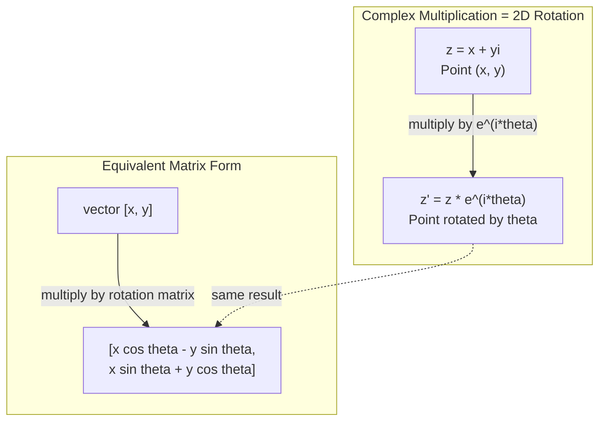
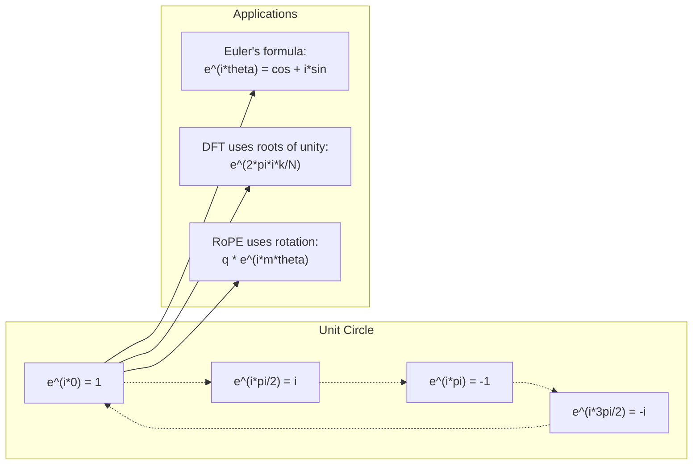

<!-- local-zh-machine-draft: English source is canonical; prose translated automatically, code/math preserved. -->

<a id="complex-numbers-for-ai"></a>

# 人工智能的复数

> -1 的平方根不是虚数。它是旋转、频率和信号处理一半的关键。

**类型：** 了解
**语言：** Python
**先决条件：** 第 1 阶段，第 01-04 课（线性代数、微积分）
**时间：** ~60 分钟

<a id="learning-objectives"></a>

## 学习目标

- 以直角坐标和极坐标形式执行复杂算术（加、乘、除、共轭）
- 应用欧拉公式在复指数和三角函数之间进行转换
- 使用 Unity 的复数 roots 实现离散傅里叶变换
- 解释 RoPE 中复杂旋转和 transformers 中正弦位置编码的基础

<a id="the-problem"></a>

## 问题

你打开一篇关于傅立叶变换的论文，到处都是 `i`。您查看 transformer 位置编码，并看到不同频率的 `sin` 和 `cos` - 复指数的实部和虚部。您阅读了有关量子计算的内容，并找到了用复杂向量空间表达的所有内容。

复数看起来很抽象。建立在 -1 的平方根上的数字系统感觉就像一个数学技巧。但这不是一个诡计。它是旋转和振荡的自然语言。每当有物体旋转、振动或振荡时，复数就是正确的工具。

如果不理解复数，就无法理解离散傅里叶变换。你无法理解FFT。您无法理解 RoPE（旋转位置 Embedding）在现代语言模型中如何工作。您无法理解为什么原始 Transformer 论文中的正弦位置编码使用它们所使用的频率。

本课程从头开始构建复杂的算术，将其与几何联系起来，并向您准确展示复数在机器学习中出现的位置。

<a id="the-concept"></a>

## 概念

<a id="what-is-a-complex-number"></a>

### 什么是复数？

复数有两部分：实部和虚部。

```
z = a + bi

where:
  a is the real part
  b is the imaginary part
  i is the imaginary unit, defined by i^2 = -1
```

就是这样。将数轴延伸到一个平面上。实数位于一个轴上。虚数位于另一边。每个复数都是该平面上的一个点。

<a id="complex-arithmetic"></a>

### 复杂算术

**Addition.** 将实部相加，将虚部相加。

```
(a + bi) + (c + di) = (a + c) + (b + d)i

Example: (3 + 2i) + (1 + 4i) = 4 + 6i
```

**Multiplication.** 使用分配律并记住 i^2 = -1。

```
(a + bi)(c + di) = ac + adi + bci + bdi^2
                 = ac + adi + bci - bd
                 = (ac - bd) + (ad + bc)i

Example: (3 + 2i)(1 + 4i) = 3 + 12i + 2i + 8i^2
                            = 3 + 14i - 8
                            = -5 + 14i
```

**Conjugate.** 翻转虚部的符号。

```
conjugate of (a + bi) = a - bi
```

复数与其共轭的乘积始终是实数：

```
(a + bi)(a - bi) = a^2 + b^2
```

**Division.** 将分子和分母乘以分母的共轭。

```
(a + bi) / (c + di) = (a + bi)(c - di) / (c^2 + d^2)
```

这消除了分母中的虚部，给你一个干净的复数。

<a id="the-complex-plane"></a>

### 复平面

复平面将每个复数映射到一个二维点。横轴为实轴，纵轴为虚轴。

```
z = 3 + 2i  corresponds to the point (3, 2)
z = -1 + 0i corresponds to the point (-1, 0) on the real axis
z = 0 + 4i  corresponds to the point (0, 4) on the imaginary axis
```

复数同时是一个点和一个来自原点的向量。这种双重解释使得复数对于几何学很有用。

<a id="polar-form"></a>

### 极性形式

平面上的任何点都可以通过它到原点的距离和它到正实轴的角度来描述。

```
z = r * (cos(theta) + i*sin(theta))

where:
  r = |z| = sqrt(a^2 + b^2)     (magnitude, or modulus)
  theta = atan2(b, a)             (phase, or argument)
```

矩形形式 (a + bi) 适合加法。极坐标形式（r，theta）有利于乘法。

** 极坐标形式的乘法。** 大小相乘，角度相加。

```
z1 = r1 * e^(i*theta1)
z2 = r2 * e^(i*theta2)

z1 * z2 = (r1 * r2) * e^(i*(theta1 + theta2))
```

这就是为什么复数非常适合旋转。乘以幅度为 1 的复数是纯旋转。

<a id="eulers-formula"></a>

### 欧拉公式

复指数和三角函数之间的桥梁：

```
e^(i*theta) = cos(theta) + i*sin(theta)
```

这是本课最重要的公式。当 θ = pi 时：

```
e^(i*pi) = cos(pi) + i*sin(pi) = -1 + 0i = -1

Therefore: e^(i*pi) + 1 = 0
```

五个基本常数 (e, i, pi, 1, 0) 连接在一个方程中。

<a id="why-eulers-formula-matters-for-ml"></a>

### 为什么欧拉公式对机器学习很重要

欧拉公式表示，`e^(i*theta)` traces 单位圆随着 theta 的变化而变化。当 theta = 0 时，您位于 (1, 0)。当 theta = pi/2 时，您位于 (0, 1)。当 theta = pi 时，您位于 (-1, 0)。在 theta = 3*pi/2 处，您位于 (0, -1)。完整旋转为 theta = 2*pi。

这意味着复指数是旋转。旋转在信号处理和机器学习中无处不在。

<a id="connection-to-2d-rotations"></a>

### 连接到 2D 旋转

将复数 (x + yi) 乘以 e^(i*theta) 可将点 (x, y) 围绕原点旋转角度 theta。

```
Rotation via complex multiplication:
  (x + yi) * (cos(theta) + i*sin(theta))
  = (x*cos(theta) - y*sin(theta)) + (x*sin(theta) + y*cos(theta))i

Rotation via matrix multiplication:
  [cos(theta)  -sin(theta)] [x]   [x*cos(theta) - y*sin(theta)]
  [sin(theta)   cos(theta)] [y] = [x*sin(theta) + y*cos(theta)]
```

它们产生相同的结果。复数乘法是二维旋转。旋转矩阵只是用矩阵表示法编写的复数乘法。



<a id="phasors-and-rotating-signals"></a>

### 相量和旋转信号

复指数 e^(i*omega*t) 是以角频率 omega 绕单位圆旋转的点。随着t的增加，圆上的点为traces。

该旋转点的实部是 cos(omega*t)。虚部是sin(omega*t)。正弦信号是旋转复数的影子。

```
e^(i*omega*t) = cos(omega*t) + i*sin(omega*t)

Real part:      cos(omega*t)    -- a cosine wave
Imaginary part: sin(omega*t)    -- a sine wave
```

这就是相量表示。您不是跟踪摆动的正弦波，而是跟踪平滑旋转的箭头。相移变成角度偏移。幅度变化变成幅度变化。信号相加成为矢量相加。

<a id="roots-of-unity"></a>

### Roots 统一

单位的第 N 个 roots 是单位圆上等距的 N 个点：

```
w_k = e^(2*pi*i*k/N)    for k = 0, 1, 2, ..., N-1
```

对于 N = 4，roots 为：1、i、-1、-i（四个罗盘点）。
对于 N = 8，您将获得四个罗盘点加上四个对角线。

Roots的统一是离散傅里叶变换的基础。 DFT 将信号分解为这 N 个等间隔频率的分量。

<a id="connection-to-the-dft"></a>

### 连接到 DFT

信号 x[0]、x[1]、...、x[N-1] 的离散傅立叶变换为：

```
X[k] = sum_{n=0}^{N-1} x[n] * e^(-2*pi*i*k*n/N)
```

每个 X[k] 测量信号与 k 次单位根（频率为 k 的复正弦曲线）的相关程度。 DFT 将信号分解为 N 个旋转相量，并告诉您每个旋转相量的幅度和相位。

<a id="why-i-is-not-imaginary"></a>

### 为什么我不是虚构的

“想象”这个词是历史的偶然。笛卡尔轻蔑地使用它。但当人们第一次拒绝负数时，i 并不比负数更虚。负数回答“3 减去 5 得到什么？”虚数单位回答“你平方什么才能得到-1？”

更有用的是：i 是一个 90 度旋转运算符。将实数乘以 i 一次，即相对虚轴旋转 90 度。再次乘以 i (i^2)，您又旋转 90 度——现在您指向负实数方向。这就是为什么 i^2 = -1。这并不神秘。它是由两个四分之一圈构成的半圈。

这就是为什么复数在工程中无处不在。任何旋转的东西——电磁波、量子态、信号振荡、位置编码——自然都是用复数来描述的。

<a id="complex-exponentials-vs-trigonometric-functions"></a>

### 复指数与三角函数

在欧拉公式出现之前，工程师将信号写为 A*cos(omega*t + phi)——幅度 A、频率 omega、相位 phi。这可行，但使算术变得痛苦。将两个不同相位的余弦相加需要三角恒等式。

对于复指数，相同的信号为 A*e^(i*(omega*t + phi))。两个信号相加只是两个复数相加。乘法（调制）只是将幅度相乘并添加角度。相移变成角度相加。频移变成相量的乘法。

整个信号处理领域都转向了复指数表示法，因为数学更清晰。 “真实信号”始终只是复数表示的实部。虚部作为簿记被保留下来，使所有代数自然地得到解决。

<a id="connection-to-transformers"></a>

### 连接到 transformers

**正弦位置编码**（原始Transformer论文）：

```
PE(pos, 2i) = sin(pos / 10000^(2i/d))
PE(pos, 2i+1) = cos(pos / 10000^(2i/d))
```

sin 和 cos 对是不同频率下复指数的实部和虚部。每个频率为编码位置提供不同的“分辨率”。低频变化缓慢（粗位置）。高频变化很快（精细位置）。它们共同为每个位置提供了独特的频率指纹。

**RoPE（旋转位置 Embedding）** 更进一步。它显式地将查询向量和键向量乘以复杂的旋转矩阵。两个tokens之间的相对位置成为旋转角度。 Attention 使用这些旋转向量进行计算，使模型通过复数乘法对相对位置敏感。

| 操作 | 代数形式 | 几何意义 |
|-----------|---------------|-------------------|
| 加法 | (a+c) + (b+d)i | 平面内向量相加 |
| 乘法 | (ac-bd) + (ad+bc)i | 旋转和缩放 |
| 共轭 | 阿比 | 在实轴上反射 |
| 震级 | sqrt(a^2 + b^2) | 距原点的距离 |
| 阶段 | atan2(b, a) | 与正实轴的角度 |
| 师 | 乘以共轭 | 反向旋转和重新缩放 |
| 电源 | r^n * e^(i*n*theta) | 旋转 n 次，缩放 r^n |



```figure
roots-of-unity
```

<a id="build-it"></a>

## 动手实现

<a id="step-1-complex-class"></a>

### 第 1 步：复杂类

构建一个复数类，支持算术、幅度、相位以及矩形和极坐标形式之间的转换。

```python
import math

class Complex:
    def __init__(self, real, imag=0.0):
        self.real = real
        self.imag = imag

    def __add__(self, other):
        return Complex(self.real + other.real, self.imag + other.imag)

    def __mul__(self, other):
        r = self.real * other.real - self.imag * other.imag
        i = self.real * other.imag + self.imag * other.real
        return Complex(r, i)

    def __truediv__(self, other):
        denom = other.real ** 2 + other.imag ** 2
        r = (self.real * other.real + self.imag * other.imag) / denom
        i = (self.imag * other.real - self.real * other.imag) / denom
        return Complex(r, i)

    def magnitude(self):
        return math.sqrt(self.real ** 2 + self.imag ** 2)

    def phase(self):
        return math.atan2(self.imag, self.real)

    def conjugate(self):
        return Complex(self.real, -self.imag)
```

<a id="step-2-polar-conversion-and-eulers-formula"></a>

### 步骤2：极坐标转换和欧拉公式

```python
def to_polar(z):
    return z.magnitude(), z.phase()

def from_polar(r, theta):
    return Complex(r * math.cos(theta), r * math.sin(theta))

def euler(theta):
    return Complex(math.cos(theta), math.sin(theta))
```

验证：`euler(theta).magnitude()` 应始终为 1.0。 `euler(0)` 应给出 (1, 0)。 `euler(pi)` 应该给出 (-1, 0)。

<a id="step-3-rotation"></a>

### 第三步：旋转

将点 (x, y) 旋转角度 theta 是一个复数乘法：

```python
point = Complex(3, 4)
rotated = point * euler(math.pi / 4)
```

幅度保持不变。只是角度改变了。

<a id="step-4-dft-from-complex-arithmetic"></a>

### 步骤 4：复杂算术的 DFT

```python
def dft(signal):
    N = len(signal)
    result = []
    for k in range(N):
        total = Complex(0, 0)
        for n in range(N):
            angle = -2 * math.pi * k * n / N
            total = total + Complex(signal[n], 0) * euler(angle)
        result.append(total)
    return result
```

这就是 O(N^2) DFT。每个输出 X[k] 是信号样本乘以单位 roots 的总和。

<a id="step-5-inverse-dft"></a>

### 第5步：逆DFT

逆 DFT 从频谱中重建原始信号。与前向 DFT 的唯一变化是：翻转指数中的符号并除以 N。

```python
def idft(spectrum):
    N = len(spectrum)
    result = []
    for n in range(N):
        total = Complex(0, 0)
        for k in range(N):
            angle = 2 * math.pi * k * n / N
            total = total + spectrum[k] * euler(angle)
        result.append(Complex(total.real / N, total.imag / N))
    return result
```

这为您提供完美的重建。应用 DFT，然后应用 IDFT，您就可以将原始信号恢复到机器精度。没有信息丢失。

<a id="step-6-roots-of-unity"></a>

### 第6步：统一的Roots

```python
def roots_of_unity(N):
    return [euler(2 * math.pi * k / N) for k in range(N)]
```

验证两个属性：
- 每个根的大小恰好为 1。
- 所有 N roots 的总和为零（它们通过对称性抵消）。

这些性质使得 DFT 可逆。统一的 roots 形成频域的正交基。

<a id="use-it"></a>

## 实际应用

Python 具有内置的复数支持。文字`j`代表虚数单位。

```python
z = 3 + 2j
w = 1 + 4j

print(z + w)
print(z * w)
print(abs(z))

import cmath
print(cmath.phase(z))
print(cmath.exp(1j * cmath.pi))
```

对于数组，numpy 原生处理复数：

```python
import numpy as np

z = np.array([1+2j, 3+4j, 5+6j])
print(np.abs(z))
print(np.angle(z))
print(np.conj(z))
print(np.real(z))
print(np.imag(z))

signal = np.sin(2 * np.pi * 5 * np.linspace(0, 1, 128))
spectrum = np.fft.fft(signal)
freqs = np.fft.fftfreq(128, d=1/128)
```

<a id="ship-it"></a>

## 交付成果

运行`code/complex_numbers.py`，生成`outputs/skill-complex-arithmetic.md`。

<a id="exercises"></a>

## 练习

1. ** 手工复杂算术。** 计算 (2 + 3i) * (4 - i) 并用代码验证。然后计算 (5 + 2i) / (1 - 3i)。在复平面上绘制两个结果，并检查乘法是否旋转并缩放了第一个数字。

2. **旋转序列。** 从点(1, 0)开始。乘以 e^(i*pi/6) 十二次。验证 12 次乘法后是否返回 (1, 0)。打印每一步的坐标并确认它们 trace 是规则的 12 边形。

3. 已知信号的 **DFT。** 创建一个信号，该信号是 sin(2*pi*3*t) 和0.5*sin(2*pi*7*t) 在 32 个点采样。运行 DFT。验证幅度谱在频率 3 和 7 处有峰值，7 处的峰值是 3 处峰值高度的一半。

4. 统一可视化的**Roots。** 计算统一的第8个roots。验证它们的总和为零。验证任意根乘以原根 e^(2*pi*i/8) 是否会给出下一个根。

5. **旋转矩阵等价。** 对于 10 个随机角度和 10 个随机点，验证复数乘法与 2x2 旋转矩阵的矩阵向量乘法给出的结果相同。打印最大数值差。

<a id="key-terms"></a>

## 关键术语

| 术语 | 这意味着什么 |
|------|---------------|
| 复数 | 数字 a + bi，其中 a 是实部，b 是虚部，i^2 = -1 |
| 虚数单位 | 数字 i，定义为 i^2 = -1。不是哲学意义上的虚数——它是一个旋转算子 |
| 复平面 | x 轴为实轴、y 轴为虚轴的 2D 平面。也称为阿尔甘平面 |
| 幅度（模数） | 距原点的距离：sqrt(a^2 + b^2)。写为\|z\| |
| 阶段（参数） | 与正实轴的角度：atan2(b, a)。写为 arg(z) |
| 共轭 | 穿过实轴的镜像：a + bi 的共轭是 a - bi |
| 极性形式 | 将 z 表示为 r * e^(i*theta) 而不是 a + bi。让乘法变得简单 |
| 欧拉公式 | e^(i*theta) = cos(theta) + i*sin(theta)。将指数与三角函数联系起来 |
| 相量 | 表示正弦信号的旋转复数 e^(i*omega*t) |
| Roots 统一 | N 个复数 e^(2*pi*i*k/N)（k = 0 到 N-1）。单位圆上N个等距点 |
| 密度泛函理论 | 离散傅立叶变换。使用单位 roots 将信号分解为复杂的正弦分量 |
| RoPE | 旋转位置 Embedding。使用复数乘法对 transformer 中的相对位置进行编码 attention |

<a id="further-reading"></a>

## 进一步阅读

- [欧拉公式的可视化介绍](https://betterexplained.com/articles/intuitive-understanding-of-eulers-formula/) - 无需繁重的符号即可构建几何直觉
- [Su 等人：RoFormer (2021)](https://arxiv.org/abs/2104.09864) - 介绍使用复杂旋转的旋转位置 Embedding 的论文
- [Vaswani 等人：Attention Is All You Need (2017)](https://arxiv.org/abs/1706.03762) - 具有正弦位置编码的原始 Transformer 论文
- [3Blue1Brown：欧拉公式与群论介绍](https://www.youtube.com/watch?v=mvmuCPvRoWQ) - 为什么 e^(i*pi) = -1 的直观解释
- [Needham：视觉复数分析](https://global.oup.com/academic/product/visual-complex-analysis-9780198534464) - 复数的最佳视觉处理，充满几何洞察力
- [Strang：线性代数简介，第 1 章10](https://math.mit.edu/~gs/linearalgebra/) - 线性代数和 eigenvalues 背景下的复数
