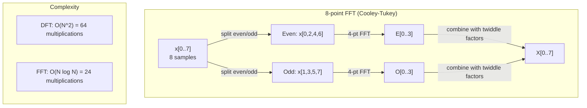
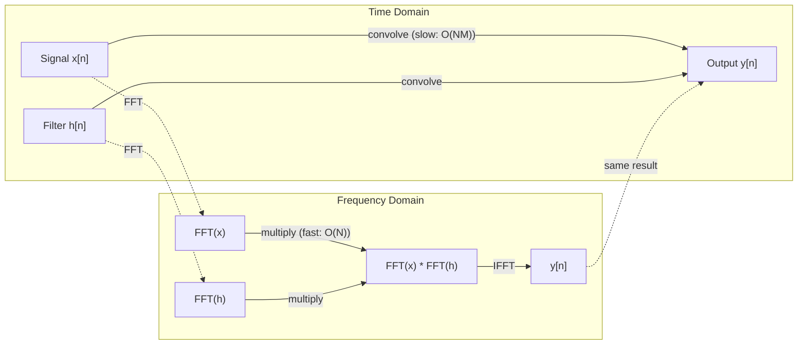

<!-- local-zh-machine-draft: English source is canonical; prose translated automatically, code/math preserved. -->

<a id="the-fourier-transform"></a>

# 傅里叶变换

> 每个信号都是正弦波的总和。傅立叶变换告诉您哪些。

**类型：** 构建
**语言：** Python
**先决条件：** 第 1 阶段，第 01-04 课、第 19 课（复数）
**时间：** ~90 分钟

<a id="learning-objectives"></a>

## 学习目标

- 从头开始实现 DFT 并根据 O(N log N) Cooley-Tukey FFT 进行验证
- 解释频率系数：从信号中提取幅度、相位和功率谱
- 应用卷积定理通过FFT乘法执行卷积
- 将傅立叶频率分解连接到 transformer 位置编码和 CNN 卷积层

<a id="the-problem"></a>

## 问题

音频记录是一段时间内的一系列压力测量结果。股票价格是几天内的一系列值。图像是空间上像素强度的网格。所有这些都是时域（或空间域）的数据。您会看到某些索引的值发生变化。

但许多模式在时域中是不可见的。该音频信号是纯音还是和弦？这个股价有周周期吗？该图像有重复的纹理吗？这些问题与频率内容有关，而时域隐藏了它。

傅里叶变换将数据从时域转换到频域。它获取信号并将其分解为不同频率的正弦波。每个正弦波都有一个幅度（强度）和一个相位（起始位置）。傅立叶变换告诉你这两点。

这对于机器学习来说很重要，因为频域思维无处不在。卷积神经网络执行卷积，即频域中的乘法。 Transformer 位置编码使用频率分解来表示位置。音频模型（语音识别、音乐生成）对频谱图（声音的频率表示）进行操作。时间序列模型寻找周期性模式。了解傅立叶变换使您可以使用 vocabulary 来处理所有这些。

<a id="the-concept"></a>

## 概念

<a id="the-dft-definition"></a>

### DFT定义

给定 N 个样本 x[0]、x[1]、...、x[N-1]，离散傅立叶变换产生 N 个频率系数 X[0]、X[1]、...、X[N-1]：

```
X[k] = sum_{n=0}^{N-1} x[n] * e^(-2*pi*i*k*n/N)

for k = 0, 1, ..., N-1
```

每个 X[k] 都是一个复数。其规模 |X[k]| 告诉您频率 k 的幅度。 其相位角(X[k]）告诉您该频率的相位偏移。

关键见解：`e^(-2*pi*i*k*n/N)` 是频率为 k 的旋转相量。 DFT 计算信号与 N 个等距频率中的每个频率之间的相关性。如果信号包含频率为 k 的能量，则相关性很大。如果不是，则接近于零。

<a id="what-each-coefficient-means"></a>

### 每个系数的含义

**X[0]：直流分量。** 这是所有样本的总和——与平均值成正比。它表示信号的恒定（零频率）偏移。

```
X[0] = sum_{n=0}^{N-1} x[n] * e^0 = sum of all samples
```

**X[k] 对于 1 <= k <= N/2：正频率。** X[k] 表示每 N 个样本的频率 k 个周期。 k 越高意味着频率越高（振荡越快）。

**X[N/2]：奈奎斯特频率。** N个样本可以表示的最高频率。高于此值，就会出现混叠现象——高频伪装成低频。

**X[k] 对于 N/2 < k < N：负频率。** 对于实值信号， X[N-k] = conj(X[k]).负频率是正频率的镜像。这就是为什么有用的信息位于前 N/2 + 1 个系数中。

<a id="inverse-dft"></a>

### 逆DFT

逆 DFT 根据频率系数重建原始信号：

```
x[n] = (1/N) * sum_{k=0}^{N-1} X[k] * e^(2*pi*i*k*n/N)

for n = 0, 1, ..., N-1
```

与前向 DFT 的唯一区别是：指数中的符号为正（不是负），并且有一个 1/N normalization 因子。

逆DFT是完美的重构。没有信息丢失。您可以从时域转到频域并返回，不会出现任何错误。 DFT 是基础的改变——它在不同的坐标系中重新表达相同的信息。

<a id="the-fft-making-it-fast"></a>

### FFT：让它变得更快

上面定义的 DFT 为 O(N^2)：对于 N 个输出系数中的每一个，您对 N 个输入样本进行求和。对于 N = 100 万，即 10^12 次操作。

快速傅里叶变换 (FFT) 以 O(N log N) 的时间计算相同的结果。对于 N = 100 万次，这大约是 2000 万次操作，而不是 1 万亿次。这就是频率分析变得实用的原因。

Cooley-Tukey 算法（最常见的 FFT）通过分而治之的方式工作：

1. 将信号分为偶数索引和奇数索引样本。
2. 递归计算每一半的 DFT。
3. 使用“旋转因子”e^(-2*pi*i*k/N) 组合两个半尺寸 DFT。

```
X[k] = E[k] + e^(-2*pi*i*k/N) * O[k]          for k = 0, ..., N/2 - 1
X[k + N/2] = E[k] - e^(-2*pi*i*k/N) * O[k]    for k = 0, ..., N/2 - 1

where E = DFT of even-indexed samples
      O = DFT of odd-indexed samples
```

对称性意味着每个级别的递归都执行 O(N) 工作，并且有 log2(N) 个级别。总计：O(N log N)。



FFT 要求信号长度为 2 的幂。实际上，信号被零填充到下一个 2 的幂。

<a id="spectral-analysis"></a>

### 光谱分析

**功率谱**为 |X[k]|^2——每个频率系数的平方幅度。它显示每个频率有多少能量。

**相位谱**是角度(X[k])——每个频率的相位偏移。对于大多数分析任务，您关心功率谱而忽略相位。

```
Power at frequency k:  P[k] = |X[k]|^2 = X[k].real^2 + X[k].imag^2
Phase at frequency k:  phi[k] = atan2(X[k].imag, X[k].real)
```

<a id="frequency-resolution"></a>

### 频率分辨率

DFT 的频率分辨率取决于样本数量 N 和 sampling 速率 fs。

```
Frequency of bin k:      f_k = k * fs / N
Frequency resolution:    delta_f = fs / N
Maximum frequency:       f_max = fs / 2  (Nyquist)
```

要解析两个接近的频率，您需要更多样本。要捕获高频，您需要更高的 sampling 速率。

<a id="the-convolution-theorem"></a>

### 卷积定理

这是信号处理中最重要的结果之一，与 CNNs 直接相关。

**时域卷积等于频域逐点乘法。**

```
x * h = IFFT(FFT(x) . FFT(h))

where * is convolution and . is element-wise multiplication
```

为什么这很重要：

- 长度为 N 和 M 的两个信号的直接卷积需要 O(N*M) 次运算。
- 基于 FFT 的卷积需要 O(N log N)：同时变换、相乘、变换回来。
- 对于大内核，FFT 卷积速度要快得多。
- 这正是在具有大感受野的卷积层中发生的情况。

注意：DFT 计算循环卷积（信号环绕）。对于线性卷积（无环绕），在计算之前将两个信号补零至长度 N + M - 1。



<a id="windowing"></a>

### 窗口化

DFT 假设信号是周期性的——它将 N 个样本视为无限重复信号的一个周期。如果信号开始和结束的值不同，则会在边界处产生不连续性，表现为虚假的高频内容。这称为频谱泄漏。

在计算 DFT 之前，加窗通过将两端的信号逐渐减小至零来减少泄漏。

常用窗口：

| 窗户 | 形状 | 主瓣宽度 | 旁瓣电平 | 应用场景 |
|--------|-------|----------------|-----------------|----------|
| 长方形 | 平房（无窗） | 最窄 | 最高（-13分贝） | 当信号在 N 个样本中恰好具有周期性时 |
| 汉恩 | 升余弦 | 中等 | 低（-31 分贝） | 通用光谱分析 |
| 汉明 | 修正余弦 | 中等 | 较低（-42 分贝） | 音频处理、语音分析 |
| 布莱克曼 | 三重余弦 | 宽 | 非常低（-58 分贝） | 当旁瓣抑制至关重要时 |

```
Hann window:    w[n] = 0.5 * (1 - cos(2*pi*n / (N-1)))
Hamming window: w[n] = 0.54 - 0.46 * cos(2*pi*n / (N-1))
```

通过将窗口与 DFT 之前的信号逐元素相乘来应用窗口：`X = DFT(x * w)`。

<a id="dft-properties"></a>

### 密度泛函性质

| 财产 | 时域 | 频域 |
|----------|-------------|-----------------|
| 线性度 | a*x + b*y | a*X + b*Y |
| 时移 | x[n - k] | X[f] * e^(-2*pi*i*f*k/N) |
| 频移 | x[n] * e^(2*pi*i*f0*n/N) | X[f - f0] |
| 卷积 | x * h | X * H（逐点） |
| 乘法 | x * h（逐点） | X * H（循环卷积，按 1/N 缩放） |
| 帕塞瓦尔定理 | sum \|x[n]\|^2 | (1/N) * sum \|X[k]\|^2 |
| 共轭对称性（实数输入） | x[n] 真实 | X[k] = conj(X[N-k]) |

帕塞瓦尔定理表明两个域的总能量相同。通过变换能量得以守恒。

<a id="connection-to-positional-encodings"></a>

### 与位置编码的连接

原始 Transformer 使用正弦位置编码：

```
PE(pos, 2i)   = sin(pos / 10000^(2i/d_model))
PE(pos, 2i+1) = cos(pos / 10000^(2i/d_model))
```

每个维度对 (2i, 2i+1) 以不同的频率振荡。频率在几何上从高（维度 0,1）到低（最后维度）间隔。这使得每个位置在所有频段上都有一个独特的模式——类似于傅里叶系数如何唯一地识别信号。

它提供的关键属性：

- **唯一性：** 没有两个位置具有相同的编码。
- **有界值：** sin和cos始终在[-1、1]中。
- **相对位置：** 位置p+k的编码可以表示为位置p编码的线性函数。该模型可以学习关注相对位置。

<a id="connection-to-cnns"></a>

### 连接到 CNNs

卷积层通过在信号或图像上滑动来将学习的滤波器（内核）应用于输入。从数学上来说，这就是卷积运算。

根据卷积定理，这等价于：
1. 对输入进行 FFT
2. FFT 内核
3. 频域相乘
4. IFFT 结果

标准 CNN 实现使用直接卷积（对于小型 3x3 内核更快）。但对于大内核或全局卷积，基于 FFT 的方法要快得多。某些架构（如 FNet）完全用 FFT 替换 attention，以 O(N log N) 而不是 O(N^2) 复杂度实现有竞争力的精度。

<a id="spectrograms-and-the-short-time-fourier-transform"></a>

### 频谱图和短时傅里叶变换

单个 FFT 可以为您提供整个信号的频率内容，但不会告诉您这些频率何时出现。线性调频脉冲（频率随时间增加的信号）和和弦（所有频率同时出现）可以具有相同的幅度谱。

短时傅立叶变换 (STFT) 通过在信号的重叠窗口上计算 FFT 来解决这个问题。结果是频谱图：一个轴为时间、另一轴为频率的二维表示。每个点的强度显示了当时该频率的能量。

```
STFT procedure:
1. Choose a window size (e.g., 1024 samples)
2. Choose a hop size (e.g., 256 samples -- 75% overlap)
3. For each window position:
   a. Extract the windowed segment
   b. Apply a Hann/Hamming window
   c. Compute FFT
   d. Store the magnitude spectrum as one column of the spectrogram
```

声谱图是音频 ML 模型的标准输入表示形式。语音识别模型（Whisper、DeepSpeech）在梅尔频谱图上运行——频率映射到梅尔音阶的频谱图，可以更好地匹配人类的音调感知。

<a id="aliasing"></a>

### 混叠

如果信号包含高于 fs/2（奈奎斯特频率）的频率，则 fs 速率下的 sampling 将创建混叠副本。以 100 Hz 采样的 90 Hz 信号看起来与 10 Hz 信号相同。没有办法单独将它们与样本区分开来。

```
Example:
  True signal: 90 Hz sine wave
  Sampling rate: 100 Hz
  Apparent frequency: 100 - 90 = 10 Hz

  The samples from the 90 Hz signal at 100 Hz sampling rate
  are identical to the samples from a 10 Hz signal.
  No amount of math can recover the original 90 Hz.
```

这就是为什么模数转换器包含抗混叠滤波器，可以在 sampling 之前消除高于奈奎斯特的频率。在 ML 中，当在没有适当低通滤波的情况下对 feature 地图进行下采样时，会出现锯齿现象 - 某些架构通过抗锯齿池层来解决此问题。

<a id="zero-padding-does-not-increase-resolution"></a>

### 零填充不会提高分辨率

一个常见的误解：在 FFT 之前对信号进行零填充可以提高频率分辨率。事实并非如此。在现有频率仓之间进行零填充插值，为您提供看起来更平滑的频谱。但它无法揭示原始样本中不存在的频率细节。

真实频率分辨率仅取决于观测时间T=N/fs。要解析由 delta_f 分隔的两个频率，您至少需要 T = 1 / delta_f 秒的数据。无论多少补零都会改变这个基本限制。

```figure
fourier-synthesis
```

<a id="build-it"></a>

## 动手实现

<a id="step-1-dft-from-scratch"></a>

### 第 1 步：从头开始 DFT

O(N^2) DFT 直接由定义得出。

```python
import math

class Complex:
    ...

def dft(x):
    N = len(x)
    result = []
    for k in range(N):
        total = Complex(0, 0)
        for n in range(N):
            angle = -2 * math.pi * k * n / N
            w = Complex(math.cos(angle), math.sin(angle))
            xn = x[n] if isinstance(x[n], Complex) else Complex(x[n])
            total = total + xn * w
        result.append(total)
    return result
```

<a id="step-2-inverse-dft"></a>

### 步骤 2：逆 DFT

结构相同，正指数，除以N。

```python
def idft(X):
    N = len(X)
    result = []
    for n in range(N):
        total = Complex(0, 0)
        for k in range(N):
            angle = 2 * math.pi * k * n / N
            w = Complex(math.cos(angle), math.sin(angle))
            total = total + X[k] * w
        result.append(Complex(total.real / N, total.imag / N))
    return result
```

<a id="step-3-fft-cooley-tukey"></a>

### 步骤 3：FFT（库利-图基）

递归 FFT 需要 2 的幂长度。分为偶数和奇数，递归，与旋转因子结合。

```python
def fft(x):
    N = len(x)
    if N <= 1:
        return [x[0] if isinstance(x[0], Complex) else Complex(x[0])]
    if N % 2 != 0:
        return dft(x)

    even = fft([x[i] for i in range(0, N, 2)])
    odd = fft([x[i] for i in range(1, N, 2)])

    result = [Complex(0)] * N
    for k in range(N // 2):
        angle = -2 * math.pi * k / N
        twiddle = Complex(math.cos(angle), math.sin(angle))
        t = twiddle * odd[k]
        result[k] = even[k] + t
        result[k + N // 2] = even[k] - t
    return result
```

<a id="step-4-spectral-analysis-helpers"></a>

### 第 4 步：光谱分析助手

```python
def power_spectrum(X):
    return [xk.real ** 2 + xk.imag ** 2 for xk in X]

def convolve_fft(x, h):
    N = len(x) + len(h) - 1
    padded_N = 1
    while padded_N < N:
        padded_N *= 2

    x_padded = x + [0.0] * (padded_N - len(x))
    h_padded = h + [0.0] * (padded_N - len(h))

    X = fft(x_padded)
    H = fft(h_padded)

    Y = [xk * hk for xk, hk in zip(X, H)]

    y = idft(Y)
    return [y[n].real for n in range(N)]
```

<a id="use-it"></a>

## 实际应用

对于实际工作，请使用 numpy 的 FFT，它由高度优化的 C 库支持。

```python
import numpy as np

signal = np.sin(2 * np.pi * 5 * np.arange(256) / 256)
spectrum = np.fft.fft(signal)
freqs = np.fft.fftfreq(256, d=1/256)

power = np.abs(spectrum) ** 2

positive_freqs = freqs[:len(freqs)//2]
positive_power = power[:len(power)//2]
```

对于加窗和更高级的频谱分析：

```python
from scipy.signal import windows, stft

window = windows.hann(256)
windowed = signal * window
spectrum = np.fft.fft(windowed)
```

对于卷积：

```python
from scipy.signal import fftconvolve

result = fftconvolve(signal, kernel, mode='full')
```

对于频谱图：

```python
from scipy.signal import stft

frequencies, times, Zxx = stft(signal, fs=sample_rate, nperseg=256)
spectrogram = np.abs(Zxx) ** 2
```

频谱图矩阵具有形状（n_频率，n_time_帧）。每一列是一个时间窗口的功率谱。这就是音频 ML 模型作为输入使用的内容。

<a id="ship-it"></a>

## 交付成果

运行`code/fourier.py`，生成`outputs/prompt-spectral-analyzer.md`。

<a id="exercises"></a>

## 练习

1. **纯音识别。** 创建未知频率（1 到 50 Hz 之间）的单个正弦波信号，以 128 Hz 采样 1 秒。使用 DFT 来识别频率。验证答案是否匹配。现在添加标准差为 0.5 的高斯噪声并重复。噪声如何影响频谱？

2. **FFT 与 DFT 验证。** 生成长度为 64 的随机信号。计算 DFT (O(N^2)) 和 FFT。验证所有系数是否匹配在 1e-10 范围内。对长度为 256、512、1024 和 2048 的信号进行计时。绘制 DFT 时间与 FFT 时间的比率。

3. **卷积定理举例证明。** 创建信号 x = [1, 2, 3, 4, 0, 0, 0, 0] 和滤波器 h = [1, 1, 1, 0, 0, 0, 0, 0]。直接计算它们的循环卷积（嵌套循环）。然后通过 FFT（变换、乘法、逆变换）进行计算。验证结果匹配。现在通过适当的零填充进行线性卷积。

4. ** 开窗效果。** 创建一个信号，该信号是 10 Hz 和 12 Hz（非常接近）的两个正弦波之和。以 128 Hz 采样 1 秒。计算无窗、Hann 窗和 Hamming 窗的功率谱。哪个窗口最容易区分两个峰？为什么？

5. **位置编码分析。** 生成 d_model = 128 和 max_pos = 512 的正弦位置编码。对于每对位置 (p1, p2)，计算其编码的点积。证明点积仅取决于 |p1 - p2|，而不是绝对位置。随着距离的增加，点积会发生什么变化？

<a id="key-terms"></a>

## 关键术语

| 术语 | 这意味着什么 |
|------|---------------|
| DFT（离散傅立叶变换） | 将 N 个时域样本转换为 N 个频域系数。每个系数都是与该频率下的复正弦曲线的相关性 |
| FFT（快速傅里叶变换） | 用于计算 DFT 的 O(N log N) 算法。 Cooley-Tukey 算法递归地分割偶数/奇数索引 |
| 逆DFT | 从频率系数重建时域信号。与具有翻转指数符号和 1/N 缩放的 DFT 相同的公式 |
| 频率档 | DFT 输出中的每个索引 k 表示频率 k*fs/N Hz。 “bin”是离散频率槽 |
| 直流分量 | X[0]，零频系数。与信号平均值成正比 |
| 奈奎斯特频率 | fs/2，sampling 速率 fs 可表示的最大频率。频率高于此别名 |
| 功率谱 | \|X[k]\|^2，每个频率系数的平方幅度。显示不同频率的能量分布 |
| 相位谱 | angle(X[k])，每个频率分量的相位偏移。分析中经常被忽视 |
| 光谱泄漏 | 将非周期信号视为周期信号而引起的杂散频率内容。通过加窗减少 |
| 窗函数 | 在 DFT 之前应用锥形函数（Hann、Hamming、Blackman）以减少频谱泄漏 |
| 旋转因子 | 复指数 e^(-2*pi*i*k/N) 用于在 FFT 蝶形计算中组合子 DFT |
| 卷积定理 | 时域中的卷积等于频域中的逐点乘法。信号处理基础和 CNNs |
| 循环卷积 | 信号环绕的卷积。这就是 DFT 自然计算的内容 |
| 线性卷积 | 无环绕的标准卷积。通过DFT之前的补零实现 |
| 帕塞瓦尔定理 | 通过傅里叶变换保留总能量。总和 \|x[n]\|^2 = (1/N) 总和\|X[k]\|^2 |
| 混叠 | 当高于奈奎斯特的频率由于 sampling 速率不足而显示为较低频率时 |

<a id="further-reading"></a>

## 进一步阅读

- [Cooley & Tukey: An Algorithm for the Machine Calculation of Complex Fourier Series (1965)](https://www.ams.org/journals/mcom/1965-19-090/S0025-5718-1965-0178586-1/) - 改变计算的原始 FFT 论文
- [3Blue1Brown：但是什么是傅里叶变换？](https://www.youtube.com/watch?v=spUNpyF58BY) - 傅里叶变换的最佳视觉介绍
- [Lee-Thorp 等人：FNet：将 Tokens 与傅立叶变换混合 (2021)](https://arxiv.org/abs/2105.03824) - 用 FFT 替换 self-attention transformers
- [Smith：科学家和工程师数字信号处理指南](http://www.dspguide.com/) - 免费在线教科书，涵盖 FFT、加窗和深入频谱分析
- [Vaswani 等人：Attention Is All You Need (2017)](https://arxiv.org/abs/1706.03762) - 从傅里叶频率分解导出的正弦位置编码
- [Radford 等人：Whisper (2022)](https://arxiv.org/abs/2212.04356) - 使用梅尔频谱图作为输入表示的语音识别
