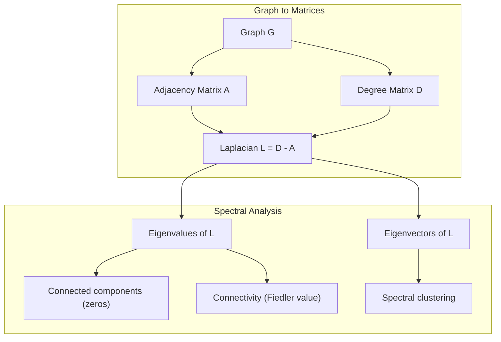
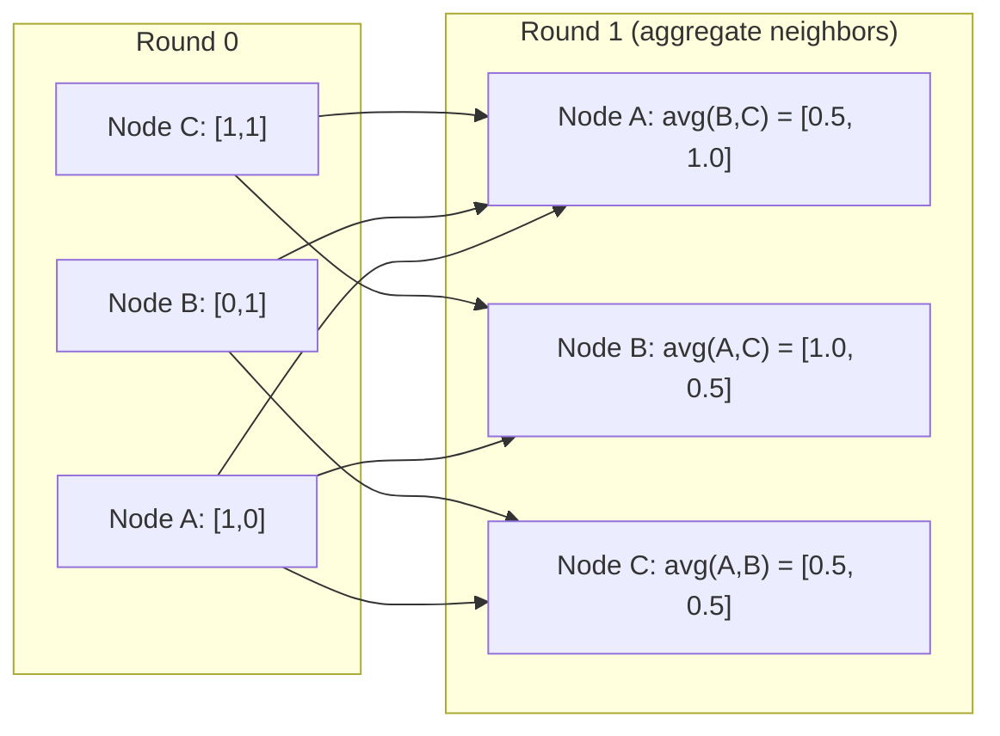

<!-- local-zh-machine-draft: English source is canonical; prose translated automatically, code/math preserved. -->

<a id="graph-theory-for-machine-learning"></a>

# 机器学习的图论

> 图是关系的数据结构。如果你的数据有联系，你就需要图论。

**类型：** 构建
**语言：** Python
**先决条件：** 第 1 阶段，第 01-03 课（线性代数、矩阵）
**时间：** ~90 分钟

<a id="learning-objectives"></a>

## 学习目标

- 使用邻接矩阵/列表表示构建图类并实现 BFS 和 DFS 遍历
- 计算图拉普拉斯并使用其 eigenvalues 来检测连接的组件和集群节点
- 将一轮 GNN 式消息传递实现为归一化邻接矩阵乘法
- 使用 Fiedler 向量应用谱聚类来划分图

<a id="the-problem"></a>

## 问题

社交网络、分子、知识库、引文网络、路线图——所有这些都是图表。传统的机器学习将数据视为平面表。每行都是独立的。每个feature都是一列。但是当连接结构很重要时，表就会失败。

考虑一个社交网络。您想要预测用户将购买什么产品。他们的购买历史很重要。但他们朋友的购买历史更重要。连接携带信号。

或者考虑一个分子。您想要预测它是否与蛋白质结合。原子很重要，但真正重要的是原子如何相互结合。结构就是数据。

图神经网络（GNN）是深度学习中增长最快的领域。它们为药物发现、社会推荐、欺诈检测和知识图推理提供动力。每个 GNN 都建立在相同的基础上：基本图论。

你需要四件事：
1. 一种将图形表示为矩阵的方法（这样您就可以将它们相乘）
2. 探索图结构的遍历算法
3. 拉普拉斯算子——谱图论中最重要的矩阵
4. 消息传递——使 GNN 发挥作用的操作

<a id="the-concept"></a>

## 概念

<a id="graphs-nodes-and-edges"></a>

### 图：节点和边

图 G = (V, E) 由顶点（节点）V 和边 E 组成。每条边连接两个节点。

**有向与无向。** 在无向图中，边 (u, v) 表示 u 连接到 v 并且 v 连接到 u。在有向图（有向图）中，边（u，v）表示u指向v，但不一定相反。

**加权与未加权。** 在未加权图中，边要么存在，要么不存在。在加权图中，每条边都有一个数值 weight——距离、成本、强度。

| 图表类型 | 示例 |
|-----------|---------|
| 无向、无权重 | 脸书友谊网 |
| 有向、未加权 | Twitter 关注网络 |
| 无向、加权 | 路线图（距离） |
| 定向、加权 | 网页链接（PageRank 分数） |

<a id="the-adjacency-matrix"></a>

### 邻接矩阵

邻接矩阵A是核心表示。对于有 n 个节点的图：

```
A[i][j] = 1    if there is an edge from node i to node j
A[i][j] = 0    otherwise
```

对于无向图，A 是对称的：A[i][j] = A[j][i]。对于加权图，边 (i, j) 的 A[i][j] = weight。

**示例 -- 三角形：**

```
Nodes: 0, 1, 2
Edges: (0,1), (1,2), (0,2)

A = [[0, 1, 1],
     [1, 0, 1],
     [1, 1, 0]]
```

邻接矩阵是每个 GNN 的输入。 A 上的矩阵运算对应于图上的运算。

<a id="degree"></a>

### 学位

节点的度是与其相连的边的数量。对于有向图，有入度（边进来）和出度（边出去）。

度矩阵 D 是对角矩阵：

```
D[i][i] = degree of node i
D[i][j] = 0    for i != j
```

对于三角形示例：D = diag(2, 2, 2) 因为每个节点都连接到其他两个节点。

度数告诉您节点的重要性。高度=中心节点。网络的度分布揭示了其结构。社交网络遵循幂律（中心很少，叶节点很多）。随机图具有泊松分布度。

<a id="bfs-and-dfs"></a>

### 广度优先搜索和深度优先搜索

两种基本的图遍历算法。你两者都需要。

**广度优先搜索（BFS）：** 首先探索所有邻居，然后是邻居的邻居。使用队列 (FIFO)。

```
BFS from node 0:
  Visit 0
  Queue: [1, 2]        (neighbors of 0)
  Visit 1
  Queue: [2, 3]        (add neighbors of 1)
  Visit 2
  Queue: [3]           (neighbors of 2 already visited)
  Visit 3
  Queue: []            (done)
```

BFS 在未加权图中找到最短路径。从起始点到任何节点的距离等于该节点首次发现的 BFS 级别。这就是为什么 BFS 用于社交网络中的跳数距离。

**深度优先搜索（DFS）：** 在回溯之前尽可能深入。使用堆栈 (LIFO) 或递归。

```
DFS from node 0:
  Visit 0
  Stack: [1, 2]        (neighbors of 0)
  Visit 2               (pop from stack)
  Stack: [1, 3]         (add neighbors of 2)
  Visit 3               (pop from stack)
  Stack: [1]
  Visit 1               (pop from stack)
  Stack: []             (done)
```

DFS 可用于：
- 查找连接的组件（从未访问的节点运行 DFS）
- 循环检测（DFS树中的后边缘）
- 拓扑排序（逆DFS完成顺序）

| 算法 | 数据结构 | 发现 | 应用场景 |
|-----------|---------------|-------|----------|
| 广度FS | 队列 | 最短路径 | 社交网络距离、知识图谱遍历 |
| 深度FS | 堆栈 | 组件、周期 | 连通性、拓扑排序 |

<a id="the-graph-laplacian"></a>

### 图拉普拉斯算子

L = D - A。谱图论中最重要的矩阵。

对于三角形：

```
D = [[2, 0, 0],    A = [[0, 1, 1],    L = [[2, -1, -1],
     [0, 2, 0],         [1, 0, 1],         [-1, 2, -1],
     [0, 0, 2]]         [1, 1, 0]]         [-1, -1,  2]]
```

拉普拉斯算子具有显着的特性：

1. **L 是半正定的。** 所有 eigenvalues 都 >= 0。

2. **零的数量 eigenvalues 等于连通分量的数量。** 连通图恰好有一个零 eigenvalue。具有 3 个断开组件的图具有三个零 eigenvalues。

3. ** 最小的非零 eigenvalue（Fiedler 值）衡量连通性。** 大的 Fiedler 值表示图连通性良好。 Fiedler 值较小意味着该图有一个弱点——瓶颈。

4. ** Fiedler值（Fiedler向量）的eigenvector揭示了最佳分割。** 具有正值的节点进入一组，具有负值的节点进入另一组。这就是谱聚类。



<a id="spectral-properties"></a>

### 光谱特性

邻接矩阵和拉普拉斯算子的 eigenvalues 无需任何遍历即可揭示结构特性。

**谱聚类**的工作原理如下：
1. 计算拉普拉斯 L
2. 找到 L 的 k 个最小的 eigenvectors （跳过第一个，对于连通图来说是全 1）
3. 使用这些 eigenvectors 作为每个节点的新坐标
4. 在这些坐标上运行 k 均值

为什么这有效？ L 的 eigenvectors 编码了图表上的“最平滑”函数。连接良好的节点会获得类似的 eigenvector 值。被瓶颈分开的节点会得到不同的值。 eigenvectors 自然地分离集群。

**随机游走连接。** 归一化拉普拉斯算子与图上的随机游走相关。随机游走的平稳分布与节点度成正比。混合时间（步行收敛的速度）取决于光谱间隙。

<a id="message-passing"></a>

### 消息传递

图神经网络的核心运算。每个节点从其邻居收集消息，聚合它们，并更新自己的状态。

```
h_v^(k+1) = UPDATE(h_v^(k), AGGREGATE({h_u^(k) : u in neighbors(v)}))
```

在最简单的形式中，AGGREGATE = 均值，UPDATE = 线性变换 + 激活：

```
h_v^(k+1) = sigma(W * mean({h_u^(k) : u in neighbors(v)}))
```

这是变相的矩阵乘法。设H为所有节点features的矩阵，A为邻接矩阵：

```
H^(k+1) = sigma(A_norm * H^(k) * W)
```

其中 A_norm 是归一化邻接矩阵（每行总和为 1）。

一轮消息传递让每个节点“看到”其直接邻居。两轮让它看到邻居的邻居。 K 轮为每个节点提供来自其 K 跳邻域的信息。



<a id="concepts-and-ml-applications"></a>

### 概念和机器学习应用

| 概念 | 机器学习应用 |
|---------|---------------|
| 邻接矩阵 | GNN 输入表示 |
| 图拉普拉斯 | 谱聚类、社区检测 |
| 广度优先搜索/深度优先搜索 | 知识图谱遍历、路径查找 |
| 学位分布 | 节点重要性，feature工程 |
| 消息传递 | GNN 层（GCN、GAT、GraphSAGE） |
| Eigenvalues L | 社区检测、图划分 |
| 谱聚类 | 无监督节点分组 |
| 网页排名 | 节点重要性，网络搜索 |

```figure
graph-degree-distribution
```

<a id="build-it"></a>

## 动手实现

<a id="step-1-graph-class-from-scratch"></a>

### 第 1 步：从头开始创建图形类

```python
class Graph:
    def __init__(self, n_nodes, directed=False):
        self.n = n_nodes
        self.directed = directed
        self.adj = {i: {} for i in range(n_nodes)}

    def add_edge(self, u, v, weight=1.0):
        self.adj[u][v] = weight
        if not self.directed:
            self.adj[v][u] = weight

    def neighbors(self, node):
        return list(self.adj[node].keys())

    def degree(self, node):
        return len(self.adj[node])

    def adjacency_matrix(self):
        import numpy as np
        A = np.zeros((self.n, self.n))
        for u in range(self.n):
            for v, w in self.adj[u].items():
                A[u][v] = w
        return A

    def degree_matrix(self):
        import numpy as np
        D = np.zeros((self.n, self.n))
        for i in range(self.n):
            D[i][i] = self.degree(i)
        return D

    def laplacian(self):
        return self.degree_matrix() - self.adjacency_matrix()
```

邻接表（`self.adj`）有效地存储邻居。邻接矩阵转换使用 numpy，因为所有谱运算都需要它。

<a id="step-2-bfs-and-dfs"></a>

### 步骤2：BFS和DFS

```python
from collections import deque

def bfs(graph, start):
    visited = set()
    order = []
    distances = {}
    queue = deque([(start, 0)])
    visited.add(start)
    while queue:
        node, dist = queue.popleft()
        order.append(node)
        distances[node] = dist
        for neighbor in graph.neighbors(node):
            if neighbor not in visited:
                visited.add(neighbor)
                queue.append((neighbor, dist + 1))
    return order, distances


def dfs(graph, start):
    visited = set()
    order = []
    stack = [start]
    while stack:
        node = stack.pop()
        if node in visited:
            continue
        visited.add(node)
        order.append(node)
        for neighbor in reversed(graph.neighbors(node)):
            if neighbor not in visited:
                stack.append(neighbor)
    return order
```

BFS 使用 deque（双端队列）来实现 O(1) popleft。 DFS 使用列表作为堆栈。两者都访问每个节点一次——O(V + E)时间。

<a id="step-3-connected-components-and-laplacian-eigenvalues"></a>

### 步骤 3：连接组件和拉普拉斯 eigenvalues

```python
def connected_components(graph):
    visited = set()
    components = []
    for node in range(graph.n):
        if node not in visited:
            order, _ = bfs(graph, node)
            visited.update(order)
            components.append(order)
    return components


def laplacian_eigenvalues(graph):
    import numpy as np
    L = graph.laplacian()
    eigenvalues = np.linalg.eigvalsh(L)
    return eigenvalues
```

`eigvalsh` 用于对称矩阵——拉普拉斯算子对于无向图始终是对称的。它按升序返回 eigenvalues。计算零的数量即可找到连通分量的数量。

<a id="step-4-spectral-clustering"></a>

### 步骤 4：谱聚类

```python
def spectral_clustering(graph, k=2):
    import numpy as np
    L = graph.laplacian()
    eigenvalues, eigenvectors = np.linalg.eigh(L)
    features = eigenvectors[:, 1:k+1]

    labels = np.zeros(graph.n, dtype=int)
    for i in range(graph.n):
        if features[i, 0] >= 0:
            labels[i] = 0
        else:
            labels[i] = 1
    return labels
```

对于 k=2，Fiedler 向量的符号将图分成两个簇。对于 k>2，您将对前 k eigenvectors 运行 k-means（不包括简单的全 1 eigenvector）。

<a id="step-5-message-passing"></a>

### 第五步：消息传递

```python
def message_passing(graph, features, weight_matrix):
    import numpy as np
    A = graph.adjacency_matrix()
    row_sums = A.sum(axis=1, keepdims=True)
    row_sums[row_sums == 0] = 1
    A_norm = A / row_sums
    aggregated = A_norm @ features
    output = aggregated @ weight_matrix
    return output
```

这是一轮 GNN 消息传递。每个节点的新 features 是其邻居的 features 的加权平均值，由 weight 矩阵转换。堆叠多轮以进一步传播信息。

<a id="use-it"></a>

## 实际应用

对于networkx和numpy，相同的操作是一行：

```python
import networkx as nx
import numpy as np

G = nx.karate_club_graph()

A = nx.adjacency_matrix(G).toarray()
L = nx.laplacian_matrix(G).toarray()

eigenvalues = np.linalg.eigvalsh(L.astype(float))
print(f"Smallest eigenvalues: {eigenvalues[:5]}")
print(f"Connected components: {nx.number_connected_components(G)}")

communities = nx.community.greedy_modularity_communities(G)
print(f"Communities found: {len(communities)}")

pr = nx.pagerank(G)
top_nodes = sorted(pr.items(), key=lambda x: x[1], reverse=True)[:5]
print(f"Top 5 PageRank nodes: {top_nodes}")
```

networkx 通过优化的 C 后端处理任何大小的图表。在生产中使用它。使用从头开始的实现来了解它的作用。

<a id="numpy-spectral-analysis"></a>

### numpy光谱分析

```python
import numpy as np

A = np.array([
    [0, 1, 1, 0, 0],
    [1, 0, 1, 0, 0],
    [1, 1, 0, 1, 0],
    [0, 0, 1, 0, 1],
    [0, 0, 0, 1, 0]
])

D = np.diag(A.sum(axis=1))
L = D - A

eigenvalues, eigenvectors = np.linalg.eigh(L)
print(f"Eigenvalues: {np.round(eigenvalues, 4)}")
print(f"Fiedler value: {eigenvalues[1]:.4f}")
print(f"Fiedler vector: {np.round(eigenvectors[:, 1], 4)}")

fiedler = eigenvectors[:, 1]
group_a = np.where(fiedler >= 0)[0]
group_b = np.where(fiedler < 0)[0]
print(f"Cluster A: {group_a}")
print(f"Cluster B: {group_b}")
```

费德勒矢量完成了繁重的工作。一个簇中为正条目，另一簇中为负条目。无需迭代优化——只需一次特征分解。

<a id="ship-it"></a>

## 交付成果

本课产生：
- `outputs/skill-graph-analysis.md`——分析图结构数据的技巧参考

<a id="connections"></a>

## 连接

| 概念 | 它出现在哪里 |
|---------|------------------|
| 邻接矩阵 | GCN、GAT、GraphSAGE 输入 |
| 拉普拉斯算子 | 谱聚类、ChebNet 滤波器 |
| 广度FS | 知识图谱遍历、最短路径查询 |
| 消息传递 | 每个 GNN 层，神经消息传递 |
| 光谱间隙 | 图连通性、随机游走的混合时间 |
| 学位分布 | 幂律网络，节点 feature 工程 |
| 连接组件 | 预处理，处理断开的图 |
| 网页排名 | 节点重要性排名，attention初始化 |

GNN 值得特别提及。 GCN 中的图卷积运算（Kipf & Welling，2017）使用添加了自循环的邻接矩阵，A_hat = A + I：

```text
H^(l+1) = sigma(D_hat^(-1/2) * A_hat * D_hat^(-1/2) * H^(l) * W^(l))
```

其中 A_hat = A + I（邻接加自环），D_hat 是 A_hat 的度矩阵。自环确保每个节点在聚合期间包含自己的 features。这正是对称 normalization 的消息传递。 D_hat^(-1/2) * A_hat * D_hat^(-1/2) 是归一化邻接矩阵。拉普拉斯算子出现是因为这个 normalization 与 L_sym = I - D^(-1/2) * A * D^(-1/2) 相关。理解拉普拉斯算子意味着理解 GCN 工作的原因。

<a id="exercises"></a>

## 练习

1. **从头开始实现PageRank。** 从统一分数开始。在每一步：对于指向 v 的所有 u，score(v) = (1-d)/n + d * sum(score(u)/out_ Degree(u))。使用 d=0.85。运行直到收敛（变化 < 1e-6）。在小网络图上进行测试。

2. **使用谱聚类查找社区。** 创建一个具有两个明显分离的聚类的图（例如，通过一条边连接的两个派系）。运行谱聚类并验证它找到正确的分割。添加更多跨簇边时会发生什么？

3. ** 实现加权图中最短路径的 Dijkstra 算法**。将结果与具有统一 weights 的同一图上的 BFS 进行比较。

4. **构建2层消息传递网络。** 使用不同的weight矩阵应用两次消息传递。表明经过 2 轮后，每个节点都拥有来自其 2 跳邻域的信息。

5. **分析现实世界的图。** 使用空手道俱乐部图（34 个节点，78 个边）。计算度分布、拉普拉斯 eigenvalues 和谱聚类。将谱聚类结果与已知的地面实况分割进行比较。

<a id="key-terms"></a>

## 关键术语

| 术语 | 人们怎么说 | 它实际上意味着什么 |
|------|----------------|----------------------|
| 图 | “节点和边” | 编码成对关系的数学结构 G=(V,E) |
| 邻接矩阵 | “连接表” | 一个 n x n 矩阵，其中 A[i][j] = 1（如果节点 i 和 j 连接） |
| 学位 | “节点的连接程度” | 接触节点的边数 |
| 拉普拉斯算子 | “D 减 A” | L = D - A，eigenvalues 揭示图结构的矩阵 |
| 费德勒值 | “代数连通性” | L 的最小非零 eigenvalue，测量图的连通程度 |
| 广度FS | “逐级搜索” | 在深入之前访问所有邻居的遍历，找到最短路径 |
| 深度FS | “先深入” | 在回溯之前沿着一条路径到达终点的遍历 |
| 消息传递 | “节点与邻居交谈” | 每个节点都会聚合来自其邻居的信息，这是 GNN 的核心 |
| 谱聚类 | “集群由eigenvectors” | 使用拉普拉斯算子的 eigenvectors 对图进行分区 |
| 连接组件 | “单独的一块” | 每个节点都可以到达其他每个节点的最大子图 |

<a id="further-reading"></a>

## 进一步阅读

- **Kipf 和 Welling (2017)**——“使用图卷积网络进行半监督分类。”这篇论文推出了现代 GNN。表明谱图卷积简化了消息传递。
- **Spielman (2012)** --“谱图论”讲义。拉普拉斯算子、谱间隙和图划分的权威介绍。
- **Hamilton (2020)**——“图表示学习”。本书涵盖了 GNN 从基础知识到应用的内容。
- **Bronstein 等人。 (2021)**——“几何深度学习：网格、组、图形、测地线和仪表。”统一框架文件。
- **Veličković 等人。 (2018)**——“图 Attention 网络。”使用 attention 机制扩展消息传递。
