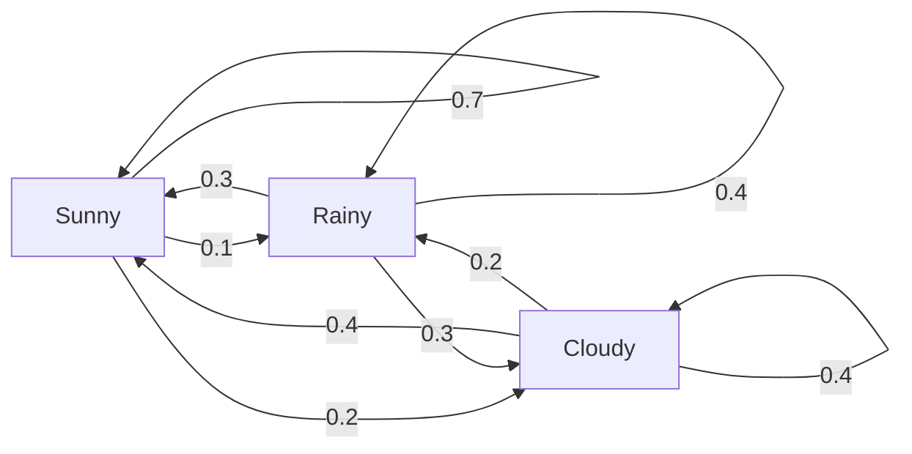
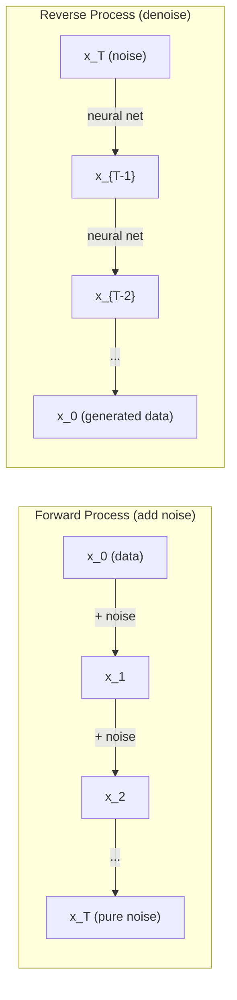

<!-- local-zh-machine-draft: English source is canonical; prose translated automatically, code/math preserved. -->

<a id="stochastic-processes"></a>

# 随机过程

> 随机性与结构。随机游走、马尔可夫链和 diffusion models 背后的数学。

**类型：** 了解
**语言：** Python
**先决条件：** 第 1 阶段，第 06-07 课（概率、贝叶斯）
**时间：** ~75分钟

<a id="learning-objectives"></a>

## 学习目标

- 模拟一维和二维随机游走并验证位移的 sqrt(n) 缩放
- 构建马尔可夫链模拟器并通过特征分解计算其平稳分布
- 从目标分布实现 sampling 的 Metropolis-Hastings MCMC 和 Langevin 动力学
- 将正向扩散过程与布朗运动联系起来并解释反向过程如何生成数据

<a id="the-problem"></a>

## 问题

许多人工智能系统都涉及随时间演变的随机性。不是静态随机性——结构化的、顺序的随机性，其中每一步都取决于之前发生的事情。

语言模型一次生成一个 tokens。每个 token 取决于之前的上下文。该模型输出概率分布、从中抽取样本，然后继续。这是一个随机过程。

Diffusion models 逐步向图像添加噪声，直到变成纯静态。然后他们反转这个过程，逐步去噪，直到出现新图像。前向过程是一个马尔可夫链。相反的过程是一个学习的马尔可夫链向后运行。

Reinforcement learning agents 在环境中采取操作。每个动作都有一定的概率导致一个新的状态。 agent 在随机世界中遵循随机策略。整个事情就是Markov decision process。

MCMC sampling——贝叶斯 inference 的骨干——构建一个马尔可夫链，其平稳分布是您想要从中采样的后验分布。

所有这些都建立在四个基本理念之上：
1. 随机游走——最简单的随机过程
2. 马尔可夫链——带有转移矩阵的结构化随机性
3. 朗之万动力学 -- gradient descent 带噪声
4. Metropolis-Hastings -- 来自任何发行版的 sampling

<a id="the-concept"></a>

## 概念

<a id="random-walks"></a>

### 随机游走

从位置 0 开始。每一步，掷一枚均匀的硬币。头部：向右移动（+1）。尾巴：向左移动（-1）。

n 步后，您的位置是 n 个随机 +/-1 值的总和。预期位置为 0（行走是无偏的）。但距原点的预期距离随着 sqrt(n) 增长。

这是违反直觉的。步行很公平——两个方向都没有漂移。但随着时间的推移，它离起点越来越远。 n 步骤后的标准差为 sqrt(n)。

```
Step 0:  Position = 0
Step 1:  Position = +1 or -1
Step 2:  Position = +2, 0, or -2
...
Step 100: Expected distance from origin ~ 10 (sqrt(100))
Step 10000: Expected distance from origin ~ 100 (sqrt(10000))
```

**在2D**中，步行以相等的概率向上、向下、向左或向右移动。相同的 sqrt(n) 缩放适用于距原点的距离。路径 traces 是一个类似分形的图案。

**为什么sqrt(n)？** 每一步都是+1或-1等概率。 n 步骤后，位置 S_n = X_1 + X_2 + ... + X_n，其中每个 X_i 为 +/-1。每一步的方差为1，且各步之间是独立的，因此Var(S_n) = n。标准差 = sqrt(n)。根据中心极限定理，S_n / sqrt(n) 收敛于标准正态分布。

这种 sqrt(n) 缩放在机器学习中随处可见。 SGD 噪声尺度为 1/sqrt(batch_size)。 Embedding 尺寸比例为 sqrt(d)。平方根是独立随机加法的签名。

**与布朗运动的连接。** 以步长 1/sqrt(n) 和每单位时间 n 步进行随机游走。当 n 趋向无穷大时，步行收敛为布朗运动 B(t)——一个连续时间过程，其中 B(t) 服从均值 0 和方差 t 的正态分布。

布朗运动是扩散的数学基础。它模拟了流体中粒子的随机抖动、股票价格的波动，以及最重要的是 diffusion models 中的噪声过程。

**赌徒的毁灭。** 从位置k开始的随机游走者，在0和N处有吸收障碍。在0之前到达N的概率是多少？对于公平步行：P(到达 N) = k/N。这是令人惊讶的简单和优雅。它与鞅理论相关——公平随机游走是鞅（预期未来值=当前值）。

<a id="markov-chains"></a>

### 马尔可夫链

马尔可夫链是根据固定概率在状态之间转换的系统。关键属性：下一个状态仅取决于当前状态，而不取决于历史记录。

```
P(X_{t+1} = j | X_t = i, X_{t-1} = ...) = P(X_{t+1} = j | X_t = i)
```

这就是马尔可夫性质。这意味着您可以使用转移矩阵 P 来描述整个动态：

```
P[i][j] = probability of going from state i to state j
```

P 的每一行总和为 1（你必须去某个地方）。

**示例 -- 天气:**

```
States: Sunny (0), Rainy (1), Cloudy (2)

P = [[0.7, 0.1, 0.2],    (if sunny: 70% sunny, 10% rainy, 20% cloudy)
     [0.3, 0.4, 0.3],    (if rainy: 30% sunny, 40% rainy, 30% cloudy)
     [0.4, 0.2, 0.4]]    (if cloudy: 40% sunny, 20% rainy, 40% cloudy)
```

在任何状态下开始。经过多次转换后，状态分布收敛到平稳分布 pi，其中 pi * P = pi。这是P的左eigenvector与eigenvalue 1。

对于天气链，平稳分布为 [0.55, 0.18, 0.27]——从长远来看，无论起始状态如何，55% 的时间都是晴天。



**计算平稳分布。** 有两种方法：

1. **幂法**：将任何初始分布重复乘以P。经过足够的迭代后，它收敛了。
2. **Eigenvalue方法**：用eigenvalue找到P的左边eigenvector 1.这是P^T的eigenvector eigenvalue 1.

两种方法都要求链满足收敛条件。

** 收敛条件。** 马尔可夫链收敛到唯一的平稳分布，如果它是：
- **Irreducible**：每个状态都可以从每个其他状态到达
- **Aperiodic**：链条不以固定周期循环

您在机器学习中遇到的大多数链都满足这两个条件。

**吸收状态。** 如果一旦进入某个状态就永远不会离开，则该状态是吸收的（P[i][i] = 1）。吸收具有终端状态的马尔可夫链模型流程——结束的游戏、流失的客户、到达文本结尾 token 的 token 序列。

**混合时间。** 链“接近”平稳分布需要多少步？形式上，直到与平稳性的总变化距离下降到某个阈值以下为止的步数。快速混合 = 需要很少的步骤。 P 的光谱间隙（1 减去第二大 eigenvalue）控制混合时间。间隙越大=混合速度越快。

<a id="connection-to-language-models"></a>

### 与语言模型的连接

语言模型中的Token生成近似于马尔可夫过程。给定当前上下文，模型输出下一个 token 的分布。 Temperature 控制清晰度：

```
P(token_i) = exp(logit_i / temperature) / sum(exp(logit_j / temperature))
```

- Temperature = 1.0：标准分布
- Temperature < 1.0：更清晰（更具确定性）
- Temperature > 1.0：更平坦（更随机）
- Temperature -> 0：argmax（贪婪）

Top-k sampling 截断为 k 个最高概率 tokens。 Top-p（核）sampling截断为tokens中累积概率超过p的最小集合。两者都会修改马尔可夫转移概率。

<a id="brownian-motion"></a>

### 布朗运动

随机游走的连续时间限制。位置 B(t) 具有三个属性：
1. B(0) = 0
2. B(t) - B(s) 呈正态分布，均值为 0，方差为 t - s（对于 t > s）
3. 非重叠间隔的增量是独立的

布朗运动是连续的，但无处可微——它在每个尺度上都会晃动。该路径在平面中的分形维数为 2。

在离散模拟中，您可以通过以下方式近似布朗运动：

```
B(t + dt) = B(t) + sqrt(dt) * z,    where z ~ N(0, 1)
```

sqrt(dt) 缩放很重要。它来自应用于随机游走的中心极限定理。

<a id="langevin-dynamics"></a>

### 朗之万动力公司

Gradient descent 查找函数的最小值。 Langevin Dynamics 找到与 exp(-U(x)/T) 成正比的概率分布，其中 U 是能量函数，T 是 temperature。

```
x_{t+1} = x_t - dt * gradient(U(x_t)) + sqrt(2 * T * dt) * z_t
```

有两种力作用在粒子上：
1. **Gradient force** (-dt * gradient(U))：向低能量方向推进（如 gradient descent）
2. **随机力** (sqrt(2*T*dt) * z)：随机方向推动（探索）

当 temperature T = 0 时，这是纯 gradient descent。在高 temperature 处，它几乎是随机游走。在右边的 temperature 中，粒子探索能量景观并在低能量区域花费更多时间。

**连接到diffusion models.** diffusion model的转发过程是：

```
x_t = sqrt(alpha_t) * x_{t-1} + sqrt(1 - alpha_t) * noise
```

这是一个逐渐将数据与噪声混合在一起的马尔可夫链。经过足够的步骤后，x_T 是纯高斯噪声。

相反的过程——从噪声回到数据——也是马尔可夫链，但它的转移概率是由神经网络学习的。网络学习预测每一步添加的噪声，然后将其减去。



<a id="mcmc-markov-chain-monte-carlo"></a>

### MCMC：马尔可夫链 Monte Carlo

有时，您需要从分布 p(x) 中进行采样，您可以评估该分布（最多为常数），但无法直接从中采样。贝叶斯后验是典型的例子——你知道似然乘以先验，但归一化常数却很棘手。

**Metropolis-Hastings** 构造一个平稳分布为 p(x) 的马尔可夫链：

1. 从某个位置 x 开始
2. 从提议分布 Q(x' 中提议一个新位置 x'|x)
3. 计算接受率：a = p(x') * Q(x|x') / (p(x) * Q(x'|x))
4. 以 min(1, a) 的概率接受 x'。否则留在x。
5. 重复。

如果 Q 是对称的（例如，Q(x'|x) = Q(x|x') = N(x, sigma^2))，比率简化为 a = p(x') / p(x)。您只需要概率比——归一化常数就可以抵消。

该链保证在温和条件下收敛于 p(x)。但如果提案太小（随机游走）或太大（高拒绝），收敛可能会很慢。调整提案是 MCMC 的艺术。

**为什么有效。** 接受率确保了详细的平衡：位于 x 并移动到 x' 的概率等于位于 x' 并移动到 x 的概率。详细的平衡意味着 p(x) 是链的平稳分布。因此，经过足够的步骤后，样本来自 p(x)。

**实际考虑：**
- **Burn-in**：丢弃前N个样本。链需要时间从起点到达平稳分布。
- **Thinning**：保留每个第k个样本以减少自相关。
- **多链**：从不同起点运行多条链。如果它们收敛到相同的分布，则您就有了收敛的证据。
- **接受率**：对于d维的高斯提案，最佳接受率约为23％（Roberts＆Rosenthal，2001）。太高意味着链条几乎无法移动。太低意味着它拒绝一切。

<a id="stochastic-processes-in-ai"></a>

### 人工智能中的随机过程

| 工艺流程 | 人工智能应用 |
|---------|---------------|
| 随机游走 | RL 探索，Node2Vec embeddings |
| 马尔可夫链 | 文本生成，MCMC sampling |
| 布朗运动 | Diffusion models（转发过程） |
| 朗之万动力学 | 基于分数的生成模型，SGLD |
| Markov decision process | Reinforcement learning |
| 大都会-黑斯廷斯 | 贝叶斯inference，后验sampling |

```figure
random-walk-diffusion
```

<a id="build-it"></a>

## 动手实现

<a id="step-1-random-walk-simulator"></a>

### 第 1 步：随机游走模拟器

```python
import numpy as np

def random_walk_1d(n_steps, seed=None):
    rng = np.random.RandomState(seed)
    steps = rng.choice([-1, 1], size=n_steps)
    positions = np.concatenate([[0], np.cumsum(steps)])
    return positions


def random_walk_2d(n_steps, seed=None):
    rng = np.random.RandomState(seed)
    directions = rng.choice(4, size=n_steps)
    dx = np.zeros(n_steps)
    dy = np.zeros(n_steps)
    dx[directions == 0] = 1   # right
    dx[directions == 1] = -1  # left
    dy[directions == 2] = 1   # up
    dy[directions == 3] = -1  # down
    x = np.concatenate([[0], np.cumsum(dx)])
    y = np.concatenate([[0], np.cumsum(dy)])
    return x, y
```

一维步行存储累积和。每一步都是+1或-1。 n步后，位置就是总和。方差随 n 线性增长，因此标准差以 sqrt(n) 的形式增长。

<a id="step-2-markov-chain"></a>

### 步骤2：马尔可夫链

```python
class MarkovChain:
    def __init__(self, transition_matrix, state_names=None):
        self.P = np.array(transition_matrix, dtype=float)
        self.n_states = len(self.P)
        self.state_names = state_names or [str(i) for i in range(self.n_states)]

    def step(self, current_state, rng=None):
        if rng is None:
            rng = np.random.RandomState()
        probs = self.P[current_state]
        return rng.choice(self.n_states, p=probs)

    def simulate(self, start_state, n_steps, seed=None):
        rng = np.random.RandomState(seed)
        states = [start_state]
        current = start_state
        for _ in range(n_steps):
            current = self.step(current, rng)
            states.append(current)
        return states

    def stationary_distribution(self):
        eigenvalues, eigenvectors = np.linalg.eig(self.P.T)
        idx = np.argmin(np.abs(eigenvalues - 1.0))
        stationary = np.real(eigenvectors[:, idx])
        stationary = stationary / stationary.sum()
        return np.abs(stationary)
```

平稳分布是 P 的左 eigenvector 和 eigenvalue 1。我们通过计算 P^T 的 eigenvectors 找到它（将左 eigenvectors 转置为右 eigenvectors）。

<a id="step-3-langevin-dynamics"></a>

### 第三步：朗之万动力学

```python
def langevin_dynamics(grad_U, x0, dt, temperature, n_steps, seed=None):
    rng = np.random.RandomState(seed)
    x = np.array(x0, dtype=float)
    trajectory = [x.copy()]
    for _ in range(n_steps):
        noise = rng.randn(*x.shape)
        x = x - dt * grad_U(x) + np.sqrt(2 * temperature * dt) * noise
        trajectory.append(x.copy())
    return np.array(trajectory)
```

gradient 将 x 推向低能量。噪音可以防止其卡住。在平衡状态下，样本的分布与 exp(-U(x)/temperature) 成正比。

<a id="step-4-metropolis-hastings"></a>

### 第四步：大都会-黑斯廷斯

```python
def metropolis_hastings(target_log_prob, proposal_std, x0, n_samples, seed=None):
    rng = np.random.RandomState(seed)
    x = np.array(x0, dtype=float)
    samples = [x.copy()]
    accepted = 0
    for _ in range(n_samples - 1):
        x_proposed = x + rng.randn(*x.shape) * proposal_std
        log_ratio = target_log_prob(x_proposed) - target_log_prob(x)
        if np.log(rng.rand()) < log_ratio:
            x = x_proposed
            accepted += 1
        samples.append(x.copy())
    acceptance_rate = accepted / (n_samples - 1)
    return np.array(samples), acceptance_rate
```

该算法提出一个新点，检查它是否具有更高的概率（或以与比率成比例的概率接受），然后重复。良好混合的合格率应在 23-50% 左右。

<a id="use-it"></a>

## 实际应用

在实践中，您可以使用这些算法的已建立库。但理解其机制对于调试和调整很重要。

```python
import numpy as np

rng = np.random.RandomState(42)
walk = np.cumsum(rng.choice([-1, 1], size=10000))
print(f"Final position: {walk[-1]}")
print(f"Expected distance: {np.sqrt(10000):.1f}")
print(f"Actual distance: {abs(walk[-1])}")
```

<a id="numpy-for-transition-matrices"></a>

### numpy 用于转换矩阵

```python
import numpy as np

P = np.array([[0.7, 0.1, 0.2],
              [0.3, 0.4, 0.3],
              [0.4, 0.2, 0.4]])

distribution = np.array([1.0, 0.0, 0.0])
for _ in range(100):
    distribution = distribution @ P

print(f"Stationary distribution: {np.round(distribution, 4)}")
```

将初始分布反复乘以 P。经过足够的迭代后，无论您从哪里开始，它都会收敛到平稳分布。这就是寻找主导左eigenvector的幂方法。

<a id="connections-to-real-frameworks"></a>

### 与真实框架的连接

- **PyTorch 扩散：** Hugging Face中的`DDPMScheduler` `diffusers`实现了正向和反向马尔可夫链
- **NumPyro / PyMC:** 使用 MCMC（NUTS 采样器，改进了 Metropolis-Hastings）进行贝叶斯 inference
- **Gymnasium (RL):** 环境步骤函数定义了一个 Markov decision process

<a id="verifying-markov-chain-convergence"></a>

### 验证马尔可夫链收敛

```python
import numpy as np

P = np.array([[0.9, 0.1], [0.3, 0.7]])

eigenvalues = np.linalg.eigvals(P)
spectral_gap = 1 - sorted(np.abs(eigenvalues))[-2]
print(f"Eigenvalues: {eigenvalues}")
print(f"Spectral gap: {spectral_gap:.4f}")
print(f"Approximate mixing time: {1/spectral_gap:.1f} steps")
```

光谱间隙告诉您链忘记其初始状态的速度有多快。 0.2 的间隙意味着大约需要 5 个步骤来混合。 0.01 的间隙意味着大约 100 步。在运行长时间模拟之前一定要检查这一点——缓慢混合的链会浪费计算。

<a id="ship-it"></a>

## 交付成果

本课产生：
- `outputs/prompt-stochastic-process-advisor.md`——prompt，帮助识别哪个随机过程框架适用于给定的问题

<a id="connections"></a>

## 连接

| 概念 | 它出现在哪里 |
|---------|------------------|
| 随机游走 | Node2Vec 图 embeddings，RL 中的探索 |
| 马尔可夫链 | Token一代LLMs，MCMC sampling |
| 布朗运动 | DDPM、基于 SDE 的模型中的前向扩散过程 |
| 朗之万动力学 | 基于分数的生成模型，随机 gradient Langevin 动力学 (SGLD) |
| 固定分布 | MCMC 收敛目标、PageRank |
| 大都会-黑斯廷斯 | 贝叶斯后验 sampling，模拟退火 |
| Temperature | LLM sampling，强化学习中的玻尔兹曼探索，模拟退火 |
| 混合时间 | MCMC的收敛速度、谱间隙分析 |
| 吸收状态 | 序列结束 token，RL 中的终端状态 |
| 详细余额 | MCMC 采样器的正确性保证 |

Diffusion models值得特别attention。 DDPM (Ho et al., 2020) 定义了一个前向马尔可夫链：

```
q(x_t | x_{t-1}) = N(x_t; sqrt(1-beta_t) * x_{t-1}, beta_t * I)
```

其中 beta_t 是噪声表。经过 T 个步骤后，x_T 大约为 N(0, I)。相反的过程由预测噪声的神经网络参数化：

```
p_theta(x_{t-1} | x_t) = N(x_{t-1}; mu_theta(x_t, t), sigma_t^2 * I)
```

生成的每一步都是学习马尔可夫链中的一步。了解马尔可夫链意味着了解 diffusion models 生成数据的方式和原因。

SGLD（随机 Gradient Langevin Dynamics）将小批量 gradient descent 与 Langevin 噪声相结合。您无需计算完整的 gradient，而是使用随机估计并添加校准噪声。随着 learning rate 的衰减，SGLD 从优化过渡到 sampling——您可以免费获得近似的贝叶斯后验样本。这是从神经网络获取不确定性估计的最简单方法之一。

所有这些联系的关键见解是：随机过程不仅仅是理论工具。它们是现代人工智能系统内部的计算机制。当您调整 LLM 的 temperature 时，您正在调整马尔可夫链。当您训练 diffusion model 时，您正在学习反转类似布朗运动的过程。当您运行贝叶斯 inference 时，您正在构建一个收敛到后验的链。

<a id="exercises"></a>

## 练习

1. ** 模拟 10000 步的 1000 次随机游走。** 绘制最终位置的分布。验证其近似高斯分布，平均值为 0，标准差 sqrt(10000) = 100。

2. ** 使用马尔可夫链构建文本生成器。** 在小语料库上训练：对于每个单词，计算到下一个单词的转换。构建转移矩阵。通过 sampling 从链中生成新句子。

3. **使用Metropolis-Hastings实施模拟退火**。从高位开始 temperature（接受几乎所有内容）并逐渐冷却（仅接受改进）。用它来查找具有许多局部最小值的函数的最小值。

4. **比较不同 temperatures 下的 Langevin 动力学。** 来自双阱势 U(x) = (x^2 - 1)^2 的样本。在低 temperature 时，样品聚集在一个孔中。在高位 temperature 处，它们分布在两者上。找到链在孔之间混合的关键 temperature。

5. **实现前向扩散过程。** 从一维信号（例如正弦波）开始。使用线性噪声计划逐步添加噪声超过 100 个步骤。显示信号如何退化为纯噪声。然后实现一个简单的降噪器来反转该过程（即使是一个简单的降噪器，只是减去估计的噪声）。

<a id="key-terms"></a>

## 关键术语

| 术语 | 人们怎么说 | 它实际上意味着什么 |
|------|----------------|----------------------|
| 随机游走 | “抛硬币运动” | 每一步位置以随机增量变化的过程 |
| 马尔可夫性质 | 《无记忆》 | 未来只取决于现状，而不取决于历史 |
| 转移矩阵 | 《概率表》 | P[i][j] = 从状态 i 移动到状态 j 的概率 |
| 固定分布 | “长期平均” | 分布 pi 其中 pi*P = pi -- 链的平衡 |
| 布朗运动 | 「随意摇动」 | 随机游走的连续时间限制，B(t) ~ N(0, t) |
| 朗之万动力学 | “Gradient descent 有噪音” | 结合确定性 gradient 和随机扰动的更新规则 |
| MCMC | 《朝着目标前进》 | 构建一条马尔可夫链，其平稳分布就是您想要的 |
| 大都会-黑斯廷斯 | “提议并接受/拒绝” | 使用接受率来确保收敛的 MCMC 算法 |
| Temperature | “随机性旋钮” | Parameter 控制勘探与开采之间的权衡 |
| 扩散过程 | “噪音进来，噪音出去” | 前进：逐渐添加噪音。反向：逐渐去除。生成数据。 |

<a id="further-reading"></a>

## 进一步阅读

- **Ho，Jain，Abbeel (2020)**——“去噪扩散概率模型。”发起diffusion model革命的DDPM论文。前向和反向马尔可夫链的清晰推导。
- **Song & Ermon (2019)**——“通过估计数据分布的 Gradients 进行生成建模。”使用 Langevin 动力学的基于分数的方法用于 sampling。
- **Roberts & Rosenthal (2004)**——“一般状态空间马尔可夫链和 MCMC 算法。” MCMC 何时以及为何发挥作用背后的理论。
- **Norris (1997)**——“马尔可夫链”。标准教科书。涵盖收敛、平稳分布和命中时间。
- **Welling & Teh (2011)**——“通过随机 Gradient Langevin Dynamics 进行贝叶斯学习。”将 SGD 与 Langevin 动力学相结合，实现可扩展的贝叶斯 inference。
