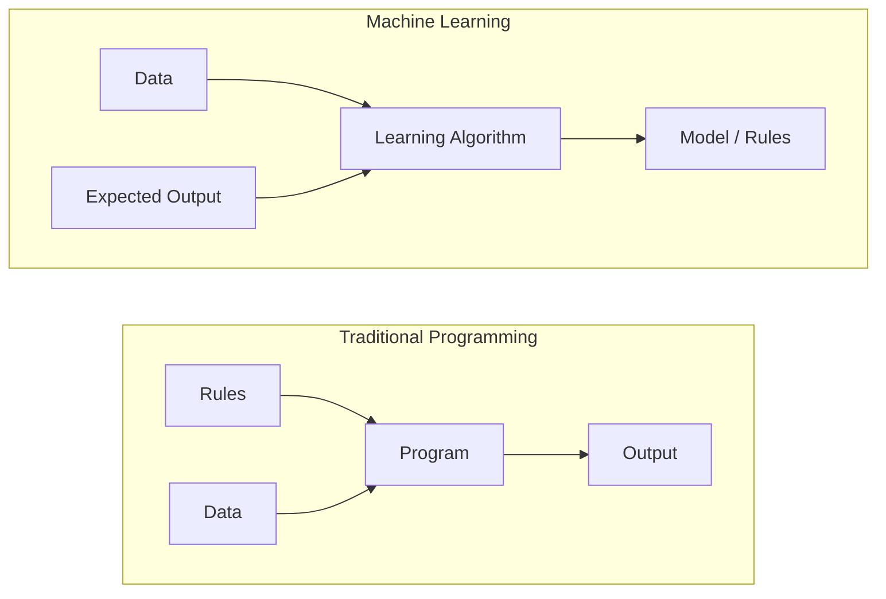
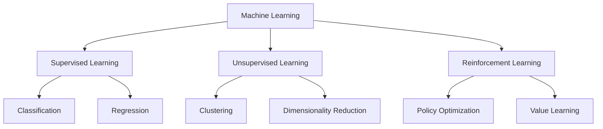
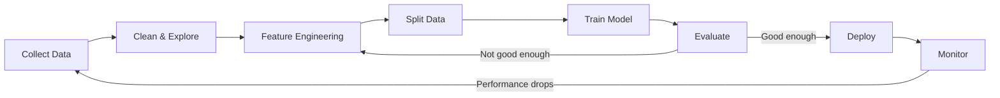
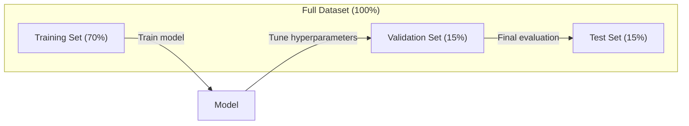
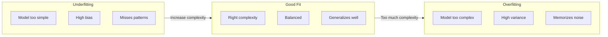
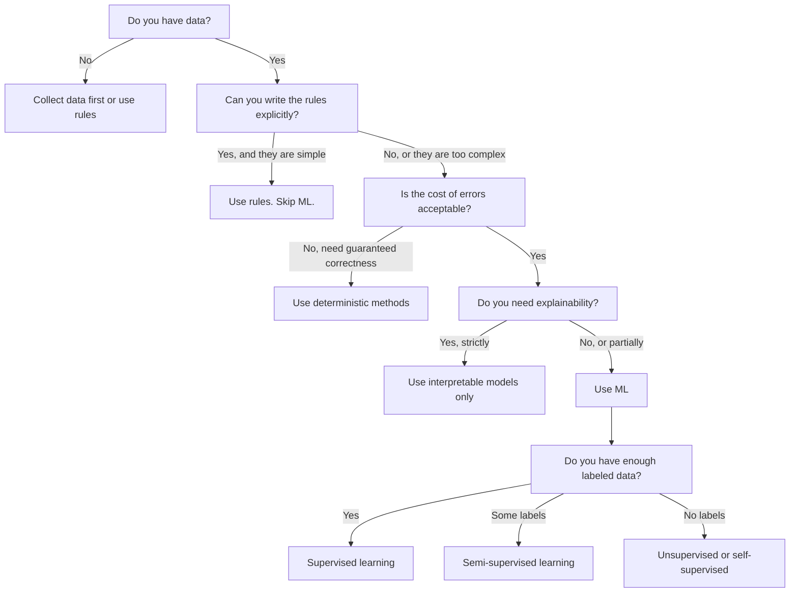

<!-- local-zh-machine-draft: English source is canonical; prose translated automatically, code/math preserved. -->

<a id="what-is-machine-learning"></a>

# 什么是机器学习

> 机器学习正在教计算机寻找数据中的模式，而不是手动编写规则。

**类型：** 了解
**语言：** Python
**先决条件：** 第 1 阶段（数学基础）
**时间：** ~45分钟

<a id="learning-objectives"></a>

## 学习目标

- 解释有监督、无监督和 reinforcement learning 之间的区别，并确定哪种类型适用于给定问题
- 从头开始实现最近的质心分类器并根据随机基线对其进行评估
- 区分分类和回归任务，并为每个任务选择合适的 loss function
- 评估给定的业务问题是否适合机器学习或通过确定性规则更好地解决

<a id="the-problem"></a>

## 问题

您想要构建一个垃圾邮件过滤器。传统方法：坐下来写数百条规则。 “如果电子邮件包含‘FREE MONEY’，请将其标记为垃圾邮件。如果电子邮件包含超过 3 个感叹号，请将其标记为垃圾邮件。”您花费数周时间编写规则。然后垃圾邮件发送者会改变他们的措辞。你的规则被打破了。你写更多的规则。循环永远不会结束。

机器学习扭转了这一局面。您无需编写规则，而是向计算机提供数千封带标签的电子邮件（“垃圾邮件”或“非垃圾邮件”），然后让它自行找出规则。计算机会发现你从未想到的模式。当垃圾邮件发送者改变策略时，您可以重新训练新数据，而不是重写代码。

这种从“编程规则”到“从数据中学习”的转变是机器学习的核心。每个推荐引擎、语音助手、自动驾驶汽车和语言模型都是这样工作的。

<a id="the-concept"></a>

## 概念

<a id="learning-from-data-not-rules"></a>

### 从数据而不是规则中学习

传统编程和机器学习解决问题的方向相反。



传统编程：您编写规则。该程序将它们应用于数据以产生输出。

机器学习：您提供数据和预期输出。算法发现规则。

训练出来的“模型”是规则，编码为数字（weights，parameters）。它根据见过的例子进行概括，并对从未见过的数据做出预测。

<a id="the-three-types-of-machine-learning"></a>

### 机器学习的三种类型



**监督学习**：您有输入-输出对。该模型学习将输入映射到输出。
- “这里有 10,000 张标记为猫或狗的照片。学会区分它们。”
- “这是房屋 features 和价格。学习预测价格。”

**无监督学习**：您只有输入。没有标签。该模型自行寻找结构。
- “这里有 10,000 个客户的购买历史记录。找到自然的分组。”
- “这里有 1,000 个维度的数据点。在保持结构的同时减少到 2 维。”

**Reinforcement Learning**：agent 在环境中采取行动并收到奖励或惩罚。它学习一种策略（政策）来最大化总奖励。
- “玩这个游戏。赢+1，输-1。想出一个策略。”
- “控制这个机器人手臂。拾起物体+1，每浪费一秒-0.01。”

您将在实践中构建的大部分内容都使用监督学习。无监督学习在预处理和探索中很常见。 Reinforcement learning 为游戏人工智能、机器人技术和 RLHF 语言模型提供支持。

<a id="beyond-the-big-three"></a>

### 超越三巨头

上面的三个类别很清晰，但现实世界的机器学习常常模糊了界限。

**半监督学习**使用少量标记数据和大量未标记数据。您可能有 100 张标记的医学图像和 100,000 张未标记的图像。技术包括：

- **标签传播：** 构建连接相似数据点的图。标签通过图中从已标记的节点传播到未标记的邻居。
- **伪标签：** 在标记数据上训练模型，用它来预测未标记数据的标签，然后对所有内容进行重新训练。该模型引导自己的训练集。
- **一致性正则化：** 该模型应该对输入和该输入的稍微扰动版本给出相同的预测。即使没有标签，这也有效。

**自监督学习**从数据本身创建监督。根本不需要人类标签。该模型根据数据结构创建自己的预测任务。

- **掩码语言建模（BERT）：** 隐藏句子中15%的单词，训练模型预测缺失的单词。 “标签”来自原文。
- **Contrastive learning (SimCLR):** 拍摄一个图像，创建两个增强版本。训练模型识别它们来自同一图像，同时将它们与其他图像的增强版本区分开来。
- **Next-token 预测 (GPT):** 在给定所有先前单词的情况下预测下一个单词。每个文本文档都成为一个训练示例。

这些并不是与三大巨头分开的类别。它们是结合了监督和无监督想法的策略。自监督学习在技术上是受监督的（模型预测某些东西），但标签是自动生成的，而不是由人类生成的。

<a id="classification-vs-regression"></a>

### 分类与回归

这是两个主要的监督学习任务。

| 方面 | 分类 | 回归 |
|--------|---------------|------------|
| 输出 | 离散类别 | 连续数字 |
| 示例 | “这封邮件是垃圾邮件吗？” | “房价会是多少？” |
| 输出空间 | {猫、狗、鸟} | 任意实数 |
| Loss function | Cross-entropy，精度 | 均方误差，MAE |
| 决定 | 类之间的界限 | 拟合数据的曲线 |

分类回答“哪个类别？”回归回答“多少？”

有些问题可以用任何一种方式来解释。预测股票是上涨还是下跌是分类。预测确切的价格就是回归。

<a id="the-ml-workflow"></a>

### 机器学习工作流程

无论算法如何，每个机器学习项目都遵循相同的流程。



**收集数据**：收集原始数据。数据越多几乎总是越好，但质量比数量更重要。

**Clean & Explore**：处理缺失值、删除重复项、可视化分布、发现异常。此步骤通常占用项目总时间的 60-80%。

**Feature Engineering**：将原始数据转换为模型可以使用的features。将日期转换为星期几。标准化数字列。对分类变量进行编码。好的 features 比花哨的算法更重要。

**分割数据**：分为训练集、验证集和测试集。该模型根据训练数据进行训练，您根据验证数据调整 hyperparameters，并报告测试数据的最终性能。

**训练模型**：将训练数据输入算法。该算法调整内部 parameters 以最小化 loss function。

**Evaluate**：测量验证/测试数据的性能。如果性能不可接受，请返回并尝试不同的 features、算法或 hyperparameters。

**Deploy**：将模型投入生产，对新数据进行预测。

**Monitor**：跟踪一段时间内的性能。数据分布发生变化（数据漂移），模型性能下降。当表现下降时，重新训练。

<a id="training-validation-and-test-splits"></a>

### 训练、验证和测试拆分

这是初学者容易犯错的最重要的概念。您必须根据模型在训练期间从未见过的数据来评估您的模型。否则你测量的是记忆力，而不是学习力。



| 斯普利特 | 目的 | 使用时 | 典型尺寸 |
|-------|---------|-----------|-------------|
| 培训 | 模型从这些数据中学习 | 训练期间 | 60-80% |
| 验证 | 调hyperparameters，比较型号 | 每次训练运行后 | 10-20% |
| 测试 | 最终无偏绩效评估 | 曾经，在最后一刻 | 10-20% |

测试集是神圣的。你只看一次。如果您不断根据测试性能调整模型，那么您实际上是在测试集上进行训练，并且您报告的数字毫无意义。

对于小型数据集，使用 k 折交叉验证：将数据拆分为 k 个部分，在 k-1 个部分上进行训练，在剩余部分上进行验证，旋转并平均结果。

<a id="overfitting-vs-underfitting"></a>

### Overfitting 与 Underfitting



**Underfitting**：模型太简单，无法捕获数据中的模式。试图拟合曲线关系的直线。训练误差较高。测试误差较高。

**Overfitting**：模型太复杂并且记住训练数据，包括其噪声。一条通过每个训练点但在新数据上失败的摆动曲线。训练误差低。测试误差较高。

**非常适合**：该模型无需记忆噪音即可捕获真实模式。训练误差和测试误差都相当低。

overfitting的标志：
- 训练准确率远高于验证准确率
- 该模型在训练数据上表现良好，但在新数据上表现不佳
- 添加更多训练数据可以提高性能（模型是在记忆，而不是学习）

针对 overfitting 的修复：
- 获取更多训练数据
- 降低模型复杂度（parameters 更少，架构更简单）
- 正则化（对大的weights添加惩罚）
- Dropout（训练期间随机将神经元清零）
- 提前停止（当验证错误开始增加时停止训练）

针对 underfitting 的修复：
- 使用更复杂的模型
- 添加更多 features
- 减少正则化
- 训练时间更长

<a id="the-bias-variance-tradeoff"></a>

### 偏差与方差的权衡

这就是 overfitting 和 underfitting 背后的数学框架。

**Bias**：模型中错误假设产生的错误。当真实关系是非线性时，线性模型具有很高的偏差。高偏置导致 underfitting。

**Variance**：对训练数据小波动的敏感性产生的误差。当对不同的数据子集进行训练时，具有高方差的模型会给出非常不同的预测。高方差导致 overfitting。

| 模型复杂度 | 偏差 | 方差 | 结果 |
|-----------------|------|----------|--------|
| 太低（曲线数据的线性模型） | 高 | 低 | Underfitting |
| 刚刚好 | 中等 | 中等 | 良好的概括性 |
| 太高（10 个点的 20 次多项式） | 低 | 高 | Overfitting |

总误差 = 偏差^2 + 方差 + 不可约噪声

您无法减少不可约噪声（它是数据本身的随机性）。您想要找到偏差^2 + 方差最小化的最佳点。

<a id="no-free-lunch-theorem"></a>

### 没有免费午餐定理

没有一种算法能够最好地解决所有问题。在一类问题上表现良好的算法在另一类问题上表现不佳。这就是数据科学家尝试多种算法并比较结果的原因。

在实践中，选择取决于：
- 您有多少数据
- features 有多少个
- 关系是线性还是非线性
- 是否需要可解释性
- 您能负担得起多少计算能力

<a id="when-not-to-use-machine-learning"></a>

### 何时不使用机器学习

机器学习很强大，但并不总是正确的工具。在选择模型之前，先问问自己是否真的需要一个。

**当以下情况时不使用ML：**

- **规则简单且定义明确。** 税收计算、排序算法、单位转换。如果您可以用几个 if 语句编写逻辑，那么模型会增加复杂性，但没有任何好处。
- **您没有数据或数据很少。** ML需要示例来学习。如果有 10 个数据点，你无法训练出任何有意义的东西。首先收集数据。
- ** 错误的代价是灾难性的，你需要保证正确性。** 医疗剂量计算、核反应堆控制、密码验证。机器学习模型是概率性的。他们有时会错。如果“有时错误”是不可接受的，请使用确定性方法。
- **A 查找表或启发式解决了问题。** 如果简单的阈值或表涵盖了 99% 的情况，则添加 ML 会增加维护成本，而没有任何有意义的改进。
- **您无法解释该决定，并且需要可解释性。** 受监管的行业（贷款、保险、刑事司法）有时要求每个决定都可以完全解释。一些机器学习模型是可解释的（线性回归、小型决策树）。大多数都不是。
- **问题的变化速度比您重新训练的速度还要快。** 如果规则每天都在变化并且重新训练需要一周，那么模型总是陈旧的。

使用此决策流程图：



```figure
f3-learning-boundary
```

<a id="build-it"></a>

## 动手实现

`code/ml_intro.py` 中的代码从头开始实现了最近质心分类器，这是最简单的 ML 算法。它展示了核心思想：从数据中学习，然后根据新数据进行预测。

<a id="step-1-nearest-centroid-classifier-from-scratch"></a>

### 第 1 步：从头开始最近的质心分类器

最近的质心分类器计算训练数据中每个类的中心（平均值）。为了进行预测，它将每个新点分配给距离最近的中心的类。

```python
class NearestCentroid:
    def fit(self, X, y):
        self.classes = np.unique(y)
        self.centroids = np.array([
            X[y == c].mean(axis=0) for c in self.classes
        ])

    def predict(self, X):
        distances = np.array([
            np.sqrt(((X - c) ** 2).sum(axis=1))
            for c in self.centroids
        ])
        return self.classes[distances.argmin(axis=0)]
```

这就是整个算法。拟合计算两个均值。 Predict 计算距离。没有gradient descent，没有迭代，没有hyperparameters。

<a id="step-2-train-on-synthetic-data"></a>

### 第 2 步：使用合成数据进行训练

我们生成一个二维分类数据集，其中两个类略有重叠。质心分类器在类中心之间绘制线性决策边界。

```python
rng = np.random.RandomState(42)
X_class0 = rng.randn(100, 2) + np.array([1.0, 1.0])
X_class1 = rng.randn(100, 2) + np.array([-1.0, -1.0])
X = np.vstack([X_class0, X_class1])
y = np.array([0] * 100 + [1] * 100)
```

<a id="step-3-compare-against-a-baseline"></a>

### 第 3 步：与基线进行比较

每个机器学习模型都应该与一个简单的基线进行比较。在这里，基线预测一个随机类别。如果您的 ML 模型无法击败随机猜测，则说明出现了问题。

```python
baseline_preds = rng.choice([0, 1], size=len(y_test))
baseline_acc = np.mean(baseline_preds == y_test)
```

质心分类器在这个干净的数据集上应该获得 90% 以上的准确率。随机基线约为 50%。

<a id="why-this-matters"></a>

### 为什么这很重要

最近的质心分类器非常简单。它没有hyperparameters，没有迭代，没有gradient descent。然而它捕捉了基本的机器学习模式：

1. **Learn** 训练数据的表示（质心）
2. **Predict** 使用该表示的新数据（最近距离）
3. **E根据基线评估**（随机猜测）

从逻辑回归到 transformers，每个 ML 算法都遵循相同的三步模式。表示变得更加复杂，但工作流程保持不变。

<a id="step-4-what-the-centroid-classifier-cannot-do"></a>

### 第四步：质心分类器不能做什么

最近的质心分类器假设每个类形成一个单一的斑点。它绘制了线性决策边界。当出现以下情况时会失败：

- 类有多个簇（例如，数字“1”可以用几种不同的方式书写）
- 决策边界是非线性的（例如，一个类包围另一个类）
- Features 的尺度差异很大（距离以最大尺度 feature 为主）

这些限制激发了您将学习的所有其他算法。 K 最近邻处理多个集群。决策树处理非线性边界。 Feature 缩放修复了缩放问题。每节课都建立在上一课的局限性之上。

<a id="use-it"></a>

## 实际应用

sklearn 提供 `NearestCentroid` 和合成数据生成器：

```python
from sklearn.neighbors import NearestCentroid
from sklearn.datasets import make_classification
from sklearn.model_selection import train_test_split

X, y = make_classification(
    n_samples=500, n_features=2, n_redundant=0,
    n_clusters_per_class=1, random_state=42
)
X_train, X_test, y_train, y_test = train_test_split(X, y, test_size=0.3)

clf = NearestCentroid()
clf.fit(X_train, y_train)
print(f"Accuracy: {clf.score(X_test, y_test):.3f}")
```

<a id="ship-it"></a>

## 交付成果

本课程生成 `outputs/prompt-ml-problem-framer.md`——一个 prompt，它将模糊的业务问题转化为具体的 ML 任务。给它一个问题描述（“我们想要减少流失”或“预测下个季度的需求”），它会识别学习类型，定义预测目标，列出候选 features，选择成功指标，建立基线，并标记 data leakage 或类别不平衡等陷阱。在任何 ML 项目开始时使用它，以避免构建错误的东西。

<a id="key-terms"></a>

## 关键术语

| 术语 | 人们怎么说 | 它实际上意味着什么 |
|------|----------------|----------------------|
| 模型 | “人工智能” | 具有可学习 parameters 的数学函数，可将输入映射到输出 |
| 培训 | “教授人工智能” | 运行优化算法来调整模型 parameters 以便预测与已知输出匹配 |
| Feature | “输入栏” | 模型用于进行预测的数据的可测量属性 |
| 标签 | “答案” | 训练示例的已知输出，用于计算误差信号 |
| Hyperparameter | “您可以调整的设置” | 训练前设置的parameter，用于控制学习过程（learning rate，层数） |
| Loss function | “这个模型有多么错误” | 衡量预测输出与实际输出之间差距的函数，训练试图将其最小化 |
| Overfitting | “它记住了测试” | 该模型学习了训练特定的噪声而不是一般模式，因此它在新数据上失败 |
| Underfitting | “没学到任何东西” | 该模型太简单，无法捕获数据中的真实模式 |
| 概括 | “它适用于新数据” | 模型对未经训练的数据做出准确预测的能力 |
| 交叉验证 | “在不同的块上进行测试” | 反复将数据拆分为训练/测试折叠并对结果进行平均，从而提供更稳健的性能估计 |
| 正则化 | “保持 weights 较小” | 在 loss function 中添加惩罚项，以阻止过于复杂的模型 |
| 数据漂移 | “世界变了” | 输入数据的统计分布随时间变化，从而降低模型性能 |

<a id="exercises"></a>

## 练习

1. 获取任何数据集（例如 Iris、泰坦尼克号）。将其分为 70/15/15 部分：训练/验证/测试。解释为什么不应在测试集上调整 hyperparameters。
2. 列出三个现实世界的问题。对于每一个，确定它是分类、回归还是聚类，以及它是有监督的还是无监督的。
3. 模型在训练数据上的准确度为 99%，但在测试数据上的准确度为 60%。诊断问题并列出您将尝试解决的三件事。

<a id="further-reading"></a>

## 进一步阅读

- [统计学习简介](https://www.statlearning.com/) - 免费教科书，涵盖所有经典机器学习方法和实际示例
- [Google 机器学习速成课程](https://developers.google.com/machine-learning/crash-course) - ML概念的简洁直观介绍
- [Scikit-learn 用户指南](https://scikit-learn.org/stable/user_guide.html) - 在 Python 中实现 ML 的实用参考
