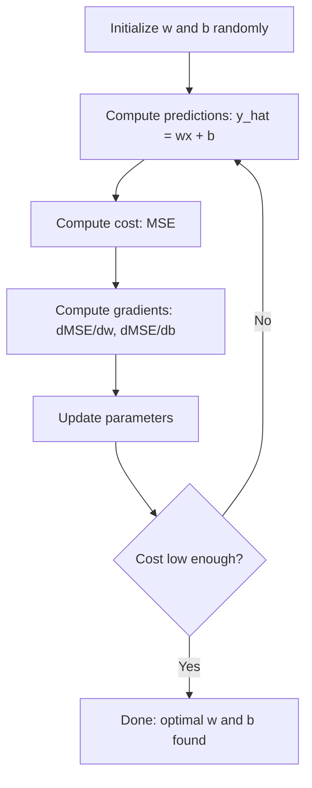

<!-- local-zh-machine-draft: English source is canonical; prose translated automatically, code/math preserved. -->

<a id="linear-regression"></a>

# 线性回归

> 线性回归通过数据绘制最佳直线。它是机器学习的“你好世界”。

**类型：** 构建
**语言：** Python
**先决条件：** 第 1 阶段（线性代数、微积分、最优化）、第 2 阶段第 1 课
**时间：** ~90 分钟

<a id="learning-objectives"></a>

## 学习目标

- 推导均方误差的gradient descent更新规则并从头开始实现线性回归
- 比较 gradient descent 和正规方程的计算复杂度以及何时使用它们
- 使用 feature 标准化构建多元线性回归模型并解释学习到的 weights
- 解释岭回归（L2正则化）如何通过惩罚大的 weights 来防止 overfitting

<a id="the-problem"></a>

## 问题

您有数据：房屋面积及其销售价格。您想要根据新房的大小来预测其价格。您可以在散点图上观察它，但您需要一个公式。您需要一条最适合数据的线，以便您可以插入任何尺寸并获得价格预测。

线性回归给出了这条线。更重要的是，它介绍了整个 ML 训练循环：定义模型、定义成本函数、优化 parameters。每个机器学习算法都遵循相同的模式。用最简单的案例掌握这里，你就会到处认得。

这不仅仅是为了解决简单的问题。线性回归在生产系统中用于需求预测、A/B 测试分析、财务建模，并作为每个回归任务的基线。

<a id="the-concept"></a>

## 概念

<a id="the-model"></a>

### 模型

线性回归假设输入 (x) 和输出 (y) 之间存在线性关系：

```
y = wx + b
```

- `w`（weight/slope）：x增加1时y变化多少
- `b`（偏差/截距）：x = 0时y的值

对于多个输入 (features)，这扩展到：

```
y = w1*x1 + w2*x2 + ... + wn*xn + b
```

或者矢量形式：`y = w^T * x + b`

目标：找到 w 和 b 的值，使所有训练示例中的预测 y 尽可能接近实际 y。

<a id="the-cost-function-mean-squared-error"></a>

### 成本函数（均方误差）

如何衡量“尽可能接近”？您需要一个数字来反映您的预测的错误程度。最常见的选择是均方误差 (MSE)：

```
MSE = (1/n) * sum((y_predicted - y_actual)^2)
```

为什么要平方？有两个原因。首先，它对大错误的惩罚多于对小错误的惩罚（10 的错误比 1 的错误严重 100 倍，而不是 10 倍）。其次，平方函数是平滑且处处可微的，这使得优化变得简单。

成本函数创建一个表面。对于单个 weight w 和偏差 b，MSE 表面看起来像一个碗（凸抛物面）。碗的底部是 MSE 最小的地方。训练意味着找到底部。

<a id="gradient-descent"></a>

### Gradient Descent

Gradient descent 通过走下坡路找到碗底。



gradients 告诉您两件事：每个 parameter 向哪个方向移动，以及移动多少。

对于 y_hat = wx + b 的 MSE：

```
dMSE/dw = (2/n) * sum((y_hat - y) * x)
dMSE/db = (2/n) * sum(y_hat - y)
```

更新规则：

```
w = w - learning_rate * dMSE/dw
b = b - learning_rate * dMSE/db
```

learning rate 控制步长。太大：超出最小值并出现偏差。太小：训练需要很长时间。典型起始值：0.01、0.001 或 0.0001。

<a id="the-normal-equation-closed-form-solution"></a>

### 正规方程（闭式解）

特别是对于线性回归，有一个直接公式可以给出最优的 weights 而无需任何迭代：

```
w = (X^T * X)^(-1) * X^T * y
```

这会反转矩阵以一步求解 w。它非常适合小型数据集。对于大型数据集（数百万行或数千个 features），首选 gradient descent，因为在 features 的数量中，矩阵求逆是 O(n^3)。

<a id="multiple-linear-regression"></a>

### 多元线性回归

有了多个features，模型就变成：

```
y = w1*x1 + w2*x2 + ... + wn*xn + b
```

一切都一样：MSE是成本函数，gradient descent同时更新所有weights。唯一的区别是您正在拟合超平面而不是直线。

Feature缩放在这里很重要。 如果有一个feature范围从 0 到 1，另一个范围从 0 到 1,000,000，gradient descent将会陷入困境，因为成本面变得拉长。 标准化features（减去平均值，除以标准差）训练前。

<a id="polynomial-regression"></a>

### 多项式回归

如果关系不是线性的怎么办？您仍然可以通过创建多项式 features 来使用线性回归：

```
y = w1*x + w2*x^2 + w3*x^3 + b
```

这仍然是“线性”回归，因为模型在 weights (w1, w2, w3) 中是线性的。您只是使用 x 的非线性 features 。

更高次数的多项式可以拟合更复杂的曲线，但存在 overfitting 的风险。 10 次多项式将通过 10 点数​​据集中的每个点，但对新数据的预测效果很差。

<a id="r-squared-score"></a>

### R 平方分数

MSE 告诉你你错了多少，但数字取决于 y 的大小。 R 平方 (R^2) 给出与尺度无关的度量：

```
R^2 = 1 - (sum of squared residuals) / (sum of squared deviations from mean)
    = 1 - SS_res / SS_tot
```

- R^2 = 1.0：完美预测
- R^2 = 0.0：模型并不比每次预测均值更好
- R^2 < 0.0：模型比预测平均值更差

<a id="regularization-preview-ridge-regression"></a>

### 正则化预览（岭回归）

当您有许多 features 时，模型可能会通过分配较大的 weights 来过度拟合。岭回归（L2 正则化）添加了惩罚：

```
Cost = MSE + lambda * sum(w_i^2)
```

惩罚项阻止大weights。 hyperparameter lambda 控制权衡：更高的 lambda 意味着更小的 weights 和更多的正则化。这将在后面的课程中深入介绍。现在，请知道它的存在以及它为何有帮助。

```figure
linear-regression-fit
```

<a id="build-it"></a>

## 动手实现

<a id="step-1-generate-sample-data"></a>

### 第 1 步：生成样本数据

```python
import random
import math

random.seed(42)

TRUE_W = 3.0
TRUE_B = 7.0
N_SAMPLES = 100

X = [random.uniform(0, 10) for _ in range(N_SAMPLES)]
y = [TRUE_W * x + TRUE_B + random.gauss(0, 2.0) for x in X]

print(f"Generated {N_SAMPLES} samples")
print(f"True relationship: y = {TRUE_W}x + {TRUE_B} (+ noise)")
print(f"First 5 points: {[(round(X[i], 2), round(y[i], 2)) for i in range(5)]}")
```

<a id="step-2-linear-regression-from-scratch-with-gradient-descent"></a>

### 步骤 2：使用 gradient descent 从头开始线性回归

```python
class LinearRegression:
    def __init__(self, learning_rate=0.01):
        self.w = 0.0
        self.b = 0.0
        self.lr = learning_rate
        self.cost_history = []

    def predict(self, X):
        return [self.w * x + self.b for x in X]

    def compute_cost(self, X, y):
        predictions = self.predict(X)
        n = len(y)
        cost = sum((pred - actual) ** 2 for pred, actual in zip(predictions, y)) / n
        return cost

    def compute_gradients(self, X, y):
        predictions = self.predict(X)
        n = len(y)
        dw = (2 / n) * sum((pred - actual) * x for pred, actual, x in zip(predictions, y, X))
        db = (2 / n) * sum(pred - actual for pred, actual in zip(predictions, y))
        return dw, db

    def fit(self, X, y, epochs=1000, print_every=200):
        for epoch in range(epochs):
            dw, db = self.compute_gradients(X, y)
            self.w -= self.lr * dw
            self.b -= self.lr * db
            cost = self.compute_cost(X, y)
            self.cost_history.append(cost)
            if epoch % print_every == 0:
                print(f"  Epoch {epoch:4d} | Cost: {cost:.4f} | w: {self.w:.4f} | b: {self.b:.4f}")
        return self

    def r_squared(self, X, y):
        predictions = self.predict(X)
        y_mean = sum(y) / len(y)
        ss_res = sum((actual - pred) ** 2 for actual, pred in zip(y, predictions))
        ss_tot = sum((actual - y_mean) ** 2 for actual in y)
        return 1 - (ss_res / ss_tot)


print("=== Training Linear Regression (Gradient Descent) ===")
model = LinearRegression(learning_rate=0.005)
model.fit(X, y, epochs=1000, print_every=200)
print(f"\nLearned: y = {model.w:.4f}x + {model.b:.4f}")
print(f"True:    y = {TRUE_W}x + {TRUE_B}")
print(f"R-squared: {model.r_squared(X, y):.4f}")
```

<a id="step-3-normal-equation-closed-form-solution"></a>

### 步骤 3：正规方程（封闭式解）

```python
class LinearRegressionNormal:
    def __init__(self):
        self.w = 0.0
        self.b = 0.0

    def fit(self, X, y):
        n = len(X)
        x_mean = sum(X) / n
        y_mean = sum(y) / n
        numerator = sum((X[i] - x_mean) * (y[i] - y_mean) for i in range(n))
        denominator = sum((X[i] - x_mean) ** 2 for i in range(n))
        self.w = numerator / denominator
        self.b = y_mean - self.w * x_mean
        return self

    def predict(self, X):
        return [self.w * x + self.b for x in X]

    def r_squared(self, X, y):
        predictions = self.predict(X)
        y_mean = sum(y) / len(y)
        ss_res = sum((actual - pred) ** 2 for actual, pred in zip(y, predictions))
        ss_tot = sum((actual - y_mean) ** 2 for actual in y)
        return 1 - (ss_res / ss_tot)


print("\n=== Normal Equation (Closed-Form) ===")
model_normal = LinearRegressionNormal()
model_normal.fit(X, y)
print(f"Learned: y = {model_normal.w:.4f}x + {model_normal.b:.4f}")
print(f"R-squared: {model_normal.r_squared(X, y):.4f}")
```

<a id="step-4-multiple-linear-regression"></a>

### 步骤 4：多元线性回归

```python
class MultipleLinearRegression:
    def __init__(self, n_features, learning_rate=0.01):
        self.weights = [0.0] * n_features
        self.bias = 0.0
        self.lr = learning_rate
        self.cost_history = []

    def predict_single(self, x):
        return sum(w * xi for w, xi in zip(self.weights, x)) + self.bias

    def predict(self, X):
        return [self.predict_single(x) for x in X]

    def compute_cost(self, X, y):
        predictions = self.predict(X)
        n = len(y)
        return sum((pred - actual) ** 2 for pred, actual in zip(predictions, y)) / n

    def fit(self, X, y, epochs=1000, print_every=200):
        n = len(y)
        n_features = len(X[0])
        for epoch in range(epochs):
            predictions = self.predict(X)
            errors = [pred - actual for pred, actual in zip(predictions, y)]
            for j in range(n_features):
                grad = (2 / n) * sum(errors[i] * X[i][j] for i in range(n))
                self.weights[j] -= self.lr * grad
            grad_b = (2 / n) * sum(errors)
            self.bias -= self.lr * grad_b
            cost = self.compute_cost(X, y)
            self.cost_history.append(cost)
            if epoch % print_every == 0:
                print(f"  Epoch {epoch:4d} | Cost: {cost:.4f}")
        return self

    def r_squared(self, X, y):
        predictions = self.predict(X)
        y_mean = sum(y) / len(y)
        ss_res = sum((actual - pred) ** 2 for actual, pred in zip(y, predictions))
        ss_tot = sum((actual - y_mean) ** 2 for actual in y)
        return 1 - (ss_res / ss_tot)


random.seed(42)
N = 100
X_multi = []
y_multi = []
for _ in range(N):
    size = random.uniform(500, 3000)
    bedrooms = random.randint(1, 5)
    age = random.uniform(0, 50)
    price = 50 * size + 10000 * bedrooms - 1000 * age + 50000 + random.gauss(0, 20000)
    X_multi.append([size, bedrooms, age])
    y_multi.append(price)


def standardize(X):
    n_features = len(X[0])
    means = [sum(X[i][j] for i in range(len(X))) / len(X) for j in range(n_features)]
    stds = []
    for j in range(n_features):
        variance = sum((X[i][j] - means[j]) ** 2 for i in range(len(X))) / len(X)
        stds.append(variance ** 0.5)
    X_scaled = []
    for i in range(len(X)):
        row = [(X[i][j] - means[j]) / stds[j] if stds[j] > 0 else 0 for j in range(n_features)]
        X_scaled.append(row)
    return X_scaled, means, stds


y_mean_val = sum(y_multi) / len(y_multi)
y_std_val = (sum((yi - y_mean_val) ** 2 for yi in y_multi) / len(y_multi)) ** 0.5
y_scaled = [(yi - y_mean_val) / y_std_val for yi in y_multi]

X_scaled, x_means, x_stds = standardize(X_multi)

print("\n=== Multiple Linear Regression (3 features) ===")
print("Features: house size, bedrooms, age")
multi_model = MultipleLinearRegression(n_features=3, learning_rate=0.01)
multi_model.fit(X_scaled, y_scaled, epochs=1000, print_every=200)

print(f"\nWeights (standardized): {[round(w, 4) for w in multi_model.weights]}")
print(f"Bias (standardized): {multi_model.bias:.4f}")
print(f"R-squared: {multi_model.r_squared(X_scaled, y_scaled):.4f}")
```

<a id="step-5-polynomial-regression"></a>

### 第5步：多项式回归

```python
class PolynomialRegression:
    def __init__(self, degree, learning_rate=0.01):
        self.degree = degree
        self.weights = [0.0] * degree
        self.bias = 0.0
        self.lr = learning_rate

    def make_features(self, X):
        return [[x ** (d + 1) for d in range(self.degree)] for x in X]

    def predict(self, X):
        features = self.make_features(X)
        return [sum(w * f for w, f in zip(self.weights, row)) + self.bias for row in features]

    def fit(self, X, y, epochs=1000, print_every=200):
        features = self.make_features(X)
        n = len(y)
        for epoch in range(epochs):
            predictions = [sum(w * f for w, f in zip(self.weights, row)) + self.bias for row in features]
            errors = [pred - actual for pred, actual in zip(predictions, y)]
            for j in range(self.degree):
                grad = (2 / n) * sum(errors[i] * features[i][j] for i in range(n))
                self.weights[j] -= self.lr * grad
            grad_b = (2 / n) * sum(errors)
            self.bias -= self.lr * grad_b
            if epoch % print_every == 0:
                cost = sum(e ** 2 for e in errors) / n
                print(f"  Epoch {epoch:4d} | Cost: {cost:.6f}")
        return self

    def r_squared(self, X, y):
        predictions = self.predict(X)
        y_mean = sum(y) / len(y)
        ss_res = sum((actual - pred) ** 2 for actual, pred in zip(y, predictions))
        ss_tot = sum((actual - y_mean) ** 2 for actual in y)
        return 1 - (ss_res / ss_tot)


random.seed(42)
X_poly = [x / 10.0 for x in range(0, 50)]
y_poly = [0.5 * x ** 2 - 2 * x + 3 + random.gauss(0, 1.0) for x in X_poly]

x_max = max(abs(x) for x in X_poly)
X_poly_norm = [x / x_max for x in X_poly]
y_poly_mean = sum(y_poly) / len(y_poly)
y_poly_std = (sum((yi - y_poly_mean) ** 2 for yi in y_poly) / len(y_poly)) ** 0.5
y_poly_norm = [(yi - y_poly_mean) / y_poly_std for yi in y_poly]

print("\n=== Polynomial Regression (degree 2 vs degree 5) ===")
print("True relationship: y = 0.5x^2 - 2x + 3")

print("\nDegree 2:")
poly2 = PolynomialRegression(degree=2, learning_rate=0.1)
poly2.fit(X_poly_norm, y_poly_norm, epochs=2000, print_every=500)
print(f"  R-squared: {poly2.r_squared(X_poly_norm, y_poly_norm):.4f}")

print("\nDegree 5:")
poly5 = PolynomialRegression(degree=5, learning_rate=0.1)
poly5.fit(X_poly_norm, y_poly_norm, epochs=2000, print_every=500)
print(f"  R-squared: {poly5.r_squared(X_poly_norm, y_poly_norm):.4f}")

print("\nDegree 2 fits the true curve well. Degree 5 fits training data slightly better")
print("but risks overfitting on new data.")
```

<a id="step-6-ridge-regression-l2-regularization"></a>

### 第6步：岭回归（L2正则化）

```python
class RidgeRegression:
    def __init__(self, n_features, learning_rate=0.01, alpha=1.0):
        self.weights = [0.0] * n_features
        self.bias = 0.0
        self.lr = learning_rate
        self.alpha = alpha

    def predict_single(self, x):
        return sum(w * xi for w, xi in zip(self.weights, x)) + self.bias

    def predict(self, X):
        return [self.predict_single(x) for x in X]

    def fit(self, X, y, epochs=1000, print_every=200):
        n = len(y)
        n_features = len(X[0])
        for epoch in range(epochs):
            predictions = self.predict(X)
            errors = [pred - actual for pred, actual in zip(predictions, y)]
            mse = sum(e ** 2 for e in errors) / n
            reg_term = self.alpha * sum(w ** 2 for w in self.weights)
            cost = mse + reg_term
            for j in range(n_features):
                grad = (2 / n) * sum(errors[i] * X[i][j] for i in range(n))
                grad += 2 * self.alpha * self.weights[j]
                self.weights[j] -= self.lr * grad
            grad_b = (2 / n) * sum(errors)
            self.bias -= self.lr * grad_b
            if epoch % print_every == 0:
                print(f"  Epoch {epoch:4d} | Cost: {cost:.4f} | L2 penalty: {reg_term:.4f}")
        return self


print("\n=== Ridge Regression (L2 Regularization) ===")
print("Same data as multiple regression, with alpha=0.1")
ridge = RidgeRegression(n_features=3, learning_rate=0.01, alpha=0.1)
ridge.fit(X_scaled, y_scaled, epochs=1000, print_every=200)
print(f"\nRidge weights: {[round(w, 4) for w in ridge.weights]}")
print(f"Plain weights: {[round(w, 4) for w in multi_model.weights]}")
print("Ridge weights are smaller (shrunk toward zero) due to the L2 penalty.")
```

<a id="use-it"></a>

## 实际应用

现在 scikit-learn 也是如此，这就是您将在生产中实际使用的内容。

```python
from sklearn.linear_model import LinearRegression as SklearnLR
from sklearn.linear_model import Ridge
from sklearn.preprocessing import PolynomialFeatures, StandardScaler
from sklearn.model_selection import train_test_split
from sklearn.metrics import mean_squared_error, r2_score
import numpy as np

np.random.seed(42)
X_sk = np.random.uniform(0, 10, (100, 1))
y_sk = 3.0 * X_sk.squeeze() + 7.0 + np.random.normal(0, 2.0, 100)

X_train, X_test, y_train, y_test = train_test_split(X_sk, y_sk, test_size=0.2, random_state=42)

lr = SklearnLR()
lr.fit(X_train, y_train)
y_pred = lr.predict(X_test)

print("=== Scikit-learn Linear Regression ===")
print(f"Coefficient (w): {lr.coef_[0]:.4f}")
print(f"Intercept (b): {lr.intercept_:.4f}")
print(f"R-squared (test): {r2_score(y_test, y_pred):.4f}")
print(f"MSE (test): {mean_squared_error(y_test, y_pred):.4f}")

poly = PolynomialFeatures(degree=2, include_bias=False)
X_poly_sk = poly.fit_transform(X_train)
X_poly_test = poly.transform(X_test)

lr_poly = SklearnLR()
lr_poly.fit(X_poly_sk, y_train)
print(f"\nPolynomial degree 2 R-squared: {r2_score(y_test, lr_poly.predict(X_poly_test)):.4f}")

scaler = StandardScaler()
X_train_scaled = scaler.fit_transform(X_train)
X_test_scaled = scaler.transform(X_test)

ridge = Ridge(alpha=1.0)
ridge.fit(X_train_scaled, y_train)
print(f"Ridge R-squared: {r2_score(y_test, ridge.predict(X_test_scaled)):.4f}")
print(f"Ridge coefficient: {ridge.coef_[0]:.4f}")
```

您的从头开始实施和 scikit-learn 会产生相同的结果。区别：scikit-learn 处理边缘情况、数值稳定性和性能优化。使用该库进行生产。使用从头开始的版本来了解正在发生的情况。

<a id="ship-it"></a>

## 交付成果

本课产生：
- `outputs/skill-regression.md` - 根据问题选择正确回归方法的技能

<a id="exercises"></a>

## 练习

1. 实现批量 gradient descent、stochastic gradient descent (SGD) 和小批量 gradient descent。比较同一数据集上的收敛速度。哪个收敛最快？哪个成本曲线最平滑？
2. 从三次函数生成数据 (y = ax^3 + bx^2 + cx + d + 噪声)。拟合 1、3 和 10 次多项式。比较训练 R^2 和测试 R^2。 overfitting 在什么程度上变得明显？
3. 实现Lasso回归（L1正则化：penalty = alpha * sum(|w_i|））。训练多feature住房数据。比较 weights 与 Ridge 归零的情况。为什么 L1 产生稀疏解而 L2 却不能？

<a id="key-terms"></a>

## 关键术语

| 术语 | 人们怎么说 | 它实际上意味着什么 |
|------|----------------|----------------------|
| 线性回归 | “通过数据画一条线” | 找到 weight w 和偏差 b，使 wx+b 与实际 y 值之间的平方差之和最小化 |
| 成本函数 | “这个模型有多糟糕” | 将模型 parameters 映射到测量预测误差的单个数字的函数，该函数优化最小化 |
| 均方误差 | “平方误差的平均值” | (1/n) * (预测 - 实际)^2 之和，不成比例地惩罚大错误 |
| Gradient descent | 《走下坡路》 | 使用偏导数，朝降低成本函数的方向迭代调整 parameters |
| Learning rate | “步长” | 控制每个 gradient descent 步骤 parameters 变化量的标量 |
| 正规方程 | “直接解决” | 封闭式解 w = (X^T X)^-1 X^T y 无需迭代即可给出最优 weights |
| R平方 | “身材有多好” | 模型解释的 y 方差分数，范围从负无穷大到 1.0 |
| Feature 缩放 | “使 features 具有可比性” | 将 features 转换为相似范围（例如，零均值、单位方差），以便 gradient descent 收敛得更快 |
| 正则化 | “惩罚复杂性” | 在成本函数中添加一项收缩weights，防止overfitting |
| 岭回归 | “L2正则化” | 将 lambda * sum(w_i^2) 惩罚添加到 MSE 的线性回归 |
| 多项式回归 | “用线性数学拟合曲线” | 多项式 features (x, x^2, x^3, ...) 上的线性回归，在 weights 中仍然是线性的 |
| Overfitting | “记忆训练数据” | 使用非常复杂的模型，以至于它适合训练数据中的噪声，但无法适应新数据 |

<a id="further-reading"></a>

## 进一步阅读

- [统计学习简介 (ISLR)](https://www.statlearning.com/) -- 免费 PDF，第 3 章和第 6 章涵盖线性回归和正则化以及实际的 R 示例
- [统计学习的要素 (ESL)](https://hastie.su.domains/ElemStatLearn/) -- 免费 PDF，ISLR 的数学伴侣，对岭和套索进行更深入的处理
- [Stanford CS229线性回归讲义](https://cs229.stanford.edu/main_notes.pdf) -- Andrew Ng从第一原理推导出正规方程和gradient descent的笔记
- [scikit-learn LinearRegression 文档](https://scikit-learn.org/stable/modules/linear_model.html) -- LinearRegression、Ridge、Lasso 和 ElasticNet 的实用参考以及代码示例
