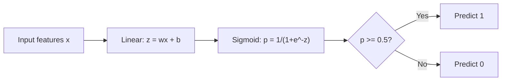
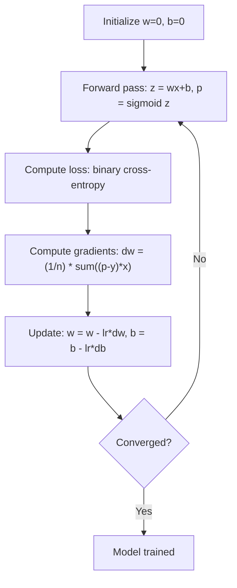

<!-- local-zh-machine-draft: English source is canonical; prose translated automatically, code/math preserved. -->

<a id="logistic-regression"></a>

# 逻辑回归

> 逻辑回归将直线弯曲成 S 曲线，以概率回答是或否问题。

**类型：** 构建
**语言：** Python
**先决条件：** 第 2 阶段第 1-2 课（什么是 ML，线性回归）
**时间：** ~90 分钟

<a id="learning-objectives"></a>

## 学习目标

- 使用 sigmoid 函数和二进制 cross-entropy 损失从头开始实现逻辑回归
- 计算和解释二元分类的精确率、召回率、F1 分数和混淆矩阵
- 解释为什么 MSE 分类失败以及为什么二进制 cross-entropy 会产生凸成本面
- 构建用于多类分类的 softmax 回归模型并评估阈值调整权衡

<a id="the-problem"></a>

## 问题

您想要根据肿瘤的大小来预测肿瘤是恶性还是良性。您尝试线性回归。它输出诸如 0.3 或 1.7 或 -0.5 之类的数字。这些是什么意思？ 1.7“非常恶性”吗？ -0.5 是“非常良性”吗？线性回归输出无界数字。分类需要 0 到 1 之间的有界概率，以及明确的决定：是或否。

逻辑回归解决了这个问题。它采用相同的线性组合 (wx + b) 并将其传递给 sigmoid 函数，该函数将任何数字压缩到范围 (0, 1) 中。输出是一个概率。您设置一个阈值（通常为 0.5）并做出决定。

这是实践中使用最广泛的算法之一。尽管它的名字如此，逻辑回归是一种分类算法，而不是回归算法。该名称来自它使用的逻辑 (sigmoid) 函数。

<a id="the-concept"></a>

## 概念

<a id="why-linear-regression-fails-for-classification"></a>

### 为什么线性回归无法用于分类

想象一下根据学习时间预测通过/失败 (1/0)。线性回归拟合一条穿过数据的线：

```
hours:  1   2   3   4   5   6   7   8   9   10
actual: 0   0   0   0   1   1   1   1   1   1
```

线性拟合可能会产生诸如第 1 小时为 -0.2 和第 10 小时为 1.3 之类的预测。这些值不是概率。它们低于 0，高于 1。更糟糕的是，一个异常值（学习了 50 个小时的人）会拖累整条线，改变每个人的预测。

分类需要一个函数：
- 输出 0 到 1 之间的值（概率）
- 创建急剧转变（决策边界）
- 不会因远离边界的异常值而扭曲

<a id="the-sigmoid-function"></a>

### Sigmoid功能

sigmoid 函数正是这样做的：

```
sigmoid(z) = 1 / (1 + e^(-z))
```

属性：
- 当 z 较大且为正数时，sigmoid(z) 接近 1
- 当z很大且为负时，sigmoid(z)接近0
- 当z = 0时，sigmoid(z) = 0.5
- 输出始终在 0 和 1 之间
- 该函数平滑且处处可微

该导数具有方便的形式：sigmoid'(z) = sigmoid(z) * (1 - sigmoid(z))。这使得 gradient 计算高效。

<a id="logistic-regression--linear-model--sigmoid"></a>

### 逻辑回归 = 线性模型 + Sigmoid

该模型计算 z = wx + b（与线性回归相同），然后应用 sigmoid：



输出 p 被解释为 P(y=1 | x)，输入属于类别 1 的概率。决策边界是 wx + b = 0，这使得 sigmoid 输出恰好为 0.5。

<a id="binary-cross-entropy-loss"></a>

### 二进制 Cross-Entropy 损失

您不能使用 MSE 进行逻辑回归。具有 sigmoid 的 MSE 创建具有许多局部最小值的非凸成本面。相反，使用二进制 cross-entropy （对数丢失）：

```
Loss = -(1/n) * sum(y * log(p) + (1-y) * log(1-p))
```

为什么这有效：
- 当 y=1 并且 p 接近 1 时：log(1) = 0，因此损失接近 0（正确，低成本）
- 当y=1且p接近0时：log(0)接近负无穷大，因此损失巨大（错误，成本高）
- 当 y=0 并且 p 接近 0 时：log(1) = 0，因此损失接近 0（正确，低成本）
- 当y=0且p接近1时：log(0)接近负无穷大，因此损失巨大（错误，成本高）

这个 loss function 对于逻辑回归是凸的，保证单个全局最小值。

<a id="gradient-descent-for-logistic-regression"></a>

### Gradient Descent 用于逻辑回归

二进制 cross-entropy 和 sigmoid 的 gradients 具有干净的形式：

```
dL/dw = (1/n) * sum((p - y) * x)
dL/db = (1/n) * sum(p - y)
```

这些看起来与线性回归 gradients 相同。不同之处在于 p = sigmoid(wx + b) 而不是 p = wx + b。 sigmoid 引入了非线性，但 gradient 更新规则保持不变。



<a id="the-decision-boundary"></a>

### 决策边界

对于 2D 输入（两个 features），决策边界是以下线：

```
w1*x1 + w2*x2 + b = 0
```

一侧的点被分类为 1，另一侧的点被分类为 0。逻辑回归总是产生线性决策边界。如果需要弯曲边界，可以添加多项式 features 或使用非线性模型。

<a id="multi-class-classification-with-softmax"></a>

### 使用 Softmax 进行多类分类

二元逻辑回归处理两个类别。对于 k 个类，使用 softmax 函数：

```
softmax(z_i) = e^(z_i) / sum(e^(z_j) for all j)
```

每个类都有自己的 weight 向量。该模型计算每个类别的分数 z_i，然后 softmax 将分数转换为总和为 1 的概率。预测的类别是概率最高的类别。

loss function 变为绝对 cross-entropy：

```
Loss = -(1/n) * sum(sum(y_k * log(p_k)))
```

其中 y_k 为 1 表示真实类别，0 表示所有其他类别（one-hot 编码）。

<a id="evaluation-metrics"></a>

### Evaluation 指标

仅靠准确性是不够的。对于 95% 阴性和 5% 阳性的数据集，始终预测阴性的模型可以获得 95% 的准确率，但毫无用处。

**混淆矩阵**：

| | 预测为阳性 | 预测阴性 |
|---|---|---|
| 实际上积极 | 真阳性 (TP) | 假阴性 (FN) |
| 实际上是否定的 | 误报 (FP) | 真阴性 (TN) |

**Precision**：在所有预测的阳性结果中，有多少实际上是阳性的？
```
Precision = TP / (TP + FP)
```

**Recall**（灵敏度）：在所有实际阳性结果中，我们捕获了多少？
```
Recall = TP / (TP + FN)
```

**F1 Score**：精确率和召回率的调和平均值。平衡这两个指标。
```
F1 = 2 * (Precision * Recall) / (Precision + Recall)
```

何时确定优先级：
- **Precision**：当误报代价高昂时（垃圾邮件过滤器，您不想阻止合法电子邮件）
- **Recall**：当假阴性代价高昂时（癌症筛查，你不想错过肿瘤）
- **F1**：当您需要单个平衡指标时

```figure
logistic-sigmoid
```

<a id="build-it"></a>

## 动手实现

<a id="step-1-sigmoid-function-and-data-generation"></a>

### 步骤一：Sigmoid函数及数据生成

```python
import random
import math

def sigmoid(z):
    z = max(-500, min(500, z))
    return 1.0 / (1.0 + math.exp(-z))


random.seed(42)
N = 200
X = []
y = []

for _ in range(N // 2):
    X.append([random.gauss(2, 1), random.gauss(2, 1)])
    y.append(0)

for _ in range(N // 2):
    X.append([random.gauss(5, 1), random.gauss(5, 1)])
    y.append(1)

combined = list(zip(X, y))
random.shuffle(combined)
X, y = zip(*combined)
X = list(X)
y = list(y)

print(f"Generated {N} samples (2 classes, 2 features)")
print(f"Class 0 center: (2, 2), Class 1 center: (5, 5)")
print(f"First 5 samples:")
for i in range(5):
    print(f"  Features: [{X[i][0]:.2f}, {X[i][1]:.2f}], Label: {y[i]}")
```

<a id="step-2-logistic-regression-from-scratch"></a>

### 第 2 步：从头开始逻辑回归

```python
class LogisticRegression:
    def __init__(self, n_features, learning_rate=0.01):
        self.weights = [0.0] * n_features
        self.bias = 0.0
        self.lr = learning_rate
        self.loss_history = []

    def predict_proba(self, x):
        z = sum(w * xi for w, xi in zip(self.weights, x)) + self.bias
        return sigmoid(z)

    def predict(self, x, threshold=0.5):
        return 1 if self.predict_proba(x) >= threshold else 0

    def compute_loss(self, X, y):
        n = len(y)
        total = 0.0
        for i in range(n):
            p = self.predict_proba(X[i])
            p = max(1e-15, min(1 - 1e-15, p))
            total += y[i] * math.log(p) + (1 - y[i]) * math.log(1 - p)
        return -total / n

    def fit(self, X, y, epochs=1000, print_every=200):
        n = len(y)
        n_features = len(X[0])
        for epoch in range(epochs):
            dw = [0.0] * n_features
            db = 0.0
            for i in range(n):
                p = self.predict_proba(X[i])
                error = p - y[i]
                for j in range(n_features):
                    dw[j] += error * X[i][j]
                db += error
            for j in range(n_features):
                self.weights[j] -= self.lr * (dw[j] / n)
            self.bias -= self.lr * (db / n)
            loss = self.compute_loss(X, y)
            self.loss_history.append(loss)
            if epoch % print_every == 0:
                print(f"  Epoch {epoch:4d} | Loss: {loss:.4f} | w: [{self.weights[0]:.3f}, {self.weights[1]:.3f}] | b: {self.bias:.3f}")
        return self

    def accuracy(self, X, y):
        correct = sum(1 for i in range(len(y)) if self.predict(X[i]) == y[i])
        return correct / len(y)


split = int(0.8 * N)
X_train, X_test = X[:split], X[split:]
y_train, y_test = y[:split], y[split:]

print("\n=== Training Logistic Regression ===")
model = LogisticRegression(n_features=2, learning_rate=0.1)
model.fit(X_train, y_train, epochs=1000, print_every=200)

print(f"\nTrain accuracy: {model.accuracy(X_train, y_train):.4f}")
print(f"Test accuracy:  {model.accuracy(X_test, y_test):.4f}")
print(f"Weights: [{model.weights[0]:.4f}, {model.weights[1]:.4f}]")
print(f"Bias: {model.bias:.4f}")
```

<a id="step-3-confusion-matrix-and-metrics-from-scratch"></a>

### 第 3 步：从头开始混淆矩阵和指标

```python
class ClassificationMetrics:
    def __init__(self, y_true, y_pred):
        self.tp = sum(1 for t, p in zip(y_true, y_pred) if t == 1 and p == 1)
        self.tn = sum(1 for t, p in zip(y_true, y_pred) if t == 0 and p == 0)
        self.fp = sum(1 for t, p in zip(y_true, y_pred) if t == 0 and p == 1)
        self.fn = sum(1 for t, p in zip(y_true, y_pred) if t == 1 and p == 0)

    def accuracy(self):
        total = self.tp + self.tn + self.fp + self.fn
        return (self.tp + self.tn) / total if total > 0 else 0

    def precision(self):
        denom = self.tp + self.fp
        return self.tp / denom if denom > 0 else 0

    def recall(self):
        denom = self.tp + self.fn
        return self.tp / denom if denom > 0 else 0

    def f1(self):
        p = self.precision()
        r = self.recall()
        return 2 * p * r / (p + r) if (p + r) > 0 else 0

    def print_confusion_matrix(self):
        print(f"\n  Confusion Matrix:")
        print(f"                  Predicted")
        print(f"                  Pos   Neg")
        print(f"  Actual Pos     {self.tp:4d}  {self.fn:4d}")
        print(f"  Actual Neg     {self.fp:4d}  {self.tn:4d}")

    def print_report(self):
        self.print_confusion_matrix()
        print(f"\n  Accuracy:  {self.accuracy():.4f}")
        print(f"  Precision: {self.precision():.4f}")
        print(f"  Recall:    {self.recall():.4f}")
        print(f"  F1 Score:  {self.f1():.4f}")


y_pred_test = [model.predict(x) for x in X_test]
print("\n=== Classification Report (Test Set) ===")
metrics = ClassificationMetrics(y_test, y_pred_test)
metrics.print_report()
```

<a id="step-4-decision-boundary-analysis"></a>

### 步骤 4：决策边界分析

```python
print("\n=== Decision Boundary ===")
w1, w2 = model.weights
b = model.bias
print(f"Decision boundary: {w1:.4f}*x1 + {w2:.4f}*x2 + {b:.4f} = 0")
if abs(w2) > 1e-10:
    print(f"Solved for x2:     x2 = {-w1/w2:.4f}*x1 + {-b/w2:.4f}")

print("\nSample predictions near the boundary:")
test_points = [
    [3.0, 3.0],
    [3.5, 3.5],
    [4.0, 4.0],
    [2.5, 2.5],
    [5.0, 5.0],
]
for point in test_points:
    prob = model.predict_proba(point)
    pred = model.predict(point)
    print(f"  [{point[0]}, {point[1]}] -> prob={prob:.4f}, class={pred}")
```

<a id="step-5-multi-class-with-softmax"></a>

### 步骤5：使用softmax进行多类别

```python
class SoftmaxRegression:
    def __init__(self, n_features, n_classes, learning_rate=0.01):
        self.n_features = n_features
        self.n_classes = n_classes
        self.lr = learning_rate
        self.weights = [[0.0] * n_features for _ in range(n_classes)]
        self.biases = [0.0] * n_classes

    def softmax(self, scores):
        max_score = max(scores)
        exp_scores = [math.exp(s - max_score) for s in scores]
        total = sum(exp_scores)
        return [e / total for e in exp_scores]

    def predict_proba(self, x):
        scores = [
            sum(self.weights[k][j] * x[j] for j in range(self.n_features)) + self.biases[k]
            for k in range(self.n_classes)
        ]
        return self.softmax(scores)

    def predict(self, x):
        probs = self.predict_proba(x)
        return probs.index(max(probs))

    def fit(self, X, y, epochs=1000, print_every=200):
        n = len(y)
        for epoch in range(epochs):
            grad_w = [[0.0] * self.n_features for _ in range(self.n_classes)]
            grad_b = [0.0] * self.n_classes
            total_loss = 0.0
            for i in range(n):
                probs = self.predict_proba(X[i])
                for k in range(self.n_classes):
                    target = 1.0 if y[i] == k else 0.0
                    error = probs[k] - target
                    for j in range(self.n_features):
                        grad_w[k][j] += error * X[i][j]
                    grad_b[k] += error
                true_prob = max(probs[y[i]], 1e-15)
                total_loss -= math.log(true_prob)
            for k in range(self.n_classes):
                for j in range(self.n_features):
                    self.weights[k][j] -= self.lr * (grad_w[k][j] / n)
                self.biases[k] -= self.lr * (grad_b[k] / n)
            if epoch % print_every == 0:
                print(f"  Epoch {epoch:4d} | Loss: {total_loss / n:.4f}")
        return self

    def accuracy(self, X, y):
        correct = sum(1 for i in range(len(y)) if self.predict(X[i]) == y[i])
        return correct / len(y)


random.seed(42)
X_3class = []
y_3class = []

centers = [(1, 1), (5, 1), (3, 5)]
for label, (cx, cy) in enumerate(centers):
    for _ in range(50):
        X_3class.append([random.gauss(cx, 0.8), random.gauss(cy, 0.8)])
        y_3class.append(label)

combined = list(zip(X_3class, y_3class))
random.shuffle(combined)
X_3class, y_3class = zip(*combined)
X_3class = list(X_3class)
y_3class = list(y_3class)

split_3 = int(0.8 * len(X_3class))
X_train_3 = X_3class[:split_3]
y_train_3 = y_3class[:split_3]
X_test_3 = X_3class[split_3:]
y_test_3 = y_3class[split_3:]

print("\n=== Multi-class Softmax Regression (3 classes) ===")
softmax_model = SoftmaxRegression(n_features=2, n_classes=3, learning_rate=0.1)
softmax_model.fit(X_train_3, y_train_3, epochs=1000, print_every=200)
print(f"\nTrain accuracy: {softmax_model.accuracy(X_train_3, y_train_3):.4f}")
print(f"Test accuracy:  {softmax_model.accuracy(X_test_3, y_test_3):.4f}")

print("\nSample predictions:")
for i in range(5):
    probs = softmax_model.predict_proba(X_test_3[i])
    pred = softmax_model.predict(X_test_3[i])
    print(f"  True: {y_test_3[i]}, Predicted: {pred}, Probs: [{', '.join(f'{p:.3f}' for p in probs)}]")
```

<a id="step-6-threshold-tuning"></a>

### 第 6 步：阈值调整

```python
print("\n=== Threshold Tuning ===")
print("Default threshold: 0.5. Adjusting the threshold trades precision for recall.\n")

thresholds = [0.3, 0.4, 0.5, 0.6, 0.7]
print(f"{'Threshold':>10} {'Accuracy':>10} {'Precision':>10} {'Recall':>10} {'F1':>10}")
print("-" * 52)

for t in thresholds:
    y_pred_t = [1 if model.predict_proba(x) >= t else 0 for x in X_test]
    m = ClassificationMetrics(y_test, y_pred_t)
    print(f"{t:>10.1f} {m.accuracy():>10.4f} {m.precision():>10.4f} {m.recall():>10.4f} {m.f1():>10.4f}")
```

<a id="use-it"></a>

## 实际应用

现在 scikit-learn 也是如此。

```python
from sklearn.linear_model import LogisticRegression as SklearnLR
from sklearn.metrics import accuracy_score, precision_score, recall_score, f1_score
from sklearn.metrics import confusion_matrix, classification_report
from sklearn.model_selection import train_test_split
from sklearn.preprocessing import StandardScaler
import numpy as np

np.random.seed(42)
X_0 = np.random.randn(100, 2) + [2, 2]
X_1 = np.random.randn(100, 2) + [5, 5]
X_sk = np.vstack([X_0, X_1])
y_sk = np.array([0] * 100 + [1] * 100)

X_tr, X_te, y_tr, y_te = train_test_split(X_sk, y_sk, test_size=0.2, random_state=42)

scaler = StandardScaler()
X_tr_sc = scaler.fit_transform(X_tr)
X_te_sc = scaler.transform(X_te)

lr = SklearnLR()
lr.fit(X_tr_sc, y_tr)
y_pred = lr.predict(X_te_sc)

print("=== Scikit-learn Logistic Regression ===")
print(f"Accuracy:  {accuracy_score(y_te, y_pred):.4f}")
print(f"Precision: {precision_score(y_te, y_pred):.4f}")
print(f"Recall:    {recall_score(y_te, y_pred):.4f}")
print(f"F1:        {f1_score(y_te, y_pred):.4f}")
print(f"\nConfusion Matrix:\n{confusion_matrix(y_te, y_pred)}")
print(f"\nClassification Report:\n{classification_report(y_te, y_pred)}")
```

您从头开始的实施会产生相同的决策边界和指标。 Scikit-learn 添加了求解器选项（liblinear、lbfgs、saga）、自动正则化、多类策略（一对一 rest、多项式）和数值稳定性优化。

<a id="ship-it"></a>

## 交付成果

本课产生：
- `code/logistic_regression.py` - 使用指标从头开始逻辑回归

<a id="exercises"></a>

## 练习

1. 生成不可线性分离的数据集（例如，两个同心圆）。训练逻辑回归并观察其失败。然后添加多项式 features (x1^2, x2^2, x1*x2) 并再次训练。表明准确度有所提高。
2. 为 3 类 softmax 模型实现多类混淆矩阵。计算每类的精确率和召回率。哪一类最难分类？
3. 从头开始构建 ROC 曲线。对于从 0 到 1 的 100 个阈值，计算真阳性率和假阳性率。使用梯形规则计算 AUC（曲线下面积）。

<a id="key-terms"></a>

## 关键术语

| 术语 | 人们怎么说 | 它实际上意味着什么 |
|------|----------------|----------------------|
| 逻辑回归 | “分类回归” | 线性模型，后跟输出类概率的 sigmoid 函数 |
| Sigmoid功能 | “S型曲线” | 函数 1/(1+e^(-z)) 将任何实数映射到范围 (0, 1) |
| 二进制 cross-entropy | “日志丢失” | loss function -[y*log(p) + (1-y)*log(1-p)] 严重惩罚自信的错误预测 |
| 决策边界 | 《分割线》 | 模型输出概率等于 0.5 的表面，分隔预测类别 |
| Softmax | “多类sigmoid” | 将分数向量转换为总和为 1 的概率的函数 |
| 精度 | “选择的有多少是相关的” | TP / (TP + FP)，阳性预测中实际为阳性的比例 |
| 召回 | “选择了多少相关的” | TP / (TP + FN)，模型正确识别的实际阳性分数 |
| F1成绩 | “平衡的准确性” | 精度和召回率的调和平均值：2*P*R / (P+R) |
| 混淆矩阵 | 「错误分解」 | 显示每个类对的 TP、TN、FP、FN 计数的表格 |
| 阈值 | “切断” | 模型预测类别 1 高于该值的概率值（默认 0.5，可调） |
| 独热编码 | “类别的二进制列” | 将类 k 表示为由 0 组成的向量，位置 k 处为 1 |
| 分类 cross-entropy | “多类对数损失” | 使用 one-hot 编码标签将二进制 cross-entropy 扩展到 k 类 |
