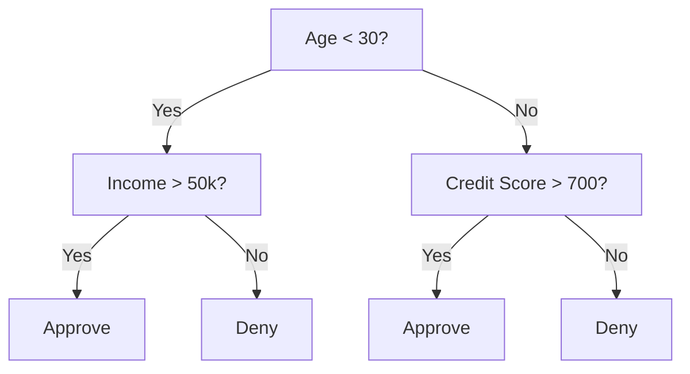
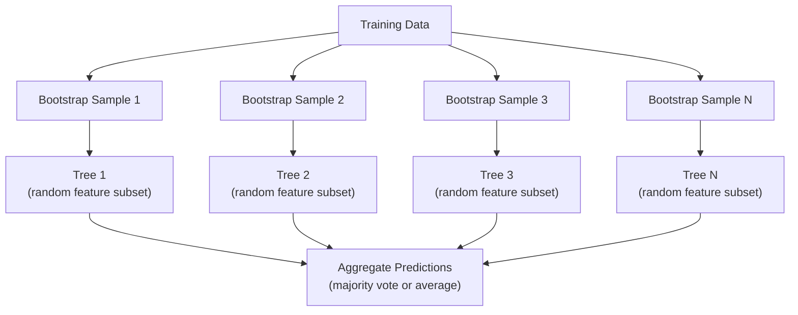

<!-- local-zh-machine-draft: English source is canonical; prose translated automatically, code/math preserved. -->

<a id="decision-trees-and-random-forests"></a>

# 决策树和随机森林

> 决策树只是一个流程图。但它们的森林是机器学习中最强大的工具之一。

**类型：** 构建
**语言：** Python
**先决条件：** 第 1 阶段（第 09 课信息论、第 06 课概率）
**时间：** ~90 分钟

<a id="learning-objectives"></a>

## 学习目标

- 实施基尼杂质、熵和信息增益计算以找到最佳决策树分割
- 使用预剪枝控制（最大深度、最小样本）从头开始构建决策树分类器
- 使用 bootstrap sampling 和 feature 随机化构建随机森林，并解释为什么它可以减少方差
- 将 MDI feature 重要性与排列重要性进行比较，并确定 MDI 何时有偏差

<a id="the-problem"></a>

## 问题

您有表格数据。行是样本，列是 features，并且有一个要预测的目标列。你可以向它扔一个神经网络。但对于表格数据，基于树的模型（决策树、随机森林、gradient 提升树）始终优于深度学习。 Kaggle 结构化数据竞赛主要由 XGBoost 和 LightGBM 主导，而不是 transformers。

为什么？树无需预处理即可处理混合 feature 类型（数字和分类）。它们无需 feature 工程即可处理非线性关系。它们是可解释的：您可以查看树并准确了解做出预测的原因。平均许多树的随机森林在中等大小的数据集上对 overfitting 具有很强的抵抗力。

本课程使用递归分裂从头开始构建决策树，然后在顶部构建随机森林。您将实现分割标准（基尼杂质、熵、信息增益）背后的数学原理，并理解为什么一组弱学习者会成为强学习者。

<a id="the-concept"></a>

## 概念

<a id="what-a-decision-tree-does"></a>

### 决策树有什么作用

决策树通过询问一系列是/否问题将 feature 空间划分为矩形区域。



每个内部节点都会根据阈值测试 feature。每个叶节点都会做出预测。要对新数据点进行分类，请从根开始并遵循 branches 直到到达叶子。

该树是通过在每个节点选择 feature 和最好分离数据的阈值来自上而下构建的。 “最佳”是由分割标准定义的。

<a id="split-criteria-measuring-impurity"></a>

### 分割标准：测量杂质

在每个节点，我们都有一组样本。我们希望将它们拆分，以便生成的子节点尽可能“纯”，这意味着每个子节点主要包含一个类。

**Gini impurity** 测量随机选择的样本在根据该节点的类分布进行标记时被错误分类的概率。

```
Gini(S) = 1 - sum(p_k^2)

where p_k is the proportion of class k in set S.
```

对于纯节点（所有一类），基尼 = 0。对于具有 50/50 类的二元分割，基尼 = 0.5。越低越好。

```
Example: 6 cats, 4 dogs

Gini = 1 - (0.6^2 + 0.4^2) = 1 - (0.36 + 0.16) = 0.48
```

**Entropy** 测量节点中的信息内容（无序）。在第 1 阶段第 09 课中介绍。

```
Entropy(S) = -sum(p_k * log2(p_k))
```

对于纯节点，熵 = 0。对于 50/50 二元分割，熵 = 1.0。越低越好。

```
Example: 6 cats, 4 dogs

Entropy = -(0.6 * log2(0.6) + 0.4 * log2(0.4))
        = -(0.6 * -0.737 + 0.4 * -1.322)
        = 0.442 + 0.529
        = 0.971 bits
```

**信息增益**是分裂后杂质（熵或基尼）的减少。

```
IG(S, feature, threshold) = Impurity(S) - weighted_avg(Impurity(S_left), Impurity(S_right))

where the weights are the proportions of samples in each child.
```

每个节点的贪心算法：尝试每个 feature 和每个可能的阈值。选择最大化信息增益的（feature，阈值）对。

<a id="how-splitting-works"></a>

### 分裂如何运作

对于当前节点有 n 个 features 和 m 个样本的数据集：

1. 对于每个 feature j（j = 1 到 n）：
   - 按 feature j 对样本进行排序
   - 尝试将连续不同值之间的每个中点作为阈值
   - 计算每个阈值的信息增益
2. 选择信息增益最高的feature和阈值
3. 将数据拆分为左（feature <= 阈值）和右（feature > 阈值）
4. 对每个孩子进行递归

这种贪心方法并不能保证全局最优树。寻找最优树是 NP 困难的。但贪婪分裂在实践中效果很好。

<a id="stopping-conditions"></a>

### 停止条件

在没有停止条件的情况下，树会一直生长，直到每片叶子都是纯净的（每片叶子一个样本）。这完美地记住了训练数据并且概括得非常好。

**预剪枝** 在树完全生长之前停止它：
- 最大深度：当树达到设定深度时停止分裂
- 每叶最少样本：如果节点少于 k 个样本，则停止
- 最小信息增益：如果最佳分割对杂质的改善程度低于阈值，则停止
- 最大叶子节点：限制叶子总数

**Post-pruning** 长出完整的树，然后修剪它：
- 成本复杂度剪枝（scikit-learn 使用）：添加与叶子数量成比例的惩罚。增加惩罚以获得更小的树木
- 减少错误修剪：如果验证错误不增加，则删除子树

预剪枝更简单、更快。后修剪通常会产生更好的树，因为它不会过早地停止可能导致有用的进一步分裂的分裂。

<a id="decision-trees-for-regression"></a>

### 回归决策树

对于回归，叶子预测是该叶子中目标值的平均值。分割标准也发生变化：

**方差减少**替换信息增益：

```
VR(S, feature, threshold) = Var(S) - weighted_avg(Var(S_left), Var(S_right))
```

选择最大程度减少方差的分割。该树将输入空间划分为区域，并预测每个区域中的常数（平均值）。

<a id="random-forests-the-power-of-ensembles"></a>

### 随机森林：集成的力量

单个决策树具有高方差。数据的微小变化可能会产生完全不同的树。随机森林通过对许多树进行平均来解决这个问题。



随机性的两个来源使树变得多样化：

**Bagging（引导聚合）：** 每棵树都在引导样本上进行训练，这是一个从训练数据中替换的随机样本。大约 63% 的原始样本出现在每个引导程序中（rest 是可用于验证的袋外样本）。

**Feature 随机化：** 在每次分割时，仅考虑 features 的随机子集。对于分类，默认值为 sqrt(n_features)。对于回归，n_features/3。这可以防止所有树在同一个主导 feature 上分裂。

关键见解：对许多去相关树进行平均可以减少方差而不增加偏差。每棵树都可能很平庸。乐团实力雄厚。

<a id="feature-importance"></a>

### Feature重要性

随机森林自然提供 feature 重要性分数。最常见的方法：

** 杂质平均减少量 (MDI)：** 对于每个 feature，计算使用 feature 的所有树和所有节点的杂质总减少量。 Features 在较早的分裂中产生更大的杂质减少更为重要。

```
importance(feature_j) = sum over all nodes where feature_j is used:
    (n_samples_at_node / n_total_samples) * impurity_decrease
```

这很快（在训练期间计算），但偏向于具有许多可能分割点的高基数 features 和 features。

**排列重要性**是另一种选择：打乱一个feature的值并测量模型的准确性下降了多少。更可靠但速度更慢。

<a id="when-trees-beat-neural-networks"></a>

### 当树打败神经网络时

树木和森林在表格数据的神经网络中占主导地位。几个原因：

| 因素 | 树木 | 神经网络 |
|--------|-------|----------------|
| 混合类型（数字+分类） | 原生支持 | 需要编码 |
| 小数据集（< 10k 行） | 工作顺利 | 过拟合 |
| Feature互动 | 通过拆分发现 | 需要架构设计 |
| 可解释性 | 完全透明 | 黑匣子 |
| 培训时间 | 分钟 | 时间 |
| Hyperparameter 灵敏度 | 低 | 高 |

当数据具有空间或顺序结构（图像、文本、音频）时，神经网络会获胜。对于 features 的平面表，树是默认的。

```figure
decision-tree-depth
```

<a id="build-it"></a>

## 动手实现

<a id="step-1-gini-impurity-and-entropy"></a>

### 步骤 1：基尼杂质和熵

从头开始建立两个分割标准，并验证他们就哪些分割是好的达成一致。

```python
import math

def gini_impurity(labels):
    n = len(labels)
    if n == 0:
        return 0.0
    counts = {}
    for label in labels:
        counts[label] = counts.get(label, 0) + 1
    return 1.0 - sum((c / n) ** 2 for c in counts.values())

def entropy(labels):
    n = len(labels)
    if n == 0:
        return 0.0
    counts = {}
    for label in labels:
        counts[label] = counts.get(label, 0) + 1
    return -sum(
        (c / n) * math.log2(c / n) for c in counts.values() if c > 0
    )
```

<a id="step-2-find-the-best-split"></a>

### 第 2 步：找到最佳分割

尝试每个 feature 和每个阈值。返回信息增益最高的那个。

```python
def information_gain(parent_labels, left_labels, right_labels, criterion="gini"):
    measure = gini_impurity if criterion == "gini" else entropy
    n = len(parent_labels)
    n_left = len(left_labels)
    n_right = len(right_labels)
    if n_left == 0 or n_right == 0:
        return 0.0
    parent_impurity = measure(parent_labels)
    child_impurity = (
        (n_left / n) * measure(left_labels) +
        (n_right / n) * measure(right_labels)
    )
    return parent_impurity - child_impurity
```

<a id="step-3-build-the-decisiontree-class"></a>

### 第 3 步：构建 DecisionTree 类

递归分割、预测和 feature 重要性跟踪。 `_build` 是树的核心：当节点是纯节点或达到预剪枝限制时，它会停止，否则它会采用最佳分割并递归到两个子节点。

```python
import random

class DecisionTree:
    def __init__(self, max_depth=None, min_samples_split=2,
                 min_samples_leaf=1, criterion="gini",
                 max_features=None):
        self.max_depth = max_depth
        self.min_samples_split = min_samples_split
        self.min_samples_leaf = min_samples_leaf
        self.criterion = criterion
        self.max_features = max_features
        self.tree = None
        self.feature_importances_ = None

    def fit(self, X, y):
        self.n_features = len(X[0])
        self.feature_importances_ = [0.0] * self.n_features
        self.n_samples = len(X)
        self.tree = self._build(X, y, depth=0)
        total = sum(self.feature_importances_)
        if total > 0:
            self.feature_importances_ = [
                fi / total for fi in self.feature_importances_
            ]

    def predict(self, X):
        return [self._predict_one(x, self.tree) for x in X]

    def _build(self, X, y, depth):
        if len(set(y)) == 1:
            return {"leaf": True, "value": y[0]}

        if self.max_depth is not None and depth >= self.max_depth:
            return self._make_leaf(y)

        if len(y) < self.min_samples_split:
            return self._make_leaf(y)

        best_feature, best_threshold, best_gain = self._best_split(X, y)

        if best_feature is None or best_gain <= 0:
            return self._make_leaf(y)

        left_X, left_y, right_X, right_y = self._split_data(
            X, y, best_feature, best_threshold
        )

        if len(left_y) < self.min_samples_leaf or len(right_y) < self.min_samples_leaf:
            return self._make_leaf(y)

        weight = len(y) / self.n_samples
        self.feature_importances_[best_feature] += weight * best_gain

        return {
            "leaf": False,
            "feature": best_feature,
            "threshold": best_threshold,
            "left": self._build(left_X, left_y, depth + 1),
            "right": self._build(right_X, right_y, depth + 1),
        }

    def _make_leaf(self, y):
        counts = {}
        for label in y:
            counts[label] = counts.get(label, 0) + 1
        return {"leaf": True, "value": max(counts, key=counts.get)}

    def _best_split(self, X, y):
        best_feature = None
        best_threshold = None
        best_gain = -1.0

        if self.max_features == "sqrt":
            k = max(1, int(math.sqrt(self.n_features)))
            feature_indices = random.sample(range(self.n_features), k)
        elif isinstance(self.max_features, int):
            if self.max_features < 1:
                raise ValueError("max_features must be at least 1 when given as an integer")
            k = min(self.max_features, self.n_features)
            feature_indices = random.sample(range(self.n_features), k)
        else:
            feature_indices = list(range(self.n_features))

        for feature_idx in feature_indices:
            values = sorted(set(X[i][feature_idx] for i in range(len(X))))
            if len(values) <= 1:
                continue

            for i in range(len(values) - 1):
                threshold = (values[i] + values[i + 1]) / 2.0
                left_y = [y[j] for j in range(len(X)) if X[j][feature_idx] <= threshold]
                right_y = [y[j] for j in range(len(X)) if X[j][feature_idx] > threshold]

                if len(left_y) < self.min_samples_leaf or len(right_y) < self.min_samples_leaf:
                    continue

                gain = information_gain(y, left_y, right_y, self.criterion)
                if gain > best_gain:
                    best_gain = gain
                    best_feature = feature_idx
                    best_threshold = threshold

        return best_feature, best_threshold, best_gain

    def _split_data(self, X, y, feature, threshold):
        left_X, left_y, right_X, right_y = [], [], [], []
        for i in range(len(X)):
            if X[i][feature] <= threshold:
                left_X.append(X[i])
                left_y.append(y[i])
            else:
                right_X.append(X[i])
                right_y.append(y[i])
        return left_X, left_y, right_X, right_y

    def _predict_one(self, x, node):
        if node["leaf"]:
            return node["value"]
        if x[node["feature"]] <= node["threshold"]:
            return self._predict_one(x, node["left"])
        return self._predict_one(x, node["right"])
```

<a id="step-4-build-the-randomforest-class"></a>

### 第 4 步：构建 RandomForest 类

Bootstrap sampling、feature 随机化和多数投票。

```python
class RandomForest:
    def __init__(self, n_trees=100, max_depth=None,
                 min_samples_split=2, max_features="sqrt",
                 criterion="gini"):
        self.n_trees = n_trees
        self.max_depth = max_depth
        self.min_samples_split = min_samples_split
        self.max_features = max_features
        self.criterion = criterion
        self.trees = []

    def fit(self, X, y):
        n = len(X)
        for _ in range(self.n_trees):
            indices = [random.randint(0, n - 1) for _ in range(n)]
            X_boot = [X[i] for i in indices]
            y_boot = [y[i] for i in indices]
            tree = DecisionTree(
                max_depth=self.max_depth,
                min_samples_split=self.min_samples_split,
                max_features=self.max_features,
                criterion=self.criterion,
            )
            tree.fit(X_boot, y_boot)
            self.trees.append(tree)

    def predict(self, X):
        all_preds = [tree.predict(X) for tree in self.trees]
        predictions = []
        for i in range(len(X)):
            votes = {}
            for preds in all_preds:
                v = preds[i]
                votes[v] = votes.get(v, 0) + 1
            predictions.append(max(votes, key=votes.get))
        return predictions
```

有关所有辅助方法的完整实现，请参阅 `code/trees.py`。

<a id="use-it"></a>

## 实际应用

使用 scikit-learn，训练随机森林只需三行：

```python
from sklearn.ensemble import RandomForestClassifier
from sklearn.datasets import load_iris
from sklearn.model_selection import train_test_split

X, y = load_iris(return_X_y=True)
X_train, X_test, y_train, y_test = train_test_split(X, y, random_state=42)

rf = RandomForestClassifier(n_estimators=100, random_state=42)
rf.fit(X_train, y_train)
print(f"Accuracy: {rf.score(X_test, y_test):.4f}")
print(f"Feature importances: {rf.feature_importances_}")
```

在实践中，gradient 增强树（XGBoost、LightGBM、CatBoost）通常比随机森林更强，因为它们按顺序构建树，每棵树都会纠正前一棵树的错误。但随机森林更难配置错误，并且几乎不需要 hyperparameter 调整。

<a id="ship-it"></a>

## 交付成果

本课程生成 `outputs/prompt-tree-interpreter.md`——一个为业务利益相关者解释决策树拆分的 prompt。向其提供经过训练的树结构（深度、features、分割阈值、准确性），它将模型转换为简单语言规则，对 feature 重要性进行排名，标记 overfitting 或泄漏，并建议后续步骤。任何时候您需要向不读代码的人解释基于树的模型时都可以使用它。

<a id="exercises"></a>

## 练习

1. 在具有 3 个类别的 2D 数据集上训练单个决策树。手动 trace 分割并绘制矩形决策边界。比较 max_深度 = 2 与 max_ 深度 = 10 处的边界。

2. 对回归树实施方差减少分裂。生成 200 个点的 y = sin(x) + 噪声并拟合您的回归树。根据真实曲线绘制树的分段常数预测。

3. 构建一个包含 1、5、10、50 和 200 棵树的随机森林。绘制训练精度和测试精度与树数量的关系图。观察到测试精度稳定但没有下降（森林抵抗 overfitting）。

4. 比较基尼杂质与熵作为 5 个不同数据集的分割标准。测量精度和树深度。在大多数情况下，它们产生几乎相同的结果。解释一下为什么。

5. 实施排列重要性。将其与数据集上的 MDI 重要性进行比较，其中 feature 是随机噪声但具有高基数。 MDI 将对噪音 feature 进行高度排序。排列重要性不会。

<a id="key-terms"></a>

## 关键术语

| 术语 | 人们怎么说 | 它实际上意味着什么 |
|------|----------------|----------------------|
| 决策树 | “预测流程图” | 通过学习 if/else 分割序列将 feature 空间划分为矩形区域的模型 |
| 基尼杂质 | “节点的混合程度如何” | 在节点处对随机样本进行错误分类的概率。 0 = 纯净，0.5 = 二进制的最大杂质 |
| 熵 | “节点中的紊乱” | 节点的信息内容。 0 = 纯，1.0 = 二进制的最大不确定性。从信息论 |
| 信息增益 | “分手多好” | 分裂后杂质减少。选择分裂的贪心准则 |
| 预剪枝 | “早点把树停掉” | 通过设置最大深度、最小样本或最小增益阈值提前停止树木生长 |
| 后剪枝 | “之后修剪树” | 生长完整的树，然后删除不会提高验证性能的子树 |
| 套袋 | “训练随机子集” | 引导聚合。在不同的随机样本上训练每个模型并进行替换 |
| 随机森林 | “一丛树” | 决策树集合，每个决策树都在每次分割时使用随机 feature 子集的引导样本进行训练 |
| Feature重要性（MDI） | “features 哪个重要” | 每个 feature 贡献的总杂质减少量，对所有树和节点进行求和 |
| 排列重要性 | “洗牌并检查” | 当 feature 的值被随机打乱时，准确性会下降。对于嘈杂的环境比 MDI 更可靠 features |
| 方差减少 | “信息增益的回归版本” | 信息增益的回归树模拟。选择最能减少目标方差的分割 |
| 引导样本 | “具有重复的随机样本” | 从原始数据集中替换后抽取的随机样本。大小相同，但有重复项 |

<a id="further-reading"></a>

## 进一步阅读

- [Breiman: Random Forests (2001)](https://link.springer.com/article/10.1023/A:1010933404324) - 原始随机森林论文
- [Grinsztajn 等人：为什么基于树的模型在表格数据上仍然优于深度学习？ (2022)](https://arxiv.org/abs/2207.08815) - 表格任务上树与神经网络的严格比较
- [scikit-learn 决策树文档](https://scikit-learn.org/stable/modules/tree.html) - 可视化工具实用指南
- [XGBoost: A Scalable Tree Boosting System (Chen & Guestrin, 2016)](https://arxiv.org/abs/1603.02754) - 主导 Kaggle 的 gradient Boosting 论文
