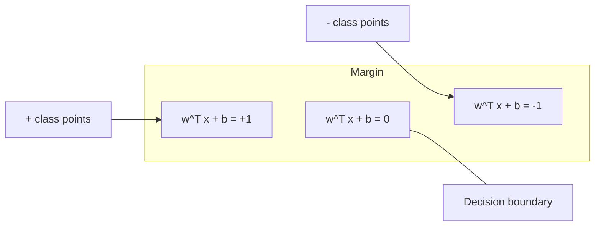
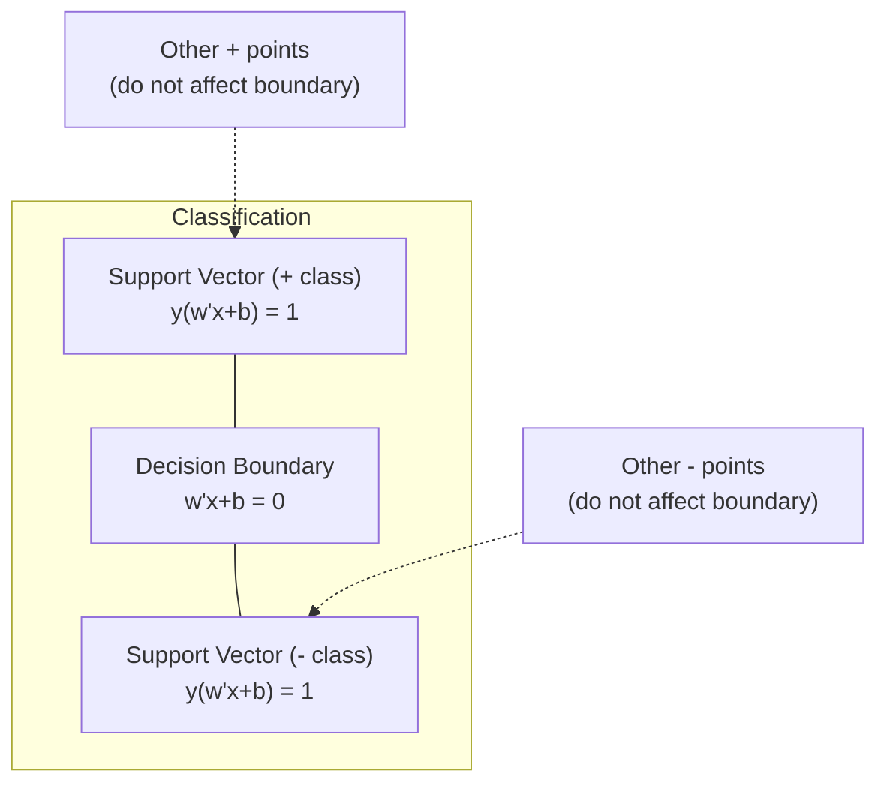
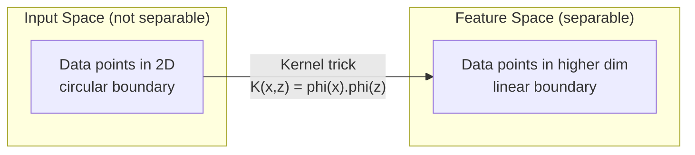

<!-- local-zh-machine-draft: English source is canonical; prose translated automatically, code/math preserved. -->

<a id="support-vector-machines"></a>

# 支持向量机

> 找到两个班级之间最宽的街道。这就是整个想法。

**类型：** 构建
**语言：** Python
**先决条件：** 第 1 阶段（第 08 课优化、14 范数和距离、18 凸优化）
**时间：** ~90 分钟

<a id="learning-objectives"></a>

## 学习目标

- 使用铰链损失和 gradient descent 在原始公式上从头开始实现线性 SVM
- 解释最大边际原理并从训练模型中识别支持向量
- 比较线性、多项式和 RBF 内核，并解释内核技巧如何避免显式高维映射
- 评估 C parameter 控制的边距宽度和分类误差之间的权衡

<a id="the-problem"></a>

## 问题

您有两类数据点，需要绘制一条线（或超平面）将它们分开。无限多的线路都可以工作。你应该选择哪一个？

间隔最大的那个。间隔是决策边界与每侧最近数据点之间的距离。更宽的间隔意味着分类器更有信心，并且可以更好地概括未见过的数据。

这种直觉催生了支持向量机，它是机器学习中数学上最优雅的算法之一。 SVM 是深度学习之前的主要分类方法，并且仍然是小数据集、高维数据以及需要有理论保证的有原则的、易于理解的模型的问题的最佳选择。

SVM 直接连接到第 1 阶段：优化是凸的（第 18 课），边际是用范数测量的（第 14 课），核技巧利用点积来处理非线性边界，而无需在高维空间中进行计算。

<a id="the-concept"></a>

## 概念

<a id="the-maximum-margin-classifier"></a>

### 最大间隔分类器

给定在 {-1, +1} 中带有标签 y_i 和 feature 向量 x_i 的线性可分离数据，我们需要一个超平面 w^T x + b = 0 来分隔类。

从点 x_i 到超平面的距离为：

```
distance = |w^T x_i + b| / ||w||
```

对于正确分类的点： y_i * (w^T x_i + b) > 0。边距是从超平面到两侧最近点的距离的两倍。



优化问题：

```
maximize    2 / ||w||     (the margin width)
subject to  y_i * (w^T x_i + b) >= 1  for all i
```

等价地（最小化 ||w||^2更容易优化）：

```
minimize    (1/2) ||w||^2
subject to  y_i * (w^T x_i + b) >= 1  for all i
```

这是一个凸二次规划。它拥有独特的全球解决方案。恰好位于边缘边界上的数据点（其中 y_i * (w^T x_i + b) = 1）是支持向量。它们是确定决策边界的唯一点。移动或删除任何非支持向量点，边界不会改变。

<a id="support-vectors-the-critical-few"></a>

### 支持向量：关键的少数



大多数训练点都是无关紧要的。只有支持向量才重要。这就是支持向量机在预测时内存效率高的原因：您只需要存储支持向量，而不是整个训练集。

支持向量的数量也给出了泛化误差的界限。相对于数据集大小而言，较少的支持向量意味着更好的泛化。

<a id="soft-margin-handling-noise-with-the-c-parameter"></a>

### 软裕度：使用 C parameter 处理噪声

真实数据很少是完全可分离的。有些点可能位于边界的错误一侧或边界内部。软边际公式允许通过引入松弛变量来违规。

```
minimize    (1/2) ||w||^2 + C * sum(xi_i)
subject to  y_i * (w^T x_i + b) >= 1 - xi_i
            xi_i >= 0  for all i
```

松弛变量 xi_i 测量 i 违反裕度的程度。 C 控制权衡：

| C值 | 行为 |
|---------|----------|
| 大C | 对违规行为予以严厉处罚。边缘窄，错误分类少。过拟合 |
| 小C | 允许更多的违规行为。裕度较大，错误分类较多。欠拟合 |

C 是正则化强度，倒数。大 C = 较少正则化。小 C = 更多正则化。

<a id="hinge-loss-the-svm-loss-function"></a>

### 铰链损耗：SVM loss function

软间隔 SVM 可以重写为无约束优化：

```
minimize    (1/2) ||w||^2 + C * sum(max(0, 1 - y_i * (w^T x_i + b)))
```

max(0, 1 - y_i * f(x_i)) 项是铰链损耗。当点被正确分类并且超出边界时，它为零。当点位于边缘内或错误分类时，它是线性的。

```
Hinge loss for a single point:

loss
  |
  | \
  |  \
  |   \
  |    \
  |     \_______________
  |
  +-----|-----|-------->  y * f(x)
       0     1

Zero loss when y*f(x) >= 1 (correctly classified, outside margin).
Linear penalty when y*f(x) < 1.
```

与逻辑损失（逻辑回归）比较：

```
Hinge:     max(0, 1 - y*f(x))          Hard cutoff at margin
Logistic:  log(1 + exp(-y*f(x)))        Smooth, never exactly zero
```

铰链损失产生稀疏解（只有支持向量具有非零贡献）。逻辑损失使用所有数据点。这使得 SVM 在预测时更加节省内存。

<a id="training-a-linear-svm-with-gradient-descent"></a>

### 使用 gradient descent 训练线性 SVM

您可以使用 gradient descent 在铰链损失加上 L2 正则化上训练线性 SVM，而无需求解约束 QP：

```
L(w, b) = (lambda/2) * ||w||^2 + (1/n) * sum(max(0, 1 - y_i * (w^T x_i + b)))

Gradient with respect to w:
  If y_i * (w^T x_i + b) >= 1:  dL/dw = lambda * w
  If y_i * (w^T x_i + b) < 1:   dL/dw = lambda * w - y_i * x_i

Gradient with respect to b:
  If y_i * (w^T x_i + b) >= 1:  dL/db = 0
  If y_i * (w^T x_i + b) < 1:   dL/db = -y_i
```

这称为原始公式。每个 epoch 的运行时间为 O(n * d)，其中 n 是样本数，d 是 features 的数量。对于大型、稀疏、高维数据（文本分类），这很快。

<a id="the-dual-formulation-and-the-kernel-trick"></a>

### 对偶公式和核技巧

SVM 问题的拉格朗日对偶（来自第一阶段第 18 课，KKT 条件）为：

```
maximize    sum(alpha_i) - (1/2) * sum_ij(alpha_i * alpha_j * y_i * y_j * (x_i . x_j))
subject to  0 <= alpha_i <= C
            sum(alpha_i * y_i) = 0
```

对偶仅涉及点积 x_我 。 x_j 数据点之间。 这是关键的见解。 用核函数 K(x_我，x_j) 并且 SVM 可以学习非线性边界，而无需显式计算变换。

```
Linear kernel:      K(x, z) = x . z
Polynomial kernel:  K(x, z) = (x . z + c)^d
RBF (Gaussian):     K(x, z) = exp(-gamma * ||x - z||^2)
```

RBF 核将数据映射到无限维空间。输入空间中靠近的点的核值接近 1。相距较远的点的核值接近 0。它可以学习任何平滑的决策边界。



内核技巧计算高维空间中的点积，而无需去那里。对于 D 维中 d 次多项式核，显式 feature 空间具有 O(D^d) 维。但 K(x, z) 的计算时间为 O(D)。

<a id="svm-for-regression-svr"></a>

### 用于回归的支持向量机 (SVR)

支持向量回归在数据周围拟合一个宽度为 epsilon 的管。管内点零损耗。管外的点受到线性惩罚。

```
minimize    (1/2) ||w||^2 + C * sum(xi_i + xi_i*)
subject to  y_i - (w^T x_i + b) <= epsilon + xi_i
            (w^T x_i + b) - y_i <= epsilon + xi_i*
            xi_i, xi_i* >= 0
```

epsilon parameter 控制管宽度。更宽的管子 = 更少的支撑向量 = 更平滑的配合。更窄的管子 = 更多的支撑向量 = 更紧密的配合。

<a id="why-svms-lost-to-deep-learning-and-when-they-still-win"></a>

### 为什么 SVM 输给了深度学习（以及当它们仍然获胜时）

从 20 世纪 90 年代末到 2010 年代初，SVM 在机器学习领域占据主导地位。深度学习超越它们有几个原因：

| 因素 | 支持向量机 | 深度学习 |
|--------|------|---------------|
| Feature工程 | 需要它 | 学习features |
| 可扩展性 | 内核的 O(n^2) 到 O(n^3) | O(n)，根据 epoch，使用 SGD |
| 图片/文字/音频 | 需要手工制作 features | 从原始数据中学习 |
| 大型数据集 (>100k) | 慢 | 扩展性良好 |
| GPU加速 | 好处有限 | 大幅加速 |

在这些情况下，SVM 仍然会获胜：
- 小数据集（数百到数千个样本）
- 高维稀疏数据（文本带有TF-IDF features）
- 当您需要数学保证时（边际界限）
- 当训练时间必须最短时（线性 SVM 非常快）
- 边缘结构清晰的二元分类
- 异常检测（一类 SVM）

```figure
svm-margin
```

<a id="build-it"></a>

## 动手实现

<a id="step-1-hinge-loss-and-gradient"></a>

### 步骤1：铰链损失和gradient

基础。计算批次的铰链损失及其 gradient。

```python
def hinge_loss(X, y, w, b):
    n = len(X)
    total_loss = 0.0
    for i in range(n):
        margin = y[i] * (dot(w, X[i]) + b)
        total_loss += max(0.0, 1.0 - margin)
    return total_loss / n
```

<a id="step-2-linear-svm-via-gradient-descent"></a>

### 步骤 2：通过 gradient descent 进行线性 SVM

通过最小化正则化铰链损失来进行训练。无需 QP 求解器。

```python
class LinearSVM:
    def __init__(self, lr=0.001, lambda_param=0.01, n_epochs=1000):
        self.lr = lr
        self.lambda_param = lambda_param
        self.n_epochs = n_epochs
        self.w = None
        self.b = 0.0

    def fit(self, X, y):
        n_features = len(X[0])
        self.w = [0.0] * n_features
        self.b = 0.0

        for epoch in range(self.n_epochs):
            for i in range(len(X)):
                margin = y[i] * (dot(self.w, X[i]) + self.b)
                if margin >= 1:
                    self.w = [wj - self.lr * self.lambda_param * wj
                              for wj in self.w]
                else:
                    self.w = [wj - self.lr * (self.lambda_param * wj - y[i] * X[i][j])
                              for j, wj in enumerate(self.w)]
                    self.b -= self.lr * (-y[i])

    def predict(self, X):
        return [1 if dot(self.w, x) + self.b >= 0 else -1 for x in X]
```

<a id="step-3-kernel-functions"></a>

### 第三步：内核函数

实现线性、多项式和 RBF 内核。

```python
def linear_kernel(x, z):
    return dot(x, z)

def polynomial_kernel(x, z, degree=3, c=1.0):
    return (dot(x, z) + c) ** degree

def rbf_kernel(x, z, gamma=0.5):
    diff = [xi - zi for xi, zi in zip(x, z)]
    return math.exp(-gamma * dot(diff, diff))
```

<a id="step-4-margin-and-support-vector-identification"></a>

### 第 4 步：边际和支持向量识别

训练后，确定哪些点是支持向量并计算边距宽度。

```python
def find_support_vectors(X, y, w, b, tol=1e-3):
    support_vectors = []
    for i in range(len(X)):
        margin = y[i] * (dot(w, X[i]) + b)
        if abs(margin - 1.0) < tol:
            support_vectors.append(i)
    return support_vectors
```

有关所有演示的完整实现，请参阅 `code/svm.py`。

<a id="use-it"></a>

## 实际应用

使用 scikit-learn：

```python
from sklearn.svm import SVC, LinearSVC, SVR
from sklearn.preprocessing import StandardScaler
from sklearn.pipeline import Pipeline

clf = Pipeline([
    ("scaler", StandardScaler()),
    ("svm", SVC(kernel="rbf", C=1.0, gamma="scale")),
])
clf.fit(X_train, y_train)
print(f"Accuracy: {clf.score(X_test, y_test):.4f}")
print(f"Support vectors: {clf['svm'].n_support_}")
```

重要提示：在训练 SVM 之前，请务必先缩放 features。 SVM 对 feature 大小敏感，因为边际取决于 ||w||，并且未缩放的 features 会扭曲几何形状。

对于大型数据集，请使用 `LinearSVC`（原始公式，每个 epoch 的 O(n)）而不是 `SVC`（对偶公式，O(n^2) 到 O(n^3)）：

```python
from sklearn.svm import LinearSVC

clf = Pipeline([
    ("scaler", StandardScaler()),
    ("svm", LinearSVC(C=1.0, max_iter=10000)),
])
```

<a id="exercises"></a>

## 练习

1. 生成二维线性可分离数据集。训练 LinearSVM 并识别支持向量。验证支持向量是否是最接近决策边界的点。

2. 在噪声数据集上将 C 从 0.001 更改为 1000。绘制每个 C 值的决策边界。观察从宽间隔 (underfitting) 到窄间隔 (overfitting) 的过渡。

3. 创建一个类边界为圆形（非线性）的数据集。证明线性 SVM 失败。计算 RBF 内核矩阵并表明这些类在内核引发的 feature 空间中变得可分离。

4. 在同一数据集上比较铰链损失与逻辑损失。训练线性 SVM 和逻辑回归。计算有多少训练点对每个模型的决策边界有贡献（支持向量与所有点）。

5. 实施 SVR（epsilon 不敏感损失）。将其拟合为 y = sin(x) + 噪声。在预测周围绘制 epsilon 管并突出显示支持向量（管外的点）。

<a id="key-terms"></a>

## 关键术语

| 术语 | 它实际上意味着什么 |
|------|----------------------|
| 支持向量 | 最接近决策边界的训练点。确定超平面的唯一点 |
| 保证金 | 决策边界和最近支持向量之间的距离。 SVM 最大化了这一点 |
| 铰链损失 | 最大值(0, 1 - y*f(x))。当正确分类且超出边界时为零。否则线性惩罚 |
| C parameter | 边距宽度和分类误差之间的权衡。大 C = 窄边距，小 C = 宽边距 |
| 软边距 | SVM 公式允许通过松弛变量进行边际违规。处理不可分离的数据 |
| 内核技巧 | 在高维 feature 空间中计算点积，而不显式映射到该空间 |
| 线性核 | K(x, z) = x 。 z。相当于标准点积。对于线性可分离数据 |
| RBF核 | K(x, z) = exp(-gamma * \|\|x-z\|\|^2)。映射到无限维度。学习任何平滑边界 |
| 多项式核 | K(x, z) = (x . z + c)^d。映射到多项式组合的 feature 空间 |
| 双重配方 | 仅依赖于数据点之间的点积的 SVM 问题的重新表述。启用内核 |
| 支持向量机 | 支持向量回归。在数据周围安装一个 epsilon 管。管内点零损耗 |
| 松弛变量 | xi_i：测量点违反边界的程度。对于边界外正确分类的点为零 |
| 最大保证金 | 选择与各类最近点距离最大的超平面的原则 |

<a id="further-reading"></a>

## 进一步阅读

- [Vapnik：统计学习理论的本质 (1995)](https://link.springer.com/book/10.1007/978-1-4757-3264-1) - SVM 和统计学习的基础文本
- [Cortes & Vapnik：支持向量网络 (1995)](https://link.springer.com/article/10.1007/BF00994018) - 原始 SVM 论文
- [Platt：顺序最小优化 (1998)](https://www.microsoft.com/en-us/research/publication/sequential-minimal-optimization-a-fast-algorithm-for-training-support-vector-machines/) - 使 SVM 训练变得实用的 SMO 算法
- [scikit-learn SVM 文档](https://scikit-learn.org/stable/modules/svm.html) - 包含实施细节的实用指南
- [LIBSVM：支持向量机库](https://www.csie.ntu.edu.tw/~cjlin/libsvm/) - 大多数 SVM 实现背后的 C++ 库
