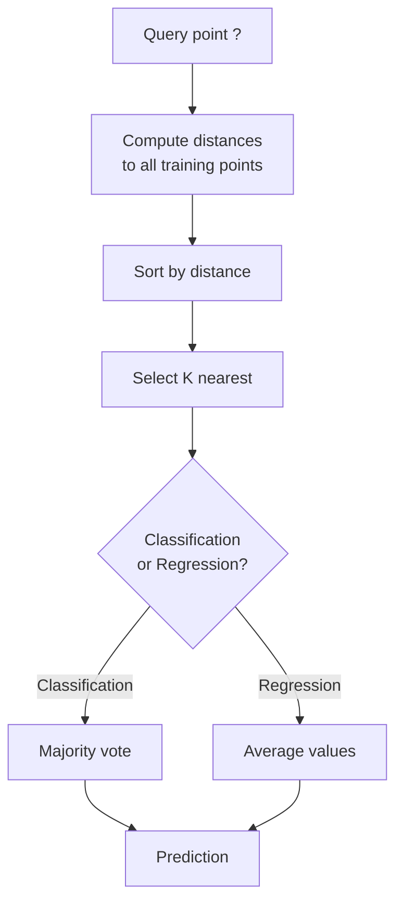
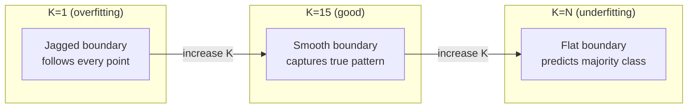
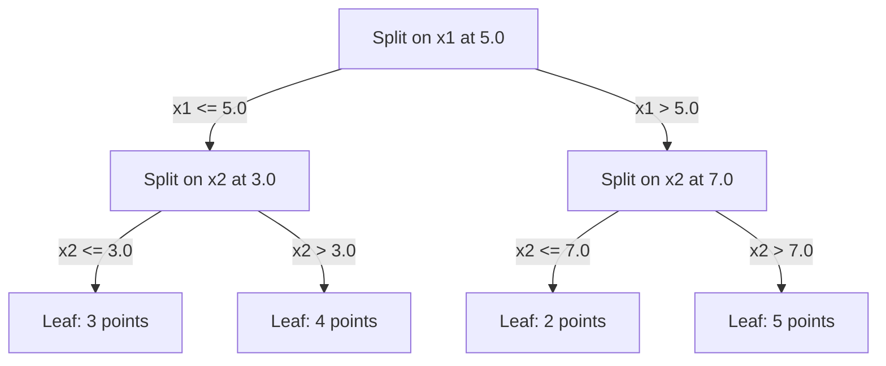

<!-- local-zh-machine-draft: English source is canonical; prose translated automatically, code/math preserved. -->

<a id="k-nearest-neighbors-and-distances"></a>

# K-最近邻和距离

> 储存一切。通过观察你的邻居来预测。实际可行的最简单的算法。

**类型：** 构建
**语言：** Python
**先决条件：** 第 1 阶段（第 14 课规范和距离）
**时间：** ~90 分钟

<a id="learning-objectives"></a>

## 学习目标

- 使用可配置的 K 和距离加权投票从头开始实施 KNN 分类和回归
- 比较 L1、L2、余弦和 Minkowski 距离度量并为给定数据类型选择合适的度量
- 解释维数灾难并证明 KNN 在高维空间中退化的原因
- 构建 KD 树以进行高效的最近邻搜索并分析何时优于暴力搜索

<a id="the-problem"></a>

## 问题

你有一个数据集。新的数据点到达。您需要对其进行分类或预测其价值。您无需从数据中学习 parameters（如线性回归或 SVM），只需找到最接近新点的 K 个训练点并让它们投票即可。

这就是 K 最近邻。没有训练阶段。没有parameters来学习。没有 loss function 来最小化。您存储整个训练集并在预测时计算距离。

听起来太简单了，不适合工作。但 KNN 在许多问题上都具有令人惊讶的竞争力，特别是对于中小型数据集，深入理解它揭示了基本概念：距离度量的选择（连接到第一阶段第 14 课）、维数灾难以及惰性学习和热切学习之间的差异。

KNN 在现代人工智能中也随处可见，只是名称不同。 Vector databases 对 embeddings 进行 KNN 搜索。检索增强生成 (RAG) 查找 K 个最近的文档块。推荐系统寻找相似的用户或项目。算法是一样的。规模和数据结构不同。

<a id="the-concept"></a>

## 概念

<a id="how-knn-works"></a>

### KNN 的工作原理

给定一个标记点数据集和一个新查询点：

1. 计算从查询到数据集中每个点的距离
2. 按距离排序
3. 取K个最接近的点
4. 对于分类：K 个邻居中的多数投票
5. 对于回归：K 个邻居值的平均值（或加权平均值）



这就是整个算法。无需拟合。没有 gradient descent。没有epoch。

<a id="choosing-k"></a>

### 选择K

K是单个hyperparameter。它控制偏差-方差的权衡：

| K | 行为 |
|---|----------|
| K = 1 | 决策边界遵循每个点。零训练误差。高方差。过拟合 |
| 小K（3-5） | 对局部结构敏感。可以捕获复杂的边界 |
| 大K | 边界更平滑。对噪声更加鲁棒。可能不适合 |
| K = N | 预测每个点的多数类别。最大偏差 |

对于 N 个点的数据集，常见的起点是 K = sqrt(N)。使用奇数 K 进行二元分类以避免平局。



<a id="distance-metrics"></a>

### 距离度量

距离函数定义了“近”的含义。不同的指标会产生不同的邻居、不同的预测。

**L2（欧几里得）** 是默认值。直线距离。

```
d(a, b) = sqrt(sum((a_i - b_i)^2))
```

对 feature 刻度敏感。在将 L2 与 KNN 一起使用之前，请务必标准化 features。

**L1（曼哈顿）** 对绝对差值求和。比 L2 对异常值更稳健，因为它不会对差异进行平方。

```
d(a, b) = sum(|a_i - b_i|)
```

**余弦距离** 测量向量之间的角度，忽略大小。对于文本和 embedding 数据至关重要。

```
d(a, b) = 1 - (a . b) / (||a|| * ||b||)
```

**Minkowski** 用 parameter 概括 L1 和 L2。

```
d(a, b) = (sum(|a_i - b_i|^p))^(1/p)

p=1: Manhattan
p=2: Euclidean
p->inf: Chebyshev (max absolute difference)
```

使用哪个指标取决于数据：

| 数据类型 | 最佳指标 | 为什么 |
|-----------|------------|-----|
| 数字 features，类似比例 | L2（欧几里得） | 默认，适用于空间数据 |
| 数值 features，异常值 | L1（曼哈顿） | 稳健，不会放大较大的差异 |
| 短信embeddings | 余弦 | 幅度是噪音，方向是意义 |
| 高维稀疏 | 余弦或 L1 | L2 遭受维数灾难 |
| 混合型 | 定制距离 | 合并每个 feature 类型的指标 |

<a id="weighted-knn"></a>

### 加权KNN

标准 KNN 为所有 K 个邻居提供相等的 weight。但距离 0.1 处的邻居应该比距离 5.0 处的邻居更重要。

**距离加权 KNN** weights 每个邻居与距离成反比：

```
weight_i = 1 / (distance_i + epsilon)

For classification: weighted vote
For regression:     weighted average = sum(w_i * y_i) / sum(w_i)
```

当查询点与训练点完全匹配时，epsilon 可以防止被零除。

加权 KNN 对 K 的选择不太敏感，因为无论如何，遥远的邻居贡献很小。

<a id="the-curse-of-dimensionality"></a>

### 维度的诅咒

KNN 性能在高维度下会下降。这并不是一个含糊的担忧。这是一个数学事实。

**问题1：距离收敛。** 随着维度的增加，最大距离与最小距离的比率接近1。所有点都变得距离查询同样“远”。

```
In d dimensions, for random uniform points:

d=2:    max_dist / min_dist = varies widely
d=100:  max_dist / min_dist ~ 1.01
d=1000: max_dist / min_dist ~ 1.001

When all distances are nearly equal, "nearest" is meaningless.
```

**问题 2：体积爆炸。** 要捕获固定部分数据内的 K 个邻居，您需要扩展搜索半径以覆盖 feature 空间的更大部分。高维度的“邻域”涵盖了大部分空间。

**问题3：角占主导地位。** 在d维单位超立方体中，大部分体积集中在角附近，而不是中心。随着 d 的增长，内切于立方体的球体包含体积消失的部分。

实际结果：KNN 在达到大约 20-50 features 时效果良好。除此之外，在应用 KNN 之前您需要进行降维（PCA、UMAP、t-SNE），或者您需要使用基于树的搜索结构来利用数据固有的较低维度。

<a id="kd-trees-fast-nearest-neighbor-search"></a>

### KD树：快速最近邻搜索

暴力 KNN 计算从查询到每个训练点的距离。即每次查询的时间复杂度为 O(n * d)。对于大型数据集，这太慢了。

KD 树沿着 feature 轴递归地划分空间。在每一层，它沿着一个维度在中值处分裂。



要找到最近的邻居，请遍历树到包含查询的叶子，然后仅当相邻分区包含更接近的点时才回溯并检查它们。

平均查询时间：对于低维度，O(log n)。但 KD 树在高维度 (d > 20) 中会退化为 O(n)，因为回溯消除的 branches 越来越少。

<a id="ball-trees-better-for-moderate-dimensions"></a>

### 球树：更适合中等尺寸

球树将数据划分为嵌套的超球面而不是轴对齐的框。每个节点定义一个包含该子树中所有点的球（中心+半径）。

相对于 KD 树的优点：
- 在中等尺寸（最多约 50）中效果更好
- 处理非轴对齐结构
- 更严格的边界体积意味着在搜索过程中会修剪更多的 branches

KD 树和球树都是精确算法。对于真正的大规模搜索（数百万个点，数百个维度），改用 approximate nearest neighbor 方法（HNSW，IVF，产品 quantization）。这些内容将在第一阶段第 14 课中介绍。

<a id="lazy-learning-vs-eager-learning"></a>

### 懒惰学习与渴望学习

KNN 是一个惰性学习器：它在训练时不做任何工作，而在预测时进行所有工作。大多数其他算法（线性回归、支持向量机、神经网络）都是热切学习者：它们在训练时进行大量计算以构建紧凑的模型，然后预测速度很快。

| 方面 | 懒惰（KNN） | Eager（SVM、神经网络） |
|--------|------------|------------------------|
| 培训时间 | O(1) 只存储数据 | O(n * epochs) |
| 预测时间 | 每个查询 O(n * d) | O(d) 或 O(parameters) |
| 预测记忆 | 存储整个训练集 | 仅限商店型号 parameters |
| 适应新数据 | 立即加分 | 重新训练模型 |
| 决策边界 | 隐式、动态计算 | 明确，训练后固定 |

惰性学习在以下情况下是理想的：
- 数据集经常变化（添加/删除点而无需重新训练）
- 您需要对极少数查询进行预测
- 您想要零训练时间
- 数据集足够小，暴力搜索速度很快

<a id="knn-for-regression"></a>

### KNN 回归

用于回归的 KNN 不是多数投票，而是对 K 个邻居的目标值进行平均。

```
prediction = (1/K) * sum(y_i for i in K nearest neighbors)

Or with distance weighting:
prediction = sum(w_i * y_i) / sum(w_i)
where w_i = 1 / distance_i
```

KNN 回归产生分段常数（或带加权的分段平滑）预测。它无法推断超出训练数据的范围。如果训练目标都在 0 到 100 之间，KNN 将永远不会预测 200。

```figure
knn-smoothness
```

<a id="build-it"></a>

## 动手实现

<a id="step-1-distance-functions"></a>

### 第 1 步：距离函数

实现 L1、L2、余弦和 Minkowski 距离。这些直接连接到第一阶段第 14 课。

```python
import math

def l2_distance(a, b):
    return math.sqrt(sum((ai - bi) ** 2 for ai, bi in zip(a, b)))

def l1_distance(a, b):
    return sum(abs(ai - bi) for ai, bi in zip(a, b))

def cosine_distance(a, b):
    dot_val = sum(ai * bi for ai, bi in zip(a, b))
    norm_a = math.sqrt(sum(ai ** 2 for ai in a))
    norm_b = math.sqrt(sum(bi ** 2 for bi in b))
    if norm_a == 0 or norm_b == 0:
        return 1.0
    return 1.0 - dot_val / (norm_a * norm_b)

def minkowski_distance(a, b, p=2):
    if p == float('inf'):
        return max(abs(ai - bi) for ai, bi in zip(a, b))
    return sum(abs(ai - bi) ** p for ai, bi in zip(a, b)) ** (1 / p)
```

<a id="step-2-knn-classifier-and-regressor"></a>

### 步骤 2：KNN 分类器和回归器

使用可配置的 K、距离度量和可选的距离权重构建完整的 KNN。

```python
class KNN:
    def __init__(self, k=5, distance_fn=l2_distance, weighted=False,
                 task="classification"):
        self.k = k
        self.distance_fn = distance_fn
        self.weighted = weighted
        self.task = task
        self.X_train = None
        self.y_train = None

    def fit(self, X, y):
        self.X_train = X
        self.y_train = y

    def predict(self, X):
        return [self._predict_one(x) for x in X]
```

<a id="step-3-kd-tree-for-efficient-search"></a>

### 步骤 3：用于高效搜索的 KD 树

从头开始构建一个 KD 树，在每个维度的中值上递归分裂。

```python
class KDTree:
    def __init__(self, X, indices=None, depth=0):
        # Recursively partition the data
        self.axis = depth % len(X[0])
        # Split on median of the current axis
        ...

    def query(self, point, k=1):
        # Traverse to leaf, then backtrack
        ...
```

有关所有辅助方法和演示的完整实现，请参阅 `code/knn.py`。

<a id="step-4-feature-scaling"></a>

### 步骤4：Feature缩放

KNN 需要 feature 缩放，因为距离对 feature 幅度敏感。范围从 0 到 1000 的 feature 将主导范围从 0 到 1 的 feature。

```python
def standardize(X):
    n = len(X)
    d = len(X[0])
    means = [sum(X[i][j] for i in range(n)) / n for j in range(d)]
    stds = [
        max(1e-10, (sum((X[i][j] - means[j]) ** 2 for i in range(n)) / n) ** 0.5)
        for j in range(d)
    ]
    return [[((X[i][j] - means[j]) / stds[j]) for j in range(d)] for i in range(n)], means, stds
```

<a id="use-it"></a>

## 实际应用

使用 scikit-learn：

```python
from sklearn.neighbors import KNeighborsClassifier
from sklearn.preprocessing import StandardScaler
from sklearn.pipeline import Pipeline

clf = Pipeline([
    ("scaler", StandardScaler()),
    ("knn", KNeighborsClassifier(n_neighbors=5, metric="euclidean")),
])
clf.fit(X_train, y_train)
print(f"Accuracy: {clf.score(X_test, y_test):.4f}")
```

当数据集足够大且维度足够低时，Scikit-learn自动使用KD树或球树。对于高维数据，它会退回到暴力破解。您可以使用 `algorithm` parameter 进行控制。

对于大规模最近邻搜索（数百万个向量），请使用 FAISS、Annoy 或 vector database：

```python
import faiss

index = faiss.IndexFlatL2(dimension)
index.add(embeddings)
distances, indices = index.search(query_vectors, k=5)
```

<a id="exercises"></a>

## 练习

1. 在具有 3 个类别的 2D 数据集上实现 KNN 分类。绘制 K=1、K=5、K=15 和 K=N 的决策边界。观察从 overfitting 到 underfitting 的转换。

2. 生成 2、5、10、50、100 和 500 维的 1000 个随机点。对于每个维度，计算最大成对距离与最小成对距离的比率。绘制比率与维数的关系图以可视化维数灾难。

3. 比较文本分类问题上 KNN 的 L1、L2 和余弦距离（使用 TF-IDF 向量）。哪个指标提供最好的准确性？为什么余弦在文本方面更胜一筹？

4. 实现 KD 树并测量 2D、10D 和 50D 中 1k、10k 和 100k 点的数据集的查询时间与暴力破解。 KD 树在什么维度上不再比暴力破解更快？

5. 为 y = sin(x) + 噪声构建加权 KNN 回归器。将其与 K=3、10、30 的未加权 KNN 进行比较。表明加权可以产生更平滑的预测，尤其是对于较大的 K。

<a id="key-terms"></a>

## 关键术语

| 术语 | 它实际上意味着什么 |
|------|----------------------|
| K-最近邻 | 通过查找与查询最接近的 K 个训练点来进行预测的非参数算法 |
| 懒惰学习 | 训练时不进行计算。所有工作都在预测时间发生。 KNN 是典型的例子 |
| 渴望学习 | 训练时进行大量计算以构建紧凑的模型。大多数机器学习算法都是渴望的 |
| 维数诅咒 | 在高维度中，距离会聚，邻域会扩展以覆盖大部分空间，使得 KNN 无效 |
| KD树 | 沿 feature 轴递归划分空间的二叉树。低维 O(log n) 次查询 |
| 球树 | 嵌套超球面树。在中等尺寸（最多 50）中比 KD 树效果更好 |
| 加权KNN | 邻居的权重与距离成反比。越近的邻居对预测的影响越大 |
| Feature 缩放 | 将 features 标准化为可比范围。对于 KNN 等基于距离的方法是必需的 |
| 多数票 | 通过计算 K 个邻居中最常见的类别来进行分类 |
| 暴力搜索 | 计算到每个训练点的距离。每个查询 O(n*d)。对于大 n 来说精确但缓慢 |
| Approximate nearest neighbor | 比精确搜索更快地找到近似最近点的算法（HNSW、LSH、IVF） |
| 沃罗诺伊图 | 空间划分，其中每个区域包含比任何其他点更接近一个训练点的所有点。 K=1 KNN 产生 Voronoi 边界 |

<a id="further-reading"></a>

## 进一步阅读

- [Cover & Hart: 最近邻模式分类 (1967)](https://ieeexplore.ieee.org/document/1053964) - 基础 KNN 论文证明其错误率至多是贝叶斯最优的两倍
- [Friedman, Bentley, Finkel: An Algorithm for Find Best Matches in Logarithmic Expected Time (1977)](https://dl.acm.org/doi/10.1145/355744.355745) - 原始 KD 树论文
- [Beyer 等人：“最近邻”何时有意义？ (1999)](https://link.springer.com/chapter/10.1007/3-540-49257-7_15) - 最近邻维数灾难的形式分析
- [scikit-learn 最近邻居文档](https://scikit-learn.org/stable/modules/neighbors.html) - 算法选择的实用指南
- [FAISS：高效相似性搜索的库](https://github.com/facebookresearch/faiss) - 用于十亿级 approximate nearest neighbor 搜索的 Meta 库
