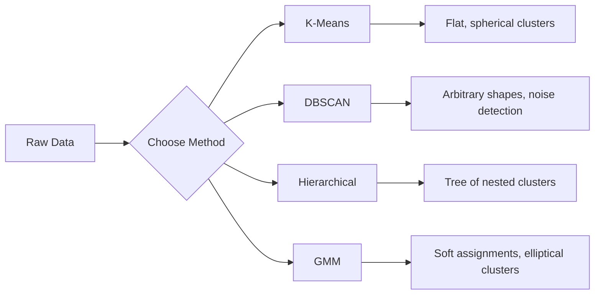

<!-- local-zh-machine-draft: English source is canonical; prose translated automatically, code/math preserved. -->

<a id="unsupervised-learning"></a>

# 无监督学习

> 没有标签，就没有老师。该算法自行寻找结构。

**类型：** 构建
**语言：** Python
**先决条件：** 第 1 阶段（范数和距离、概率和分布），第 2 阶段第 1-6 课
**时间：** ~90 分钟

<a id="learning-objectives"></a>

## 学习目标

- 从头开始实现 K-Means、DBSCAN 和高斯混合模型并比较它们的聚类行为
- 使用轮廓得分和肘部方法评估聚类质量以选择最佳 K
- 解释 DBSCAN 何时优于 K-Means 并确定哪种算法可以处理非球形簇和异常值
- 使用聚类方法构建异常检测管道来标记偏离正常模式的点

<a id="the-problem"></a>

## 问题

到目前为止，每节 ML 课程都假设有标签数据：“这是一个输入，这是正确的输出。”在现实世界中，标签是昂贵的。一家医院拥有数百万条患者记录，但没有人为每条记录手动标记疾病类别。电子商务网站拥有数百万个用户会话，但没有人手动标记客户群。安全团队拥有网络日志，但没有人标记每个异常情况。

无监督学习可以在不被告知要寻找什么的情况下发现模式。它将相似的数据点分组，发现隐藏的结构并揭示异常情况。如果监督学习是从有答案的教科书中学习，那么无监督学习就是盯着原始数据，直到模式显现出来。

问题是：如果没有标签，你就无法直接衡量“对”或“错”。您需要不同的工具来评估您的算法找到的结构是否有意义。

<a id="the-concept"></a>

## 概念

<a id="clustering-grouping-similar-things-together"></a>

### 聚类：将相似的事物分组在一起

聚类将每个数据点分配到一个组（簇），以便同一组内的点比其他组中的点更相似。问题始终是：“相似”是什么意思？



<a id="k-means-the-workhorse"></a>

### K-Means：主力

K-Means 将数据准确地划分为 K 个簇。每个簇都有一个质心（其质心），每个点都属于最近的质心。

劳埃德算法：

1. 随机选取K个点作为初始质心
2. 将每个数据点分配给最近的质心
3. 重新计算每个质心作为其指定点的平均值
4. 重复步骤 2-3，直到分配停止变化

目标函数（惯性）测量从每个点到其指定质心的总平方距离。 K 均值最大限度地减少了这种情况，但仅找到局部最小值。不同的初始化可以给出不同的结果。

<a id="choosing-k"></a>

### 选择K

两种标准方法：

**Elbow 方法：** 对 K = 1, 2, 3, ..., n 运行 K 均值。绘制惯性与 K 的关系图。寻找“肘部”，在此处添加更多簇将停止显着降低惯性。

**剪影得分：** 对于每个点，测量它与其自己的簇 (a) 与最近的其他簇 (b) 的相似程度。轮廓系数为 (b - a) / max(a, b)，范围从 -1（错误聚类）到 +1（聚类良好）。全局得分的所有点的平均值。

<a id="dbscan-density-based-clustering"></a>

### DBSCAN：基于密度的聚类

K 均值假设簇是球形的，并要求您预先选择 K。 DBSCAN 没有做出任何假设。它发现簇是由稀疏区域分隔的密集区域。

两个parameters：
- **eps**：邻域的半径
- **min_samples**：形成密集区域所需的最少点数

三种类型的点：
- **核心点**：在eps距离内至少有min_采样点
- **边界点**：在核心点的eps内但本身不是核心点
- **噪声点**：既不是核心也不是边界。这些都是异常值。

DBSCAN 将彼此相距 eps 以内的核心点连接到同一簇中。边界点加入附近核心点的簇。噪声点不属于任何簇。

优点：找到任何形状的簇，自动确定簇的数量，识别异常值。弱点：与不同密度的簇作斗争。

<a id="hierarchical-clustering"></a>

### 层次聚类

构建嵌套集群的树（树状图）。

聚合（自下而上）：
1. 从每个点作为自己的簇开始
2. 合并两个最接近的簇
3. 重复直到只剩下一簇
4. 在所需级别切割树状图以获得 K 个簇

集群之间的“紧密度”可以通过以下方式来衡量：
- **单联动**：两个簇中任意两点之间的最小距离
- **完整联动**：任意两点之间的最大距离
- **平均联动**：所有对之间的平均距离
- **Ward的方法**：导致簇内总方差增加最小的合并

<a id="gaussian-mixture-models-gmm"></a>

### 高斯混合模型 (GMM)

K-Means 给出了硬分配：每个点恰好属于一个簇。 GMM 给出软分配：每个点都有属于每个簇的概率。

GMM 假设数据是由 K 个高斯分布的混合生成的，每个高斯分布都有自己的均值和协方差。期望最大化 (EM) 算法在以下各项之间交替：

- **E-step**：计算每个点属于每个高斯的概率
- **M-step**：更新每个高斯的均值、协方差和混合weight，以最大化数据的可能性

GMM 可以对椭圆形簇（不仅仅是像 K-Means 那样的球形）进行建模，并自然地处理重叠簇。

<a id="when-to-use-which"></a>

### 何时使用哪个

| 方法 | 最适合 | 避免当 |
|--------|----------|------------|
| K-均值 | 大型数据集、球形簇、已知 K | 形状不规则，存在异常值 |
| 数据库扫描 | 未知 K、任意形状、异常值检测 | 不同的密度，非常高的尺寸 |
| 分层的 | 小数据集，需要树状图，未知 K | 大型数据集（O(n^2) 内存） |
| 高斯模型 | 重叠集群，需要软分配 | 数据集非常大，维度太多 |

<a id="anomaly-detection-with-clustering"></a>

### 通过聚类进行异常检测

聚类自然支持异常检测：
- **K-意味着**：远离任何质心的点都是异常
- **DBSCAN**：根据定义，噪声点是异常点
- **GMM**：所有高斯分布下概率较低的点都是异常点

```figure
kmeans-step
```

<a id="build-it"></a>

## 动手实现

<a id="step-1-k-means-from-scratch"></a>

### 第 1 步：从头开始 K 均值

```python
import math
import random


def euclidean_distance(a, b):
    return math.sqrt(sum((ai - bi) ** 2 for ai, bi in zip(a, b)))


def kmeans(data, k, max_iterations=100, seed=42):
    random.seed(seed)
    n_features = len(data[0])

    centroids = random.sample(data, k)

    for iteration in range(max_iterations):
        clusters = [[] for _ in range(k)]
        assignments = []

        for point in data:
            distances = [euclidean_distance(point, c) for c in centroids]
            nearest = distances.index(min(distances))
            clusters[nearest].append(point)
            assignments.append(nearest)

        new_centroids = []
        for cluster in clusters:
            if len(cluster) == 0:
                new_centroids.append(random.choice(data))
                continue
            centroid = [
                sum(point[j] for point in cluster) / len(cluster)
                for j in range(n_features)
            ]
            new_centroids.append(centroid)

        if all(
            euclidean_distance(old, new) < 1e-6
            for old, new in zip(centroids, new_centroids)
        ):
            print(f"  Converged at iteration {iteration + 1}")
            break

        centroids = new_centroids

    return assignments, centroids
```

<a id="step-2-elbow-method-and-silhouette-score"></a>

### 第2步：肘部法和轮廓评分

```python
def compute_inertia(data, assignments, centroids):
    total = 0.0
    for point, cluster_id in zip(data, assignments):
        total += euclidean_distance(point, centroids[cluster_id]) ** 2
    return total


def silhouette_score(data, assignments):
    n = len(data)
    if n < 2:
        return 0.0

    clusters = {}
    for i, c in enumerate(assignments):
        clusters.setdefault(c, []).append(i)

    if len(clusters) < 2:
        return 0.0

    scores = []
    for i in range(n):
        own_cluster = assignments[i]
        own_members = [j for j in clusters[own_cluster] if j != i]

        if len(own_members) == 0:
            scores.append(0.0)
            continue

        a = sum(euclidean_distance(data[i], data[j]) for j in own_members) / len(own_members)

        b = float("inf")
        for cluster_id, members in clusters.items():
            if cluster_id == own_cluster:
                continue
            avg_dist = sum(euclidean_distance(data[i], data[j]) for j in members) / len(members)
            b = min(b, avg_dist)

        if max(a, b) == 0:
            scores.append(0.0)
        else:
            scores.append((b - a) / max(a, b))

    return sum(scores) / len(scores)


def find_best_k(data, max_k=10):
    print("Elbow method:")
    inertias = []
    for k in range(1, max_k + 1):
        assignments, centroids = kmeans(data, k)
        inertia = compute_inertia(data, assignments, centroids)
        inertias.append(inertia)
        print(f"  K={k}: inertia={inertia:.2f}")

    print("\nSilhouette scores:")
    for k in range(2, max_k + 1):
        assignments, centroids = kmeans(data, k)
        score = silhouette_score(data, assignments)
        print(f"  K={k}: silhouette={score:.4f}")

    return inertias
```

<a id="step-3-dbscan-from-scratch"></a>

### 第 3 步：从头开始 DBSCAN

```python
def dbscan(data, eps, min_samples):
    n = len(data)
    labels = [-1] * n
    cluster_id = 0

    def region_query(point_idx):
        neighbors = []
        for i in range(n):
            if euclidean_distance(data[point_idx], data[i]) <= eps:
                neighbors.append(i)
        return neighbors

    visited = [False] * n

    for i in range(n):
        if visited[i]:
            continue
        visited[i] = True

        neighbors = region_query(i)

        if len(neighbors) < min_samples:
            labels[i] = -1
            continue

        labels[i] = cluster_id
        seed_set = list(neighbors)
        seed_set.remove(i)

        j = 0
        while j < len(seed_set):
            q = seed_set[j]

            if not visited[q]:
                visited[q] = True
                q_neighbors = region_query(q)
                if len(q_neighbors) >= min_samples:
                    for nb in q_neighbors:
                        if nb not in seed_set:
                            seed_set.append(nb)

            if labels[q] == -1:
                labels[q] = cluster_id

            j += 1

        cluster_id += 1

    return labels
```

<a id="step-4-gaussian-mixture-model-em-algorithm"></a>

### 步骤4：高斯混合模型（EM算法）

```python
def gmm(data, k, max_iterations=100, seed=42):
    random.seed(seed)
    n = len(data)
    d = len(data[0])

    indices = random.sample(range(n), k)
    means = [list(data[i]) for i in indices]
    variances = [1.0] * k
    weights = [1.0 / k] * k

    def gaussian_pdf(x, mean, variance):
        d = len(x)
        coeff = 1.0 / ((2 * math.pi * variance) ** (d / 2))
        exponent = -sum((xi - mi) ** 2 for xi, mi in zip(x, mean)) / (2 * variance)
        return coeff * math.exp(max(exponent, -500))

    for iteration in range(max_iterations):
        responsibilities = []
        for i in range(n):
            probs = []
            for j in range(k):
                probs.append(weights[j] * gaussian_pdf(data[i], means[j], variances[j]))
            total = sum(probs)
            if total == 0:
                total = 1e-300
            responsibilities.append([p / total for p in probs])

        old_means = [list(m) for m in means]

        for j in range(k):
            r_sum = sum(responsibilities[i][j] for i in range(n))
            if r_sum < 1e-10:
                continue

            weights[j] = r_sum / n

            for dim in range(d):
                means[j][dim] = sum(
                    responsibilities[i][j] * data[i][dim] for i in range(n)
                ) / r_sum

            variances[j] = sum(
                responsibilities[i][j]
                * sum((data[i][dim] - means[j][dim]) ** 2 for dim in range(d))
                for i in range(n)
            ) / (r_sum * d)
            variances[j] = max(variances[j], 1e-6)

        shift = sum(
            euclidean_distance(old_means[j], means[j]) for j in range(k)
        )
        if shift < 1e-6:
            print(f"  GMM converged at iteration {iteration + 1}")
            break

    assignments = []
    for i in range(n):
        assignments.append(responsibilities[i].index(max(responsibilities[i])))

    return assignments, means, weights, responsibilities
```

<a id="step-5-generate-test-data-and-run-everything"></a>

### 第 5 步：生成测试数据并运行所有内容

```python
def make_blobs(centers, n_per_cluster=50, spread=0.5, seed=42):
    random.seed(seed)
    data = []
    true_labels = []
    for label, (cx, cy) in enumerate(centers):
        for _ in range(n_per_cluster):
            x = cx + random.gauss(0, spread)
            y = cy + random.gauss(0, spread)
            data.append([x, y])
            true_labels.append(label)
    return data, true_labels


def make_moons(n_samples=200, noise=0.1, seed=42):
    random.seed(seed)
    data = []
    labels = []
    n_half = n_samples // 2
    for i in range(n_half):
        angle = math.pi * i / n_half
        x = math.cos(angle) + random.gauss(0, noise)
        y = math.sin(angle) + random.gauss(0, noise)
        data.append([x, y])
        labels.append(0)
    for i in range(n_half):
        angle = math.pi * i / n_half
        x = 1 - math.cos(angle) + random.gauss(0, noise)
        y = 1 - math.sin(angle) - 0.5 + random.gauss(0, noise)
        data.append([x, y])
        labels.append(1)
    return data, labels


if __name__ == "__main__":
    centers = [[2, 2], [8, 3], [5, 8]]
    data, true_labels = make_blobs(centers, n_per_cluster=50, spread=0.8)

    print("=== K-Means on 3 blobs ===")
    assignments, centroids = kmeans(data, k=3)
    print(f"  Centroids: {[[round(c, 2) for c in cent] for cent in centroids]}")
    sil = silhouette_score(data, assignments)
    print(f"  Silhouette score: {sil:.4f}")

    print("\n=== Elbow Method ===")
    find_best_k(data, max_k=6)

    print("\n=== DBSCAN on 3 blobs ===")
    db_labels = dbscan(data, eps=1.5, min_samples=5)
    n_clusters = len(set(db_labels) - {-1})
    n_noise = db_labels.count(-1)
    print(f"  Found {n_clusters} clusters, {n_noise} noise points")

    print("\n=== GMM on 3 blobs ===")
    gmm_assignments, gmm_means, gmm_weights, _ = gmm(data, k=3)
    print(f"  Means: {[[round(m, 2) for m in mean] for mean in gmm_means]}")
    print(f"  Weights: {[round(w, 3) for w in gmm_weights]}")
    gmm_sil = silhouette_score(data, gmm_assignments)
    print(f"  Silhouette score: {gmm_sil:.4f}")

    print("\n=== DBSCAN on moons (non-spherical clusters) ===")
    moon_data, moon_labels = make_moons(n_samples=200, noise=0.1)
    moon_db = dbscan(moon_data, eps=0.3, min_samples=5)
    n_moon_clusters = len(set(moon_db) - {-1})
    n_moon_noise = moon_db.count(-1)
    print(f"  Found {n_moon_clusters} clusters, {n_moon_noise} noise points")

    print("\n=== K-Means on moons (will fail to separate) ===")
    moon_km, moon_centroids = kmeans(moon_data, k=2)
    moon_sil = silhouette_score(moon_data, moon_km)
    print(f"  Silhouette score: {moon_sil:.4f}")
    print("  K-Means splits moons poorly because they are not spherical")

    print("\n=== Anomaly detection with DBSCAN ===")
    anomaly_data = list(data)
    anomaly_data.append([20.0, 20.0])
    anomaly_data.append([-5.0, -5.0])
    anomaly_data.append([15.0, 0.0])
    anomaly_labels = dbscan(anomaly_data, eps=1.5, min_samples=5)
    anomalies = [
        anomaly_data[i]
        for i in range(len(anomaly_labels))
        if anomaly_labels[i] == -1
    ]
    print(f"  Detected {len(anomalies)} anomalies")
    for a in anomalies[-3:]:
        print(f"    Point {[round(v, 2) for v in a]}")
```

<a id="use-it"></a>

## 实际应用

对于 scikit-learn，相同的算法是单行的：

```python
from sklearn.cluster import KMeans, DBSCAN, AgglomerativeClustering
from sklearn.mixture import GaussianMixture
from sklearn.metrics import silhouette_score as sklearn_silhouette

km = KMeans(n_clusters=3, random_state=42).fit(data)
db = DBSCAN(eps=1.5, min_samples=5).fit(data)
agg = AgglomerativeClustering(n_clusters=3).fit(data)
gmm_model = GaussianMixture(n_components=3, random_state=42).fit(data)
```

从头开始的版本准确地向您展示了这些库的计算内容。 K-Means 在分配和重新计算之间迭代。 DBSCAN 从密集的种子中生长出簇。 GMM 在期望和最大化之间交替。库版本添加了数值稳定性、更智能的初始化（K-Means++）和 GPU 加速，但核心逻辑是相同的。

<a id="ship-it"></a>

## 交付成果

本课程从头开始生成 K-Means、DBSCAN 和 GMM 的工作实现。聚类代码可以重用作为更高级的无监督方法的基础。

<a id="exercises"></a>

## 练习

1. 实现 K-Means++ 初始化：不是选择随机质心，而是随机选择第一个质心和每个后续质心，其概率与其距最近的现有质心的平方距离成正比。将收敛速度与随机初始化进行比较。
2. 将层次凝聚聚类添加到代码中。实现 Ward 的链接并生成树状图（作为合并的嵌套列表）。在不同级别上进行切割并与 K 均值结果进行比较。
3. 构建一个简单的异常检测管道：对相同的数据运行 DBSCAN 和 GMM，两种方法一致的标记点是异常值（DBSCAN 中的噪声，GMM 中的低概率）。测量重叠并在方法不一致时进行讨论。

<a id="key-terms"></a>

## 关键术语

| 术语 | 人们怎么说 | 它实际上意味着什么 |
|------|----------------|----------------------|
| 聚类 | “将相似的事物归为一组” | 将数据划分为组内相似性超过组间相似性的子集，通过特定距离度量来衡量 |
| 质心 | “集群的中心” | 分配给一个簇的所有点的平均值；由 K-Means 用作簇代表 |
| 惯性 | “集群有多紧密” | 每个点到其指定质心的距离平方和；越低越紧 |
| 剪影得分 | “簇的分离程度如何” | 对于每个点，(b - a) / max(a, b)，其中 a 是平均簇内距离，b 是平均最近簇距离 |
| 核心点 | “密集区域中的一个点” | 在 DBSCAN 中，至少具有 min_ 的点对 eps 距离内的邻居进行采样 |
| EM算法 | “软 K 均值” | 期望最大化：迭代计算隶属概率（E-step）并更新分布 parameters（M-step） |
| 树状图 | “簇树” | 显示层次聚类中聚类合并的顺序和距离的树图 |
| 异常 | “异常值” | 不符合预期模式的数据点，被 DBSCAN 识别为噪声或被 GMM 识别为低概率 |

<a id="further-reading"></a>

## 进一步阅读

- [Stanford CS229 - 无监督学习](https://cs229.stanford.edu/notes2022fall/main_notes.pdf) - Andrew Ng 关于聚类和 EM 的讲义
- [scikit-learn 聚类指南](https://scikit-learn.org/stable/modules/clustering.html) - 所有聚类算法与可视化示例的实际比较
- [DBSCAN 原始论文 (Ester et al., 1996)](https://www.aaai.org/Papers/KDD/1996/KDD96-037.pdf) - 引入基于密度的聚类的论文
