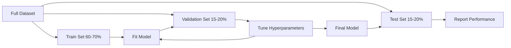

<!-- local-zh-machine-draft: English source is canonical; prose translated automatically, code/math preserved. -->

<a id="model-evaluation"></a>

# 模型 Evaluation

> 模型的好坏取决于衡量它的方式。

**类型：** 构建
**语言：** Python
**先决条件：** 第 1 阶段（概率与分布、ML 统计）、第 2 阶段第 1-8 课
**时间：** ~90 分钟

<a id="learning-objectives"></a>

## 学习目标

- 从头开始实施 K 折和分层 K 折交叉验证，并解释为什么分层对于不平衡数据很重要
- 从头开始计算精确率、召回率、F1、AUC-ROC 和回归指标（MSE、RMSE、MAE、R 平方）
- 解释学习曲线以诊断模型是否存在高偏差或高方差
- 识别常见的 evaluation 错误，包括 data leakage、错误的指标选择和测试集污染

<a id="the-problem"></a>

## 问题

您训练了一个模型。它对您的数据的准确率达到 95%。好不好？

也许吧。也许不是。如果 95% 的数据属于一个类别，则始终预测该类别的模型可以获得 95% 的准确率，但完全没有用处。如果您对训练时使用的相同数据进行评估，则 95% 的数字毫无意义，因为模型只是记住了答案。如果您的数据集具有时间成分，并且您在分割之前随机洗牌，则您的模型可能会使用未来的数据来预测过去。

模型 evaluation 是大多数 ML 项目出错的地方。错误的指标会让糟糕的模型看起来很好。错误的分割会让模型作弊。错误的比较会让你选择更差的模型。正确获取 evaluation 不是可选的。这是在生产中有效的模型与在看到真实数据时就失败的模型之间的区别。

<a id="the-concept"></a>

## 概念

<a id="train-validation-test"></a>

### 训练、验证、测试



三个分裂，三个目的：

- **训练集**：模型从该数据中学习。它在训练期间看到这些示例。
- **验证集**：用于调整hyperparameters并在模型之间进行选择。该模型永远不会根据这些数据进行训练，但您的决策会受到它的影响。
- **测试装置**：在最后触摸一次，报告最终性能。如果您查看测试性能，然后返回更改您的模型，它就不再是测试集。它已成为第二个验证集。

测试集是您的保证，报告的性能反映了模型在真正未见过的数据上的表现。

<a id="k-fold-cross-validation"></a>

### K 折交叉验证

对于小型数据集，单个训练/验证分割会浪费数据并给出嘈杂的估计。 K 折交叉验证使用所有数据进行训练和验证：

```mermaid
flowchart TB
    subgraph Fold1["Fold 1"]
        direction LR
        V1["Val"] --- T1a["Train"] --- T1b["Train"] --- T1c["Train"] --- T1d["Train"]
    end
    subgraph Fold2["Fold 2"]
        direction LR
        T2a["Train"] --- V2["Val"] --- T2b["Train"] --- T2c["Train"] --- T2d["Train"]
    end
    subgraph Fold3["Fold 3"]
        direction LR
        T3a["Train"] --- T3b["Train"] --- V3["Val"] --- T3c["Train"] --- T3d["Train"]
    end
    subgraph Fold4["Fold 4"]
        direction LR
        T4a["Train"] --- T4b["Train"] --- T4c["Train"] --- V4["Val"] --- T4d["Train"]
    end
    subgraph Fold5["Fold 5"]
        direction LR
        T5a["Train"] --- T5b["Train"] --- T5c["Train"] --- T5d["Train"] --- V5["Val"]
    end
    Fold1 --> R["Average scores"]
    Fold2 --> R
    Fold3 --> R
    Fold4 --> R
    Fold5 --> R
```



1. 将数据拆分为 K 个大小相等的折叠
2. 对于每次折叠，训练 K-1 次折叠并验证剩余的折叠
3. 平均 K 验证分数

K=5 或 K=10 是标准选择。每个数据点仅用于验证一次。平均分数是比任何单一分割更稳定的估计。

**Stratified K-fold**：保留每个折叠中的类分布。如果您的数据集为 70% A 类和 30% B 类，则每次折叠的比例将大致相同。这对于不平衡的数据集非常重要，其中随机分割可能会将所有少数样本放在一起。

<a id="classification-metrics"></a>

### 分类指标

**混淆矩阵**：基础。对于二元分类：

|  | 预测为阳性 | 预测阴性 |
|--|---|---|
| 实际上积极 | 真阳性 (TP) | 假阴性 (FN) |
| 实际上是否定的 | 误报 (FP) | 真阴性 (TN) |

从这个矩阵中，所有其他指标如下：

- **准确度** = (TP + TN) / (TP + TN + FP + FN)。正确预测的分数。当类别不平衡时会产生误导。
- **精度** = TP / (TP + FP)。在所有预测为积极的事情中，有多少实际上是积极的？当误报代价高昂时使用（例如，垃圾邮件过滤器将真实电子邮件标记为垃圾邮件）。
- **Recall**（灵敏度）= TP /（TP + FN）。在所有实际阳性病例中，我们发现了多少？当假阴性代价高昂时使用（例如，癌症筛查漏掉了肿瘤）。
- **F1 得分 ** = 2 * 精确率 * 召回率 /（精确率 + 召回率）。精确率和召回率的调和平均值。当两者都没有明显占主导地位时，平衡两者。
- **AUC-ROC**：接收器操作特征曲线下的面积。绘制不同分类阈值下的真阳性率与假阳性率。 AUC = 0.5 表示随机猜测，AUC = 1.0 表示完美分离。与阈值无关：它衡量模型将正值排在负值之上的程度，无论您选择的截止值如何。

<a id="regression-metrics"></a>

### 回归指标

- **MSE**（均方误差）=平均值（（y_true - y_pred）^ 2）。对大错误进行二次惩罚。对异常值敏感。
- **RMSE**（均方根误差）= sqrt（MSE）。与目标变量相同的单位。比 MSE 更容易解释。
- **MAE**（平均绝对误差）=平均值（|y_true - y_pred|）。线性处理所有错误。比 MSE 对异常值更稳健。
- **R 平方** = 1 - SS_res / SS_tot，其中 SS_res = 总和((y_true - y_pred)^2) 和 SS_tot = sum((y_true - y_mean)^2)。模型解释的方差分数。 R^2 = 1.0 是完美的。 R^2 = 0.0 意味着模型并不比总是预测平均值更好。如果模型比平均值差，R^2 可能为负。

<a id="learning-curves"></a>

### 学习曲线

将训练和验证分数绘制为训练集大小的函数：

- **高偏差 (underfitting)**：两条曲线收敛到低分。添加更多数据不会有帮助。您需要一个更复杂的模型。
- **高方差（overfitting）**：训练分数很高，但验证分数低得多。他们之间的差距很大。添加更多数据应该会有所帮助。

<a id="validation-curves"></a>

### 验证曲线

将训练和验证分数绘制为 hyperparameter 的函数：

- 复杂度较低时：两个分数都较低 (underfitting)
- 在适当的复杂性下：两个分数都很高并且接近
- 高复杂度时：训练分数保持较高，但验证分数下降 (overfitting)

最佳 hyperparameter 值是验证分数达到峰值的位置。

<a id="common-evaluation-mistakes"></a>

### 常见错误Evaluation

**Data leakage**：测试集中的信息泄漏到训练中。示例：在分割之前在完整数据集上拟合缩放器，包括时间序列预测中的未来数据，使用从目标派生的 feature。始终先分割，然后预处理。

**类别不平衡**：99%的交易是合法的，1%是欺诈的。始终预测“合法”的模型可以获得 99% 的准确率。请改用精确率、召回率、F1 或 AUC-ROC。

**错误的指标**：当您应该优化召回（医学诊断）时优化准确性，或者当您的数据有严重异常值时优化RMSE（改为使用MAE）。

**不使用分层分割**：对于不平衡的数据，随机分割可能会将很少的少数样本放入验证文件夹中，从而给出不稳定的估计。

**测试过于频繁**：每次查看测试性能并进行调整时，都会过度拟合测试集。测试装置是一次性的。

```figure
precision-recall-threshold
```

<a id="build-it"></a>

## 动手实现

<a id="step-1-trainvalidationtest-split"></a>

### 第 1 步：训练/验证/测试拆分

```python
import random
import math


def train_val_test_split(X, y, train_ratio=0.6, val_ratio=0.2, seed=42):
    random.seed(seed)
    n = len(X)
    indices = list(range(n))
    random.shuffle(indices)

    train_end = int(n * train_ratio)
    val_end = int(n * (train_ratio + val_ratio))

    train_idx = indices[:train_end]
    val_idx = indices[train_end:val_end]
    test_idx = indices[val_end:]

    X_train = [X[i] for i in train_idx]
    y_train = [y[i] for i in train_idx]
    X_val = [X[i] for i in val_idx]
    y_val = [y[i] for i in val_idx]
    X_test = [X[i] for i in test_idx]
    y_test = [y[i] for i in test_idx]

    return X_train, y_train, X_val, y_val, X_test, y_test
```

<a id="step-2-k-fold-and-stratified-k-fold-cross-validation"></a>

### 步骤2：K折和分层K折交叉验证

```python
def kfold_split(n, k=5, seed=42):
    random.seed(seed)
    indices = list(range(n))
    random.shuffle(indices)

    fold_size = n // k
    folds = []

    for i in range(k):
        start = i * fold_size
        end = start + fold_size if i < k - 1 else n
        val_idx = indices[start:end]
        train_idx = indices[:start] + indices[end:]
        folds.append((train_idx, val_idx))

    return folds


def stratified_kfold_split(y, k=5, seed=42):
    random.seed(seed)

    class_indices = {}
    for i, label in enumerate(y):
        class_indices.setdefault(label, []).append(i)

    for label in class_indices:
        random.shuffle(class_indices[label])

    folds = [{"train": [], "val": []} for _ in range(k)]

    for label, indices in class_indices.items():
        fold_size = len(indices) // k
        for i in range(k):
            start = i * fold_size
            end = start + fold_size if i < k - 1 else len(indices)
            val_part = indices[start:end]
            train_part = indices[:start] + indices[end:]
            folds[i]["val"].extend(val_part)
            folds[i]["train"].extend(train_part)

    return [(f["train"], f["val"]) for f in folds]


def cross_validate(X, y, model_fn, k=5, metric_fn=None, stratified=False):
    n = len(X)

    if stratified:
        folds = stratified_kfold_split(y, k)
    else:
        folds = kfold_split(n, k)

    scores = []
    for train_idx, val_idx in folds:
        X_train = [X[i] for i in train_idx]
        y_train = [y[i] for i in train_idx]
        X_val = [X[i] for i in val_idx]
        y_val = [y[i] for i in val_idx]

        model = model_fn()
        model.fit(X_train, y_train)
        predictions = [model.predict(x) for x in X_val]

        if metric_fn:
            score = metric_fn(y_val, predictions)
        else:
            score = sum(1 for yt, yp in zip(y_val, predictions) if yt == yp) / len(y_val)
        scores.append(score)

    return scores
```

<a id="step-3-confusion-matrix-and-classification-metrics"></a>

### 步骤 3：混淆矩阵和分类指标

```python
def confusion_matrix(y_true, y_pred):
    tp = sum(1 for yt, yp in zip(y_true, y_pred) if yt == 1 and yp == 1)
    tn = sum(1 for yt, yp in zip(y_true, y_pred) if yt == 0 and yp == 0)
    fp = sum(1 for yt, yp in zip(y_true, y_pred) if yt == 0 and yp == 1)
    fn = sum(1 for yt, yp in zip(y_true, y_pred) if yt == 1 and yp == 0)
    return tp, tn, fp, fn


def accuracy(y_true, y_pred):
    tp, tn, fp, fn = confusion_matrix(y_true, y_pred)
    total = tp + tn + fp + fn
    return (tp + tn) / total if total > 0 else 0.0


def precision(y_true, y_pred):
    tp, tn, fp, fn = confusion_matrix(y_true, y_pred)
    return tp / (tp + fp) if (tp + fp) > 0 else 0.0


def recall(y_true, y_pred):
    tp, tn, fp, fn = confusion_matrix(y_true, y_pred)
    return tp / (tp + fn) if (tp + fn) > 0 else 0.0


def f1_score(y_true, y_pred):
    p = precision(y_true, y_pred)
    r = recall(y_true, y_pred)
    return 2 * p * r / (p + r) if (p + r) > 0 else 0.0


def roc_curve(y_true, y_scores):
    thresholds = sorted(set(y_scores), reverse=True)
    tpr_list = []
    fpr_list = []

    total_positives = sum(y_true)
    total_negatives = len(y_true) - total_positives

    for threshold in thresholds:
        y_pred = [1 if s >= threshold else 0 for s in y_scores]
        tp = sum(1 for yt, yp in zip(y_true, y_pred) if yt == 1 and yp == 1)
        fp = sum(1 for yt, yp in zip(y_true, y_pred) if yt == 0 and yp == 1)

        tpr = tp / total_positives if total_positives > 0 else 0.0
        fpr = fp / total_negatives if total_negatives > 0 else 0.0

        tpr_list.append(tpr)
        fpr_list.append(fpr)

    return fpr_list, tpr_list, thresholds


def auc_roc(y_true, y_scores):
    fpr_list, tpr_list, _ = roc_curve(y_true, y_scores)

    pairs = sorted(zip(fpr_list, tpr_list))
    fpr_sorted = [p[0] for p in pairs]
    tpr_sorted = [p[1] for p in pairs]

    area = 0.0
    for i in range(1, len(fpr_sorted)):
        width = fpr_sorted[i] - fpr_sorted[i - 1]
        height = (tpr_sorted[i] + tpr_sorted[i - 1]) / 2
        area += width * height

    return area
```

<a id="step-4-regression-metrics"></a>

### 步骤 4：回归指标

```python
def mse(y_true, y_pred):
    n = len(y_true)
    return sum((yt - yp) ** 2 for yt, yp in zip(y_true, y_pred)) / n


def rmse(y_true, y_pred):
    return math.sqrt(mse(y_true, y_pred))


def mae(y_true, y_pred):
    n = len(y_true)
    return sum(abs(yt - yp) for yt, yp in zip(y_true, y_pred)) / n


def r_squared(y_true, y_pred):
    mean_y = sum(y_true) / len(y_true)
    ss_res = sum((yt - yp) ** 2 for yt, yp in zip(y_true, y_pred))
    ss_tot = sum((yt - mean_y) ** 2 for yt in y_true)
    if ss_tot == 0:
        return 0.0
    return 1.0 - ss_res / ss_tot
```

<a id="step-5-learning-curves"></a>

### 第 5 步：学习曲线

```python
def learning_curve(X, y, model_fn, metric_fn, train_sizes=None, val_ratio=0.2, seed=42):
    random.seed(seed)
    n = len(X)
    indices = list(range(n))
    random.shuffle(indices)

    val_size = int(n * val_ratio)
    val_idx = indices[:val_size]
    pool_idx = indices[val_size:]

    X_val = [X[i] for i in val_idx]
    y_val = [y[i] for i in val_idx]

    if train_sizes is None:
        train_sizes = [int(len(pool_idx) * r) for r in [0.1, 0.2, 0.4, 0.6, 0.8, 1.0]]

    train_scores = []
    val_scores = []

    for size in train_sizes:
        subset = pool_idx[:size]
        X_train = [X[i] for i in subset]
        y_train = [y[i] for i in subset]

        model = model_fn()
        model.fit(X_train, y_train)

        train_pred = [model.predict(x) for x in X_train]
        val_pred = [model.predict(x) for x in X_val]

        train_scores.append(metric_fn(y_train, train_pred))
        val_scores.append(metric_fn(y_val, val_pred))

    return train_sizes, train_scores, val_scores
```

<a id="step-6-a-simple-classifier-for-testing-plus-the-full-demo"></a>

### 第 6 步：用于测试的简单分类器以及完整的演示

```python
class SimpleLogistic:
    def __init__(self, lr=0.1, epochs=100):
        self.lr = lr
        self.epochs = epochs
        self.weights = None
        self.bias = 0.0

    def sigmoid(self, z):
        z = max(-500, min(500, z))
        return 1.0 / (1.0 + math.exp(-z))

    def fit(self, X, y):
        n_features = len(X[0])
        self.weights = [0.0] * n_features
        self.bias = 0.0

        for _ in range(self.epochs):
            for xi, yi in zip(X, y):
                z = sum(w * x for w, x in zip(self.weights, xi)) + self.bias
                pred = self.sigmoid(z)
                error = yi - pred
                for j in range(n_features):
                    self.weights[j] += self.lr * error * xi[j]
                self.bias += self.lr * error

    def predict_proba(self, x):
        z = sum(w * xi for w, xi in zip(self.weights, x)) + self.bias
        return self.sigmoid(z)

    def predict(self, x):
        return 1 if self.predict_proba(x) >= 0.5 else 0


class SimpleLinearRegression:
    def __init__(self, lr=0.001, epochs=200):
        self.lr = lr
        self.epochs = epochs
        self.weights = None
        self.bias = 0.0

    def fit(self, X, y):
        n_features = len(X[0])
        self.weights = [0.0] * n_features
        self.bias = 0.0
        n = len(X)

        for _ in range(self.epochs):
            for xi, yi in zip(X, y):
                pred = sum(w * x for w, x in zip(self.weights, xi)) + self.bias
                error = yi - pred
                for j in range(n_features):
                    self.weights[j] += self.lr * error * xi[j] / n
                self.bias += self.lr * error / n

    def predict(self, x):
        return sum(w * xi for w, xi in zip(self.weights, x)) + self.bias


def standardize(values):
    n = len(values)
    mean = sum(values) / n
    var = sum((v - mean) ** 2 for v in values) / n
    std = math.sqrt(var) if var > 0 else 1.0
    return [(v - mean) / std for v in values], mean, std


def make_classification_data(n=300, seed=42):
    random.seed(seed)
    X = []
    y = []
    for _ in range(n):
        x1 = random.gauss(0, 1)
        x2 = random.gauss(0, 1)
        label = 1 if (x1 + x2 + random.gauss(0, 0.5)) > 0 else 0
        X.append([x1, x2])
        y.append(label)
    return X, y


def make_regression_data(n=200, seed=42):
    random.seed(seed)
    X = []
    y = []
    for _ in range(n):
        x1 = random.uniform(0, 10)
        x2 = random.uniform(0, 5)
        target = 3 * x1 + 2 * x2 + random.gauss(0, 2)
        X.append([x1, x2])
        y.append(target)
    return X, y


def make_imbalanced_data(n=300, minority_ratio=0.05, seed=42):
    random.seed(seed)
    X = []
    y = []
    for _ in range(n):
        if random.random() < minority_ratio:
            x1 = random.gauss(3, 0.5)
            x2 = random.gauss(3, 0.5)
            label = 1
        else:
            x1 = random.gauss(0, 1)
            x2 = random.gauss(0, 1)
            label = 0
        X.append([x1, x2])
        y.append(label)
    return X, y


if __name__ == "__main__":
    X_clf, y_clf = make_classification_data(300)

    print("=== Train/Validation/Test Split ===")
    X_train, y_train, X_val, y_val, X_test, y_test = train_val_test_split(X_clf, y_clf)
    print(f"  Train: {len(X_train)}, Val: {len(X_val)}, Test: {len(X_test)}")
    print(f"  Train class distribution: {sum(y_train)}/{len(y_train)} positive")
    print(f"  Val class distribution: {sum(y_val)}/{len(y_val)} positive")

    model = SimpleLogistic(lr=0.1, epochs=200)
    model.fit(X_train, y_train)

    print("\n=== Classification Metrics ===")
    y_pred = [model.predict(x) for x in X_test]
    tp, tn, fp, fn = confusion_matrix(y_test, y_pred)
    print(f"  Confusion matrix: TP={tp}, TN={tn}, FP={fp}, FN={fn}")
    print(f"  Accuracy:  {accuracy(y_test, y_pred):.4f}")
    print(f"  Precision: {precision(y_test, y_pred):.4f}")
    print(f"  Recall:    {recall(y_test, y_pred):.4f}")
    print(f"  F1 Score:  {f1_score(y_test, y_pred):.4f}")

    y_scores = [model.predict_proba(x) for x in X_test]
    auc = auc_roc(y_test, y_scores)
    print(f"  AUC-ROC:   {auc:.4f}")

    print("\n=== K-Fold Cross-Validation (K=5) ===")
    cv_scores = cross_validate(
        X_clf, y_clf,
        model_fn=lambda: SimpleLogistic(lr=0.1, epochs=200),
        k=5,
        metric_fn=accuracy,
    )
    mean_cv = sum(cv_scores) / len(cv_scores)
    std_cv = math.sqrt(sum((s - mean_cv) ** 2 for s in cv_scores) / len(cv_scores))
    print(f"  Fold scores: {[round(s, 4) for s in cv_scores]}")
    print(f"  Mean: {mean_cv:.4f} (+/- {std_cv:.4f})")

    print("\n=== Stratified K-Fold Cross-Validation (K=5) ===")
    strat_scores = cross_validate(
        X_clf, y_clf,
        model_fn=lambda: SimpleLogistic(lr=0.1, epochs=200),
        k=5,
        metric_fn=accuracy,
        stratified=True,
    )
    strat_mean = sum(strat_scores) / len(strat_scores)
    strat_std = math.sqrt(sum((s - strat_mean) ** 2 for s in strat_scores) / len(strat_scores))
    print(f"  Fold scores: {[round(s, 4) for s in strat_scores]}")
    print(f"  Mean: {strat_mean:.4f} (+/- {strat_std:.4f})")

    print("\n=== Imbalanced Data: Why Accuracy Lies ===")
    X_imb, y_imb = make_imbalanced_data(300, minority_ratio=0.05)
    positives = sum(y_imb)
    print(f"  Class distribution: {positives} positive, {len(y_imb) - positives} negative ({positives/len(y_imb)*100:.1f}% positive)")

    always_negative = [0] * len(y_imb)
    print(f"  Always-negative baseline:")
    print(f"    Accuracy:  {accuracy(y_imb, always_negative):.4f}")
    print(f"    Precision: {precision(y_imb, always_negative):.4f}")
    print(f"    Recall:    {recall(y_imb, always_negative):.4f}")
    print(f"    F1 Score:  {f1_score(y_imb, always_negative):.4f}")

    X_tr_i, y_tr_i, X_v_i, y_v_i, X_te_i, y_te_i = train_val_test_split(X_imb, y_imb)
    model_imb = SimpleLogistic(lr=0.5, epochs=500)
    model_imb.fit(X_tr_i, y_tr_i)
    y_pred_imb = [model_imb.predict(x) for x in X_te_i]
    print(f"\n  Trained model on imbalanced data:")
    print(f"    Accuracy:  {accuracy(y_te_i, y_pred_imb):.4f}")
    print(f"    Precision: {precision(y_te_i, y_pred_imb):.4f}")
    print(f"    Recall:    {recall(y_te_i, y_pred_imb):.4f}")
    print(f"    F1 Score:  {f1_score(y_te_i, y_pred_imb):.4f}")

    print("\n=== Regression Metrics ===")
    X_reg, y_reg = make_regression_data(200)

    col0 = [x[0] for x in X_reg]
    col1 = [x[1] for x in X_reg]
    col0_s, m0, s0 = standardize(col0)
    col1_s, m1, s1 = standardize(col1)
    X_reg_scaled = [[col0_s[i], col1_s[i]] for i in range(len(X_reg))]

    X_tr_r, y_tr_r, X_v_r, y_v_r, X_te_r, y_te_r = train_val_test_split(X_reg_scaled, y_reg)
    reg_model = SimpleLinearRegression(lr=0.01, epochs=500)
    reg_model.fit(X_tr_r, y_tr_r)
    y_pred_r = [reg_model.predict(x) for x in X_te_r]

    print(f"  MSE:       {mse(y_te_r, y_pred_r):.4f}")
    print(f"  RMSE:      {rmse(y_te_r, y_pred_r):.4f}")
    print(f"  MAE:       {mae(y_te_r, y_pred_r):.4f}")
    print(f"  R-squared: {r_squared(y_te_r, y_pred_r):.4f}")

    mean_baseline = [sum(y_tr_r) / len(y_tr_r)] * len(y_te_r)
    print(f"\n  Mean baseline:")
    print(f"    MSE:       {mse(y_te_r, mean_baseline):.4f}")
    print(f"    R-squared: {r_squared(y_te_r, mean_baseline):.4f}")

    print("\n=== Learning Curve ===")
    sizes, train_sc, val_sc = learning_curve(
        X_clf, y_clf,
        model_fn=lambda: SimpleLogistic(lr=0.1, epochs=200),
        metric_fn=accuracy,
    )
    print(f"  {'Size':>6} {'Train':>8} {'Val':>8}")
    for s, tr, va in zip(sizes, train_sc, val_sc):
        print(f"  {s:>6} {tr:>8.4f} {va:>8.4f}")

    print("\n=== Statistical Model Comparison ===")
    model_a_scores = cross_validate(
        X_clf, y_clf,
        model_fn=lambda: SimpleLogistic(lr=0.1, epochs=100),
        k=5, metric_fn=accuracy,
    )
    model_b_scores = cross_validate(
        X_clf, y_clf,
        model_fn=lambda: SimpleLogistic(lr=0.1, epochs=500),
        k=5, metric_fn=accuracy,
    )
    diffs = [a - b for a, b in zip(model_a_scores, model_b_scores)]
    mean_diff = sum(diffs) / len(diffs)
    std_diff = math.sqrt(sum((d - mean_diff) ** 2 for d in diffs) / len(diffs))
    t_stat = mean_diff / (std_diff / math.sqrt(len(diffs))) if std_diff > 0 else 0.0
    print(f"  Model A (100 epochs) mean: {sum(model_a_scores)/len(model_a_scores):.4f}")
    print(f"  Model B (500 epochs) mean: {sum(model_b_scores)/len(model_b_scores):.4f}")
    print(f"  Mean difference: {mean_diff:.4f}")
    print(f"  Paired t-statistic: {t_stat:.4f}")
    print(f"  (|t| > 2.78 for significance at p<0.05 with df=4)")
```

<a id="use-it"></a>

## 实际应用

通过 scikit-learn，evaluation 内置到工作流程中：

```python
from sklearn.model_selection import cross_val_score, StratifiedKFold, learning_curve
from sklearn.metrics import (
    accuracy_score, precision_score, recall_score, f1_score,
    roc_auc_score, confusion_matrix, mean_squared_error, r2_score,
)
from sklearn.linear_model import LogisticRegression

model = LogisticRegression()
scores = cross_val_score(model, X, y, cv=StratifiedKFold(5), scoring="f1")
```

从头开始的版本准确地展示了交叉验证的作用（没有魔法，只是 for 循环和索引跟踪）、每个指标的计算方式（仅计算 TP/FP/TN/FN），以及为什么分层很重要（保留每个折叠中的类别比率）。库版本添加了并行性、更多评分选项以及与管道的集成。

<a id="ship-it"></a>

## 交付成果

本课产生：
- `outputs/skill-evaluation.md` - 涵盖 evaluation 分类和回归模型策略的技能

<a id="exercises"></a>

## 练习

1. 实现精确率-召回率曲线：绘制不同阈值下的精确率与召回率。计算平均精度（PR 曲线下的面积）。将不平衡数据集上的 PR 曲线与 ROC 曲线进行比较，并解释每条曲线何时提供更多信息。
2. 构建嵌套交叉验证循环：外循环评估模型性能，内循环调整 hyperparameters。使用它公平地比较两个模型，而不会将验证数据泄漏到 evaluation 中。
3. 实施模型比较的排列测试：打乱标签、重新训练并测量性能。重复 100 次以构建零分布。根据该分布计算观察到的模型性能的 p 值。

<a id="key-terms"></a>

## 关键术语

| 术语 | 人们怎么说 | 它实际上意味着什么 |
|------|----------------|----------------------|
| Overfitting | “记忆训练数据” | 该模型捕获训练数据中的噪声，在训练中表现良好，但在未见过的数据上表现不佳 |
| 交叉验证 | “在不同子集上进行测试” | 系统地轮换数据的哪一部分用于验证，对所有轮换的结果进行平均 |
| 精度 | “有多少预测的阳性结果是正确的” | TP / (TP + FP)：阳性预测中实际为阳性的比例 |
| 召回 | “我们发现了多少实际的积极因素” | TP / (TP + FN)：正确识别的实际阳性分数 |
| AUC-ROC | “模型区分类别的效果如何” | 所有阈值的真阳性率与假阳性率曲线下面积，从 0.5（随机）到 1.0（完美） |
| R平方 | “解释了多少方差” | 1 -（残差平方和/总平方和）：模型捕获的目标方差的分数 |
| Data leakage | “模特被骗了” | 在训练期间使用在预测时无法获得的信息，导致乐观的 evaluation |
| 学习曲线 | “性能如何随着更多数据而变化” | 训练和验证分数与训练集大小的关系图，显示 underfitting 或 overfitting |
| 分层分割 | “保持班级比例平衡” | 分割数据，使每个子集的每个类别的比例与完整数据集相同 |

<a id="further-reading"></a>

## 进一步阅读

- [scikit-learn 模型选择指南](https://scikit-learn.org/stable/model_selection.html) - 有关交叉验证、指标和 hyperparameter 调优的综合参考
- [超越准确度：精确度和召回率（Google ML 速成课程）](https://developers.google.com/machine-learning/crash-course/classification/precision-and-recall) - 带有交互式示例的清晰解释
- [A 交叉验证程序调查（Arlot & Celisse，2010）](https://projecteuclid.org/journals/statistics-surveys/volume-4/issue-none/A-survey-of-cross-validation-procedures-for-model-selection/10.1214/09-SS054.full) - 严格处理不同 CV 策略何时以及为何有效
