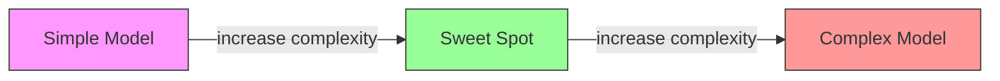
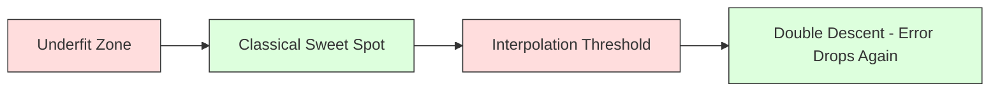
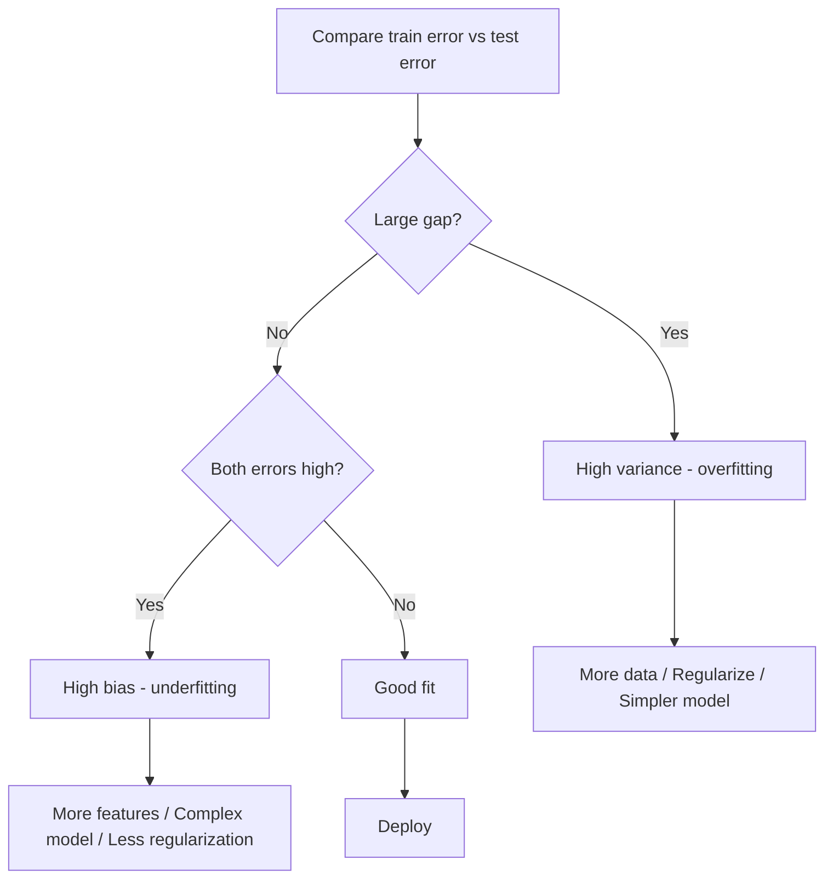
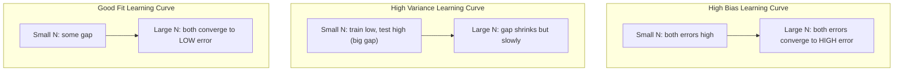
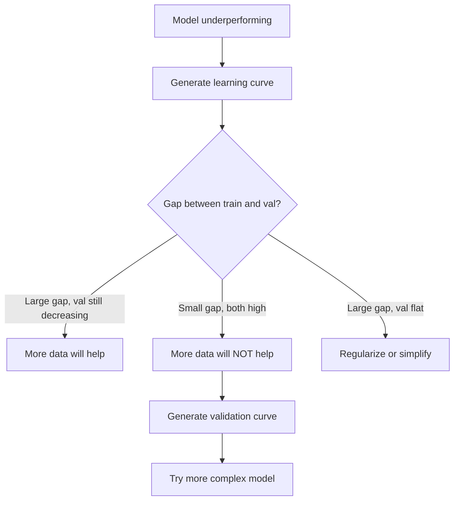

<!-- local-zh-machine-draft: English source is canonical; prose translated automatically, code/math preserved. -->

<a id="bias-variance-tradeoff"></a>

# 偏差-方差权衡

> 每个模型误差都来自三个来源之一：偏差、方差或噪声。您只能控制前两个。

**类型：** 了解
**语言：** Python
**先决条件：** 第 2 阶段，第 01-09 课（ML 基础知识、回归、分类、evaluation）
**时间：** ~75分钟

<a id="learning-objectives"></a>

## 学习目标

- 推导预期预测误差的偏差-方差分解并解释不可约噪声的作用
- 使用训练和测试错误模式诊断模型是否存在高偏差或高方差
- 解释正则化技术（L1、L2、dropout、提前停止）如何用偏差换取方差
- 实施实验，可视化复杂性不断增加的模型之间的偏差-方差权衡

<a id="the-problem"></a>

## 问题

您训练了一个模型。测试数据有一定误差。这个错误从何而来？

如果您的模型太简单（弯曲数据集上的线性回归），它将始终错过真实模式。这就是偏差。如果您的模型太复杂（15 个数据点的 20 次多项式），它将完美地拟合训练数据，但对新数据给出截然不同的预测。这就是方差。

对于固定模型容量，您无法同时最小化两者。降低偏差，方差就会上升。方差下降，偏差上升。理解这种权衡是机器学习中最有用的诊断技能。它告诉您是否使模型更复杂或不那么复杂，是获取更多数据还是更好地设计features，是更多还是更少正则化。

<a id="the-concept"></a>

## 概念

<a id="bias-systematic-error"></a>

### 偏差：系统误差

偏差衡量模型的平均预测与真实值的偏差程度。如果您在来自相同分布的许多不同训练集上训练相同的模型并对预测进行平均，则偏差就是平均值与真实值之间的差距。

高偏差意味着模型过于僵化而无法捕捉真实模式。无论您提供多少数据，拟合抛物线的直线总是会错过曲线。这是underfitting。

```
High bias (underfitting):
  Model always predicts roughly the same wrong thing.
  Training error: HIGH
  Test error: HIGH
  Gap between them: SMALL
```

<a id="variance-sensitivity-to-training-data"></a>

### 方差：对训练数据的敏感性

方差衡量当您在不同的数据子集上进行训练时，您的预测发生了多大变化。如果训练集的微小变化导致模型发生较大变化，则方差会很高。

高方差意味着模型正在拟合训练数据中的噪声，而不是基础信号。 20 次多项式将贯穿每个训练点，但会在它们之间剧烈振荡。这是overfitting。

```
High variance (overfitting):
  Model fits training data perfectly but fails on new data.
  Training error: LOW
  Test error: HIGH
  Gap between them: LARGE
```

<a id="the-decomposition"></a>

### 分解

对于任何点 x，平方损失下的预期预测误差精确分解为：

```
Expected Error = Bias^2 + Variance + Irreducible Noise

where:
  Bias^2   = (E[f_hat(x)] - f(x))^2
  Variance = E[(f_hat(x) - E[f_hat(x)])^2]
  Noise    = E[(y - f(x))^2]             (sigma^2)
```

- `f(x)`才是真正的函数
- `f_hat(x)` 是您模型的预测
- `E[...]`是对不同训练集的期望
- `y` 是观察到的标签（真实函数加噪声）

噪声项是不可约的。对于噪声数据，没有任何模型可以比 sigma^2 做得更好。您的工作是在偏差^2 和方差之间找到适当的平衡。

<a id="model-complexity-vs-error"></a>

### 模型复杂性与错误



经典的U型曲线：

| 复杂性 | 偏差 | 方差 | 总误差 |
|-----------|------|----------|-------------|
| 太低 | 高 | 低 | 高（underfitting） |
| 刚刚好 | 中等 | 中等 | 最低 |
| 太高了 | 低 | 高 | 高（overfitting） |

<a id="regularization-as-bias-variance-control"></a>

### 正则化作为偏差-方差控制

正则化故意增加偏差以减少方差。它限制了模型，使其无法追逐噪声。

- **L2（山脊）：** 将所有 weights 缩小到零。保留所有features，但减少其影响。
- **L1（套索）：** 将一些 weights 精确推至零。执行 feature 选择。
- **Dropout:** 在训练期间随机禁用神经元。强制冗余表示。
- **E提前停止：** 在模型完全拟合训练数据之前停止训练。

正则化强度（lambda、dropout 速率、时期数）直接控制您在偏差-方差曲线上的位置。更多的正则化意味着更多的偏差、更少的方差。

<a id="double-descent-the-modern-perspective"></a>

### 双重血统：现代视角

经典理论说：在最佳点之后，更多的复杂性总是有害的。但 2019 年以来的研究显示了一些意想不到的情况。如果您不断增加模型容量，使其远远超过插值阈值（模型有足够的 parameters 来完美拟合训练数据），测试误差可能会再次下降。



这种“双下降”现象解释了为什么大规模过度参数化的神经网络（parameters 比训练样本多得多）仍然具有良好的泛化能力。经典的偏差-方差权衡并没有错，但对于现代制度来说它是不完整的。

关于双重血统的主要观察：
- 它发生在线性模型、决策树和神经网络中
- 更多数据实际上会伤害插值区域（样本双下降）
- 更多的训练epoch也会导致这种情况（epoch-wise 双下降）
- 正则化可以平滑峰值，但不能消除它

为什么会出现这种情况？在插值阈值处，模型具有足够的容量来拟合所有训练点。它被迫采用一个非常具体的解决方案，贯穿每个点，数据中的微小扰动会导致拟合发生巨大变化。这是方差达到峰值的地方。超过阈值后，模型有许多可能的解决方案可以完美地拟合数据。学习算法（例如，具有隐式正则化的 gradient descent）倾向于选择其中最简单的一个。这种对简单解决方案的隐性偏差是过度参数化模型泛化的原因。

| 政权 | Parameters 与样品对比 | 行为 |
|--------|----------------------|----------|
| 参数化不足 | p << n | 经典权衡适用 |
| 插值阈值 | p~n | 方差峰值、测试误差峰值 |
| 过度参数化 | p>>n | 隐式正则化启动，测试误差下降 |

出于实际目的：如果您使用神经网络或大型树集成，请不要停在插值阈值处。要么远远低于它（通过明确的正则化），要么远远超过它。最糟糕的地方就在门槛处。

<a id="diagnosing-your-model"></a>

### 诊断你的模型



| 症状 | 诊断 | 修复 |
|---------|-----------|-----|
| 高训练误差、高测试误差 | 偏差 | 更多features，模型复杂，正则化少 |
| 训练误差低，测试误差高 | 方差 | 更多数据，正则化，更简单的模型，dropout |
| 低训练误差、低测试误差 | 很合身 | 运送它 |
| 训练误差减少，测试误差增加 | Overfitting 进行中 | 提前停止 |

<a id="practical-strategies"></a>

### 实用策略

**当偏差是问题时：**
- 添加多项式或交互作用 features
- 使用更灵活的模型（树集成而不是线性）
- 降低正则化强度
- 训练时间更长（如果尚未收敛）

**当方差是问题时：**
- 获取更多训练数据
- 使用装袋（随机森林）
- 增加正则化（更高的 lambda，更多的 dropout）
- Feature选择（去除嘈杂的features）
- 使用交叉验证及早发现

<a id="ensemble-methods-and-variance-reduction"></a>

### 集成方法和方差减少

集成方法是对抗方差的最实用的工具。

**Bagging（引导聚合）** 在训练数据的不同引导样本上训练多个模型，然后对它们的预测进行平均。每个单独的模型都有很高的方差，但平均值的方差要低得多。随机森林是应用于决策树的套袋。

为什么它在数学上起作用：如果对 N 个独立的预测进行平均，每个预测的方差为 sigma^2，则平均值的方差为 sigma^2 / N。这些模型并不是真正独立的（它们都看到相似的数据），因此减少幅度小于 1/N，但仍然很大。

**Boosting** 通过顺序构建模型来减少偏差，其中每个新模型都专注于迄今为止集成的错误。 Gradient boosting 和 AdaBoost 是主要的例子。如果添加太多模型，Boosting 可能会过度拟合，因此您需要提前停止或正则化。

| 方法 | 主要效应 | 偏差变化 | 方差变化 |
|--------|---------------|-------------|-----------------|
| 套袋 | 减少方差 | 没有变化 | 减少 |
| 提升 | 减少偏差 | 减少 | 可以增加 |
| 堆叠 | 减少两者 | 取决于元学习器 | 取决于基本型号 |
| Dropout | 隐式装袋 | 略有增加 | 减少 |

**实用规则：** 如果您的基础模型具有高方差（深树、高次多项式），请使用装袋。如果您的基础模型具有高偏差（浅树桩、简单线性模型），请使用提升。

<a id="learning-curves"></a>

### 学习曲线

学习曲线将训练和验证误差绘制为训练集大小的函数。它们是您拥有的最实用的诊断工具。与单个训练/测试比较不同，学习曲线向您显示模型的轨迹，并告诉您更多数据是否会有帮助。



如何阅读它们：

| 场景 | 训练误差 | 验证错误 | 间隙 | 这意味着什么 | 该怎么做 |
|----------|---------------|-----------------|-----|---------------|------------|
| 高偏差 | 高 | 高 | 小号 | 模型无法捕捉模式 | 更多features，模型复杂，正则化少 |
| 高方差 | 低 | 高 | 大号 | 模型记忆训练数据 | 更多数据、正则化、更简单的模型 |
| 很合身 | 中等 | 中等 | 小号 | 模型具有良好的泛化能力 | 运送它 |
| 高方差，改进 | 低 | 随着数据的增加而减少 | 收缩 | 数据可以修复的方差问题 | 收集更多数据 |
| 高偏置、平坦 | 高 | 高而平 | 小而扁平 | 更多数据无济于事 | 改变模型架构 |

关键的见解：如果两条曲线都已趋于平稳，并且差距很小，但两条误差都很高，那么再多的数据也是无用的。你需要一个更好的模型。如果差距很大并且仍在缩小，更多数据会有所帮助。

<a id="how-to-generate-learning-curves"></a>

### 如何生成学习曲线

有两种方法：

**方法1：改变训练集大小，固定模型。** 保持模型和hyperparameters不变。对越来越大的训练数据子集进行训练。测量每个尺寸的训练误差和验证误差。这是标准的学习曲线。

**方法2：改变模型复杂度，固定数据。** 保持数据不变。扫一个复杂度parameter（多项式次数、树深度、层数）。测量每种复杂度的训练误差和验证误差。这是一条验证曲线，直接显示偏差-方差权衡。

两种方法相辅相成。第一个告诉您更多数据是否会有帮助。第二个告诉您不同的模型是否有帮助。在决定下一步之前先运行这两个步骤。



```figure
bias-variance
```

<a id="build-it"></a>

## 动手实现

`code/bias_variance.py` 中的代码运行完整的偏差-方差分解实验。这是一步一步的方法。

<a id="step-1-generate-synthetic-data-from-a-known-function"></a>

### 第 1 步：从已知函数生成综合数据

我们使用 `f(x) = sin(1.5x) + 0.5x` 和高斯噪声。知道真实函数可以让我们计算精确的偏差和方差。

```python
def true_function(x):
    return np.sin(1.5 * x) + 0.5 * x

def generate_data(n_samples=30, noise_std=0.5, x_range=(-3, 3), seed=None):
    rng = np.random.RandomState(seed)
    x = rng.uniform(x_range[0], x_range[1], n_samples)
    y = true_function(x) + rng.normal(0, noise_std, n_samples)
    return x, y
```

<a id="step-2-bootstrap-sampling-and-polynomial-fitting"></a>

### 步骤2：Bootstrap Sampling 和多项式拟合

对于每个多项式次数，我们绘制许多引导训练集，拟合多项式，并在固定的测试网格上记录预测。这为我们提供了每个测试点的预测分布。

```python
def fit_polynomial(x_train, y_train, degree, lam=0.0):
    X = np.column_stack([x_train ** d for d in range(degree + 1)])
    if lam > 0:
        penalty = lam * np.eye(X.shape[1])
        penalty[0, 0] = 0
        w = np.linalg.solve(X.T @ X + penalty, X.T @ y_train)
    else:
        w = np.linalg.lstsq(X, y_train, rcond=None)[0]
    return w
```

我们拟合了 200 个不同的 bootstrap 样本。每个引导样本都是从相同的基础分布中抽取的，但包含不同的点。

<a id="step-3-computing-bias2-variance-decomposition"></a>

### 步骤3：计算偏差^2，方差分解

每个测试点有 200 组预测，我们可以直接根据定义计算分解：

```python
mean_pred = predictions.mean(axis=0)
bias_sq = np.mean((mean_pred - y_true) ** 2)
variance = np.mean(predictions.var(axis=0))
total_error = np.mean(np.mean((predictions - y_true) ** 2, axis=1))
```

- `mean_pred` 是根据引导样本估计的 E[f_hat(x)]
- `bias_sq` 是平均预测与真实值之间的平方差距
- `variance` 是引导样本中预测的平均分布
- `total_error` 应近似等于偏差^2 + 方差 + 噪声

<a id="step-4-learning-curves"></a>

### 第四步：学习曲线

学习曲线扫描训练集大小，同时保持模型复杂性固定。它们显示您的模型是否受数据限制或容量限制。

```python
def demo_learning_curves():
    sizes = [10, 15, 20, 30, 50, 75, 100, 150, 200, 300]
    degree = 5

    for n in sizes:
        train_errors = []
        test_errors = []
        for seed in range(50):
            x_train, y_train = generate_data(n_samples=n, seed=seed * 100)
            w = fit_polynomial(x_train, y_train, degree)
            train_pred = predict_polynomial(x_train, w)
            train_mse = np.mean((train_pred - y_train) ** 2)
            test_pred = predict_polynomial(x_test, w)
            test_mse = np.mean((test_pred - y_test) ** 2)
            train_errors.append(train_mse)
            test_errors.append(test_mse)
        # Average over runs gives the learning curve point
```

对于高方差模型（小数据的 5 级），您会看到：
- 训练误差一开始很低，但随着数据的增加使记忆变得更加困难而增加
- 测试误差一开始很高，然后随着模型获得更多信号而减小
- 随着数据的增加，差距缩小

对于高偏差模型（1 度），两个误差都会快速收敛到相同的高值，并且更多数据也无济于事。

<a id="step-5-regularization-sweep"></a>

### 第 5 步：正则化扫描

该代码还包括 `demo_regularization_sweep()`，它修复了高次多项式（15 次）并将岭正则化强度从 0.001 扫描到 100。这从不同角度显示了偏差-方差权衡：我们不改变模型复杂性，而是改变约束强度。

```python
def demo_regularization_sweep():
    alphas = [0.001, 0.005, 0.01, 0.05, 0.1, 0.5, 1.0, 5.0, 10.0, 50.0, 100.0]
    for alpha in alphas:
        results = bias_variance_decomposition([15], lam=alpha)
        r = results[15]
        print(f"alpha={alpha:.3f}  bias={r['bias_sq']:.4f}  var={r['variance']:.4f}")
```

在低 alpha 情况下，15 次多项式几乎不受约束。方差占主导地位，因为模型会追逐每个引导样本中的噪声。在高 alpha 值下，惩罚非常强烈，以至于模型实际上变成了一个接近常数的函数。偏差占主导地位。最佳阿尔法位于这些极端值之间。

这是不同多项式次数的相同 U 曲线，但由连续旋钮而不是离散旋钮控制。在实践中，正则化是控制权衡的首选方法，因为它允许在不更改 feature 集的情况下进行细粒度控制。

<a id="use-it"></a>

## 实际应用

sklearn 提供 `learning_curve` 和 `validation_curve` 来自动执行这些诊断，而无需编写引导循环。

<a id="validation-curve-sweep-model-complexity"></a>

### 验证曲线：扫描模型复杂性

```python
from sklearn.model_selection import validation_curve
from sklearn.pipeline import make_pipeline
from sklearn.preprocessing import PolynomialFeatures
from sklearn.linear_model import Ridge

degrees = list(range(1, 16))
train_scores_all = []
val_scores_all = []

for d in degrees:
    pipe = make_pipeline(PolynomialFeatures(d), Ridge(alpha=0.01))
    train_scores, val_scores = validation_curve(
        pipe, X, y, param_name="polynomialfeatures__degree",
        param_range=[d], cv=5, scoring="neg_mean_squared_error"
    )
    train_scores_all.append(-train_scores.mean())
    val_scores_all.append(-val_scores.mean())
```

这直接为您提供了偏差-方差权衡曲线。当验证分数相对于训练分数最差时，方差占主导地位。如果两者都不好，偏差就会占主导地位。

<a id="learning-curve-sweep-training-set-size"></a>

### 学习曲线：扫描训练集大小

```python
from sklearn.model_selection import learning_curve

pipe = make_pipeline(PolynomialFeatures(5), Ridge(alpha=0.01))
train_sizes, train_scores, val_scores = learning_curve(
    pipe, X, y, train_sizes=np.linspace(0.1, 1.0, 10),
    cv=5, scoring="neg_mean_squared_error"
)
train_mse = -train_scores.mean(axis=1)
val_mse = -val_scores.mean(axis=1)
```

绘制 `train_mse` 和 `val_mse` 与 `train_sizes` 的对比图。形状告诉您有关模型的一切。

<a id="cross-validation-with-regularization-sweep"></a>

### 使用正则化扫描进行交叉验证

```python
from sklearn.model_selection import cross_val_score

alphas = [0.001, 0.01, 0.1, 1.0, 10.0, 100.0]
for alpha in alphas:
    pipe = make_pipeline(PolynomialFeatures(10), Ridge(alpha=alpha))
    scores = cross_val_score(pipe, X, y, cv=5, scoring="neg_mean_squared_error")
    print(f"alpha={alpha:>7.3f}  MSE={-scores.mean():.4f} +/- {scores.std():.4f}")
```

这扫除了固定模型复杂性的正则化强度。您将看到相同的偏差-方差权衡：低 alpha 意味着高方差，高 alpha 意味着高偏差。

<a id="putting-it-all-together-a-complete-diagnostic-workflow"></a>

### 将它们放在一起：完整的诊断工作流程

在实践中，您可以按顺序运行这些诊断：

1. 训练你的模型。计算训练和测试误差。
2. 如果两者都很高：则存在偏见问题。跳至步骤 4。
3. 如果训练值较低但测试值较高：则存在方差问题。生成学习曲线以查看更多数据是否有帮助。如果没有，则进行正规化。
4. 生成一条涵盖主要复杂性的验证曲线 parameter。找到最佳点。
5. 在最佳位置，生成学习曲线。如果差距仍然很大，则需要更多数据或正则化。
6. 使用 `cross_val_score` 尝试具有不同 alpha 值的 Ridge/Lasso。选择交叉验证误差最低的 alpha。

对于大多数表格数据集来说，这需要 10-15 分钟的计算，并节省了数小时的猜测时间。

<a id="ship-it"></a>

## 交付成果

本课产生：`outputs/prompt-model-diagnostics.md`

<a id="exercises"></a>

## 练习

1. 使用 `noise_std=0` 运行分解（无噪音）。不可约误差项会发生什么情况？最优复杂度会改变吗？

2. 将训练集大小从 30 增加到 300。这对方差分量有何影响？最优多项式次数是否会发生变化？

3. 将 L2 正则化（岭回归）添加到实验中。对于固定的高次多项式（15 次），将 lambda 从 0 扫描到 100。将偏差^2 和方差绘制为 lambda 的函数。

4. 将真实函数从多项式修改为 `sin(x)`。偏差-方差分解如何变化？是否还有明确的最佳程度？

5. 实现一个简单的引导聚合（装袋）包装器：在引导样本和平均预测上训练 10 个模型。证明这可以减少方差而不增加太多偏差。

<a id="key-terms"></a>

## 关键术语

| 术语 | 人们怎么说 | 它实际上意味着什么 |
|------|----------------|----------------------|
| 偏差 | “模型太简单了” | 错误假设造成的系统性错误。平均模型预测与真实情况之间的差距。 |
| 方差 | “型号为overfitting” | 对训练数据的敏感性产生的错误。不同训练集的预测有多少变化。 |
| 不可约误差 | “数据中的噪音” | 真实数据生成过程中的随机性误差。没有任何模型可以消除它。 |
| Underfitting | “学习不够” | 模型具有高偏差。即使在训练数据上它也错过了真实的模式。 |
| Overfitting | “记住数据” | 模型具有高方差。它适合训练数据中无法泛化的噪声。 |
| 正则化 | “约束模型” | 添加惩罚以降低模型复杂性，用偏差换取更低的方差。 |
| 双血统 | “更多 parameters 可以提供帮助” | 当模型容量远超过插值阈值时，测试误差再次减小。 |
| 模型复杂度 | “模型有多灵活” | 模型拟合任意模式的能力。由架构、features 或正则化控制。 |

<a id="further-reading"></a>

## 进一步阅读

- [Hastie、Tibshirani、Friedman：统计学习的要素，第 1 章7](https://hastie.su.domains/ElemStatLearn/)——偏差-方差分解的最终处理
- [Belkin 等人，协调现代机器学习实践与偏差-方差权衡 (2019)](https://arxiv.org/abs/1812.11118)——双下降论文
- [Nakkiran 等人，深度双重下降 (2019)](https://arxiv.org/abs/1912.02292) -- epoch 方式和样本方式双重下降
- [Scott Fortmann-Roe：了解偏差-方差权衡](http://scott.fortmann-roe.com/docs/BiasVariance.html) -- 清晰的视觉解释
