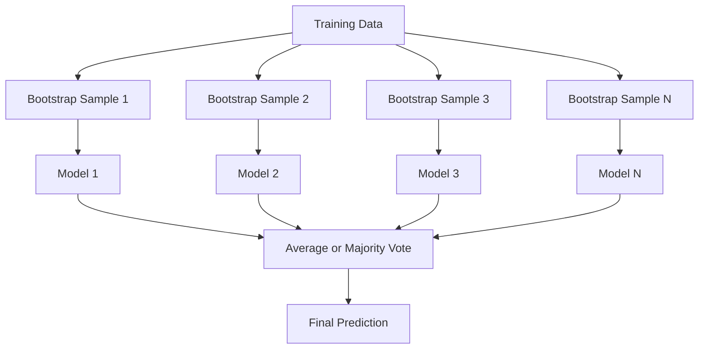
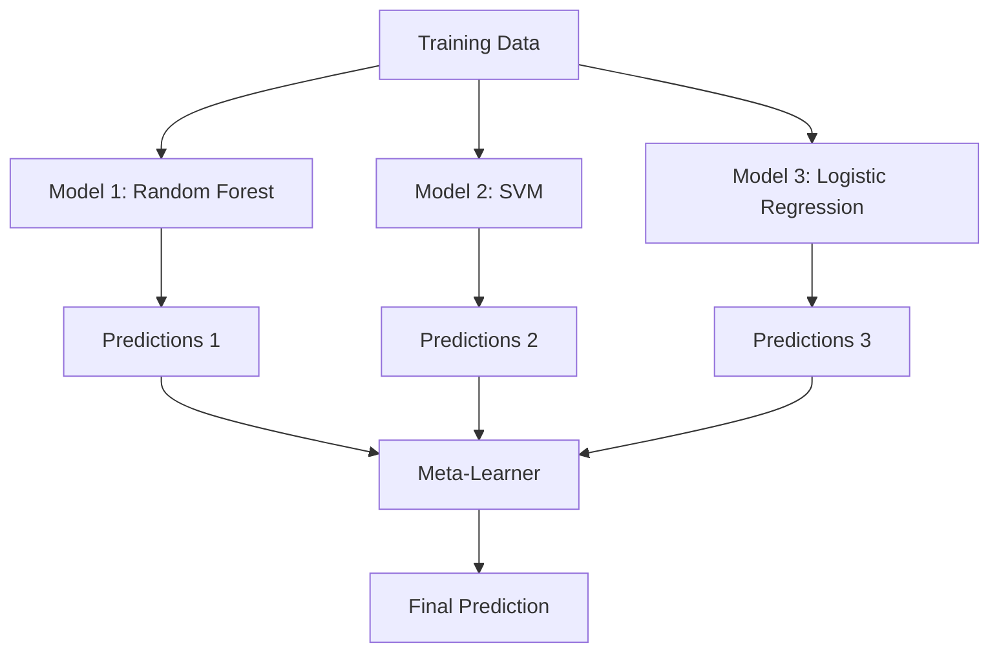

<!-- local-zh-machine-draft: English source is canonical; prose translated automatically, code/math preserved. -->

<a id="ensemble-methods"></a>

# 集成方法

> 一组弱学习者如果正确组合，就会成为强学习者。这不是一个比喻。这是一个定理。

**类型：** 构建
**语言：** Python
**先决条件：** 第 2 阶段，第 10 课（偏差-方差权衡）
**时间：** ~120 分钟

<a id="learning-objectives"></a>

## 学习目标

- 从头开始实现 AdaBoost 和 gradient 提升并解释提升如何顺序减少偏差
- 构建 bagging 集成并演示平均去相关模型如何在不增加偏差的情况下减少方差
- 根据每种方法针对的误差分量来比较 bagging、boosting 和 stacking
- 评估集成多样性并解释为什么通过更多独立的弱学习器可以提高多数投票的准确性

<a id="the-problem"></a>

## 问题

单个决策树训练速度快且易于解释，但它会过度拟合。单一线性模型在复杂边界上表现不佳。您可能需要花费数天时间来设计完美的模型架构。或者，您可以将一堆不完美的模型组合起来，得到比单独使用其中任何一个模型都更好的模型。

集成方法正是这样做的。它们是赢得表格数据 Kaggle 竞赛的最可靠的技术，它们为大多数生产 ML 系统提供支持，并且它们说明了偏差与方差的权衡。装袋可以减少方差。提升可以减少偏差。 Stacking 学习哪些模型可以信任哪些输入。

<a id="the-concept"></a>

## 概念

<a id="why-ensembles-work"></a>

### 为什么合奏会起作用

假设您有 N 个独立的分类器，每个分类器的准确度 p > 0.5。多数票具有准确性：

```
P(majority correct) = sum over k > N/2 of C(N,k) * p^k * (1-p)^(N-k)
```

对于 21 个分类器，每个分类器的准确度为 60%，多数投票准确度约为 74%。如果有 101 个分类器，则上升至 84%。当模型犯不同的错误时，错误就会抵消。

关键要求是 **diversity**。如果所有模型都犯同样的错误，那么将它们组合起来毫无帮助。集成之所以有效，是因为它们通过以下方式产生不同的模型：

- 不同的训练子集（bagging）
- 不同的feature子集（随机森林）
- 顺序纠错（提升）
- 不同型号系列（堆叠）

<a id="bagging-bootstrap-aggregating"></a>

### 装袋（引导聚合）

Bagging 通过在训练数据的不同引导样本上训练每个模型来创建多样性。



引导样本是从原始数据中替换后抽取的，大小与原始数据相同。大约 63.2% 的独特样本出现在每个引导程序中。其余 36.8%（袋外样本）提供免费验证集。

装袋可以减少方差，但不会增加太多偏差。每棵树都过度拟合其引导样本，但每棵树的 overfitting 都不同，因此求平均值可以消除噪声。

**随机森林** 的装袋具有额外的扭曲：在每次分割时，仅考虑 features 的随机子集。这迫使树木变得更加多样化。候选 features 的典型编号是 `sqrt(n_features)`（用于分类）和 `n_features / 3`（用于回归）。

<a id="boosting-sequential-error-correction"></a>

### 提升（顺序纠错）

Boosting 按顺序训练模型。每个新模型都侧重于以前模型出错的例子。


提升可以减少偏差。每个新模型都纠正了迄今为止集成的系统错误。最终的预测是所有模型的加权和，其中更好的模型获得更高的weights。

权衡：如果运行太多轮，提升可能会过度拟合，因为它会不断拟合更困难的示例，其中一些可能是噪音。

<a id="adaboost"></a>

### 阿达助推器

AdaBoost（自适应增强）是第一个实用的增强算法。它适用于任何基础学习器，通常是决策树桩（深度 1 树）。

算法：

```
1. Initialize sample weights: w_i = 1/N for all i

2. For t = 1 to T:
   a. Train weak learner h_t on weighted data
   b. Compute weighted error:
      err_t = sum(w_i * I(h_t(x_i) != y_i)) / sum(w_i)
   c. Compute model weight:
      alpha_t = 0.5 * ln((1 - err_t) / err_t)
   d. Update sample weights:
      w_i = w_i * exp(-alpha_t * y_i * h_t(x_i))
   e. Normalize weights to sum to 1

3. Final prediction: H(x) = sign(sum(alpha_t * h_t(x)))
```

误差较低的模型获得较高的 alpha。错误分类的样本会获得更高的 weights，因此下一个模型将重点关注它们。

<a id="gradient-boosting"></a>

### Gradient 升压

Gradient 提升将提升推广到任意 loss functions。它不是重新加权样本，而是将每个新模型拟合到当前集合的残差（损失的负 gradient）。

```
1. Initialize: F_0(x) = argmin_c sum(L(y_i, c))

2. For t = 1 to T:
   a. Compute pseudo-residuals:
      r_i = -dL(y_i, F_{t-1}(x_i)) / dF_{t-1}(x_i)
   b. Fit a tree h_t to the residuals r_i
   c. Find optimal step size:
      gamma_t = argmin_gamma sum(L(y_i, F_{t-1}(x_i) + gamma * h_t(x_i)))
   d. Update:
      F_t(x) = F_{t-1}(x) + learning_rate * gamma_t * h_t(x)

3. Final prediction: F_T(x)
```

对于平方误差损失，伪残差就是实际残差：`r_i = y_i - F_{t-1}(x_i)`。每棵树实际上都符合前一个集合的错误。

learning rate（收缩）控制每棵树的贡献量。较小的 learning rates 需要更多的树，但泛化能力更好。典型值：0.01 至 0.3。

<a id="xgboost-why-it-dominates-tabular-data"></a>

### XGBoost：为什么它主导表格数据

XGBoost (eXtreme Gradient Boosting) 是 gradient 的增强技术，经过工程优化，使其快速、准确并能抵抗 overfitting：

- **正规化目标：** 对叶子的 L1 和 L2 惩罚 weights 防止个别树过于自信
- **二阶近似：** 同时使用损失的一阶和二阶导数，给出更好的分割决策
- **稀疏性感知分割：** 通过学习每次分割时缺失数据的最佳方向来本地处理缺失值
- **列子采样：** 与随机森林一样，在每次分割时采样 features 以实现多样性
- **加权分位数草图：** 在分布式数据上高效找到连续 features 的分割点
- **缓存感知块结构：** 针对 CPU 缓存行优化的内存布局

对于表格数据，XGBoost（及其后继者 LightGBM）始终优于神经网络。这不会很快改变。如果您的数据适合包含行和列的表，请从 gradient 提升开始。

<a id="stacking-meta-learning"></a>

### 堆叠（元学习）

Stacking 使用多个基本模型的预测作为元学习器的 features。



元学习器学习针对哪些输入信任哪个基本模型。如果随机森林在某些区域表现更好，而支持向量机在其他区域表现更好，元学习器将学习相应的路由。

为了避免 data leakage，必须通过训练集的交叉验证生成基本模型预测。您永远不会在相同的数据上训练基础模型并生成元 features。

<a id="voting"></a>

### 投票

最简单的合奏。直接结合预测就可以了。

- **硬投票：** 对类标签进行多数投票。
- **软投票：** 平均预测概率，选择平均概率最高的类别。通常更好，因为它使用置信信息。

```figure
f3-ensemble-average
```

<a id="build-it"></a>

## 动手实现

<a id="step-1-decision-stump-base-learner"></a>

### 第 1 步：决策树桩（基础学习器）

`code/ensembles.py`中的代码从头开始实现了一切。我们从一个决策树桩开始：一棵只有一次分裂的树。

```python
class DecisionStump:
    def __init__(self):
        self.feature_idx = None
        self.threshold = None
        self.polarity = 1
        self.alpha = None

    def fit(self, X, y, weights):
        n_samples, n_features = X.shape
        best_error = float("inf")

        for f in range(n_features):
            thresholds = np.unique(X[:, f])
            for thresh in thresholds:
                for polarity in [1, -1]:
                    pred = np.ones(n_samples)
                    pred[polarity * X[:, f] < polarity * thresh] = -1
                    error = np.sum(weights[pred != y])
                    if error < best_error:
                        best_error = error
                        self.feature_idx = f
                        self.threshold = thresh
                        self.polarity = polarity

    def predict(self, X):
        n = X.shape[0]
        pred = np.ones(n)
        idx = self.polarity * X[:, self.feature_idx] < self.polarity * self.threshold
        pred[idx] = -1
        return pred
```

<a id="step-2-adaboost-from-scratch"></a>

### 第 2 步：从头开始 AdaBoost

```python
class AdaBoostScratch:
    def __init__(self, n_estimators=50):
        self.n_estimators = n_estimators
        self.stumps = []
        self.alphas = []

    def fit(self, X, y):
        n = X.shape[0]
        weights = np.full(n, 1 / n)

        for _ in range(self.n_estimators):
            stump = DecisionStump()
            stump.fit(X, y, weights)
            pred = stump.predict(X)

            err = np.sum(weights[pred != y])
            err = np.clip(err, 1e-10, 1 - 1e-10)

            alpha = 0.5 * np.log((1 - err) / err)
            weights *= np.exp(-alpha * y * pred)
            weights /= weights.sum()

            stump.alpha = alpha
            self.stumps.append(stump)
            self.alphas.append(alpha)

    def predict(self, X):
        total = sum(a * s.predict(X) for a, s in zip(self.alphas, self.stumps))
        return np.sign(total)
```

<a id="step-3-gradient-boosting-from-scratch"></a>

### 第3步：Gradient 从头开始提升

```python
class GradientBoostingScratch:
    def __init__(self, n_estimators=100, learning_rate=0.1, max_depth=3):
        self.n_estimators = n_estimators
        self.lr = learning_rate
        self.max_depth = max_depth
        self.trees = []
        self.initial_pred = None

    def fit(self, X, y):
        self.initial_pred = np.mean(y)
        current_pred = np.full(len(y), self.initial_pred)

        for _ in range(self.n_estimators):
            residuals = y - current_pred
            tree = SimpleRegressionTree(max_depth=self.max_depth)
            tree.fit(X, residuals)
            update = tree.predict(X)
            current_pred += self.lr * update
            self.trees.append(tree)

    def predict(self, X):
        pred = np.full(X.shape[0], self.initial_pred)
        for tree in self.trees:
            pred += self.lr * tree.predict(X)
        return pred
```

<a id="step-4-compare-against-sklearn"></a>

### 第 4 步：与 sklearn 进行比较

该代码验证了我们的从头开始实现与 sklearn 的 `AdaBoostClassifier` 和 `GradientBoostingClassifier` 具有相似的准确性，并并排比较了所有方法。

<a id="use-it"></a>

## 实际应用

<a id="when-to-use-each-method"></a>

### 何时使用每种方法

| 方法 | 减少 | 最适合 | 留意 |
|--------|---------|----------|---------------|
| 装袋/随机森林 | 方差 | 有噪音的数据，很多 features | 无助于消除偏见 |
| 阿达助推器 | 偏差 | 干净的数据，简单的基础学习器 | 对异常值和噪声敏感 |
| Gradient 升压 | 偏差 | 表格数据、竞赛 | 训练速度慢，不调优容易过拟合 |
| XGBoost/LightGBM | 两者都 | 生产表格 ML | 多 hyperparameters |
| 堆叠 | 两者都 | 获得最后 1-2% 的准确度 | overfitting元学习器的复杂性、风险 |
| 投票 | 方差 | 多种型号快速组合 | 仅当模型多样化时才有帮助 |

<a id="the-production-stack-for-tabular-data"></a>

### 表格数据的生产堆栈

对于大多数表格预测问题，尝试的顺序如下：

1. **LightGBM 或 XGBoost** 默认为 parameters
2. 调整n_estimators，学习_rate，max_深度，min_child_weight
3. 如果您需要最后 0.5%，请构建具有 3-5 个不同模型的堆叠集成
4. 始终使用交叉验证

尽管不断进行研究尝试，表格数据上的神经网络几乎总是比 gradient boosting 更差。 TabNet、NODE 和类似的架构偶尔可以与经过良好调整的 XGBoost 相媲美，但很少能击败它。

<a id="ship-it"></a>

## 交付成果

本课程生成 `outputs/prompt-ensemble-selector.md`——一个 prompt，可帮助您为给定数据集选择正确的集成方法。描述您的数据（大小、feature 类型、噪声级别、类别平衡）以及您正在解决的问题。 prompt 遍历决策清单，推荐一种方法，建议启动 hyperparameters，并警告该方法的常见错误。还生产 `outputs/skill-ensemble-builder.md` 以及完整的选择指南。

<a id="exercises"></a>

## 练习

1. 修改 AdaBoost 实现以跟踪每轮后的训练准确性。绘制准确度与估计器数量的关系图。什么时候收敛？

2. 通过向回归树添加随机 feature 子采样，从头开始实现随机森林。使用 `max_features=sqrt(n_features)` 和平均预测训练 100 棵树。将方差减少与单棵树进行比较。

3. 在gradient boosting实现中，添加早期停止：在每轮之后跟踪验证损失，并在连续10轮没有改善时停止。它实际上需要多少棵树？

4. 使用三个基本模型（逻辑回归、决策树、k 最近邻）和逻辑回归元学习器构建堆叠集成。使用5折交叉验证生成元features。单独与每个基本模型进行比较。

5. 使用默认值 parameters 在同一数据集上运行 XGBoost。将其准确性与从头开始的 gradient 提升进行比较。时间两者。速度差异有多大？

<a id="key-terms"></a>

## 关键术语

| 术语 | 人们怎么说 | 它实际上意味着什么 |
|------|----------------|----------------------|
| 套袋 | “训练随机子集” | Bootstrap 聚合：在 Bootstrap 样本上训练模型，平均预测以减少方差 |
| 提升 | “专注于困难的例子” | 按顺序训练模型，每个模型都纠正迄今为止集成的错误，以减少偏差 |
| 阿达助推器 | “重新衡量数据” | 通过示例 weight 更新进行提升；错误分类的点为下一个学习者获得更高的 weight |
| Gradient升压 | “拟合残差” | 通过将每个新模型拟合到 loss function 的负 gradient 来进行提升 |
| XGBoost | “卡格尔武器” | Gradient 通过正则化、二阶优化和系统级速度技巧进行提升 |
| 堆叠 | “模型之上的模型” | 使用基本模型的预测作为元学习器的输入 features |
| 随机森林 | “许多随机树” | 使用决策树进行装袋，在每次分割时添加随机 feature 子采样以实现多样性 |
| 整体多样性 | “犯不同的错误” | 模型的错误必须不相关，才能使整体优于个体 |
| 袋外错误 | “免费验证” | 不在引导抽签中的样本 (~36.8%) 可用作验证集，无需保留 |

<a id="further-reading"></a>

## 进一步阅读

- [Schapire & Freund: Boosting: 基础和算法](https://mitpress.mit.edu/9780262526036/) -- AdaBoost 创建者所著的书
- [Friedman: Greedy Function Approximation: A Gradient boosting Machine (2001)](https://doi.org/10.1214/aos/1013203451) -- 原始gradient boosting论文
- [Chen & Guestrin：XGBoost (2016)](https://arxiv.org/abs/1603.02754) -- XGBoost 论文
- [Wolpert: Stacked Generalization (1992)](https://www.sciencedirect.com/science/article/abs/pii/S0893608005800231) -- 原始堆叠论文
- [scikit-learn 集成方法](https://scikit-learn.org/stable/modules/ensemble.html) -- 实用参考
