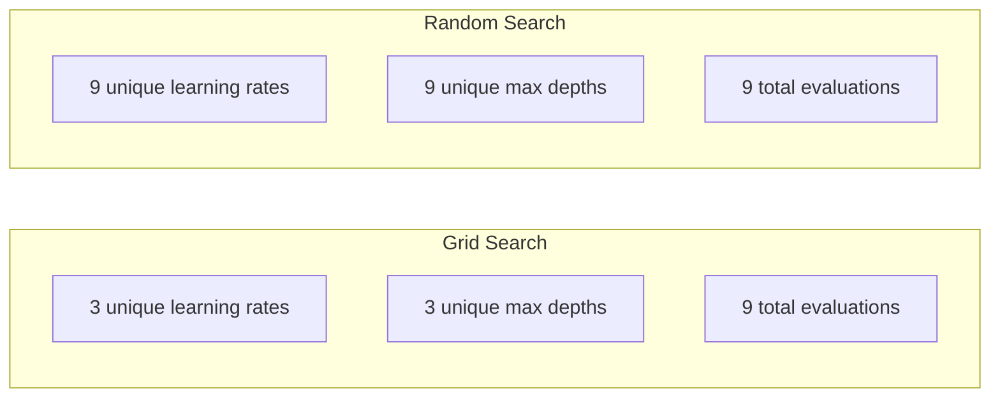
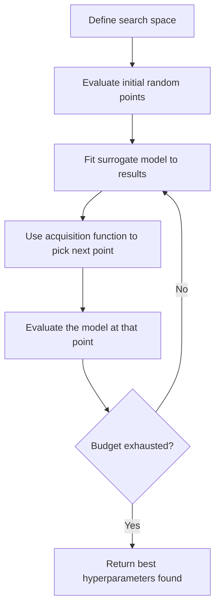
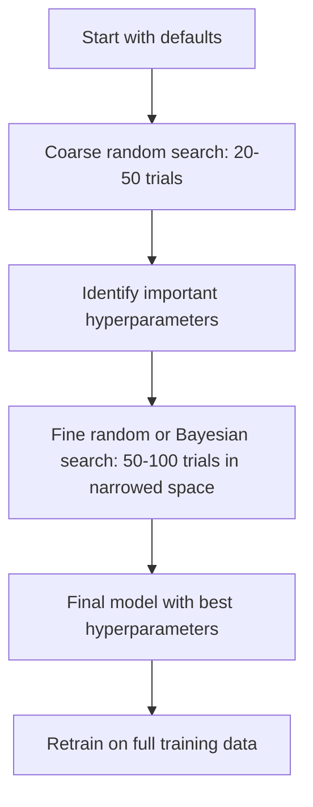
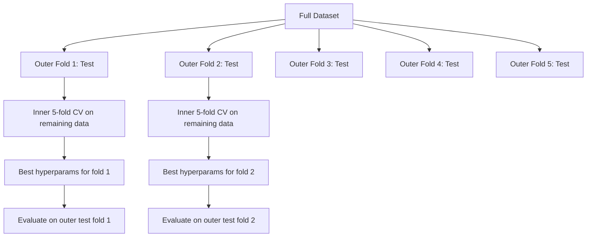

<!-- local-zh-machine-draft: English source is canonical; prose translated automatically, code/math preserved. -->

<a id="hyperparameter-tuning"></a>

# Hyperparameter 调整

> Hyperparameters 是训练开始前转动的旋钮。能否很好地转变它们是平庸模型和优秀模型之间的区别。

**类型：** 构建
**语言：** Python
**先决条件：** 第 2 阶段，第 11 课（集成方法）
**时间：** ~90 分钟

<a id="learning-objectives"></a>

## 学习目标

- 从头开始实现网格搜索、随机搜索和贝叶斯优化并比较它们的样本效率
- 解释为什么当大多数 hyperparameters 的有效维度较低时，随机搜索优于网格搜索
- 使用代理模型和采集函数构建贝叶斯优化循环来指导搜索
- 设计 hyperparameter 调整策略，通过适当的交叉验证避免 overfitting 验证集

<a id="the-problem"></a>

## 问题

您的 gradient 增强模型具有 learning rate、树木数量、最大深度、每片叶子的最小样本、子样本比率和列样本比率。即六个hyperparameters。如果每个都有 5 个合理值，则网格有 5^6 = 15,625 种组合。每次训练需要 10 秒。尝试所有这些需要 43 个小时的计算时间。

网格搜索是显而易见的方法，也是规模上最差的方法。随机搜索在计算量较少的情况下效果更好。通过学习过去的 evaluations，贝叶斯优化做得更好。了解使用哪种策略以及哪个 hyperparameters 真正重要，可以节省数天浪费的 GPU 时间。

<a id="the-concept"></a>

## 概念

<a id="parameters-vs-hyperparameters"></a>

### Parameters 与 Hyperparameters

Parameters 在训练期间学习（weights、偏差、分割阈值）。 Hyperparameters 在训练开始之前设置并控制学习的发生方式。

| Hyperparameter | 它控制什么 | 典型范围 |
|---------------|-----------------|---------------|
| Learning rate | 每次更新的步长 | 0.001至1.0 |
| 树/时期的数量 | 训练多长时间 | 10 至 10,000 |
| 最大深度 | 模型复杂度 | 1 至 30 |
| 正则化（lambda） | Overfitting预防 | 0.0001 至 100 |
| Batch size | Gradient估计噪声 | 16 至 512 |
| Dropout 率 | 神经元比例下降 | 0.0至0.5 |

<a id="grid-search"></a>

### 网格搜索

网格搜索评估指定值的每个组合。它详尽且易于理解，但随着 hyperparameters 的数量呈指数级增长。

```
Grid for 2 hyperparameters:

  learning_rate: [0.01, 0.1, 1.0]
  max_depth:     [3, 5, 7]

  Evaluations: 3 x 3 = 9 combinations

  (0.01, 3)  (0.01, 5)  (0.01, 7)
  (0.1,  3)  (0.1,  5)  (0.1,  7)
  (1.0,  3)  (1.0,  5)  (1.0,  7)
```

网格搜索有一个根本缺陷：如果一个 hyperparameter 重要，而另一个不重要，那么大多数 evaluations 都会被浪费。您只能从 9 个 evaluations 中获得重要的 parameter 的 3 个唯一值。

<a id="random-search"></a>

### 随机搜索

随机搜索从分布而不是网格中采样 hyperparameters。使用 9 个 evaluations 的相同预算，您可以获得每个 hyperparameter 的 9 个唯一值。



为什么随机优于网格（Bergstra & Bengio，2012）：

- 大多数 hyperparameters 的有效维数较低。通常，6 个 hyperparameters 中只有 1-2 个对于给定问题很重要。
- 网格搜索在不重要的维度上浪费了 evaluations。
- 对于相同的预算，随机搜索更密集地覆盖重要维度。
- 在 60 次随机试验中，您有 95% 的机会找到最优值 5% 以内的点（如果搜索空间中存在一个点）。

<a id="bayesian-optimization"></a>

### 贝叶斯优化

随机搜索会忽略结果。它不知道高 learning rates 会导致发散，或者深度 3 始终优于深度 10。贝叶斯优化使用过去的 evaluations 来决定下一步搜索的位置。



两个关键组件：

**代理模型：** 一种廉价的评估模型（通常是高斯过程），可近似昂贵的目标函数。它给出了搜索空间中任意点的预测和不确定性估计。

**获取函数：** 通过平衡利用（在已知的好点附近搜索）和探索（在不确定性较高的地方搜索）来决定下一步评估的位置。常见选择：

- ** 预期改进 (EI)：** 目前我们预计比当前最好的改进有多少？
- ** 置信上限 (UCB)：** 预测加上多个不确定性。较高的 UCB 意味着要么有希望，要么尚未探索。
- ** 改进概率（PI）：** 该点击败当前最佳点的概率是多少？

贝叶斯优化通常会发现比随机搜索更好的 hyperparameters，evaluations 的数量要少 2-5 倍。与训练实际模型相比，拟合代理模型的开销可以忽略不计。

<a id="early-stopping"></a>

### 提前停止

并非每次训练都需要完成。如果 10 个 epoch 后配置明显不好，请停止它并继续。这是在 hyperparameter 搜索的背景下提前停止。

策略：
- **基于耐心：** 如果验证损失连续 N 个 epoch 没有改善则停止
- **中值剪枝：** 如果试验的中间结果比同一步骤已完成试验的中值差则停止
- **Hyperband:** 将较小的预算分配给许多配置，然后逐步增加最佳配置的预算

Hyperband 特别有效。它启动 81 个配置，每个配置有 1 epoch，保留前三分之一，给它们 3 个 epoch，保留前三分之一，依此类推。与评估全部预算的所有配置相比，找到良好配置的速度要快 10-50 倍。

<a id="learning-rate-schedulers"></a>

### Learning Rate 调度程序

learning rate 几乎总是最重要的 hyperparameter。调度员并没有将其保持固定，而是在训练期间对其进行调整。

| 调度程序 | 公式 | 何时使用 |
|-----------|---------|-------------|
| 阶跃衰减 | 每 N epoch 乘以 0.1 | 经典CNN培训 |
| 余弦退火 | lr * 0.5 * (1 + cos(pi * t / T)) | 现代默认 |
| Warmup + 衰减 | 线性增加然后余弦衰减 | Transformers |
| 一个周期 | 在一个周期内先增加后减少 | 快速收敛 |
| 平台期减少 | 当指标停滞时减少一个因子 | 安全默认 |

<a id="hyperparameter-importance"></a>

### Hyperparameter 重要性

并非所有 hyperparameters 都同样重要。对随机森林（Probst et al., 2019）和 gradient boosting 的研究显示出一致的模式：

**高重要性：**
- Learning rate（始终先调整）
- 估计器/时期的数量（使用提前停止而不是调整）
- 正则化强度

**中等重要性：**
- 最大深度/层数
- 每片叶子的最小样本 / weight decay
- 子样本比

**低重要性：**
- 最大 features（对于随机森林）
- 具体activation function选择
- Batch size（合理范围内）

首先调整重要的，保留 rest 为默认值。

<a id="practical-strategy"></a>

### 实用策略



具体工作流程：

1. ** 从库默认值开始。** 它们是由经验丰富的从业者选择的，并且通常达到了 80%。
2. ** 粗随机搜索。** 范围广，20-50次试验。使用提前停止来快速消除不良运行。
3. **分析结果。** 哪个hyperparameters与性能相关？缩小搜索空间。
4. **精细搜索。** 贝叶斯优化或在缩小的空间中集中随机搜索。 50-100 次试验。
5. ** 使用找到的最佳 hyperparameters 对所有训练数据 ** 进行重新训练。

<a id="cross-validation-integration"></a>

### 交叉验证集成

在单个验证拆分上调整 hyperparameters 是有风险的。最好的 hyperparameters 可能会过度适合特定的验证折叠。嵌套交叉验证通过使用两个循环来解决这个问题：

- **外循环**（evaluation）：将数据拆分为train+val和test。报告公正的表现。
- **内循环**（调优）：将train+val拆分为train和val。找到最好的 hyperparameters。



每个外折都独立找到自己的最佳hyperparameters。外部分数是对泛化性能的无偏估计。

使用sklearn：

```python
from sklearn.model_selection import cross_val_score, GridSearchCV
from sklearn.ensemble import GradientBoostingRegressor

inner_cv = GridSearchCV(
    GradientBoostingRegressor(),
    param_grid={
        "learning_rate": [0.01, 0.05, 0.1],
        "max_depth": [2, 3, 5],
        "n_estimators": [50, 100, 200],
    },
    cv=5,
    scoring="neg_mean_squared_error",
)

outer_scores = cross_val_score(
    inner_cv, X, y, cv=5, scoring="neg_mean_squared_error"
)

print(f"Nested CV MSE: {-outer_scores.mean():.4f} +/- {outer_scores.std():.4f}")
```

这是昂贵的（5 个外折叠 x 5 个内折叠 x 27 个网格点 = 675 个模型拟合），但它为您提供了值得信赖的性能估计。当在论文中报告最终结果或决策的风险很高时使用它。

<a id="practical-tips"></a>

### 实用技巧

**从learning rate开始。** 对于基于gradient的方法来说始终是最重要的hyperparameter。糟糕的 learning rate 会让其他一切变得无关紧要。其他hyperparameters默认修复，先扫learning rate。

** 对 learning rate 和正则化使用对数均匀分布。** 0.001 和 0.01 之间的差异与 0.1 和 1.0 之间的差异一样重要。线性搜索在很大程度上浪费了预算。

** 使用提前停止而不是调整 n_estimators.** 对于 boosting 和神经网络，将 n_estimators 或 epoch 设置为高，并让提前停止决定何时停止。这将从搜索中删除一个 hyperparameter。

**预算分配。** 将 60% 的调优预算花在前 2 个最重要的 hyperparameters 上。剩下的 40% 花在其他事情上。前 2 项解释了大部分性能变化。

**Scale很重要。** 切勿在对数刻度上搜索batch size（16、32、64都可以）。始终以对数刻度搜索 learning rate。将搜索分布与 hyperparameter 对模型的影响进行匹配。

| 型号类型 | 顶部 Hyperparameters | 推荐搜索 | 预算 |
|-----------|--------------------|--------------------|--------|
| 随机森林 | n_estimators，max_深度，min_samples_leaf | 随机搜索，50 次试验 | 低（快速训练） |
| Gradient 升压 | 学习_rate，n_estimators，max_深度 | 贝叶斯，100 次试验 + 提前停止 | 中等 |
| 神经网络 | 学习_率，权重_衰减，批次_尺寸 | 贝叶斯或随机，100 多次试验 | 高（慢速训练） |
| 支持向量机 | C、gamma（RBF核） | 对数刻度网格，25-50 次试验 | 低（2 个参数） |
| 套索/山脊 | 阿尔法 | 对数尺度上的一维搜索，20 次试验 | 很低 |
| XGBoost | 学习_rate，max_深度，子样本，colsample | 贝叶斯，100-200 次试验 + 提前停止 | 中等 |

**如有疑问：** 随机搜索，以 2 倍 hyperparameters 数量作为试验（例如，6 个 hyperparameters = 最少 12 个以上试验）。您会惊讶地发现，经过 50 次试验的随机搜索常常胜过精心设计的网格搜索。

```figure
k-fold-cv
```

<a id="build-it"></a>

## 动手实现

<a id="step-1-grid-search-from-scratch"></a>

### 第 1 步：从头开始网格搜索

`code/tuning.py`中的代码从头开始实现了网格搜索、随机搜索和简单的贝叶斯optimizer。

```python
def grid_search(model_fn, param_grid, X_train, y_train, X_val, y_val):
    keys = list(param_grid.keys())
    values = list(param_grid.values())
    best_score = -float("inf")
    best_params = None
    n_evals = 0

    for combo in itertools.product(*values):
        params = dict(zip(keys, combo))
        model = model_fn(**params)
        model.fit(X_train, y_train)
        score = evaluate(model, X_val, y_val)
        n_evals += 1

        if score > best_score:
            best_score = score
            best_params = params

    return best_params, best_score, n_evals
```

<a id="step-2-random-search-from-scratch"></a>

### 第 2 步：从头开始随机搜索

```python
def random_search(model_fn, param_distributions, X_train, y_train,
                  X_val, y_val, n_iter=50, seed=42):
    rng = np.random.RandomState(seed)
    best_score = -float("inf")
    best_params = None

    for _ in range(n_iter):
        params = {k: sample(v, rng) for k, v in param_distributions.items()}
        model = model_fn(**params)
        model.fit(X_train, y_train)
        score = evaluate(model, X_val, y_val)

        if score > best_score:
            best_score = score
            best_params = params

    return best_params, best_score, n_iter
```

<a id="step-3-bayesian-optimization-simplified"></a>

### 步骤 3：贝叶斯优化（简化）

核心思想：将高斯过程拟合到观察到的（hyperparameter，分数）对，然后使用获取函数来决定下一步看哪里。

```python
class SimpleBayesianOptimizer:
    def __init__(self, search_space, n_initial=5):
        self.search_space = search_space
        self.n_initial = n_initial
        self.X_observed = []
        self.y_observed = []

    def _kernel(self, x1, x2, length_scale=1.0):
        dists = np.sum((x1[:, None, :] - x2[None, :, :]) ** 2, axis=2)
        return np.exp(-0.5 * dists / length_scale ** 2)

    def _fit_gp(self, X_new):
        X_obs = np.array(self.X_observed)
        y_obs = np.array(self.y_observed)
        y_mean = y_obs.mean()
        y_centered = y_obs - y_mean

        K = self._kernel(X_obs, X_obs) + 1e-4 * np.eye(len(X_obs))
        K_star = self._kernel(X_new, X_obs)

        L = np.linalg.cholesky(K)
        alpha = np.linalg.solve(L.T, np.linalg.solve(L, y_centered))
        mu = K_star @ alpha + y_mean

        v = np.linalg.solve(L, K_star.T)
        var = 1.0 - np.sum(v ** 2, axis=0)
        var = np.maximum(var, 1e-6)

        return mu, var

    def _expected_improvement(self, mu, var, best_y):
        sigma = np.sqrt(var)
        z = (mu - best_y) / (sigma + 1e-10)
        ei = sigma * (z * norm_cdf(z) + norm_pdf(z))
        return ei

    def suggest(self):
        if len(self.X_observed) < self.n_initial:
            return sample_random(self.search_space)

        candidates = [sample_random(self.search_space) for _ in range(500)]
        X_cand = np.array([to_vector(c) for c in candidates])
        mu, var = self._fit_gp(X_cand)
        ei = self._expected_improvement(mu, var, max(self.y_observed))
        return candidates[np.argmax(ei)]

    def observe(self, params, score):
        self.X_observed.append(to_vector(params))
        self.y_observed.append(score)
```

GP 代理在每个候选点给出两件事：预测分数 (mu) 和不确定性 (var)。预期改进平衡了这些：它有利于模型预测高分或不确定性高的点。早期，大多数点都具有很高的不确定性，因此 optimizer 进行了探索。后来，它重点关注最有前途的区域。

<a id="step-4-compare-all-methods"></a>

### 第 4 步：比较所有方法

在同一综合目标上运行所有三种方法并进行比较。此比较使用一个简化的包装器，该包装器使用直接目标函数（无模型训练）调用每个 optimizer，因此 API 与上面基于模型的实现不同：

```python
def synthetic_objective(params):
    lr = params["learning_rate"]
    depth = params["max_depth"]
    return -(np.log10(lr) + 2) ** 2 - (depth - 4) ** 2 + 10

param_grid = {
    "learning_rate": [0.001, 0.01, 0.1, 1.0],
    "max_depth": [2, 3, 4, 5, 6, 7, 8],
}

grid_best = None
grid_score = -float("inf")
grid_history = []
for combo in itertools.product(*param_grid.values()):
    params = dict(zip(param_grid.keys(), combo))
    score = synthetic_objective(params)
    grid_history.append((params, score))
    if score > grid_score:
        grid_score = score
        grid_best = params

param_dist = {
    "learning_rate": ("log_float", 0.001, 1.0),
    "max_depth": ("int", 2, 8),
}

rand_best = None
rand_score = -float("inf")
rand_history = []
rng = np.random.RandomState(42)
for _ in range(28):
    params = {k: sample(v, rng) for k, v in param_dist.items()}
    score = synthetic_objective(params)
    rand_history.append((params, score))
    if score > rand_score:
        rand_score = score
        rand_best = params

optimizer = SimpleBayesianOptimizer(param_dist, n_initial=5)
bayes_history = []
for _ in range(28):
    params = optimizer.suggest()
    score = synthetic_objective(params)
    optimizer.observe(params, score)
    bayes_history.append((params, score))
bayes_score = max(s for _, s in bayes_history)

print(f"{'Method':<20} {'Best Score':>12} {'Evaluations':>12}")
print("-" * 50)
print(f"{'Grid Search':<20} {grid_score:>12.4f} {len(grid_history):>12}")
print(f"{'Random Search':<20} {rand_score:>12.4f} {len(rand_history):>12}")
print(f"{'Bayesian Opt':<20} {bayes_score:>12.4f} {len(bayes_history):>12}")
```

在相同的预算下，贝叶斯优化通常会最快找到最好的分数，因为它不会在明显不好的区域浪费evaluations。随机搜索比网格搜索覆盖更多的领域。只有当您的 hyperparameters 很少并且能够做到详尽无遗时，网格搜索才会获胜。

<a id="use-it"></a>

## 实际应用

<a id="optuna-in-practice"></a>

### Optuna 实践

Optuna 是用于认真 hyperparameter 调整的推荐库。它支持修剪、分布式搜索和开箱即用的可视化。

```python
import optuna

def objective(trial):
    lr = trial.suggest_float("learning_rate", 1e-4, 1e-1, log=True)
    n_est = trial.suggest_int("n_estimators", 50, 500)
    max_depth = trial.suggest_int("max_depth", 2, 10)

    model = GradientBoostingRegressor(
        learning_rate=lr,
        n_estimators=n_est,
        max_depth=max_depth,
    )
    model.fit(X_train, y_train)
    return mean_squared_error(y_val, model.predict(X_val))

study = optuna.create_study(direction="minimize")
study.optimize(objective, n_trials=100)

print(f"Best params: {study.best_params}")
print(f"Best MSE: {study.best_value:.4f}")
```

Optuna 密钥 features：
- `suggest_float(..., log=True)` 的 parameters 在对数尺度上最佳搜索（learning rate，正则化）
- `suggest_int` 为整数 parameters
- `suggest_categorical` 用于离散选择
- 内置 MedianPruner 用于及早停止不良试验
- `study.trials_dataframe()` 进行分析

<a id="optuna-with-pruning"></a>

### Optuna 修剪

修剪可以尽早停止没有希望的试验，从而节省大量计算量。这是模式：

```python
import optuna
from sklearn.model_selection import cross_val_score

def objective(trial):
    params = {
        "learning_rate": trial.suggest_float("lr", 1e-4, 0.5, log=True),
        "max_depth": trial.suggest_int("max_depth", 2, 10),
        "n_estimators": trial.suggest_int("n_estimators", 50, 500),
        "subsample": trial.suggest_float("subsample", 0.5, 1.0),
    }

    model = GradientBoostingRegressor(**params)
    scores = cross_val_score(model, X_train, y_train, cv=3,
                             scoring="neg_mean_squared_error")
    mean_score = -scores.mean()

    trial.report(mean_score, step=0)
    if trial.should_prune():
        raise optuna.TrialPruned()

    return mean_score

pruner = optuna.pruners.MedianPruner(n_startup_trials=10, n_warmup_steps=5)
study = optuna.create_study(direction="minimize", pruner=pruner)
study.optimize(objective, n_trials=200)
```

这`MedianPruner`如果试验的中间值比同一步骤中所有已完成试验的中值差，则停止试验。 剪枝需要调用`trial.report()`报告中间指标和`trial.should_prune()`检查是否应当停止试验。 这`n_startup_trials=10`确保在修剪开始之前至少完成 10 次试验。 这通常可以节省 40-60% 的总计算量。

<a id="sklearns-built-in-tuners"></a>

### sklearn 的内置调谐器

为了快速实验，sklearn 提供了 `GridSearchCV`、`RandomizedSearchCV` 和 `HalvingRandomSearchCV`：

```python
from sklearn.model_selection import RandomizedSearchCV
from scipy.stats import loguniform, randint

param_dist = {
    "learning_rate": loguniform(1e-4, 0.5),
    "max_depth": randint(2, 10),
    "n_estimators": randint(50, 500),
}

search = RandomizedSearchCV(
    GradientBoostingRegressor(),
    param_dist,
    n_iter=100,
    cv=5,
    scoring="neg_mean_squared_error",
    random_state=42,
    n_jobs=-1,
)
search.fit(X_train, y_train)
print(f"Best params: {search.best_params_}")
print(f"Best CV MSE: {-search.best_score_:.4f}")
```

使用 scipy 中的 `loguniform` 进行 learning rate 和正则化。使用 `randint` 表示整数 hyperparameters。 `n_jobs=-1` 标志在所有 CPU 内核上并行。

<a id="common-mistakes-in-hyperparameter-tuning"></a>

### Hyperparameter调优常见错误

**Data leakage 通过预处理。** 如果在交叉验证之前在完整数据集上安装缩放器，来自验证折叠的信息会泄漏到训练中。始终将预处理放在 `Pipeline` 内，以便它仅适合训练折叠。

**Overfitting 到验证集。** 运行数千次试验可以有效地训练验证集。使用嵌套交叉验证进行最终性能估计，或保留在调优过程中从未接触过的单独测试集。

**搜索范围太窄。** 如果您的最佳值位于搜索空间的边界，则说明您的搜索范围不够广。最佳值可能超出您的范围。始终检查最好的 parameters 是否位于边缘。

**忽略交互作用。** Learning rate 和估计量的数量在提升过程中相互作用强烈。较低的 learning rate 需要更多的估计器。单独调整它们会比一起调整它们产生更糟糕的结果。

** 迭代模型不使用提前停止。** 对于 gradient 增强和神经网络，将 n_estimators 或 epoch 设置为较高值并使用提前停止。这绝对比将迭代次数调整为 hyperparameter 更好。

<a id="exercises"></a>

## 练习

1. 使用相同的总预算（例如 50 evaluations）运行网格搜索和随机搜索。比较找到的最佳分数。使用不同的种子进行 10 次实验。随机搜索获胜的频率有多少？

2. 从头开始实施超频带。从 81 个配置开始，每个配置训练 1 epoch。每轮保留前 1/3 的人，并将其预算增加三倍。将总计算量（所有配置的所有周期的总和）与运行 81 个配置的全部预算进行比较。

3. 将 learning rate 调度程序（余弦退火）添加到第 11 课中的 gradient 增强实现中。与固定的 learning rate 相比，它有帮助吗？

4. 使用 Optuna 在真实数据集（例如 sklearn 的乳腺癌数据集）上调整 RandomForestClassifier。使用 `optuna.visualization.plot_param_importances(study)` 来查看哪个 hyperparameters 最重要。它与本课的重要性排名相符吗？

5. 实现一个简单的获取功能（预期改进）并演示探索与利用。绘制替代模型的均值和不确定性，并显示 EI 接下来选择评估的位置。

<a id="key-terms"></a>

## 关键术语

| 术语 | 人们怎么说 | 它实际上意味着什么 |
|------|----------------|----------------------|
| Hyperparameter | “您选择的设置” | 训练前设置的值，用于控制学习过程，而不是从数据中学习 |
| 网格搜索 | “尝试每一种组合” | 对指定的 parameter 网格进行穷举搜索。指数成本。 |
| 随机搜索 | “随机抽样” | 来自发行版的示例 hyperparameters。比网格搜索更好地涵盖重要维度。 |
| 贝叶斯优化 | “智能搜索” | 使用目标的替代模型来决定下一步评估的位置，平衡探索和利用 |
| 替代模型 | “一个廉价的近似” | 一个模型（通常是高斯过程），近似观察到的昂贵目标函数 evaluations |
| 采集功能 | “接下来看哪里” | 通过平衡预期改进与不确定性来给候选者打分。 EI和UCB是常见的选择。 |
| 提前停止 | “别再浪费时间了” | 当验证性能停止改善时尽早终止训练 |
| 超频带 | “配置的锦标赛支架” | 自适应资源分配：以较小的预算启动许多配置，保留最佳配置并增加预算 |
| Learning rate调度器 | “训练期间改变lr” | 在训练过程中调整 learning rate 以获得更好收敛的功能 |

<a id="further-reading"></a>

## 进一步阅读

- [Bergstra & Bengio: Random Search for Hyper-Parameter Optimization (2012)](https://jmlr.org/papers/v13/bergstra12a.html) -- 显示随机节拍网格的论文
- [Snoek 等人，机器学习算法的实用贝叶斯优化 (2012)](https://arxiv.org/abs/1206.2944) -- ML 的贝叶斯优化
- [Li 等人，Hyperband：一种新颖的基于 Bandit 的方法 (2018)](https://jmlr.org/papers/v18/16-558.html)——Hyperband 论文
- [Optuna：下一代Hyperparameter优化框架](https://arxiv.org/abs/1907.10902)——Optuna论文
- [Probst 等人，可调性：Hyperparameters 的重要性 (2019)](https://jmlr.org/papers/v20/18-444.html)——hyperparameters 很重要
