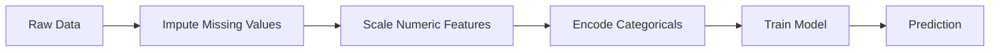
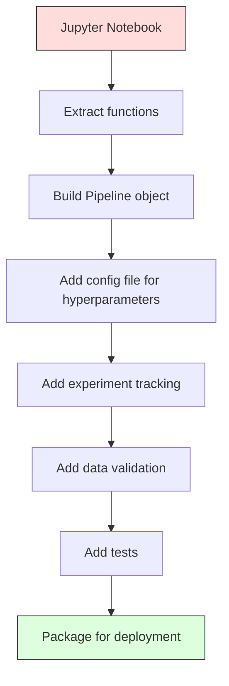

<!-- local-zh-machine-draft: English source is canonical; prose translated automatically, code/math preserved. -->

<a id="ml-pipelines"></a>

# 机器学习管道

> 模型不是产品。管道是。管道涵盖从原始数据到部署预测的所有内容，并且每个步骤都必须是可重复的。

**类型：** 构建
**语言：** Python
**先决条件：** 第 2 阶段，第 12 课（Hyperparameter 调整）
**时间：** ~120分钟

<a id="learning-objectives"></a>

## 学习目标

- 从头开始构建 ML 管道，将插补、缩放、编码和模型训练链接到单个可重现的对象中
- 识别 data leakage 场景，并解释管道如何通过仅在训练数据上拟合 transformers 来防止这些场景
- 构造一个 ColumnTransformer，对数字和分类 features 应用不同的预处理
- 实施管道序列化并证明相同的安装管道在训练和生产中产生相同的结果

<a id="the-problem"></a>

## 问题

您有一个笔记本，可以加载数据、用中位数填充缺失值、缩放 features、训练模型并打印准确性。有用。你运送它。

一个月后，有人重新训练模型并得到了不同的结果。中位数是在包括测试数据 (data leakage) 的完整数据集上计算的。缩放 parameters 未保存，因此 inference 使用不同的统计数据。 feature工程代码在训练和服役之间复制粘贴，副本出现分歧。分类列在生产中获得了 encoder 从未见过的新价值。

这些都不是假设的。它们是机器学习系统在生产中失败的最常见原因。管道通过将每个转换步骤打包成单个、有序、可复制的对象来解决所有这些问题。

<a id="the-concept"></a>

## 概念

<a id="what-a-pipeline-is"></a>

### 什么是管道

管道是一个有序的数据转换序列，后面跟着一个模型。每一步都将上一步的输出作为输入。整个管道在训练数据上安装一次。在 inference 时间，相同的拟合管道转换新数据并生成预测。



管道保证：
- 转换仅适用于训练数据（无泄漏）
- 在 inference 时间应用相同的转换
- 整个对象可以序列化并部署为一个工件
- 交叉验证按折叠应用管道，防止细微泄漏

<a id="data-leakage-the-silent-killer"></a>

### Data Leakage：沉默的杀手

当测试集或未来数据的信息污染训练时，就会发生 Data leakage。管道可防止最常见的形式。

**泄漏（错误）：**
```python
X = df.drop("target", axis=1)
y = df["target"]

scaler = StandardScaler()
X_scaled = scaler.fit_transform(X)

X_train, X_test = X_scaled[:800], X_scaled[800:]
y_train, y_test = y[:800], y[800:]
```

缩放器看到了测试数据。平均值和标准差包括测试样本。这会夸大准确性估计。

**正确：**
```python
X_train, X_test = X[:800], X[800:]

scaler = StandardScaler()
X_train_scaled = scaler.fit_transform(X_train)
X_test_scaled = scaler.transform(X_test)
```

有了管道，你就不需要考虑这个了。管道会自动处理它。

<a id="sklearn-pipeline"></a>

### sklearn管道

sklearn 的 `Pipeline` 链 transformers 和一个估计器。它公开了按顺序应用所有步骤的 `.fit()`、`.predict()` 和 `.score()`。

```python
from sklearn.pipeline import Pipeline
from sklearn.preprocessing import StandardScaler
from sklearn.linear_model import LogisticRegression

pipe = Pipeline([
    ("scaler", StandardScaler()),
    ("model", LogisticRegression()),
])

pipe.fit(X_train, y_train)
predictions = pipe.predict(X_test)
```

当您拨打`pipe.fit(X_train, y_train)`时：
1. Scaler 在 X_train 上调用 `fit_transform`
2. 模型在缩放的 X_train 上调用 `fit`

当您拨打`pipe.predict(X_test)`时：
1. Scaler 在 X_test 上调用 `transform` （不适合 _transform）
2. 模型在缩放的 X_test 上调用 `predict`

缩放器在拟合过程中永远不会看到测试数据。这就是重点。

<a id="columntransformer-different-pipelines-for-different-columns"></a>

### ColumnTransformer：不同列的不同管道

真实数据集具有需要不同预处理的数字列和分类列。 `ColumnTransformer` 处理此问题。

```python
from sklearn.compose import ColumnTransformer
from sklearn.preprocessing import StandardScaler, OneHotEncoder
from sklearn.impute import SimpleImputer

numeric_pipe = Pipeline([
    ("impute", SimpleImputer(strategy="median")),
    ("scale", StandardScaler()),
])

categorical_pipe = Pipeline([
    ("impute", SimpleImputer(strategy="most_frequent")),
    ("encode", OneHotEncoder(handle_unknown="ignore")),
])

preprocessor = ColumnTransformer([
    ("num", numeric_pipe, ["age", "income", "score"]),
    ("cat", categorical_pipe, ["city", "gender", "plan"]),
])

full_pipeline = Pipeline([
    ("preprocess", preprocessor),
    ("model", GradientBoostingClassifier()),
])
```

OneHotEncoder 中的 `handle_unknown="ignore"` 对于生产至关重要。当出现新类别（模型从未见过的城市）时，它会生成零向量而不是崩溃。

<a id="experiment-tracking"></a>

### 实验跟踪

管道使训练具有可重复性，但您还需要跟踪实验中发生的情况：使用了哪些 hyperparameters、哪个数据集版本、指标是什么、正在运行哪些代码。

**MLflow**是最常见的开源解决方案：

```python
import mlflow

with mlflow.start_run():
    mlflow.log_param("max_depth", 5)
    mlflow.log_param("n_estimators", 100)
    mlflow.log_param("learning_rate", 0.1)

    pipe.fit(X_train, y_train)
    accuracy = pipe.score(X_test, y_test)

    mlflow.log_metric("accuracy", accuracy)
    mlflow.sklearn.log_model(pipe, "model")
```

每次运行都会记录 parameters、指标、工件和完整模型。您可以比较运行、重现任何实验以及部署任何模型版本。

**Weights 和偏差 (wandb)** 提供与托管仪表板相同的功能：

```python
import wandb

wandb.init(project="my-pipeline")
wandb.config.update({"max_depth": 5, "n_estimators": 100})

pipe.fit(X_train, y_train)
accuracy = pipe.score(X_test, y_test)

wandb.log({"accuracy": accuracy})
```

<a id="model-versioning"></a>

### 模型版本控制

实验跟踪后，您需要管理模型版本。哪个型号正在生产？哪个是上演？哪一个是上周的？

MLflow 的模型注册表提供：
- **版本跟踪：** 每个保存的模型都会获得一个版本号
- **阶段转换：**“暂存”、“生产”、“已存档”
- **审批工作流程：** 模型必须明确升级到生产
- **Rollback:** 立即切换回之前版本

<a id="data-versioning-with-dvc"></a>

### 使用 DVC 进行数据版本控制

代码版本号为 git。数据也应该进行版本控制，但 git 无法处理大文件。 DVC（数据版本控制）解决了这个问题。

```
dvc init
dvc add data/training.csv
git add data/training.csv.dvc data/.gitignore
git commit -m "Track training data"
dvc push
```

DVC 将实际数据存储在远程存储（S3、GCS、Azure）中，并在 git 中保留一个记录哈希值的小 `.dvc` 文件。当您签出 git commit 时，`dvc checkout` 会恢复所使用的确切数据。

这意味着每个 git commit 都引脚代码和数据。完全再现性。

<a id="reproducible-experiments"></a>

### 可重复的实验

可重复的实验需要四件事：

1. **固定随机种子：** 为numpy、随机和框架（torch、sklearn）设置种子
2. **固定依赖项：**requirements.txt或poetry.lock具有确切的版本
3. **版本化数据：** DVC或类似数据
4. **配置文件：** 配置中的所有 hyperparameters，未硬编码

```python
import numpy as np
import random

def set_seed(seed=42):
    random.seed(seed)
    np.random.seed(seed)
    try:
        import torch
        torch.manual_seed(seed)
        torch.cuda.manual_seed_all(seed)
        torch.backends.cudnn.deterministic = True
    except ImportError:
        pass
```

<a id="from-notebook-to-production-pipeline"></a>

### 从笔记本电脑到生产流水线



典型的进展：

1. **笔记本探索：** 快速实验、可视化、feature 想法
2. **提取函数：** 将预处理、feature 工程、evaluation 移动到模块中
3. **Build Pipeline：** 链式转换为 sklearn Pipeline 或自定义类
4. **配置管理：** 将所有hyperparameters移动到YAML/JSON配置中
5. **实验跟踪：** 添加MLflow或wandb日志记录
6. **数据验证：** 在训练前检查模式、分布和缺失值模式
7. **Tests：** transformers 的单元测试，整个管道的集成测试
8. **部署：** 序列化管道，包装在 API（FastAPI，Flask）中，容器化

<a id="common-pipeline-mistakes"></a>

### 常见的管道错误

| 错误 | 为什么不好 | 修复 |
|---------|-------------|-----|
| 在分割之前拟合完整数据 | Data leakage | 使用交叉管道_val_score |
| Feature工程外管道 | 火车与服务时的不同变换 | 将所有转换放入管道中 |
| 不处理未知类别 | 新值导致生产崩溃 | OneHotEncoder(handle_unknown="ignore") |
| 硬编码的列名称 | 架构更改时中断 | 使用配置中的列名称列表 |
| 没有数据验证 | 对不良数据的无声错误预测 | 在预测前添加架构检查 |
| 训练/服务偏差 | 型号在产品中看到不同的 features | 一个 Pipeline 对象同时适用于两者 |

```figure
f3-pipeline-flow
```

<a id="build-it"></a>

## 动手实现

`code/pipeline.py` 中的代码从头开始构建了完整的 ML 管道：

<a id="step-1-custom-transformer"></a>

### 步骤1：定制Transformer

```python
class CustomTransformer:
    def __init__(self):
        self.means = None
        self.stds = None

    def fit(self, X):
        self.means = np.mean(X, axis=0)
        self.stds = np.std(X, axis=0)
        self.stds[self.stds == 0] = 1.0
        return self

    def transform(self, X):
        return (X - self.means) / self.stds

    def fit_transform(self, X):
        return self.fit(X).transform(X)
```

<a id="step-2-pipeline-from-scratch"></a>

### 第 2 步：从头开始构建管道

```python
class PipelineFromScratch:
    def __init__(self, steps):
        self.steps = steps

    def fit(self, X, y=None):
        X_current = X.copy()
        for name, step in self.steps[:-1]:
            X_current = step.fit_transform(X_current)
        name, model = self.steps[-1]
        model.fit(X_current, y)
        return self

    def predict(self, X):
        X_current = X.copy()
        for name, step in self.steps[:-1]:
            X_current = step.transform(X_current)
        name, model = self.steps[-1]
        return model.predict(X_current)
```

<a id="step-3-cross-validation-with-pipeline"></a>

### 第 3 步：与 Pipeline 交叉验证

该代码演示了管道的交叉验证如何防止 data leakage：缩放器分别适合每个折叠的训练数据。

<a id="step-4-full-production-pipeline-with-sklearn"></a>

### 第 4 步：使用 sklearn 构建完整的生产流程

具有 `ColumnTransformer` 的完整管道、多个预处理路径和模型，并通过适当的交叉验证和实验日志记录进行训练。

<a id="ship-it"></a>

## 交付成果

本课产生：
- `outputs/prompt-ml-pipeline.md`——构建和调试机器学习管道的技能
- `code/pipeline.py`——从头开始到sklearn的完整管道

<a id="exercises"></a>

## 练习

1. 构建一个处理具有 3 个数字列和 2 个分类列的数据集的管道。使用 `ColumnTransformer` 对数字应用中值插补 + 缩放，对分类应用最频繁插补 + one-hot 编码。使用 5 倍交叉验证进行训练。

2. 特意引入data leakage：在分割之前将缩放器拟合到完整数据集上。将交叉验证分数（泄漏）与管道交叉验证分数（干净）进行比较。差别有多大？

3. 使用 `joblib.dump` 序列化您的管道。将其加载到单独的脚本中并运行预测。验证预测是否相同。

4. 将自定义 transformer 添加到管道，为两个最重要的数字列创建多项式 features（2 次）。它应该在管道中的哪里？

5. 为管道设置 MLflow 跟踪。使用不同的 hyperparameters 运行 5 个实验。使用 MLflow UI (`mlflow ui`) 比较运行并选择最佳模型。

<a id="key-terms"></a>

## 关键术语

| 术语 | 人们怎么说 | 它实际上意味着什么 |
|------|----------------|----------------------|
| 管道 | “变换链+模型” | 已安装的 transformers 和模型的有序序列，作为一个单元应用以防止泄漏 |
| Data leakage | “测试信息泄露到训练中” | 使用训练集外部的信息来构建模型，夸大性能估计 |
| 列转换器 | “每列不同的预处理” | 将不同的管道应用于不同的列子集，组合结果 |
| 实验跟踪 | “记录你的跑步” | 记录每次训练运行的 parameters、指标、工件和代码版本 |
| ML流 | “跟踪和部署模型” | 用于实验跟踪、模型注册和部署的开源平台 |
| 数字化VC | “Git 数据” | 大数据文件的版本控制系统，将哈希值存储在git中，将数据存储在远程存储中 |
| 模型注册表 | 《型号版本目录》 | 一个使用阶段标签（暂存、生产、存档）跟踪模型版本的系统 |
| 训练/服务偏差 | “它在笔记本上有效” | 训练期间数据处理方式与 inference 之间的差异，导致无提示错误 |
| 再现性 | “相同的代码，相同的结果” | 能够从相同的代码、数据和配置获得相同的结果 |

<a id="further-reading"></a>

## 进一步阅读

- [scikit-learn Pipeline docs](https://scikit-learn.org/stable/modules/compose.html) -- 官方管道参考
- [MLflow 文档](https://mlflow.org/docs/latest/index.html) -- 实验跟踪和模型注册
- [DVC 文档](https://dvc.org/doc) -- 数据版本控制
- [Sculley 等人，机器学习系统中的隐藏技术债务 (2015)](https://papers.nips.cc/paper/2015/hash/86df7dcfd896fcaf2674f757a2463eba-Abstract.html)——关于 ML 系统复杂性的开创性论文
- [Google ML 最佳实践：ML 规则](https://developers.google.com/machine-learning/guides/rules-of-ml) -- 实际生产 ML 建议
