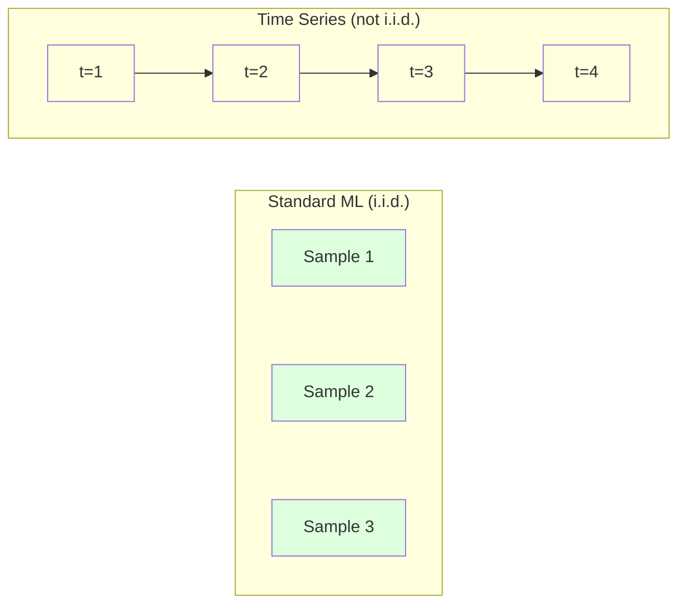
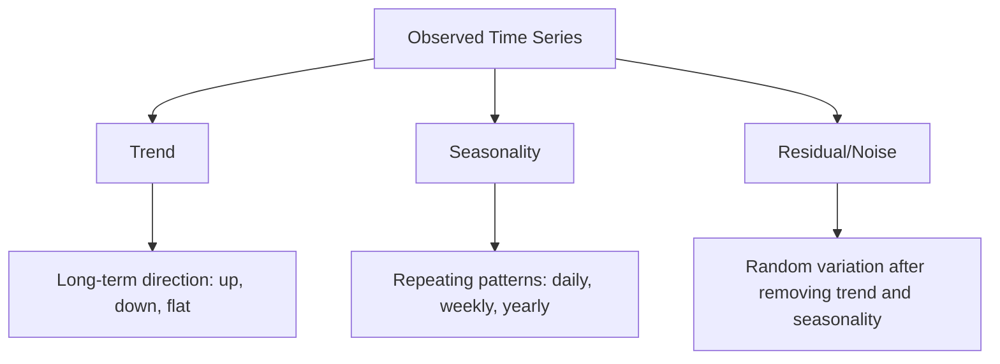
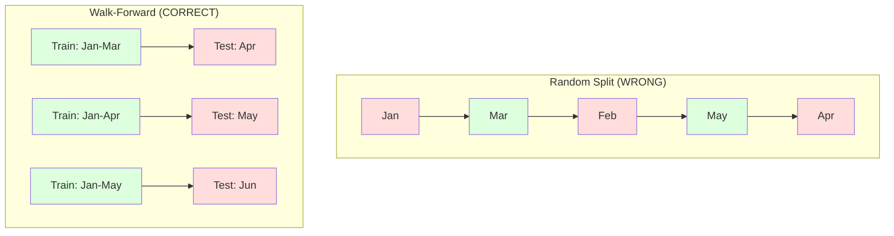

<!-- local-zh-machine-draft: English source is canonical; prose translated automatically, code/math preserved. -->

<a id="time-series-fundamentals"></a>

# 时间序列基础知识

> 如果您首先检查平稳性，过去的表现确实可以预测未来的结果。

**类型：** 构建
**语言：** Python
**先决条件：** 第 2 阶段，第 01-09 课
**时间：** ~90 分钟

<a id="learning-objectives"></a>

## 学习目标

- 将时间序列分解为趋势、季节性和残差成分并测试平稳性
- 实施滞后 features 和滚动统计，将时间序列转换为监督学习问题
- 构建一个前瞻性验证框架，防止未来数据泄漏到训练中
- 解释为什么随机训练/测试分割对于时间序列无效，并展示与适当时间分割的性能差距

<a id="the-problem"></a>

## 问题

您有按时间排序的数据。每日销售额、每小时 temperature、每分钟 CPU 使用量、每周股价。您想要预测下一个值、下周、下个季度。

您可以使用标准的 ML 工具包：随机训练/测试拆分、交叉验证、feature 矩阵输入、预测输出。每一步都是错误的。

时间序列打破了标准机器学习所依赖的假设。样本不是独立的——今天的 temperature 取决于昨天的。随机分裂将未来的信息泄漏到过去。 Features 在回测中看起来很棒，但在生产中却失败了，因为它们依赖于随时间变化的模式。

通过随机交叉验证获得 95% 准确率的模型，通过基于适当时间的 evaluation 可能获得 55% 的准确率。区别不是技术问题。这是纸面上的模型和生产中的模型之间的区别。

本课程涵盖基础知识：时间数据有何不同、如何诚实地评估模型以及如何将时间序列转换为标准 ML 模型可以使用的 features。

<a id="the-concept"></a>

## 概念

<a id="what-makes-time-series-different"></a>

### 是什么让时间序列与众不同

标准 ML 假设 i.i.d. ——独立同分布。每个样本均来自相同的分布，独立于其他样本。时间序列违反了两者：

- **不独立。** 今天的股价取决于昨天的股价。本周的销售额与上周的销售额相关。
- **不完全相同分布。** 随着时间的推移，distribution shifts。 12 月的销售情况与 3 月的销售情况有所不同。

这些违规行为并不轻微。它们改变了您构建 features 的方式、评估模型的方式以及算法的工作方式。



在标准机器学习中，样本是可以互换的。洗牌它们不会改变任何事情。在时间序列中，顺序就是一切。洗牌会破坏信号。

<a id="components-of-a-time-series"></a>

### 时间序列的组成部分

每个时间序列都是以下各项的组合：



- **Trend**：长期方向。收入每年增长10%。全球temperature不断上涨。
- **Seasonality**：以固定间隔重复模式。 12 月份零售额激增。七月是空调使用高峰期。
- **Residual**：去除趋势和季节性后剩下的内容。如果残差看起来像白噪声，则分解捕获了信号。

<a id="stationarity"></a>

### 平稳性

如果时间序列的统计属性（均值、方差、自相关）不随时间变化，则时间序列是平稳的。大多数预测方法都假设平稳性。

**为什么重要：** 非平稳序列具有漂移的均值。根据一月份的数据训练的模型学到的平均值与二月份的数据不同。这将是系统性的错误。

**如何检查：** 计算窗口上的滚动平均值和滚动标准差。如果它们漂移，则该序列是非平稳的。

**如何修复：** 差异。不是对原始值进行建模，而是对连续值之间的变化进行建模：

```
diff[t] = value[t] - value[t-1]
```

如果一轮差分不能使序列平稳，则再次应用它（二阶差分）。大多数现实世界的系列赛最多需要两轮。

**示例：**

原厂系列：[100、102、106、112、120]
第一个区别：[2,4,6,8]（仍呈上升趋势）
第二个区别：[2, 2, 2]（常数 - 静止）

原始系列有二次趋势。一阶差分将其变成线性趋势。二阶差分使其平坦。在实践中，您很少需要超过两轮。

**正式检验：** 增强迪基富勒 (ADF) 检验是平稳性的标准统计检验。原假设是“该序列是非平稳的”。 p 值低于 0.05 意味着您可以拒绝零值并得出平稳性结论。我们不会从头开始实现 ADF（它需要渐近分布表），但我们代码中的滚动统计方法提供了实用的视觉检查。

<a id="autocorrelation"></a>

### 自相关

自相关测量时间 t 处的值与时间 t-k（过去 k 个步骤）处的值的相关程度。自相关函数 (ACF) 绘制每个滞后 k 的相关性。

**ACF告诉您：**
- 该系列还记得多久以前的事。如果 ACF 在滞后 5 后降至零，则超过 5 个步骤之前的值是无关的。
- 是否存在季节性。如果 ACF 在滞后 12（月度数据）处峰值，则存在年度季节性。
- 创建多少滞后features。使用滞后直到 ACF 变得可以忽略不计。

**PACF（部分自相关函数）** 消除间接相关性。如果今天与 3 天前相关只是因为两者都与昨天相关，则滞后 3 的 PACF 将为零，而滞后 3 的 ACF 则不会。

<a id="lag-features-turning-time-series-into-supervised-learning"></a>

### Lag Features：将时间序列转变为监督学习

标准 ML 模型需要 feature 矩阵 X 和目标 y。时间序列为您提供一列值。该桥滞后 features。

取系列 [10, 12, 14, 13, 15] 并创建 lag-1 和 lag-2 features：

| lag_2 | lag_1 | 目标 |
|-------|-------|--------|
| 10    | 12    | 14     |
| 12    | 14    | 13     |
| 14    | 13    | 15     |

现在你有一个标准的回归问题。任何 ML 模型（线性回归、随机森林、gradient boosting）都可以根据滞后预测目标。

您可以设计额外的 features：
- **滚动统计：** 最近 k 个值的平均值、标准差、最小值、最大值
- **日历 features:** 星期几、月份，是_holiday，是_weekend
- **差异值：** 与上一步相比的变化
- **展开统计：** 累计平均值、累计总和
- **Ratio features:** 当前值/滚动平均值（距离最近平均值有多远）
- **互动features:**滞后_1 *日_of_周(工作日对动量的影响）

** 有多少滞后？** 使用自相关函数。如果 ACF 显着至滞后 10，则至少使用 10 滞后。如果存在每周季节性，请包括滞后 7（也可能是 14）。更多的滞后为模型提供了更多的历史记录，但也有更多的 features 适合，从而增加了 overfitting 的风险。

**目标alignment trap.** 创建滞后features时，目标必须是时间t时的值，并且所有features必须使用时间t-1或更早的值。如果您不小心将时间 t 处的值作为 feature 包含在内，那么您将拥有一个完美的预测器 - 以及一个完全无用的模型。这是时间序列 feature 工程中最常见的错误。

<a id="walk-forward-validation"></a>

### 向前验证

这是本课最重要的概念。标准 k 倍交叉验证随机分配样本进行训练和测试。对于时间序列，这会泄露未来的信息。



前向验证：
1. 训练直到时间 t 的数据
2. 在时间 t+1 进行预测（对于多步骤，在 t+1 到 t+k 进行预测）
3. 将车窗向前滑动
4. 重复

每个测试折叠仅包含所有训练数据之后的数据。未来无泄漏。这可以让您诚实地估计模型在部署后的表现。

**扩展窗口**使用所有历史数据进行训练（窗口增长）。 **滑动窗口**使用固定大小的训练窗口（窗口滑动）。当您认为旧数据仍然相关时，请使用扩展。当世界发生变化并且旧数据受到损害时，请使用滑动。

<a id="arima-intuition"></a>

### ARIMA 直觉

ARIMA 是经典的时间序列模型。它由三个组成部分组成：

- **AR (Autoregressive):** 根据过去的值进行预测。 AR(p) 使用最后的 p 值。
- **I（综合）：** 差分以实现平稳性。 I(d)应用d轮差分。
- **MA（移动平均线）：** 根据过去的预测误差进行预测。 MA(q) 使用最后 q 个错误。

ARIMA(p, d, q) 结合了这三者。您可以根据 ACF/PACF 分析或自动搜索（自动 ARIMA）选择 p、d、q。

我们不会从头开始实现 ARIMA——它需要数值优化，这超出了本课程的范围。关键的见解是了解每个组件的作用，以便您可以解释 ARIMA 结果并知道何时使用它。

<a id="when-to-use-what"></a>

### 何时使用什么

| 方法 | 最适合 | 应对季节性 | 外部手柄 Features |
|----------|---------|-------------------|------------------------|
| 滞后 features + ML | 具有许多外部的表格 features | 带日历 features | 是的 |
| 阿里玛 | 单一单变量序列，短期 | 萨里玛变体 | 否（ARIMAX 有限） |
| 指数平滑 | 简单趋势+季节性 | 是（霍尔特-温特斯） | 否 |
| 先知 | 业务预测、假期 | 是（傅立叶项） | 有限公司 |
| 神经网络（LSTM，Transformer） | 长序列、多系列 | 学到了 | 是的 |

对于大多数实际问题，滞后 features + gradient 提升是最强的起点。它自然地处理外部features，不需要平稳性，并且易于调试。

<a id="forecasting-horizons-and-strategies"></a>

### 预测范围和策略

单步预测预测提前一步。多步预测预测多个步骤。有以下三种策略：

**递归（迭代）：** 提前预测一步，将预测作为下一步的输入。简单但错误会累积——每个预测都使用之前的预测，因此错误会复合。

**Direct:** 为每个层训练一个单独的模型。 Model-1 预测 t+1，Model-5 预测 t+5。没有误差积累，但每个模型的训练样本较少，并且它们不共享信息。

**多输出：** 训练一个同时输出所有层位的模型。跨视野共享信息，但需要支持多个输出的模型（或自定义 loss function）。

对于大多数实际问题，对于短范围（1-5 步）从递归开始，对于较长范围从直接开始。

<a id="common-mistakes-in-time-series"></a>

### 时间序列中的常见错误

| 错误 | 为什么会发生这种情况 | 如何修复 |
|---------|---------------|-----------|
| 随机训练/测试分割 | 标准机器学习的习惯 | 使用前行或时间分割 |
| 使用未来的features | Feature 在时间 t 被错误包含 | 审核每个 feature 的临时 alignment |
| Overfitting 季节性 | 模型记住日历模式 | 在测试集中保持完整的季节周期 |
| 忽略尺度变化 | 收入翻倍但模式保持不变 | 模型百分比变化而不是绝对变化 |
| 滞后太多 features | “历史越多越好” | 使用 ACF 确定相关滞后 |
| 没有区别 | “模型会解决这个问题” | 树模型处理趋势；线性模型需要平稳性 |

```figure
f3-series-decompose
```

<a id="build-it"></a>

## 动手实现

`code/time_series.py` 中的代码从头开始实现了核心构建块。

<a id="lag-feature-creator"></a>

### 滞后 Feature 创建者

```python
def make_lag_features(series, n_lags):
    n = len(series)
    X = np.full((n, n_lags), np.nan)
    for lag in range(1, n_lags + 1):
        X[lag:, lag - 1] = series[:-lag]
    valid = ~np.isnan(X).any(axis=1)
    return X[valid], series[valid]
```

这会将 1D 系列转换为 feature 矩阵，其中每行将最后一个 `n_lags` 值作为 features，将当前值作为目标。

<a id="walk-forward-cross-validation"></a>

### 前向交叉验证

```python
def walk_forward_split(n_samples, n_splits=5, min_train=50):
    assert min_train < n_samples, "min_train must be less than n_samples"
    step = max(1, (n_samples - min_train) // n_splits)
    for i in range(n_splits):
        train_end = min_train + i * step
        test_end = min(train_end + step, n_samples)
        if train_end >= n_samples:
            break
        yield slice(0, train_end), slice(train_end, test_end)
```

每次分割都确保训练数据严格位于测试数据之前。训练窗口随着每次折叠而扩大。

<a id="simple-autoregressive-model"></a>

### 简单Autoregressive型号

纯 AR 模型只是滞后 features 的线性回归：

```python
class SimpleAR:
    def __init__(self, n_lags=5):
        self.n_lags = n_lags
        self.weights = None
        self.bias = None

    def fit(self, series):
        X, y = make_lag_features(series, self.n_lags)
        # Solve via normal equations
        X_b = np.column_stack([np.ones(len(X)), X])
        theta = np.linalg.lstsq(X_b, y, rcond=None)[0]
        self.bias = theta[0]
        self.weights = theta[1:]
        return self
```

这在概念上与第 02 课中的线性回归相同，但适用于同一变量的时滞版本。

<a id="stationarity-check"></a>

### 平稳性检查

该代码计算滚动统计数据以直观和数字方式评估平稳性：

```python
def check_stationarity(series, window=50):
    rolling_mean = np.array([
        series[max(0, i - window):i].mean()
        for i in range(1, len(series) + 1)
    ])
    rolling_std = np.array([
        series[max(0, i - window):i].std()
        for i in range(1, len(series) + 1)
    ])
    return rolling_mean, rolling_std
```

如果滚动平均值漂移或滚动标准差发生变化，则该序列是非平稳的。应用差分并再次检查。

该代码还通过比较该系列的前半部分和后半部分来检查平稳性。如果均值相差超过一半标准差或方差比超过 2x，则该序列被标记为非平稳。

<a id="autocorrelation-1"></a>

### 自相关

```python
def autocorrelation(series, max_lag=20):
    n = len(series)
    mean = series.mean()
    var = series.var()
    acf = np.zeros(max_lag + 1)
    for k in range(max_lag + 1):
        cov = np.mean((series[:n-k] - mean) * (series[k:] - mean))
        acf[k] = cov / var if var > 0 else 0
    return acf
```

<a id="use-it"></a>

## 实际应用

使用 sklearn，您可以直接将 lag features 与任何回归量一起使用：

```python
from sklearn.linear_model import Ridge
from sklearn.ensemble import GradientBoostingRegressor

X, y = make_lag_features(series, n_lags=10)

for train_idx, test_idx in walk_forward_split(len(X)):
    model = Ridge(alpha=1.0)
    model.fit(X[train_idx], y[train_idx])
    predictions = model.predict(X[test_idx])
```

对于 ARIMA，使用 statsmodels：

```python
from statsmodels.tsa.arima.model import ARIMA

model = ARIMA(train_series, order=(5, 1, 2))
fitted = model.fit()
forecast = fitted.forecast(steps=30)
```

`time_series.py` 中的代码演示了这两种方法，并使用前向验证对它们进行了比较。

<a id="sklearn-timeseriessplit"></a>

### sklearn 时间序列分割

sklearn 提供了 `TimeSeriesSplit` 来实现前向验证：

```python
from sklearn.model_selection import TimeSeriesSplit

tscv = TimeSeriesSplit(n_splits=5)
for train_index, test_index in tscv.split(X):
    X_train, X_test = X[train_index], X[test_index]
    y_train, y_test = y[train_index], y[test_index]
    model.fit(X_train, y_train)
    score = model.score(X_test, y_test)
```

这相当于我们从头开始的 `walk_forward_split`，但已集成到 sklearn 的交叉验证框架中。您可以将其与 `cross_val_score` 一起使用：

```python
from sklearn.model_selection import cross_val_score

scores = cross_val_score(model, X, y, cv=TimeSeriesSplit(n_splits=5))
print(f"Mean score: {scores.mean():.4f} +/- {scores.std():.4f}")
```

<a id="evaluation-metrics"></a>

### Evaluation 指标

时间序列预测使用回归指标，但具有时间感知上下文：

- **MAE（平均绝对误差）：** 的平均值 |y_true - y_pred|。易于以原始单位进行解释。 “平均而言，预测误差为 3.2 度。”
- **RMSE（均方根误差）：** 均方误差的平方根。与 MAE 相比，对大错误的惩罚更多。当大错误比许多小错误更严重时使用。
- **MAPE（平均绝对百分比误差）：** 的平均值 |error / true_value| * 100。与比例无关，可用于比较不同系列。但当真值为零时未定义。
- **朴素基线比较：** 始终与简单基线进行比较。季节性朴素基线预测一个时期前（昨天、上周）的值。如果你的模型不能打败天真，那就是出了问题。

<a id="rolling-features"></a>

### 滚动Features

该代码演示了添加滚动统计数据（7 天和 14 天窗口内的平均值、标准差、最小值、最大值）以滞后 features。这些为模型提供了有关近期趋势和波动性的信息，这些信息滞后于 features 本身无法捕获的信息。

例如，如果滚动平均值正在上升，则表明存在上升趋势。如果滚动标准增加，则表明波动性增加。这些是基于树的模型可以学习但线性模型不能学习的模式。

<a id="ship-it"></a>

## 交付成果

本课产生：
- `outputs/prompt-time-series-advisor.md` -- 用于构建时间序列问题的 prompt
- `code/time_series.py` -- 滞后 features、前向验证、AR 模型、平稳性检查

<a id="baselines-you-must-beat"></a>

### 你必须打破的底线

在构建任何模型之前，建立基线：

1. **最后一个值（持久化）。** 预测明天会和今天一样。对于许多系列来说，这是令人惊讶的难以击败的。
2. **季节性天真。** 预测今天将与上周（或去年）的同一天相同。如果您的模型无法击败这一点，那么它就没有学到除季节性之外的任何有用模式。
3. **移动平均值。** 预测最后 k 个值的平均值。平滑噪音，但无法捕捉突然的变化。

如果您精美的 ML 模型输给了季节性朴素基线，那么您就会遇到错误。最常见的是：features 中的未来泄漏、evaluation 方法错误，或者该系列确实是随机且不可预测的。

<a id="practical-tips"></a>

### 实用技巧

1. ** 从绘图开始。** 在任何建模之前，绘制原始序列。寻找趋势、季节性、异常值、结构性中断（行为的突然变化）。 30 秒的目视检查通常可以告诉您一个多小时的自动分析结果。

2. ** 差异第一，模型第二。** 如果该系列有明显的趋势，请在创建滞后 features 之前对其进行差异。基于树的模型可以处理趋势，但线性模型不能，而且差分永远不会有坏处。

3. **至少坚持一个完整的季节性周期。** 如果您有每周季节性，则您的测试集至少需要一整周。如果每月一次，至少一整月。否则，您无法评估模型是否捕获了季节性模式。

4. ** 生产中的监视器。** 时间系列模型随着世界的变化而随着时间的推移而退化。滚动跟踪预测错误。当错误开始增加时，根据最新数据重新训练模型。

5. **谨防政权更迭。** 根据大流行前数据训练的模型不会预测大流行后的行为。包括已知政权变化的指标，如 features，或使用忘记旧数据的滑动窗口。

6. **对数变换偏斜系列。** 收入、价格和计数通常是右偏的。采用对数可以稳定方差并使乘法模式相加，这是线性模型可以处理的。在对数空间中进行预测，然后求幂以返回原始单位。

<a id="exercises"></a>

## 练习

1. **平稳性实验。** 生成具有线性趋势的序列。使用滚动统计检查平稳性。应用一阶差分。再次检查。二次趋势需要多少轮差分？

2. **滞后选择。** 在季节性序列（周期=7）上计算 ACF。哪些滞后具有最高的自相关性？仅使用这些滞后（不是连续滞后）创建滞后 features。与使用滞后 1 到 7 相比，准确性是否有所提高？

3. **向前行走与随机分割。** 在滞后 features 上训练岭回归。使用随机 80/20 分割和前向验证进行评估。随机分割高估了多少性能？

4. **Feature Engineering.** 将滚动平均值（窗口 = 7）、滚动标准差（窗口 = 7）和周 features 添加到滞后 features。使用前向验证来比较有和没有这些附加功能的准确性。

5. **多步预测。** 修改 AR 模型以预测提前 5 步而不是 1 步。比较两种策略：(a) 预测一步，使用预测作为下一步的输入（递归），以及 (b) 为每个范围训练单独的模型（直接）。哪个更准确？

<a id="key-terms"></a>

## 关键术语

| 术语 | 人们怎么说 | 它实际上意味着什么 |
|------|----------------|----------------------|
| 平稳性 | “统计数据不会随着时间的推移而改变” | 均值、方差和自相关结构随时间恒定的序列 |
| 差异化 | “减去连续值” | 计算 y[t] - y[t-1] 以消除趋势并实现平稳性 |
| 自相关（ACF） | “系列如何与其自身相关” | 时间序列与其自身的滞后副本之间的相关性，作为滞后的函数 |
| 偏自相关 (PACF) | “仅直接相关” | 消除所有较短滞后的影响后滞后 k 处的自相关 |
| 滞后 features | “过去的值作为输入” | 使用 y[t-1]、y[t-2]、...、y[t-k] 作为features 预测 y[t] |
| 向前验证 | “尊重时间的交叉验证” | Evaluation，其中训练数据始终按时间顺序先于测试数据 |
| 阿里玛 | 《经典时间序列模型》 | AutoRegressive 综合移动平均线：结合过去值 (AR)、差分 (I) 和过去误差 (MA) |
| 季节性 | “重复日历模式” | 与日历周期（每日、每周、每年）相关的时间序列中有规律、可预测的周期 |
| 趋势 | “长远方向” | 随着时间的推移，系列级别持续增加或减少 |
| 扩展窗口 | “使用所有历史记录” | 训练集随着每次折叠而增长的前向验证 |
| 推拉窗 | “固定大小的历史记录” | 前向验证，其中训练集是向前滑动的固定长度窗口 |

<a id="further-reading"></a>

## 进一步阅读

- [Hyndman 和 Athanasopoulos，预测：原理与实践（第 3 版）](https://otexts.com/fpp3/)——关于时间序列预测的最佳免费教科书
- [scikit-learn 时间序列分割](https://scikit-learn.org/stable/modules/generated/sklearn.model_selection.TimeSeriesSplit.html) -- sklearn 的前向分割器
- [statsmodels ARIMA 文档](https://www.statsmodels.org/stable/generated/statsmodels.tsa.arima.model.ARIMA.html) -- 带诊断的 ARIMA 实施
- [Makridakis 等人，M5 竞赛 (2022)](https://www.sciencedirect.com/science/article/pii/S0169207021001874)——展示 ML 方法与统计方法的大规模预测竞赛
