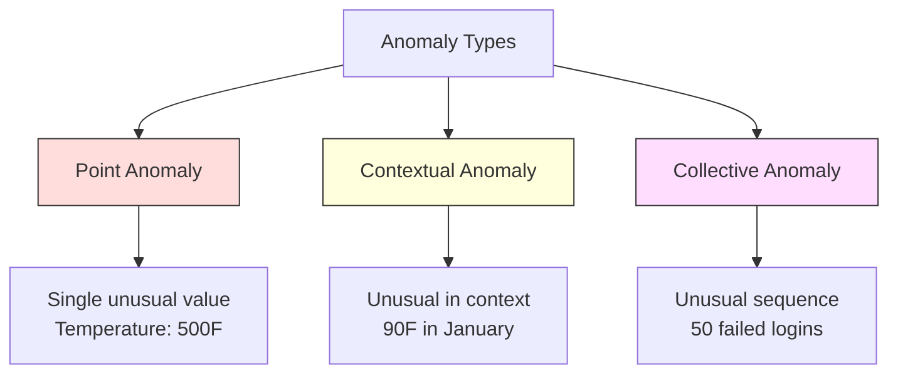
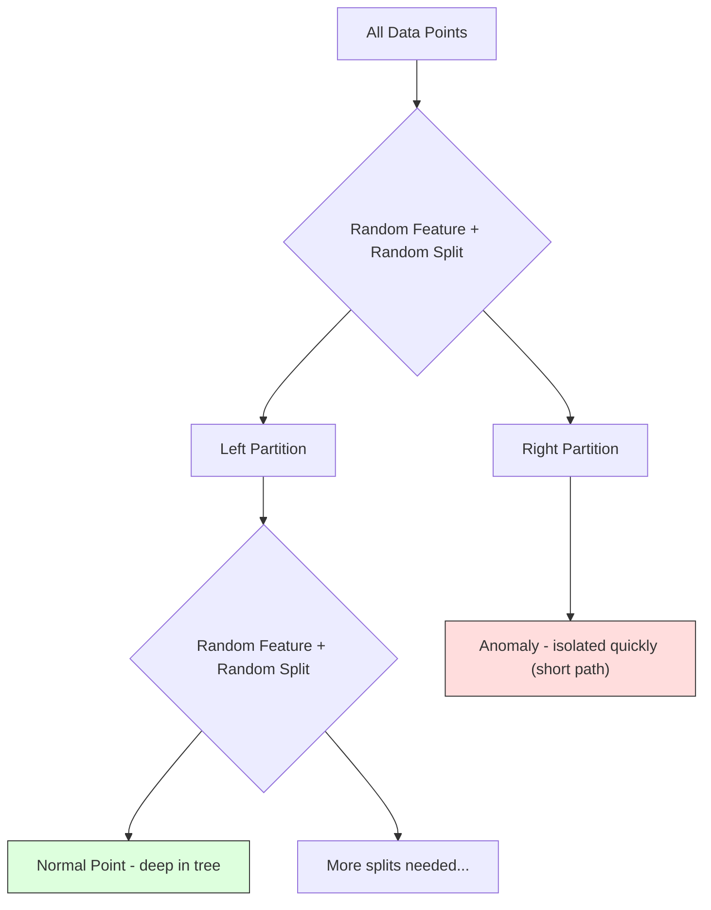
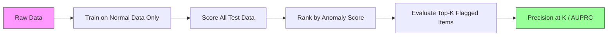

<!-- local-zh-machine-draft: English source is canonical; prose translated automatically, code/math preserved. -->

<a id="anomaly-detection"></a>

# 异常检测

> 正常很容易定义。凡是不适合的就是不正常的。

**类型：** 构建
**语言：** Python
**先决条件：** 第 2 阶段，课程 01-09
**时间：** ~75分钟

<a id="learning-objectives"></a>

## 学习目标

- 从头开始实施 Z 分数、IQR 和隔离森林异常检测方法
- 区分点异常、上下文异常和集体异常，并为每种异常选择适当的检测方法
- 解释为什么异常检测被定义为对正常数据建模而不是对异常进行分类
- 将无监督异常检测与监督分类进行比较，并评估新异常覆盖率和精度之间的权衡

<a id="the-problem"></a>

## 问题

纽约下午 2 点使用信用卡，东京下午 2:05 使用信用卡。当正常范围为 80-120 时，工厂传感器读数为 150 度。当日均 200 个时，服务器每秒发送 50,000 个请求。

这些都是异常情况。找到他们很重要。欺诈损失数十亿美元。设备故障会导致停机。网络入侵会消耗数据。

挑战：您很少标记异常示例。欺诈占交易量的 0.1%。设备故障每年都会发生几次。您无法训练标准分类器，因为“异常”类中几乎没有任何东西可供学习。即使你有一些标签，你所看到的异常并不是你会遇到的唯一类型。明天的欺诈计划看起来与今天不同。

异常检测扭转了问题。不要学习什么是异常的，而是学习什么是正常的。任何偏离正常的事情都是可疑的。它无需标签即可工作，适应新的异常类型，并可扩展到海量数据集。

<a id="the-concept"></a>

## 概念

<a id="types-of-anomalies"></a>

### 异常的类型

并非所有异常都是相同的：

- **Point anomalies.** 无论上下文如何，单个数据点都是异常的。 temperature 读数为 500 度。从通常花费 50 美元的账户中进行 50,000 美元的交易。
- **上下文异常。** 考虑到其上下文的异常数据点。 temperature 90度在夏天是正常的，在冬天是异常的。相同的值，不同的上下文。
- ** 集体异常。** 作为一组不寻常的数据点序列，即使每个单独的点可能是正常的。五次登录失败属于正常现象。连续五十次就是暴力攻击。

大多数方法检测点异常。上下文异常需要时间或位置 features。集体异常需要序列感知方法。



<a id="the-unsupervised-framing"></a>

### 无监督框架

在标准分类中，两个类别都有标签。在异常检测中，通常会遇到以下三种情况之一：

1. **完全无人监督。** 根本没有标签。您将检测器安装在所有数据上，并希望异常现象足够罕见，不会破坏“正常”模型。
2. **Semi-supervised.** 您有一个仅包含普通数据的干净数据集。你适合这套干净的套装并得分其他一切。这是尽可能最强的设置。
3. **弱监督。** 您有一些标记的异常。将它们用于 evaluation，而不是训练。无监督训练，然后测量标记子集的精确率/召回率。

关键见解：异常检测与分类根本不同。您正在对正态数据的分布进行建模，而不是对两个类之间的决策边界进行建模。

<a id="supervised-vs-unsupervised-the-tradeoff"></a>

### 有监督与无监督：权衡

如果您确实有标记的异常，您应该将它们用于训练（监督分类）还是仅用于 evaluation（无监督检测）？

** 监督（视为分类）：**
- 捕获您之前见过的确切异常类型
- 对已知异常类型的精度更高
- 完全错过新颖的异常类型
- 当新的异常类型出现时需要重新训练
- 需要足够的异常示例（通常太少）

**无监督（模型正常，标志偏差）：**
- 捕捉任何与正常情况的偏差，包括新颖的类型
- 不需要标记异常
- 误报率较高（并非所有不寻常的事情都是不好的）
- 对 distribution shift 更稳健

在实践中，最好的系统将两者结合起来：用于广泛覆盖的无监督检测、用于已知高优先级异常类型的监督模型以及对不明确案例的人工审查。

<a id="z-score-method"></a>

### Z分数法

最简单的方法。计算每个 feature 的平均值和标准差。标记距离平均值超过 k 个标准差的任何点。

```text
z_score = (x - mean) / std
anomaly if |z_score| > threshold
```

默认阈值为 3.0（对于高斯分布，99.7% 的正态数据落在 3 个标准差范围内）。

** 优点：** 简单。快速地。可解释（“该值与正常值有 4.5 个标准差”）。

**弱点：** 假设数据呈正态分布。对训练数据中的异常值敏感（异常值会改变均值并夸大标准差，使它们更难以检测）。多模式分发失败。

** 正常工作时：** 单feature 监控，数据大致呈钟形。服务器响应时间、制造公差、具有稳定基线的传感器读数。

**失败时：** 多集群数据（两个办公地点具有不同基线temperatures）、倾斜数据（1000美元的交易金额很少但不异常）、训练集中有异常值的数据。

<a id="iqr-method"></a>

### IQR法

比 Z 分数更稳健。使用四分位数范围而不是平均值和标准差。

```
Q1 = 25th percentile
Q3 = 75th percentile
IQR = Q3 - Q1
lower_bound = Q1 - factor * IQR
upper_bound = Q3 + factor * IQR
anomaly if x < lower_bound or x > upper_bound
```

默认系数为 1.5。

**优点：** 对异常值具有鲁棒性（百分位数不受极值影响）。适用于偏态分布。没有正态性假设。

**弱点：** 仅单变量（独立适用于 feature）。仅当 features 一起考虑时，无法检测到不寻常的异常（每个 feature 中的一个点可能单独正常，但在关节空间中异常）。

**实用说明：** IQR 中的 1.5 因子对应于箱线图中的须线。胡须之外的点是潜在的异常值。使用 3.0 而不是 1.5 使检测器更加保守（更少的标志，更少的误报）。正确的因素取决于您对误报的容忍度。

<a id="isolation-forest"></a>

### 隔离森林

关键见解：异常现象很少且各不相同。在数据的随机分区中，异常更容易隔离——它们需要更少的随机分割来从 rest 中分离出来。



** 工作原理：**
1. 构建许多随机树（隔离森林）
2. 在每个节点，选择一个随机的 feature 以及 feature 的最小值和最大值之间的随机分割值
3. 继续分裂，直到每个点都被隔离（在它自己的叶子中）
4. 异常在所有树上的平均路径长度较短

**为什么有效：** 正常点位于密集区域。需要多次随机分裂才能将其中一个与其邻居隔离开来。异常现象存在于稀疏区域。一两次随机分裂就足以将它们隔离开来。

异常分数基于所有树的平均路径长度，并通过随机二叉搜索树的预期路径长度进行归一化：

```
score(x) = 2^(-average_path_length(x) / c(n))
```

其中 `c(n)` 是 n 个样本的预期路径长度。分数接近 1 表示异常。分数接近 0.5 表示正常。分数接近 0 表示非常正常（位于密集簇的深处）。

**优点：** 无分布假设。在高维度下工作。扩展性良好（样本大小呈次线性，因为每棵树都使用子样本）。处理混合 feature 类型。

**弱点：** 与密集区域的异常现象作斗争（掩蔽效应）。当许多 features 不相关时，随机拆分效果较差。

**密钥 hyperparameters:**
- `n_estimators`：树的数量。通常 100 就足够了。更多的树可以提供更稳定的分数，但计算速度更慢。
- `max_samples`：每棵树的样本数。 256是原论文中的默认值。较小的值会使单个树的准确性降低，但会增加多样性。子采样是隔离森林快速运行的原因——每棵树只能看到一小部分数据。
- `contamination`：预期的异常部分。仅用于设置阈值。不影响分数本身。

<a id="local-outlier-factor-lof"></a>

### 局部离群因子 (LOF)

LOF 将点周围的局部密度与其邻居周围的密度进行比较。被密集区域包围的稀疏区域中的点是异常的。

** 工作原理：**
1. 对于每个点，找到它的 k 个最近邻点
2. 计算局部可达密度（邻域的密度如何）
3. 将每个点的密度与其相邻点的密度进行比较
4. 如果一个点的密度比其邻居低得多，则它是异常值

**LOF 得分：**
- LOF 接近 1.0 意味着与邻居的密度相似（正常）
- LOF 大于 1.0 意味着密度低于邻居（可能存在异常）
- LOF 远大于 1.0（例如 2.0+）意味着密度显着降低（可能存在异常）

“本地”部分至关重要。考虑一个包含两个簇的数据集：一个包含 1000 个点的密集簇和一个包含 50 个点的稀疏簇。稀疏簇边缘的点在全局范围内并不罕见——它有 50 个邻居。但如果它的近邻比实际密度更大，那么它在局部是不寻常的。 LOF 捕捉到了全局方法所忽略的细微差别。

**优势：** 检测局部异常（在其附近不寻常的点，即使它们不是全局不寻常的）。适用于不同密度的集群。

**弱点：** 在大型数据集上速度较慢（对于简单实现而言为 O(n^2)）。对k的选择敏感。在非常高的维度中效果不佳（维度灾难影响距离计算）。

<a id="comparison"></a>

### 比较

| 方法 | 假设 | 速度 | 处理高尺寸 | 检测局部异常 |
|--------|------------|-------|-------------------|------------------------|
| Z 分数 | 正态分布 | 非常快 | 是（根据 feature） | 否 |
| IQR | 无（根据 feature） | 非常快 | 是（根据 feature） | 否 |
| 隔离森林 | 无 | 快 | 是的 | 部分 |
| 洛夫 | 距离是有意义的 | 慢 | 很差劲 | 是的 |

<a id="evaluation-challenges"></a>

### Evaluation 挑战

评估异常检测器比评估分类器更难：

- **极端类别不平衡。** 异常率为 0.1%，预测一切“正常”的准确度为 99.9%。准确度是没有用的。
- **AUROC 具有误导性。** 在严重不平衡的情况下，即使模型在实际阈值上错过了大多数异常，AUROC 看起来也不错。
- **更好的指标：** Precision@k（前 k 个标记项目中，有多少是真正的异常）、AUPRC（精确率-召回率曲线下的面积）以及固定误报率的召回率。



<a id="anomaly-detection-pipeline"></a>

### 异常检测管道

在实践中，异常检测遵循以下工作流程：

1. **收集基线数据。** 理想情况下，您知道没有（或很少）异常的时期。
2. **Feature工程。**原始features加上派生features（滚动统计，时间features，比率）。
3. **训练检测器。** 拟合基线数据。该模型了解“正常”是什么样子。
4. **对新数据进行评分。** 每个新观察都会获得异常分数。
5. **阈值选择。** 选择分数截止。这是一个商业决策：较高的阈值意味着更少的误报，但更多的遗漏异常。
6. **警报并调查。** 标记点将转至人工审核或自动响应。
7. **反馈集合。** 记录标记的项目是真实异常还是误报。使用此数据来评估检测器并随时间调整阈值。

管道永远不会“完成”。数据分布发生变化，新的异常类型出现，阈值需要调整。将异常检测视为一个生命系统，而不是一次性模型。

```figure
f3-anomaly-fence
```

<a id="build-it"></a>

## 动手实现

`code/anomaly_detection.py`中的代码从头开始实现了Z-score、IQR和隔离森林。

<a id="z-score-detector"></a>

### Z 分数检测器

```python
def zscore_detect(X, threshold=3.0):
    mean = X.mean(axis=0)
    std = X.std(axis=0)
    std[std == 0] = 1.0
    z = np.abs((X - mean) / std)
    return z.max(axis=1) > threshold
```

简单且矢量化。如果任何 feature 超过阈值，则标记一个点。

<a id="iqr-detector"></a>

### IQR检测器

```python
def iqr_detect(X, factor=1.5):
    q1 = np.percentile(X, 25, axis=0)
    q3 = np.percentile(X, 75, axis=0)
    iqr = q3 - q1
    iqr[iqr == 0] = 1.0
    lower = q1 - factor * iqr
    upper = q3 + factor * iqr
    outside = (X < lower) | (X > upper)
    return outside.any(axis=1)
```

<a id="isolation-forest-from-scratch"></a>

### 从头开始的隔离森林

从头开始实现构建随机分区 feature 空间的隔离树：

```python
class IsolationTree:
    def __init__(self, max_depth):
        self.max_depth = max_depth

    def fit(self, X, depth=0):
        n, p = X.shape
        if depth >= self.max_depth or n <= 1:
            self.is_leaf = True
            self.size = n
            return self
        self.is_leaf = False
        self.feature = np.random.randint(p)
        x_min = X[:, self.feature].min()
        x_max = X[:, self.feature].max()
        if x_min == x_max:
            self.is_leaf = True
            self.size = n
            return self
        self.threshold = np.random.uniform(x_min, x_max)
        left_mask = X[:, self.feature] < self.threshold
        self.left = IsolationTree(self.max_depth).fit(X[left_mask], depth + 1)
        self.right = IsolationTree(self.max_depth).fit(X[~left_mask], depth + 1)
        return self
```

隔离点的路径长度决定其异常分数。较短的路径意味着更多的异常。

`IsolationForest` 类包装了多个树：

```python
class IsolationForest:
    def __init__(self, n_estimators=100, max_samples=256, seed=42):
        self.n_estimators = n_estimators
        self.max_samples = max_samples

    def fit(self, X):
        sample_size = min(self.max_samples, X.shape[0])
        max_depth = int(np.ceil(np.log2(sample_size)))
        for _ in range(self.n_estimators):
            idx = rng.choice(X.shape[0], size=sample_size, replace=False)
            tree = IsolationTree(max_depth=max_depth)
            tree.fit(X[idx])
            self.trees.append(tree)

    def anomaly_score(self, X):
        avg_path = average path length across all trees
        scores = 2.0 ** (-avg_path / c(max_samples))
        return scores
```

normalization 因子 `c(n)` 是具有 n 个元素的二叉搜索树中不成功搜索的预期路径长度。它等于 `2 * H(n-1) - 2*(n-1)/n`，其中 `H` 是谐波数。此 normalization 确保不同大小的数据集之间的分数具有可比性。

<a id="demo-scenarios"></a>

### 演示场景

该代码生成多个测试场景：

1. ** 具有异常值的单个簇。** 一个 2D 高斯簇，其中注入的异常远离中心。所有方法都应该在这里起作用。
2. **多模态数据。** 三个不同大小和密度的簇。簇之间的点是异常的。 Z 分数很困难，因为每个 feature 的范围很宽。
3. **高维数据。** 50 features，但异常仅在其中5个不同。测试方法是否可以发现 features 子集中的异常。

每个演示都使用精确率、召回率、F1 和 Precision@k 来比较所有方法。

<a id="use-it"></a>

## 实际应用

使用 sklearn（使用库实现，而不是从头开始）：

```python
from sklearn.ensemble import IsolationForest
from sklearn.neighbors import LocalOutlierFactor

iso = IsolationForest(n_estimators=100, contamination=0.05, random_state=42)
iso.fit(X_train)
predictions = iso.predict(X_test)

lof = LocalOutlierFactor(n_neighbors=20, contamination=0.05, novelty=True)
lof.fit(X_train)
predictions = lof.predict(X_test)
```

注意 `contamination` 设置异常的预期比例。正确设置很重要——太低会错过异常情况，太高会产生错误警报。

`anomaly_detection.py` 中的代码在相同数据上将从头开始的实现与 sklearn 进行比较。

<a id="sklearn-contamination-parameter"></a>

### sklearn 污染 Parameter

sklearn中的`contamination` parameter确定将连续异常分数转换为二进制预测的阈值。它不会改变基础分数。

```python
iso_5 = IsolationForest(contamination=0.05)
iso_10 = IsolationForest(contamination=0.10)
```

两者都会产生相同的异常分数。但 `iso_5` 标记了前 5%，而 `iso_10` 标记了前 10%。如果您不知道真实的异常率（通常不知道），请将污染设置为“自动”并直接使用原始分数。根据误报和漏报之间的成本权衡设置您自己的阈值。

<a id="one-class-svm"></a>

### 一类支持向量机

另一个值得了解的无监督异常检测器。一类 SVM 拟合高维 feature 空间中正常数据的边界（使用核技巧）。

```python
from sklearn.svm import OneClassSVM

oc_svm = OneClassSVM(kernel="rbf", gamma="auto", nu=0.05)
oc_svm.fit(X_train)
predictions = oc_svm.predict(X_test)
```

`nu` parameter 近似为异常的比例。一类 SVM 在中小型数据集上运行良好，但无法扩展到非常大的数据（核矩阵呈二次方增长）。

<a id="autoencoder-approach-preview"></a>

### 自动编码器方法（预览）

自动编码器是学习压缩和重建数据的神经网络。使用普通数据进行训练。在测试时，异常具有很高的重建误差，因为网络仅学会重建正常模式。

这将在第 3 阶段（深度学习）中介绍，但原理是相同的：对正常情况进行建模，对偏差进行标记。

<a id="ensemble-anomaly-detection"></a>

### 集合异常检测

正如集成方法可以改进分类（第 11 课）一样，组合多个异常检测器可以改进检测。最简单的方法：

1. 运行多个检测器（Z 分数、IQR、隔离森林、LOF）
2. 将每个检测器的分数标准化为 [0、1]
3. 标准化分数的平均值
4. 标记平均分数高于阈值的分数

这减少了误报，因为不同的方法有不同的故障模式。所有四种方法标记的点几乎肯定是异常的。仅由一个标记的点可能是该方法的一个怪癖。

更复杂的集成 weight 每个探测器的估计可靠性（在具有已知异常的验证集上测量，如果可用）。

<a id="production-considerations"></a>

### 生产注意事项

1. **阈值漂移。** 作为数据distribution shifts，固定阈值变得过时。监控异常分数的分布并定期调整。
2. **警报疲劳。** 误报太多，操作员停止支付 attention。从较高的阈值（更少、更可靠的警报）开始，并随着信任的建立而降低阈值。
3. **Ensemble 方法。** 在生产中，组合多个探测器。仅当多种方法一致认为某个点异常时才标记该点。这显着减少了误报。
4. **Feature 工程。** 原始 features 很少足够。添加滚动统计数据、比率、自上次事件以来的时间和特定于域的 features。一套好的 feature 装置比探测器的选择更重要。
5. **反馈循环。** 当操作员调查标记的项目并确认或消除它们时，将其反馈到系统中。随着时间的推移积累标记数据以评估和改进检测器。

<a id="ship-it"></a>

## 交付成果

本课产生：
- `outputs/skill-anomaly-detector.md`——选择正确探测器的决策技巧
- `code/anomaly_detection.py` -- 从头开始的 Z 分数、IQR 和隔离森林，与 sklearn 比较

<a id="choosing-a-threshold"></a>

### 选择阈值

异常分数是连续的。您需要一个阈值来做出二元决策。这是一项业务决策，而不是技术决策。

考虑两种情况：
- **欺诈检测。** 缺失欺诈成本高昂（退款、客户信任）。误报导致人类分析师花费了 5 分钟的时间进行调查。将阈值设置得低，以捕捉更多欺诈行为，接受更多误报。
- **设备维护。** 误报意味着不必要的停机，成本为 50,000 美元。错过一次故障意味着需要花费 500,000 美元进行维修。设置阈值来平衡这些成本。

在这两种情况下，最佳阈值取决于误报和误报之间的成本比。绘制不同阈值下的精度和召回率，叠加成本函数，并选择最小成本点。

<a id="scaling-to-production"></a>

### 扩展到生产

对于生产中的实时异常检测：

1. **批量训练，在线评分。** 使用最近的正常数据定期（每天、每周）训练模型。对每个新观察结果进行评分。
2. **Feature 计算必须匹配。** 如果您使用超过 30 天的滚动统计数据进行训练，则需要 30 天的历史记录来计算 features 以进行新观察。缓冲所需的历史记录。
3. **分数分布监控。** 跟踪异常分数随时间的分布。如果中值分数向上漂移，则要么数据正在变化，要么模型已经过时。
4. **Explainability.** 当您标记异常时，请说出原因。 Z 分数：“Feature X 比正常值高 4.2 个标准差。”孤立森林：“这个点平均被孤立在 3.1 个分割中（正常点取 8.5 个）。”

<a id="exercises"></a>

## 练习

1. **阈值调整。** 运行 Z 分数检测器，阈值从 1.0 到 5.0，步长为 0.5。绘制每个阈值的精确度和召回率。您的数据的最佳位置在哪里？

2. **多变量异常。** 创建 2D 数据，其中每个 feature 单独看起来正常，但组合是异常的（例如，远离主簇对角线的点）。表明每个 feature 的 Z 分数错过了这些，但隔离森林抓住了它们。

3. **LOF 从头开始。** 使用 k 最近邻实现局部离群因子。在相同数据上与 sklearn 的 LocalOutlierFactor 进行比较。使用 k=10 和 k=50——k 的选择如何影响结果？

4. **Streaming 异常检测。** 修改 Z 分数检测器以在 streaming 设置中工作：在新点到达时更新运行平均值和方差（Welford 的在线算法）。与相同数据的批量 Z 分数进行比较。

5. **真实世界 evaluation.** 获取具有已知异常的数据集（例如，来自 Kaggle 的信用卡欺诈）。使用 precision@100、 precision@500 和 AUPRC 评估所有四种方法。哪种方法效果最好？为什么？

<a id="key-terms"></a>

## 关键术语

| 术语 | 人们怎么说 | 它实际上意味着什么 |
|------|----------------|----------------------|
| 异常 | “异常点，异常点” | 与正常数据的预期模式显着偏离的数据点 |
| 点异常 | “一个奇怪的值” | 无论背景如何，个人观察都是不寻常的 |
| 上下文异常 | “正常值，错误上下文” | 考虑到其上下文（时间、地点等），观察结果不寻常，但在其他上下文中可能是正常的 |
| 隔离森林 | “随机分割以查找异常值” | 随机树的集合，可以用比正常点更少的分裂来隔离异常 |
| 局部离群因素 | “与邻居比较密度” | 一种标记局部密度远低于其邻居密度的点的方法 |
| Z 分数 | “平均值的标准差” | (x - 平均值) / std，以标准差为单位测量点距中心的距离 |
| IQR | “四分位距” | Q3 - Q1，测量中间 50% 数据的分布，用于稳健的异常值检测 |
| 污染 | “异常的预期分数” | hyperparameter 告诉检测器应将多大比例的数据标记为异常 |
| 精度@k | “前 k 个旗帜中，有多少是真实的” | 仅计算 k 个最可疑点的精度，对于不平衡异常检测很有用 |
| 澳大利亚UPRC | “精确率-召回率曲线下的面积” | 总结所有阈值的精确召回性能的指标，对于不平衡数据优于 AUROC |

<a id="further-reading"></a>

## 进一步阅读

- [Liu 等人，Isolation Forest (2008)](https://cs.nju.edu.cn/zhouzh/zhouzh.files/publication/icdm08b.pdf)——原始的 Isolation Forest 论文
- [Breunig 等人，LOF：识别基于密度的局部异常值 (2000)](https://dl.acm.org/doi/10.1145/342009.335388)——原始 LOF 论文
- [scikit-learn 异常值检测文档](https://scikit-learn.org/stable/modules/outlier_detection.html) -- 所有 sklearn 异常检测器的概述
- [Chandola 等人，异常检测：一项调查 (2009)](https://dl.acm.org/doi/10.1145/1541880.1541882) -- 异常检测方法的综合调查
- [Goldstein 和 Uchida，无监督异常检测算法的比较 Evaluation (2016)](https://journals.plos.org/plosone/article?id=10.1371/journal.pone.0152173) -- 真实数据集上 10 种方法的实证比较
