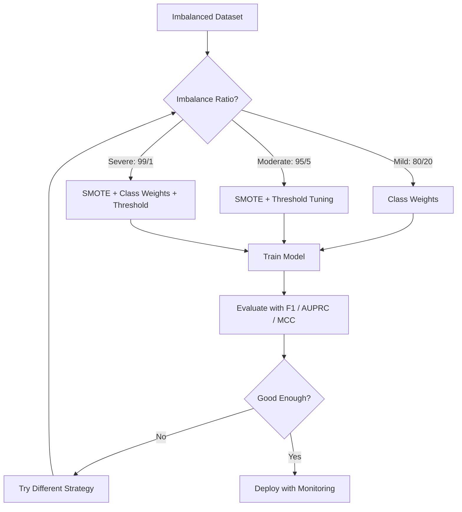
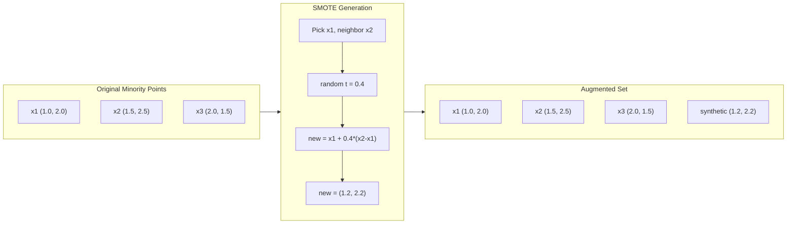
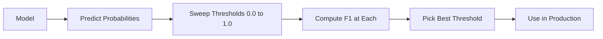
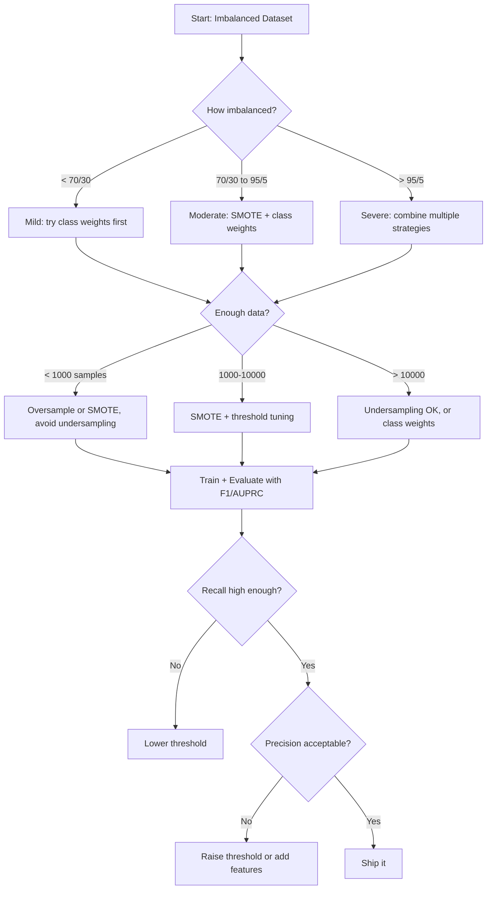

<!-- local-zh-machine-draft: English source is canonical; prose translated automatically, code/math preserved. -->

<a id="handling-imbalanced-data"></a>

# 处理不平衡数据

> 当 99% 的数据都是“正常”时，准确性就是一个谎言。

**类型：** 构建
**语言：** Python
**先决条件：** 第 2 阶段，第 01-09 课（特别是 evaluation 指标）
**时间：** ~90 分钟

<a id="learning-objectives"></a>

## 学习目标

- 从头开始实现 SMOTE 并解释合成过采样与随机复制有何不同
- 使用 F1、AUPRC 和 Matthews 相关系数而不是准确性来评估不平衡分类器
- 比较类别权重、阈值调整和重采样策略，并针对给定的不平衡率选择正确的方法
- 构建一个完整的不平衡数据管道，结合 SMOTE、weights 类和阈值优化

<a id="the-problem"></a>

## 问题

您构建了一个欺诈检测模型。它的准确率达到 99.9%。你庆祝一下。然后您意识到它对每笔交易都预测“不是欺诈”。

这不是一个错误。当只有 0.1% 的交易存在欺诈行为时，这是理性的做法。该模型了解到，始终猜测多数类可以最大限度地减少总体错误。它在技术上是正确的并且完全无用。

这种情况发生在任何真正需要分类的地方。疾病诊断：阳性率1%。网络入侵：0.01%攻击。制造缺陷：0.5% 缺陷。垃圾邮件过滤：20% 垃圾邮件。流失预测：5% 的流失者。少数群体越重要，它就越稀有。

准确性失败是因为它平等地对待所有正确的预测。正确标记合法交易和正确捕获欺诈行为都算作一分准确性。但抓住欺诈行为是该模型存在的全部原因。我们需要指标、技术和训练策略来迫使模型向罕见但重要的类别支付 attention。

<a id="the-concept"></a>

## 概念

<a id="why-accuracy-fails"></a>

### 为什么准确性会失败

考虑一个包含 1000 个样本的数据集：990 个阴性样本，10 个阳性样本。总是预测负面的模型：

|  | 预测为阳性 | 预测阴性 |
|--|---|---|
| 实际上积极 | 0（TP） | 10（前线） |
| 实际上是否定的 | 0（FP） | 990（田纳西州） |

Accuracy = (0 + 990) / 1000 = 99.0%

该模型实现了零欺诈。零疾病。零缺陷。但准确率高达 99%。这就是为什么准确性对于不平衡问题来说是危险的。

<a id="better-metrics"></a>

### 更好的指标

**精度** = TP / (TP + FP)。在所有被标记为积极的事物中，有多少实际上是积极的？高精度意味着误报少。

**召回** = TP / (TP + FN)。在所有真正积极的事情中，我们抓住了多少？高召回率意味着很少有漏掉的阳性结果。

**F1 得分 ** = 2 * 精确率 * 召回率 /（精确率 + 召回率）。调和平均值。与算术平均值相比，对精确度和召回率之间的极端不平衡的惩罚更大。

**F-beta 得分** = (1 + beta^2) * 精度 * 召回率 / (beta^2 * 精度 + 召回率)。当 beta > 1 时，召回率更重要。当 beta < 1 时，精度更重要。 F2 在欺诈检测中很常见（漏掉欺诈行为比误报更糟糕）。

**AUPRC**（精确召回曲线下的面积）。与 AUC-ROC 类似，但对于不平衡数据提供更多信息。随机分类器的 AUPRC 等于正类率（不像 ROC 那样为 0.5）。这使得改进更容易看到。

**马修斯相关系数** = (TP * TN - FP * FN) / sqrt((TP+FP)(TP+FN)(TN+FP)(TN+FN))。范围从 -1 到 +1。仅当模型在两个类别上都表现良好时才会给出高分。即使班级规模差异很大，也能保持平衡。

对于上面的“总是预测负面”模型：精确率 = 0/0（未定义，通常设置为 0），召回率 = 0/10 = 0，F1 = 0，MCC = 0。这些指标正确地将模型识别为毫无价值。

<a id="the-imbalanced-data-pipeline"></a>

### 不平衡的数据管道



<a id="smote-synthetic-minority-oversampling-technique"></a>

### SMOTE：合成少数过采样技术

随机过采样会重复现有的少数样本。这可行，但存在 overfitting 的风险，因为模型会重复看到相同的点。

SMOTE 创建了新的合成少数样本，这些样本是可信的，但不是复制品。算法：

1. 对于每个少数样本x，在其他少数样本中找到它的k个最近邻
2. 随机选择一个邻居
3. 在 x 和该邻居之间的线段上创建一个新样本

公式：`new_sample = x + random(0, 1) * (neighbor - x)`

这会在实际少数点之间进行插值，在 feature 空间的同一区域中创建样本，而无需复制现有数据。



<a id="sampling-strategies-compared"></a>

### Sampling 策略比较

**随机过采样**：重复少数样本以匹配多数计数。
- 优点：简单，无信息丢失
- 缺点：精确重复会导致 overfitting，增加训练时间

**随机欠采样**：删除多数样本以匹配少数计数。
- 优点：训练快速、简单
- 缺点：丢弃潜在有用的大多数数据，方差较高

**SMOTE**：通过插值创建合成少数样本。
- 优点：与随机过采样相比，生成新的数据点，减少 overfitting
- 缺点：可以在决策边界附近创建噪声样本，不考虑多数类分布

| 策略 | 数据已更改 | 风险 | 何时使用 |
|----------|-------------|------|-------------|
| 过采样 | 少数重复 | Overfitting | 数据集小，不平衡程度适中 |
| 欠采样 | 移除多数 | 信息丢失 | 数据集大，需要快速训练 |
| 斯莫特 | 添加合成少数 | 边界噪声 | 适度不平衡，足够的少数样本用于 k-NN |

<a id="class-weights"></a>

### Weights 类

不要更改数据，而是更改模型处理错误的方式。分配较高的 weight 来错误分类少数类。

对于具有 950 个负样本和 50 个正样本的二元问题：
- Weight 负类 = n_ 样本 / (2 * n_ 负数) = 1000 / (2 * 950) = 0.526
- Weight 为正类 = n_ 样本 / (2 * n_ 正) = 1000 / (2 * 50) = 10.0

正类获得 19 倍的 weight。对 1 个正样本进行错误分类的成本与对 19 个负样本进行错误分类的成本相同。该模型被迫向少数群体支付 attention。

在逻辑回归中，这会修改 loss function：

```
weighted_loss = -sum(w_i * [y_i * log(p_i) + (1-y_i) * log(1-p_i)])
```

其中 w_i 取决于样本 i 的类别。

weights 类在数学上相当于预期的过采样，但不会创建新的数据点。这使得它们更快并避免了重复样本的 overfitting 风险。

<a id="threshold-tuning"></a>

### 阈值调整

大多数分类器输出概率。默认阈值是 0.5：如果 P(positive) >= 0.5，则预测为正。但 0.5 是任意的。当类别不平衡时，最佳阈值通常要低得多。

流程：
1. 训练模型
2. 获取验证集上的预测概率
3. 扫描阈值从 0.0 到 1.0
4. 计算每个阈值的 F1（或您选择的指标）
5. 选择最大化指标的阈值



对于欺诈性交易，模型可能会输出 P(fraud) = 0.15。在阈值 0.5 时，这被归类为非欺诈。在阈值 0.10 处，它被正确捕获。概率 calibration 比排名更重要——只要欺诈的概率高于非欺诈，就存在将它们分开的阈值。

<a id="cost-sensitive-learning"></a>

### 成本敏感型学习

weights 类的泛化。指定特定的错误分类成本，而不是统一成本：

| | 预测积极 | 预测负面 |
|--|---|---|
| 实际上积极 | 0（正确） | C_FN = 100 |
| 实际上是否定的 | C_FP = 1 | 0（正确） |

错过欺诈交易 (FN) 的成本是误报 (FP) 的 100 倍。该模型针对总成本而不是总错误数进行优化。

当您可以估算实际成本时，这是最具原则性的方法。错过癌症诊断的成本与导致额外活检的误报的成本截然不同。明确这些成本可以迫使人们做出正确的权衡。

<a id="decision-flowchart"></a>

### 决策流程图



```figure
class-imbalance
```

<a id="build-it"></a>

## 动手实现

<a id="step-1-generate-an-imbalanced-dataset"></a>

### 第 1 步：生成不平衡数据集

```python
import numpy as np


def make_imbalanced_data(n_majority=950, n_minority=50, seed=42):
    rng = np.random.RandomState(seed)

    X_maj = rng.randn(n_majority, 2) * 1.0 + np.array([0.0, 0.0])
    X_min = rng.randn(n_minority, 2) * 0.8 + np.array([2.5, 2.5])

    X = np.vstack([X_maj, X_min])
    y = np.concatenate([np.zeros(n_majority), np.ones(n_minority)])

    shuffle_idx = rng.permutation(len(y))
    return X[shuffle_idx], y[shuffle_idx]
```

<a id="step-2-smote-from-scratch"></a>

### 第 2 步：从头开始 SMOTE

```python
def euclidean_distance(a, b):
    return np.sqrt(np.sum((a - b) ** 2))


def find_k_neighbors(X, idx, k):
    distances = []
    for i in range(len(X)):
        if i == idx:
            continue
        d = euclidean_distance(X[idx], X[i])
        distances.append((i, d))
    distances.sort(key=lambda x: x[1])
    return [d[0] for d in distances[:k]]


def smote(X_minority, k=5, n_synthetic=100, seed=42):
    rng = np.random.RandomState(seed)
    n_samples = len(X_minority)
    k = min(k, n_samples - 1)
    synthetic = []

    for _ in range(n_synthetic):
        idx = rng.randint(0, n_samples)
        neighbors = find_k_neighbors(X_minority, idx, k)
        neighbor_idx = neighbors[rng.randint(0, len(neighbors))]
        t = rng.random()
        new_point = X_minority[idx] + t * (X_minority[neighbor_idx] - X_minority[idx])
        synthetic.append(new_point)

    return np.array(synthetic)
```

<a id="step-3-random-oversampling-and-undersampling"></a>

### 步骤 3：随机过采样和欠采样

```python
def random_oversample(X, y, seed=42):
    rng = np.random.RandomState(seed)
    classes, counts = np.unique(y, return_counts=True)
    max_count = counts.max()

    X_resampled = list(X)
    y_resampled = list(y)

    for cls, count in zip(classes, counts):
        if count < max_count:
            cls_indices = np.where(y == cls)[0]
            n_needed = max_count - count
            chosen = rng.choice(cls_indices, size=n_needed, replace=True)
            X_resampled.extend(X[chosen])
            y_resampled.extend(y[chosen])

    X_out = np.array(X_resampled)
    y_out = np.array(y_resampled)
    shuffle = rng.permutation(len(y_out))
    return X_out[shuffle], y_out[shuffle]


def random_undersample(X, y, seed=42):
    rng = np.random.RandomState(seed)
    classes, counts = np.unique(y, return_counts=True)
    min_count = counts.min()

    X_resampled = []
    y_resampled = []

    for cls in classes:
        cls_indices = np.where(y == cls)[0]
        chosen = rng.choice(cls_indices, size=min_count, replace=False)
        X_resampled.extend(X[chosen])
        y_resampled.extend(y[chosen])

    X_out = np.array(X_resampled)
    y_out = np.array(y_resampled)
    shuffle = rng.permutation(len(y_out))
    return X_out[shuffle], y_out[shuffle]
```

<a id="step-4-logistic-regression-with-class-weights"></a>

### 步骤 4：类 weights 的逻辑回归

```python
def sigmoid(z):
    return 1.0 / (1.0 + np.exp(-np.clip(z, -500, 500)))


def logistic_regression_weighted(X, y, weights, lr=0.01, epochs=200):
    n_samples, n_features = X.shape
    w = np.zeros(n_features)
    b = 0.0

    for _ in range(epochs):
        z = X @ w + b
        pred = sigmoid(z)
        error = pred - y
        weighted_error = error * weights

        gradient_w = (X.T @ weighted_error) / n_samples
        gradient_b = np.mean(weighted_error)

        w -= lr * gradient_w
        b -= lr * gradient_b

    return w, b


def compute_class_weights(y):
    classes, counts = np.unique(y, return_counts=True)
    n_samples = len(y)
    n_classes = len(classes)
    weight_map = {}
    for cls, count in zip(classes, counts):
        weight_map[cls] = n_samples / (n_classes * count)
    return np.array([weight_map[yi] for yi in y])
```

<a id="step-5-threshold-tuning"></a>

### 第 5 步：阈值调整

```python
def find_optimal_threshold(y_true, y_probs, metric="f1"):
    best_threshold = 0.5
    best_score = -1.0

    for threshold in np.arange(0.05, 0.96, 0.01):
        y_pred = (y_probs >= threshold).astype(int)
        tp = np.sum((y_pred == 1) & (y_true == 1))
        fp = np.sum((y_pred == 1) & (y_true == 0))
        fn = np.sum((y_pred == 0) & (y_true == 1))

        if metric == "f1":
            precision = tp / (tp + fp) if (tp + fp) > 0 else 0.0
            recall = tp / (tp + fn) if (tp + fn) > 0 else 0.0
            score = 2 * precision * recall / (precision + recall) if (precision + recall) > 0 else 0.0
        elif metric == "recall":
            score = tp / (tp + fn) if (tp + fn) > 0 else 0.0
        elif metric == "precision":
            score = tp / (tp + fp) if (tp + fp) > 0 else 0.0

        if score > best_score:
            best_score = score
            best_threshold = threshold

    return best_threshold, best_score
```

<a id="step-6-evaluation-functions"></a>

### 第6步：Evaluation函数

```python
def confusion_matrix_values(y_true, y_pred):
    tp = np.sum((y_pred == 1) & (y_true == 1))
    tn = np.sum((y_pred == 0) & (y_true == 0))
    fp = np.sum((y_pred == 1) & (y_true == 0))
    fn = np.sum((y_pred == 0) & (y_true == 1))
    return tp, tn, fp, fn


def compute_metrics(y_true, y_pred):
    tp, tn, fp, fn = confusion_matrix_values(y_true, y_pred)
    accuracy = (tp + tn) / (tp + tn + fp + fn)
    precision = tp / (tp + fp) if (tp + fp) > 0 else 0.0
    recall = tp / (tp + fn) if (tp + fn) > 0 else 0.0
    f1 = 2 * precision * recall / (precision + recall) if (precision + recall) > 0 else 0.0

    denom = np.sqrt(float((tp + fp) * (tp + fn) * (tn + fp) * (tn + fn)))
    mcc = (tp * tn - fp * fn) / denom if denom > 0 else 0.0

    return {
        "accuracy": accuracy,
        "precision": precision,
        "recall": recall,
        "f1": f1,
        "mcc": mcc,
    }
```

<a id="step-7-compare-all-approaches"></a>

### 第 7 步：比较所有方法

```python
X, y = make_imbalanced_data(950, 50, seed=42)
split = int(0.8 * len(y))
X_train, X_test = X[:split], X[split:]
y_train, y_test = y[:split], y[split:]

# Baseline: no treatment
w_base, b_base = logistic_regression_weighted(
    X_train, y_train, np.ones(len(y_train)), lr=0.1, epochs=300
)
probs_base = sigmoid(X_test @ w_base + b_base)
preds_base = (probs_base >= 0.5).astype(int)

# Oversampled
X_over, y_over = random_oversample(X_train, y_train)
w_over, b_over = logistic_regression_weighted(
    X_over, y_over, np.ones(len(y_over)), lr=0.1, epochs=300
)
preds_over = (sigmoid(X_test @ w_over + b_over) >= 0.5).astype(int)

# SMOTE
minority_mask = y_train == 1
X_minority = X_train[minority_mask]
synthetic = smote(X_minority, k=5, n_synthetic=len(y_train) - 2 * int(minority_mask.sum()))
X_smote = np.vstack([X_train, synthetic])
y_smote = np.concatenate([y_train, np.ones(len(synthetic))])
w_sm, b_sm = logistic_regression_weighted(
    X_smote, y_smote, np.ones(len(y_smote)), lr=0.1, epochs=300
)
preds_smote = (sigmoid(X_test @ w_sm + b_sm) >= 0.5).astype(int)

# Class weights
sample_weights = compute_class_weights(y_train)
w_cw, b_cw = logistic_regression_weighted(
    X_train, y_train, sample_weights, lr=0.1, epochs=300
)
probs_cw = sigmoid(X_test @ w_cw + b_cw)
preds_cw = (probs_cw >= 0.5).astype(int)

# Threshold tuning (tune on held-out validation set, not test set)
probs_val = sigmoid(X_val @ w_cw + b_cw)
best_thresh, best_f1 = find_optimal_threshold(y_val, probs_val, metric="f1")
preds_thresh = (probs_cw >= best_thresh).astype(int)
```

代码文件在一个脚本中运行所有这些并打印结果。

<a id="use-it"></a>

## 实际应用

有了 scikit-learn 和不平衡学习，这些技术就很简单了：

```python
from sklearn.linear_model import LogisticRegression
from sklearn.metrics import classification_report, f1_score
from sklearn.model_selection import train_test_split
from imblearn.over_sampling import SMOTE
from imblearn.under_sampling import RandomUnderSampler
from imblearn.pipeline import Pipeline

X_train, X_test, y_train, y_test = train_test_split(X, y, stratify=y)

model_weighted = LogisticRegression(class_weight="balanced")
model_weighted.fit(X_train, y_train)
print(classification_report(y_test, model_weighted.predict(X_test)))

smote = SMOTE(random_state=42)
X_resampled, y_resampled = smote.fit_resample(X_train, y_train)
model_smote = LogisticRegression()
model_smote.fit(X_resampled, y_resampled)
print(classification_report(y_test, model_smote.predict(X_test)))

pipeline = Pipeline([
    ("smote", SMOTE()),
    ("model", LogisticRegression(class_weight="balanced")),
])
pipeline.fit(X_train, y_train)
print(classification_report(y_test, pipeline.predict(X_test)))
```

从头开始的实现准确地展示了每种技术的作用。 SMOTE 只是少数类别上的 k-NN 插值。 weights 类乘以损耗。阈值调整是截止值上的 for 循环。没有魔法。

<a id="ship-it"></a>

## 交付成果

本课产生：
- `outputs/skill-imbalanced-data.md`——处理不平衡分类问题的决策清单

<a id="exercises"></a>

## 练习

1. **Borderline-SMOTE**：修改 SMOTE 实现，仅为决策边界附近的少数点（其 k 最近邻包括多数类样本）生成合成样本。将结果与类别重叠的数据集上的标准 SMOTE 进行比较。

2. **成本矩阵优化**：实现成本敏感的学习，其中成本矩阵是parameter。创建一个函数，该函数采用成本矩阵并返回最小化预期成本的最佳预测。使用不同的成本比（1:10、1:100、1:1000）进行测试，并绘制精确率与召回率权衡的变化情况。

3. **Threshold calibration**：实施 Platt 缩放（对模型的原始输出进行逻辑回归以产生校准概率）。比较calibration前后的精确率-召回率曲线。表明 calibration 不会改变排名（AUC 保持不变），但使概率更有意义。

4. **Ensemble 具有平衡装袋**：训练多个模型，每个模型都在平衡引导样本上（所有少数+多数的随机子集）。平均他们的预测。将此方法与 SMOTE 的单一模型进行比较。测量运行期间的性能和差异。

5. **不平衡比例实验**：采用平衡数据集并逐步增加不平衡比例（50/50、70/30、90/10、95/5、99/1）。对于每个比率，使用和不使用 SMOTE 进行训练。绘制两种方法的 F1 与不平衡率的关系图。 SMOTE 在什么比例下开始产生有意义的变化？

<a id="key-terms"></a>

## 关键术语

| 术语 | 人们怎么说 | 它实际上意味着什么 |
|------|----------------|----------------------|
| 阶级不平衡 | “一堂课有更多的样本” | 数据集中类的分布明显偏斜，导致模型偏向多数类 |
| 斯莫特 | “合成过采样” | 通过在现有少数样本与其 k 最近的少数邻居之间进行插值来创建新的少数样本 |
| weights 类 | “让罕见类别上的错误变得更加昂贵” | 将 loss function 乘以特定类别的 weights，以便模型对少数错误分类进行更严厉的惩罚 |
| 阈值调整 | “移动决策边界” | 将分类的概率截止值从默认的 0.5 更改为优化所需指标的值 |
| 精确率与召回率的权衡 | “你不能两者兼得” | 降低阈值会捕获更多的阳性（更高的召回率），但也会标记更多的误报（更低的精度），反之亦然 |
| 澳大利亚UPRC | “PR 曲线下面积” | 将精确率-召回率曲线总结为一个数字；当类别严重不平衡时，比 AUC-ROC 提供更多信息 |
| 马修斯相关系数 | “平衡指标” | 预测标签和实际标签之间的相关性，仅当模型在两个类别上都表现良好时才会产生高分 |
| 成本敏感型学习 | “不同的错误付出的代价不同” | 将现实世界的错误分类成本纳入训练目标，以便模型针对总成本而不是错误计数进行优化 |
| 随机过采样 | “复制少数” | 重复少数类别样本以平衡类别数量；简单，但存在 overfitting 重复点的风险 |

<a id="further-reading"></a>

## 进一步阅读

- [SMOTE: Synthetic Minority Over-sampling Technique (Chawla et al., 2002)](https://arxiv.org/abs/1106.1813)——原始的 SMOTE 论文，仍然是关于不平衡学习被引用最多的工作
- [从不平衡数据中学习（He & Garcia，2009）](https://ieeexplore.ieee.org/document/5128907)——涵盖 sampling、成本敏感和算法方法的综合调查
- [imbalanced-learn 文档](https://imbalanced-learn.org/stable/) -- Python 库，具有 SMOTE 变体、欠采样策略和管道集成
- [精确召回图比 ROC 图提供更多信息（Saito & Rehmsmeier，2015）](https://journals.plos.org/plosone/article?id=10.1371/journal.pone.0118432) - 对于不平衡问题，何时以及为何更喜欢 PR 曲线而不是 ROC 曲线
