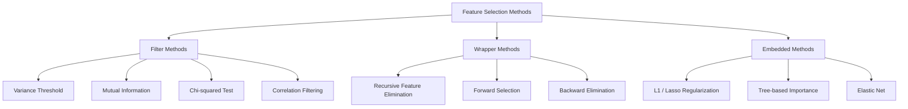
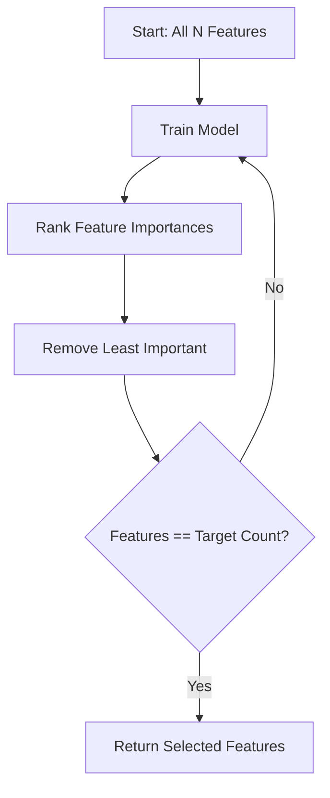
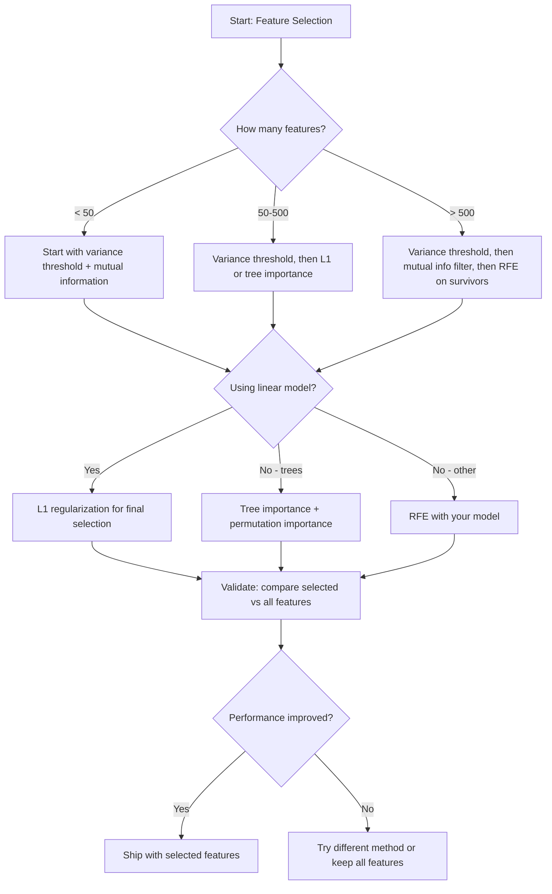

<!-- local-zh-machine-draft: English source is canonical; prose translated automatically, code/math preserved. -->

<a id="feature-selection"></a>

# Feature 选择

> features 并不是越多越好。正确的features更好。

**类型：** 构建
**语言：** Python
**先决条件：** 第 2 阶段，第 01-09、08 课（feature 工程）
**时间：** ~75分钟

<a id="learning-objectives"></a>

## 学习目标

- 从头开始实现过滤器方法（方差阈值、互信息、卡方）和包装器方法（RFE、前向选择）
- 解释为什么互信息捕获相关性错过的非线性 feature-目标关系
- 比较 L1 正则化（嵌入选择）与 RFE（包装器选择）并评估它们的计算权衡
- 构建结合多种方法的 feature 选择管道，并展示对保留数据的改进泛化

<a id="the-problem"></a>

## 问题

您有 500 个 features。你的模型训练缓慢，不断过度拟合，没有人能解释它学到了什么。您添加更多 features 希望能够提高性能。情况变得更糟。

这就是维度的诅咒。随着features数量的增长，feature空间的体积呈爆炸式增长。数据点变得稀疏。点之间的距离收敛。该模型需要指数级更多的数据才能找到真正的模式。噪声 features 淹没信号 features。 Overfitting 成为默认值。

Feature选择的是解药。消除噪音。删除冗余。保留携带目标实际信息的features。结果是：更快的训练、更好的泛化以及可以实际解释的模型。

目标不是使用所有可用信息。就是使用正确的信息。

<a id="the-concept"></a>

## 概念

<a id="three-categories-of-feature-selection"></a>

### Feature精选三类

每个 feature 选择方法都属于以下三类之一：



**过滤方法** 使用统计测量独立地对每个feature 进行评分。他们不使用模型。速度很快，但他们错过了 feature 交互。

**包装方法** 训练模型来评估 feature 子集。他们使用模型性能作为分数。结果更好，但成本高昂，因为它们需要多次重新训练模型。

**嵌入式方法**选择features作为模型训练的一部分。 L1 正则化将 weights 驱动为零。决策树在最有用的 features 上进行分割。选择发生在拟合过程中，而不是作为一个单独的步骤。

<a id="variance-threshold"></a>

### 方差阈值

最简单的过滤器。如果 feature 在样本之间几乎没有变化，那么它几乎不携带任何信息。

考虑 feature，1000 个样本中有 999 个样本的值为 0.0。其方差接近于零。没有模型可以用它来区分类别。将其删除。

```
variance(x) = mean((x - mean(x))^2)
```

设置阈值（例如 0.01）。删除方差低于其的每个 feature。这会删除常量或接近常量的 features，而根本不查看目标变量。

何时使用它：作为其他方法之前的预处理步骤。它以接近零的成本捕获了明显无用的 features。

限制：feature 可能具有高方差，但仍然是纯噪声。方差阈值是必要的，但还不够。

<a id="mutual-information"></a>

### 互信息

互信息衡量了解 feature X 的值可以在多大程度上减少目标 Y 的不确定性。

```
I(X; Y) = sum_x sum_y p(x, y) * log(p(x, y) / (p(x) * p(y)))
```

如果 X 和 Y 是独立的，则 p(x, y) = p(x) * p(y)，因此对数项为零且 I(X; Y) = 0。X 告诉您有关 Y 的信息越多，互信息就越高。

相对于相关性的主要优点：互信息捕获非线性关系。 feature 可能与目标具有零相关性，但互信息较高，因为该关系是二次或周期性的。

对于连续的 features，首先离散化为 bin（基于直方图的估计）。箱的数量会影响估计——箱太少会丢失信息，箱太多会增加噪音。常见的选择：sqrt(n) bin 或 Sturges 规则 (1 + log2(n))。


<a id="recursive-feature-elimination-rfe"></a>

### 递归 Feature 消除 (RFE)

RFE 是一种包装方法。它使用模型自己的 feature 重要性来迭代修剪：

1. 使用所有 features 训练模型
2. 按重要性对 features 进行排名（线性模型的系数、树木的杂质减少）
3. 删除最不重要的 feature(s)
4. 重复，直到剩余所需数量的 features



RFE认为feature交互，因为模型看到了所有剩余的features一起。 删除一个feature改变他人的重要性。 这使得它比过滤方法更彻底。

成本：您训练模型 N - 目标次数。 500 features 和目标为 10，即 490 次训练运行。对于昂贵的型号，这很慢。您可以通过每步删除多个 features 来加快速度（例如，每轮删除底部 10%）。

<a id="l1-lasso-regularization"></a>

### L1（套索）正则化

L1正则化将weights的绝对值添加到loss function中：

```
loss = prediction_error + alpha * sum(|w_i|)
```

alpha parameter 控制 features 修剪的积极程度。较高的 alpha 意味着更多的 weights 恰好为零。

为什么恰好为零？ L1 惩罚在 weight 空间中创建一个菱形约束区域。最优解往往落在该菱形的一角，其中一个或多个 weights 为零。 L2 正则化（岭）创建了一个循环约束，其中 weights 收缩但很少达到零。

这是嵌入的 feature 选择：模型在训练期间学习要忽略哪些 features。 Features 与零 weight 被有效删除。

优点：单次训练运行，处理相关的 features（选择一个并将其他归零），内置于大多数线性模型实现中。

限制：仅适用于线性模型。无法捕获非线性 feature 重要性。

<a id="tree-based-feature-importance"></a>

### 基于树的 Feature 重要性

决策树及其集合（随机森林，gradient 提升）自然排名为 features。每次分割都会减少杂质（分类的基尼系数或熵，回归的方差）。 Features 产生较大的杂质减少量更为重要。

对于具有 T 树的随机森林：

```
importance(feature_j) = (1/T) * sum over all trees of
    sum over all nodes splitting on feature_j of
        (n_samples * impurity_decrease)
```

这给出了每个 feature 的标准化重要性得分。它自动处理非线性关系和 feature 交互。

注意：基于树的重要性偏向于具有许多唯一值（高基数）的 features。随机 ID 列显得很重要，因为它完美地分割了每个样本。使用排列重要性作为健全性检查。

<a id="permutation-importance"></a>

### 排列重要性

与模型无关的方法：

1. 训练模型并记录验证数据的基线性能
2. 对于每个 feature：随机打乱其值，测量性能下降情况
3. 跌幅越大feature越重要

如果打乱 feature 不会损害性能，则模型不依赖它。如果性能崩溃，feature 就至关重要。

排列重要性避免了基于树的重要性的基数偏差。 但速度很慢：一满evaluation每feature，重复多次以确保稳定性。

<a id="comparison-table"></a>

### 比较表

| 方法 | 类型 | 速度 | 非线性 | Feature 互动 |
|--------|------|-------|-----------|---------------------|
| 方差阈值 | 过滤器 | 非常快 | 否 | 否 |
| 互信息 | 过滤器 | 快 | 是的 | 否 |
| 相关滤波器 | 过滤器 | 快 | 否 | 否 |
| 射频E | 包装纸 | 慢 | 取决于型号 | 是的 |
| L1 / 套索 | 嵌入式 | 快 | 否（线性） | 否 |
| 树的重要性 | 嵌入式 | 中等 | 是的 | 是的 |
| 排列重要性 | 与模型无关 | 慢 | 是的 | 是的 |

<a id="decision-flowchart"></a>

### 决策流程图



```figure
f3-feature-prune
```

<a id="build-it"></a>

## 动手实现

<a id="step-1-generate-synthetic-data-with-known-feature-structure"></a>

### 步骤 1：生成具有已知 feature 结构的合成数据

```python
import numpy as np


def make_feature_selection_data(n_samples=500, seed=42):
    rng = np.random.RandomState(seed)

    x1 = rng.randn(n_samples)
    x2 = rng.randn(n_samples)
    x3 = rng.randn(n_samples)
    x4 = x1 + 0.1 * rng.randn(n_samples)
    x5 = x2 + 0.1 * rng.randn(n_samples)

    informative = np.column_stack([x1, x2, x3, x4, x5])

    correlated = np.column_stack([
        x1 * 0.9 + 0.1 * rng.randn(n_samples),
        x2 * 0.8 + 0.2 * rng.randn(n_samples),
        x3 * 0.7 + 0.3 * rng.randn(n_samples),
        x1 * 0.5 + x2 * 0.5 + 0.1 * rng.randn(n_samples),
        x2 * 0.6 + x3 * 0.4 + 0.1 * rng.randn(n_samples),
    ])

    noise = rng.randn(n_samples, 10) * 0.5

    X = np.hstack([informative, correlated, noise])
    y = (2 * x1 - 1.5 * x2 + x3 + 0.5 * rng.randn(n_samples) > 0).astype(int)

    feature_names = (
        [f"info_{i}" for i in range(5)]
        + [f"corr_{i}" for i in range(5)]
        + [f"noise_{i}" for i in range(10)]
    )

    return X, y, feature_names
```

我们知道事实真相：features 0-4 是信息性的（加上 3 和 4 是 0 和 1 的相关副本），features 5-9 与信息性 features 相关，features 10-19 是纯噪声。一个好的选择方法应该将 0-4 排名最高，10-19 排名最低。

<a id="step-2-variance-threshold"></a>

### 步骤 2：方差阈值

```python
def variance_threshold(X, threshold=0.01):
    variances = np.var(X, axis=0)
    mask = variances > threshold
    return mask, variances
```

<a id="step-3-mutual-information-discrete"></a>

### 步骤3：互信息（离散）

```python
def discretize(x, n_bins=10):
    min_val, max_val = x.min(), x.max()
    if max_val == min_val:
        return np.zeros_like(x, dtype=int)
    bin_edges = np.linspace(min_val, max_val, n_bins + 1)
    binned = np.digitize(x, bin_edges[1:-1])
    return binned


def mutual_information(X, y, n_bins=10):
    n_samples, n_features = X.shape
    mi_scores = np.zeros(n_features)

    y_vals, y_counts = np.unique(y, return_counts=True)
    p_y = y_counts / n_samples

    for f in range(n_features):
        x_binned = discretize(X[:, f], n_bins)
        x_vals, x_counts = np.unique(x_binned, return_counts=True)
        p_x = dict(zip(x_vals, x_counts / n_samples))

        mi = 0.0
        for xv in x_vals:
            for yi, yv in enumerate(y_vals):
                joint_mask = (x_binned == xv) & (y == yv)
                p_xy = np.sum(joint_mask) / n_samples
                if p_xy > 0:
                    mi += p_xy * np.log(p_xy / (p_x[xv] * p_y[yi]))
        mi_scores[f] = mi

    return mi_scores
```

<a id="step-4-recursive-feature-elimination"></a>

### 步骤4：递归Feature消除

```python
def simple_logistic_importance(X, y, lr=0.1, epochs=100):
    n_samples, n_features = X.shape
    w = np.zeros(n_features)
    b = 0.0

    for _ in range(epochs):
        z = X @ w + b
        pred = 1.0 / (1.0 + np.exp(-np.clip(z, -500, 500)))
        error = pred - y
        w -= lr * (X.T @ error) / n_samples
        b -= lr * np.mean(error)

    return w, b


def rfe(X, y, n_features_to_select=5, lr=0.1, epochs=100):
    n_total = X.shape[1]
    remaining = list(range(n_total))
    rankings = np.ones(n_total, dtype=int)
    rank = n_total

    while len(remaining) > n_features_to_select:
        X_subset = X[:, remaining]
        w, _ = simple_logistic_importance(X_subset, y, lr, epochs)
        importances = np.abs(w)

        least_idx = np.argmin(importances)
        original_idx = remaining[least_idx]
        rankings[original_idx] = rank
        rank -= 1
        remaining.pop(least_idx)

    for idx in remaining:
        rankings[idx] = 1

    selected_mask = rankings == 1
    return selected_mask, rankings
```

<a id="step-5-l1-feature-selection"></a>

### 步骤5：L1 feature选择

```python
def soft_threshold(w, alpha):
    return np.sign(w) * np.maximum(np.abs(w) - alpha, 0)


def l1_feature_selection(X, y, alpha=0.1, lr=0.01, epochs=500):
    n_samples, n_features = X.shape
    w = np.zeros(n_features)
    b = 0.0

    for _ in range(epochs):
        z = X @ w + b
        pred = 1.0 / (1.0 + np.exp(-np.clip(z, -500, 500)))
        error = pred - y

        gradient_w = (X.T @ error) / n_samples
        gradient_b = np.mean(error)

        w -= lr * gradient_w
        w = soft_threshold(w, lr * alpha)
        b -= lr * gradient_b

    selected_mask = np.abs(w) > 1e-6
    return selected_mask, w
```

<a id="step-6-tree-based-importance-simple-decision-tree"></a>

### 第6步：基于树的重要性（简单决策树）

```python
def gini_impurity(y):
    if len(y) == 0:
        return 0.0
    classes, counts = np.unique(y, return_counts=True)
    probs = counts / len(y)
    return 1.0 - np.sum(probs ** 2)


def best_split(X, y, feature_idx):
    values = np.unique(X[:, feature_idx])
    if len(values) <= 1:
        return None, -1.0

    best_threshold = None
    best_gain = -1.0
    parent_gini = gini_impurity(y)
    n = len(y)

    for i in range(len(values) - 1):
        threshold = (values[i] + values[i + 1]) / 2.0
        left_mask = X[:, feature_idx] <= threshold
        right_mask = ~left_mask

        n_left = np.sum(left_mask)
        n_right = np.sum(right_mask)

        if n_left == 0 or n_right == 0:
            continue

        gain = parent_gini - (n_left / n) * gini_impurity(y[left_mask]) - (n_right / n) * gini_impurity(y[right_mask])

        if gain > best_gain:
            best_gain = gain
            best_threshold = threshold

    return best_threshold, best_gain


def tree_importance(X, y, n_trees=50, max_depth=5, seed=42):
    rng = np.random.RandomState(seed)
    n_samples, n_features = X.shape
    importances = np.zeros(n_features)

    for _ in range(n_trees):
        sample_idx = rng.choice(n_samples, size=n_samples, replace=True)
        feature_subset = rng.choice(n_features, size=max(1, int(np.sqrt(n_features))), replace=False)

        X_boot = X[sample_idx]
        y_boot = y[sample_idx]

        tree_imp = _build_tree_importance(X_boot, y_boot, feature_subset, max_depth)
        importances += tree_imp

    total = importances.sum()
    if total > 0:
        importances /= total

    return importances


def _build_tree_importance(X, y, feature_subset, max_depth, depth=0):
    n_features = X.shape[1]
    importances = np.zeros(n_features)

    if depth >= max_depth or len(np.unique(y)) <= 1 or len(y) < 4:
        return importances

    best_feature = None
    best_threshold = None
    best_gain = -1.0

    for f in feature_subset:
        threshold, gain = best_split(X, y, f)
        if gain > best_gain:
            best_gain = gain
            best_feature = f
            best_threshold = threshold

    if best_feature is None or best_gain <= 0:
        return importances

    importances[best_feature] += best_gain * len(y)

    left_mask = X[:, best_feature] <= best_threshold
    right_mask = ~left_mask

    importances += _build_tree_importance(X[left_mask], y[left_mask], feature_subset, max_depth, depth + 1)
    importances += _build_tree_importance(X[right_mask], y[right_mask], feature_subset, max_depth, depth + 1)

    return importances
```

<a id="step-7-run-all-methods-and-compare"></a>

### 第 7 步：运行所有方法并进行比较

该代码文件在同一合成数据集上运行所有五种方法，并打印一个比较表，显示每种方法选择哪个 features。

<a id="use-it"></a>

## 实际应用

通过 scikit-learn，feature 选择内置到管道中：

```python
from sklearn.feature_selection import (
    VarianceThreshold,
    mutual_info_classif,
    RFE,
    SelectFromModel,
)
from sklearn.linear_model import Lasso, LogisticRegression
from sklearn.ensemble import RandomForestClassifier

vt = VarianceThreshold(threshold=0.01)
X_filtered = vt.fit_transform(X)

mi_scores = mutual_info_classif(X, y)
top_k = np.argsort(mi_scores)[-10:]

rfe_selector = RFE(LogisticRegression(), n_features_to_select=10)
rfe_selector.fit(X, y)
X_rfe = rfe_selector.transform(X)

lasso_selector = SelectFromModel(Lasso(alpha=0.01))
lasso_selector.fit(X, y)
X_lasso = lasso_selector.transform(X)

rf = RandomForestClassifier(n_estimators=100)
rf.fit(X, y)
importances = rf.feature_importances_
```

从头开始的实现准确地展示了每个方法内部发生的情况。方差阈值只是计算 `var(X, axis=0)` 并应用掩码。互信息是计算列联表中的联合频率和边际频率。 RFE 是一个训练、排名和修剪的循环。 L1 是 gradient descent，具有软阈值步骤。树的重要性会累积各个分裂中的杂质减少量。没有魔法——只有统计数据和循环。

sklearn 版本增加了鲁棒性（例如，mutual_info_classif 使用 k-NN 密度估计而不是分箱）、速度（C 实现）和管道集成。

<a id="ship-it"></a>

## 交付成果

本课产生：
- `outputs/skill-feature-selector.md` -- 用于选择正确的 feature 选择方法的快速参考决策树

<a id="exercises"></a>

## 练习

1. **转发选择**：实现与RFE相反的功能。从零开始 features。在每个步骤中，添加对模型性能提升最大的 feature。当添加 features 不再有帮助时停止。将选定的 features 与 RFE 结果进行比较。哪个更快？哪个能提供更好的结果？

2. **稳定性选择**：运行L1 feature选择50次，每次在数据的随机80%子样本上运行，alpha值略有不同。计算每个 feature 被选择的频率。 Features 在 > 80% 的运行中选择是“稳定的”。将稳定的 features 与单次运行 L1 选择进行比较。哪个更可靠？

3. **多重共线性检测**：计算所有features的相关矩阵。实现一个函数，在给定相关性阈值（例如 0.9）的情况下，从每个高度相关的对中删除一个 feature（保留与目标具有较高互信息的对）。对合成数据集进行测试并验证它删除了冗余相关的 features。

4. **Feature 选择管道**：链方差阈值、互信息过滤器和 RFE 到单个管道中。首先删除接近零方差的features，然后通过互信息保留前50%，然后对幸存者运行RFE。将此管道与在所有 features 上单独运行 RFE 进行比较。管道速度更快吗？是否同样准确？

5. **从头开始排列重要性**：实现排列重要性。对于每个 feature，将其值洗牌 10 次，测量 F1 分数的平均下降。将排名与基于树的重要性进行比较。找出他们不同意的案例并解释原因（提示：相关 features）。

<a id="key-terms"></a>

## 关键术语

| 术语 | 人们怎么说 | 它实际上意味着什么 |
|------|----------------|----------------------|
| 过滤方式 | “独立评分features” | 一种 feature 选择方法，使用统计度量对 features 进行排名，无需训练模型，单独评估每个 feature |
| 包装法 | “使用模型选择features” | 一种 feature 选择方法，通过训练模型并使用其性能作为选择标准来评估 feature 子集 |
| 嵌入法 | “模型在训练时选择features” | Feature 选择作为模型拟合的一部分发生，例如 L1 正则化驱动 weights 为零 |
| 互信息 | “一个变量能告诉你多少关于另一个变量的信息” | 一种在已知 X 的情况下减少 Y 不确定性的度量，捕获线性和非线性依赖性 |
| 递归 Feature 消除 | “训练、排名、修剪、重复” | 一种迭代包装方法，用于训练模型，删除最不重要的 feature，并重复直到达到目标计数 |
| L1 /套索正则化 | “杀死features的处罚” | 将绝对 weight 值的总和添加到 loss function，这将不重要的 feature weights 驱动到恰好为零 |
| 方差阈值 | “删除常量 features” | 丢弃样本间方差低于指定阈值的 features，过滤掉不携带信息的 features |
| Feature重要性 | “哪个 features 最重要” | 表示每个 feature 对模型预测的贡献程度的分数，根据分割增益（树）或系数幅度（线性）计算得出 |
| 排列重要性 | “洗牌并测量伤害” | 通过随机打乱每个 feature 的值并测量由此导致的模型性能下降来评估 feature 的重要性 |
| 维数诅咒 | “features 太多，数据不足” | 添加features后，feature空间的体积呈指数级增加，使得数据稀疏，距离变得无意义的现象 |

<a id="further-reading"></a>

## 进一步阅读

- [变量和Feature选择简介（Guyon & Elisseeff, 2003）](https://jmlr.org/papers/v3/guyon03a.html)——feature选择方法的基础调查，至今仍被广泛引用
- [scikit-learn Feature 选择指南](https://scikit-learn.org/stable/modules/feature_selection.html) -- 带有代码示例的过滤器、包装器和嵌入式方法的实用参考
- [稳定性选择（Meinshausen & Buhlmann，2010）](https://arxiv.org/abs/0809.2932)——将子采样与 feature 选择相结合，以获得稳健、可重复的结果
- [Beware Default Random Forest Importances (Strobl et al., 2007)](https://bmcbioinformatics.biomedcentral.com/articles/10.1186/1471-2105-8-25) - 演示基于树的重要性中的基数偏差，并提出条件重要性作为替代方案
