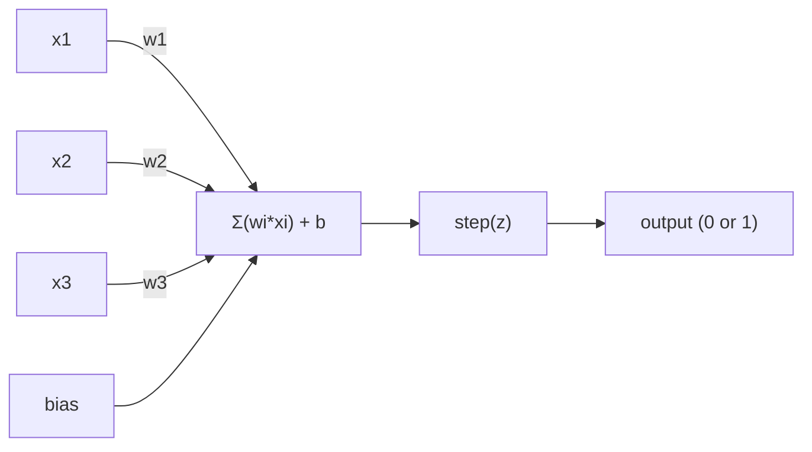
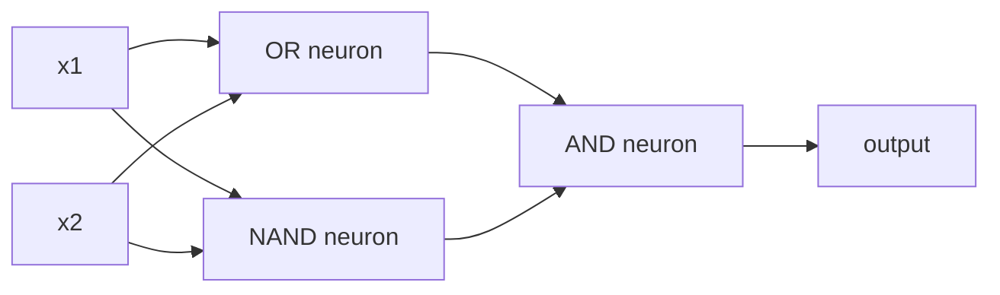

<!-- local-zh-machine-draft: English source is canonical; prose translated automatically, code/math preserved. -->

<a id="the-perceptron"></a>

# 感知器

> 感知器是神经网络的原子。拆开它，你会发现 weights、一个偏见和一个决定。

**类型：** 构建
**语言：** Python
**先决条件：** 第 1 阶段（线性代数直觉）
**时间：** ~60 分钟

<a id="learning-objectives"></a>

## 学习目标

- 在Python中从头开始实现一个感知器，包括weight更新规则和步骤activation function
- 解释为什么单个感知器只能解决线性可分离问题并演示 XOR 失败案例
- 通过组合 OR、NAND 和 AND 门来构建多层感知器来解决 XOR
- 使用 sigmoid 激活和 backpropagation 训练两层网络以自动学习 XOR

<a id="the-problem"></a>

## 问题

您了解向量和点积。您知道矩阵将输入转换为输出。但是机器*如何学习*使用哪种转换呢？

感知器回答了这个问题。这是最简单的学习机：获取一些输入，乘以 weights，添加偏差，然后做出二元决策。然后调整。就是这样。曾经构建的每个神经网络都是这个想法的层层堆叠在一起的。

理解感知器意味着理解“学习”在代码中的实际含义：调整数字直到输出与现实相符。

<a id="the-concept"></a>

## 概念

<a id="one-neuron-one-decision"></a>

### 一个神经元，一个决定

感知器接受 n 个输入，将每个输入乘以 weight，将它们相加，添加偏差，并将结果传递给 activation function。



阶跃函数是残酷的：如果加权和加上偏差 >= 0，则输出 1。否则，输出 0。

```
step(z) = 1  if z >= 0
           0  if z < 0
```

这是一个线性分类器。 weights 和偏差定义一条线（或更高维度的超平面），将输入空间分成两个区域。

<a id="the-decision-boundary"></a>

### 决策边界

对于两个输入，感知器在 2D 空间中画一条线：

```
  x2
  ┤
  │  Class 1        /
  │    (0)          /
  │                /
  │               / w1·x1 + w2·x2 + b = 0
  │              /
  │             /     Class 2
  │            /        (1)
  ┼───────────/──────────── x1
```

线一侧的所有内容都输出 0。另一侧的所有内容都输出 1。训练会移动这条线，直到它正确地分隔类别。

<a id="the-learning-rule"></a>

### 学习规则

感知器学习规则很简单：

```
For each training example (x, y_true):
    y_pred = predict(x)
    error = y_true - y_pred

    For each weight:
        w_i = w_i + learning_rate * error * x_i
    bias = bias + learning_rate * error
```

如果预测正确，误差 = 0，则不会发生任何变化。如果预测为 0 但应该为 1，则 weights 增加。如果预测为 1 但应该为 0，则 weights 减少。 learning rate 控制每次调整的大小。

<a id="the-xor-problem"></a>

### 异或问题

这就是它破裂的地方。看看这些逻辑门：

```
AND gate:           OR gate:            XOR gate:
x1  x2  out         x1  x2  out         x1  x2  out
0   0   0           0   0   0           0   0   0
0   1   0           0   1   1           0   1   1
1   0   0           1   0   1           1   0   1
1   1   1           1   1   1           1   1   0
```

AND 和 OR 是线性可分离的：您可以画一条线将 0 与 1 分开。异或则不然。没有一条线可以将 [0,1] 和 [1,0] 与 [0,0] 和[1,1]。

```
AND (separable):        XOR (not separable):

  x2                      x2
  1 ┤  0     1            1 ┤  1     0
    │     /                 │
  0 ┤  0 / 0              0 ┤  0     1
    ┼──/──────── x1         ┼──────────── x1
       line works!          no single line works!
```

这是一个基本限制。单个感知器只能解决线性可分问题。 Minsky 和 ​​Papert 在 1969 年证明了这一点，并且在接下来的十年里它几乎扼杀了神经网络研究。

解决办法：将感知器堆叠成层。多层感知器可以通过将两个线性决策组合成一个非线性决策来解决异或问题。

```figure
perceptron-boundary
```

<a id="build-it"></a>

## 动手实现

<a id="step-1-the-perceptron-class"></a>

### 第 1 步：感知器类

```python
class Perceptron:
    def __init__(self, n_inputs, learning_rate=0.1):
        self.weights = [0.0] * n_inputs
        self.bias = 0.0
        self.lr = learning_rate

    def predict(self, inputs):
        total = sum(w * x for w, x in zip(self.weights, inputs))
        total += self.bias
        return 1 if total >= 0 else 0

    def train(self, training_data, epochs=100):
        for epoch in range(epochs):
            errors = 0
            for inputs, target in training_data:
                prediction = self.predict(inputs)
                error = target - prediction
                if error != 0:
                    errors += 1
                    for i in range(len(self.weights)):
                        self.weights[i] += self.lr * error * inputs[i]
                    self.bias += self.lr * error
            if errors == 0:
                print(f"Converged at epoch {epoch + 1}")
                return
        print(f"Did not converge after {epochs} epochs")
```

<a id="step-2-train-on-logic-gates"></a>

### 第 2 步：逻辑门训练

```python
and_data = [
    ([0, 0], 0),
    ([0, 1], 0),
    ([1, 0], 0),
    ([1, 1], 1),
]

or_data = [
    ([0, 0], 0),
    ([0, 1], 1),
    ([1, 0], 1),
    ([1, 1], 1),
]

not_data = [
    ([0], 1),
    ([1], 0),
]

print("=== AND Gate ===")
p_and = Perceptron(2)
p_and.train(and_data)
for inputs, _ in and_data:
    print(f"  {inputs} -> {p_and.predict(inputs)}")

print("\n=== OR Gate ===")
p_or = Perceptron(2)
p_or.train(or_data)
for inputs, _ in or_data:
    print(f"  {inputs} -> {p_or.predict(inputs)}")

print("\n=== NOT Gate ===")
p_not = Perceptron(1)
p_not.train(not_data)
for inputs, _ in not_data:
    print(f"  {inputs} -> {p_not.predict(inputs)}")
```

<a id="step-3-watch-xor-fail"></a>

### 第 3 步：观察 XOR 失败

```python
xor_data = [
    ([0, 0], 0),
    ([0, 1], 1),
    ([1, 0], 1),
    ([1, 1], 0),
]

print("\n=== XOR Gate (single perceptron) ===")
p_xor = Perceptron(2)
p_xor.train(xor_data, epochs=1000)
for inputs, expected in xor_data:
    result = p_xor.predict(inputs)
    status = "OK" if result == expected else "WRONG"
    print(f"  {inputs} -> {result} (expected {expected}) {status}")
```

它永远不会收敛。这是单个感知器无法学习异或的铁证。

<a id="step-4-solve-xor-with-two-layers"></a>

### 步骤 4：解决两层异或问题

技巧：XOR = (x1 OR x2) AND NOT (x1 AND x2)。组合三个感知器：



```python
def xor_network(x1, x2):
    or_neuron = Perceptron(2)
    or_neuron.weights = [1.0, 1.0]
    or_neuron.bias = -0.5

    nand_neuron = Perceptron(2)
    nand_neuron.weights = [-1.0, -1.0]
    nand_neuron.bias = 1.5

    and_neuron = Perceptron(2)
    and_neuron.weights = [1.0, 1.0]
    and_neuron.bias = -1.5

    hidden1 = or_neuron.predict([x1, x2])
    hidden2 = nand_neuron.predict([x1, x2])
    output = and_neuron.predict([hidden1, hidden2])
    return output


print("\n=== XOR Gate (multi-layer network) ===")
for inputs, expected in xor_data:
    result = xor_network(inputs[0], inputs[1])
    print(f"  {inputs} -> {result} (expected {expected})")
```

四种情况全部正确。将感知器堆叠到层中会创建任何单个感知器都无法产生的决策边界。

<a id="step-5-train-a-two-layer-network"></a>

### 第 5 步：训练两层网络

步骤 4 手动连接 weights。这适用于 XOR，但不适用于您事先不知道正确的 weights 的实际问题。修复：将step函数替换为sigmoid，并通过backpropagation自动学习weights。

```python
class TwoLayerNetwork:
    def __init__(self, learning_rate=0.5):
        import random
        random.seed(0)
        self.w_hidden = [[random.uniform(-1, 1), random.uniform(-1, 1)] for _ in range(2)]
        self.b_hidden = [random.uniform(-1, 1), random.uniform(-1, 1)]
        self.w_output = [random.uniform(-1, 1), random.uniform(-1, 1)]
        self.b_output = random.uniform(-1, 1)
        self.lr = learning_rate

    def sigmoid(self, x):
        import math
        x = max(-500, min(500, x))
        return 1.0 / (1.0 + math.exp(-x))

    def forward(self, inputs):
        self.inputs = inputs
        self.hidden_outputs = []
        for i in range(2):
            z = sum(w * x for w, x in zip(self.w_hidden[i], inputs)) + self.b_hidden[i]
            self.hidden_outputs.append(self.sigmoid(z))
        z_out = sum(w * h for w, h in zip(self.w_output, self.hidden_outputs)) + self.b_output
        self.output = self.sigmoid(z_out)
        return self.output

    def train(self, training_data, epochs=10000):
        for epoch in range(epochs):
            total_error = 0
            for inputs, target in training_data:
                output = self.forward(inputs)
                error = target - output
                total_error += error ** 2

                d_output = error * output * (1 - output)

                saved_w_output = self.w_output[:]
                hidden_deltas = []
                for i in range(2):
                    h = self.hidden_outputs[i]
                    hd = d_output * saved_w_output[i] * h * (1 - h)
                    hidden_deltas.append(hd)

                for i in range(2):
                    self.w_output[i] += self.lr * d_output * self.hidden_outputs[i]
                self.b_output += self.lr * d_output

                for i in range(2):
                    for j in range(len(inputs)):
                        self.w_hidden[i][j] += self.lr * hidden_deltas[i] * inputs[j]
                    self.b_hidden[i] += self.lr * hidden_deltas[i]
```

```python
net = TwoLayerNetwork(learning_rate=2.0)
net.train(xor_data, epochs=10000)
for inputs, expected in xor_data:
    result = net.forward(inputs)
    predicted = 1 if result >= 0.5 else 0
    print(f"  {inputs} -> {result:.4f} (rounded: {predicted}, expected {expected})")
```

与步骤 4 有两个关键区别。首先，sigmoid 取代了阶跃函数——它是平滑的，因此 gradients 存在。其次，`train` 方法将误差从输出向后传播到隐藏层，根据每个 weight 对误差的贡献按比例调整。这是 20 行中的 backpropagation。

这是通往第 03 课的桥梁。`d_output` 和 `hidden_deltas` 背后的数学是将 chain rule 应用于网络图。我们将在那里正确导出它。

<a id="use-it"></a>

## 实际应用

您刚刚从头开始构建的所有内容都存在于一次导入中：

```python
from sklearn.linear_model import Perceptron as SkPerceptron
import numpy as np

X = np.array([[0,0],[0,1],[1,0],[1,1]])
y = np.array([0, 0, 0, 1])

clf = SkPerceptron(max_iter=100, tol=1e-3)
clf.fit(X, y)
print([clf.predict([x])[0] for x in X])
```

五行。你的 30 行 `Perceptron` 类做了同样的事情。 sklearn 版本添加了收敛检查、多个 loss functions 和稀疏输入支持 - 但核心循环是相同的：加权和、阶跃函数、weight 错误更新。

真正的差距是在规模上显现出来的。生产网络发生哪些变化：

- 阶跃函数变为 sigmoid、ReLU 或其他平滑激活
- Weights 通过 backpropagation 自动学习（第 03 课）
- 层数变得更深：3、10、100+ 层
- 相同的原理成立：每一层都根据前一层的输出创建新的 features

单个感知器只能画直线。将它们堆叠起来，您可以绘制任何形状。

<a id="ship-it"></a>

## 交付成果

本课产生：
- `outputs/skill-perceptron.md` - 涵盖何时需要单层与多层架构的技能

<a id="exercises"></a>

## 练习

1. 在 NAND 门（通用门 - 任何逻辑电路都可以用 NAND 构建）上训练感知器。验证其 weights 和偏差形成有效的决策边界。
2. 修改感知器类以跟踪每个 epoch 处的决策边界 (w1*x1 + w2*x2 + b = 0)。打印在与门上训练期间线路如何移动。
3. 构建一个 3 输入感知器，仅当 3 个输入中至少有 2 个为 1 时才输出 1（多数投票函数）。这是线性可分的吗？为什么？

<a id="key-terms"></a>

## 关键术语

| 术语 | 人们怎么说 | 它实际上意味着什么 |
|------|----------------|----------------------|
| 感知器 | “假神经元” | 线性分类器：输入和 weights 的点积，加上偏差，通过阶跃函数 |
| Weight | “输入有多重要” | 缩放每个输入对决策的贡献的乘数 |
| 偏差 | 《门槛》 | 一个改变决策边界的常数，让感知器即使在零输入的情况下也能启动 |
| Activation function | “压垮价值观的东西” | 在感知器的加权和步长函数之后应用的函数，用于现代网络的 sigmoid/ReLU |
| 线性可分 | “你可以在他们之间划清界限” | 单个超平面可以完美分离类的数据集 |
| 异或问题 | “感知器做不到的事情” | 证明单层网络无法学习非线性可分离函数 |
| 决策边界 | “分类器切换的地方” | 将输入空间分为两类的超平面 w*x + b = 0 |
| 多层感知器 | “真正的神经网络” | 感知器分层堆叠，每层的输出提供下一层的输入 |

<a id="further-reading"></a>

## 进一步阅读

- Frank Rosenblatt，“感知器：大脑中信息存储和组织的概率模型”（1958 年）——这一切的原始论文
- Minsky & Papert，《Perceptrons》（1969）——这本书证明了单层网络无法解决 XOR 问题，并扼杀了感知器研究十年
- Michael Nielsen，“神经网络和深度学习”，第 1 章 (http://neuralnetworksanddeeplearning.com/ )——免费在线，关于感知器如何组成网络的最佳视觉解释
