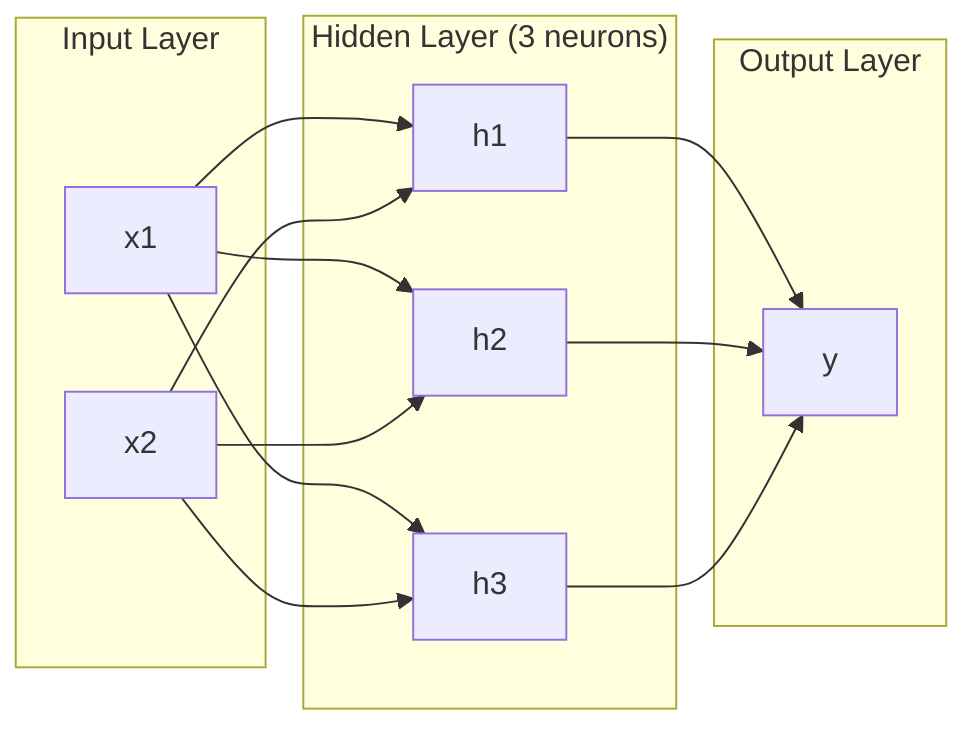
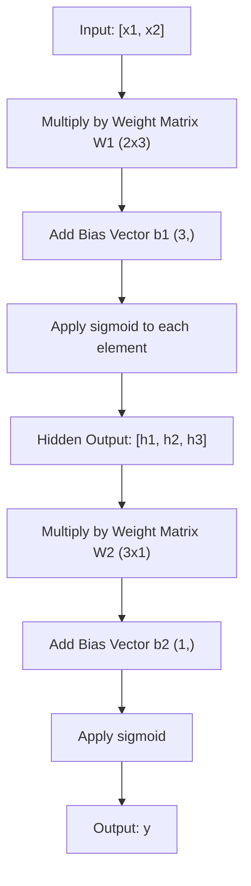
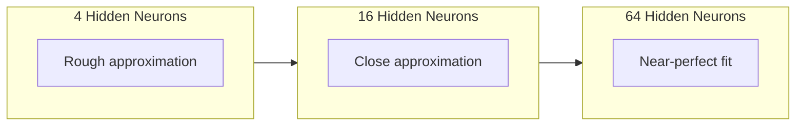

<!-- local-zh-machine-draft: English source is canonical; prose translated automatically, code/math preserved. -->

<a id="multi-layer-networks-and-forward-pass"></a>

# 多层网络和 Forward Pass

> 一个神经元画一条线。把它们叠起来，你就可以画任何东西。

**类型：** 构建
**语言：** Python
**先决条件：** 第 01 阶段（数学基础），第 03.01 课（感知器）
**时间：** ~90 分钟

<a id="learning-objectives"></a>

## 学习目标

- 使用执行完整 forward pass 的 Layer 和 Network 类从头开始构建多层网络
- Trace 网络每一层的矩阵维度并识别形状不匹配
- 解释堆叠非线性激活如何使网络能够学习弯曲的决策边界
- 使用手动调整的 2-2-1 架构解决 XOR 问题 sigmoid weights

<a id="the-problem"></a>

## 问题

单个神经元是一个画线器。就是这样。一条直线穿过您的数据。人工智能中的每个实际问题——图像识别、语言理解、下围棋——都需要曲线。将神经元堆叠成层就是获得曲线的方法。

1969 年，Minsky 和 Papert 证明了这个限制是致命的：单层网络无法学习 XOR。不是“努力学习”——数学上不能。 XOR真值表将[0,1]和[1,0]放在一侧，[0,0]和[1,1] 另一个。没有一条线将它们分开。

这导致神经网络资金被扼杀了十多年。事后看来，解决办法是显而易见的：停止使用一层。将神经元堆叠成层。让第一层将输入空间雕刻成新的 features，并让第二层将这些 features 组合成单行无法做出的决策。

该堆栈就是多层网络。它是当今生产中每个深度学习模型的基础。 forward pass（从输入通过隐藏层流向输出的数据）是您在其他任何工作之前需要构建的第一件事。

<a id="the-concept"></a>

## 概念

<a id="layers-input-hidden-output"></a>

### 层：输入、隐藏、输出

多层网络具有三种类型的层：

**输入层**——不是真正的层。它保存您的原始数据。两个features表示两个输入节点。这里不进行任何计算。

**H隐藏层**——工作发生的地方。每个神经元获取前一层的每个输出，应用 weights 和偏置，然后将结果传递给 activation function。 “隐藏”是因为您永远不会直接在训练数据中看到这些值。

**输出层**——最终答案。对于二元分类，一个神经元带有 sigmoid。对于多类，每类一个神经元。



这是一个 2-3-1 网络。两个输入，三个隐藏神经元，一个输出。每个连接都带有weight。每个神经元（输入除外）都带有偏差。

每层都会产生一个数字向量，称为隐藏状态。对于文本，隐藏状态增加了维度——将一个单词编码为 768 个数字来捕获语义。对于图像，它们降低了维度——将数百万像素压缩为可管理的表示形式。隐藏状态是学习的所在。

<a id="neurons-and-activations"></a>

### 神经元和激活

每个神经元做三件事：

1. 将每个输入乘以相应的 weight
2. 对所有乘积求和并添加偏差
3. 通过 activation function 传递总和

目前激活为sigmoid：

```
sigmoid(z) = 1 / (1 + e^(-z))
```

Sigmoid 将任何数字压缩到范围 (0, 1) 中。大的正输入推向 1。大的负输入推向 0。零映射到 0.5。这条平滑的曲线使学习成为可能——与感知器的艰难步骤不同，sigmoid 到处都有 gradient。

<a id="forward-pass-how-data-flows"></a>

### Forward Pass：数据如何流动

forward pass 通过网络逐层推送输入数据，直到到达输出。 forward pass 期间不会发生任何学习。这是纯粹的计算：乘法、加法、激活、重复。



在每一层，三个操作依次发生：

```
z = W * input + b       (linear transformation)
a = sigmoid(z)           (activation)
```

一层的输出成为下一层的输入。那就是整个forward pass。

<a id="matrix-dimensions"></a>

### 矩阵尺寸

跟踪维度是深度学习中最重要的调试技能。这是 2-3-1 网络：

| 步骤 | 操作 | 尺寸 | 结果形状 |
|------|-----------|------------|-------------|
| 输入 | x | -- | (2,) |
| 隐藏线性 | W1 * x + b1 | W1: (3, 2), b1: (3,) | (3,) |
| 隐藏激活 | sigmoid(z1) | -- | (3,) |
| 输出线性 | W2 * h + b2 | W2: (1, 3), b2: (1,) | (1,) |
| 输出激活 | sigmoid(z2) | -- | (1,) |

规则：weight k层矩阵W具有形状（神经元_in_layer_k，神经元_in_layer_k_minus_1)。行与当前层匹配。列与上一层匹配。如果形状没有对齐，则说明存在错误。

<a id="universal-approximation-theorem"></a>

### 通用逼近定理

1989 年，George Cybenko 证明了一些了不起的事情：具有单个隐藏层和足够神经元的神经网络可以将任何连续函数逼近到任何所需的精度。

这并不意味着一个隐藏层总是最好的。这意味着该架构在理论上是可行的。在实践中，更深的网络（更多层，每层更少的神经元）学习相同的功能，而 parameters 总数比浅层网络少得多。这就是深度学习起作用的原因。

直觉：隐藏层中的每个神经元都会学习一个“凹凸”或 feature。在正确的位置放置足够的凹凸可以近似任何平滑的曲线。更多的神经元，更多的凹凸，更好的近似。



<a id="composability"></a>

### 可组合性

神经网络是可组合的。您可以堆叠它们、链接它们、并行运行它们。 Whisper 模型使用 encoder 网络来处理音频，并使用单独的 decoder 网络来生成文本。现代 LLMs 仅限 decoder。 BERT 仅限 encoder。 T5是encoder-decoder。架构选择定义了模型可以做什么。

```figure
mlp-forward
```

<a id="build-it"></a>

## 动手实现

纯Python。没有 numpy。每个矩阵运算都是从头开始编写的。

<a id="step-1-sigmoid-activation"></a>

### 步骤1：Sigmoid激活

```python
import math

def sigmoid(x):
    x = max(-500.0, min(500.0, x))
    return 1.0 / (1.0 + math.exp(-x))
```

[-500、500] 的钳位可防止溢出。 `math.exp(500)`很大但有限。 `math.exp(1000)` 是无穷大。

<a id="step-2-layer-class"></a>

### 第2步：图层类

所有深度学习中最重要的运算是矩阵乘法。每一层，每个 attention 头，每个 forward pass —— 一直到下都是 matmuls。线性层采用输入向量，将其乘以 weight 矩阵，并添加偏置向量：y = Wx + b。这个方程占神经网络中 90% 的计算量。

一层包含一个 weight 矩阵和一个偏置向量。它的前向方法接受输入向量并返回激活的输出。

```python
class Layer:
    def __init__(self, n_inputs, n_neurons, weights=None, biases=None):
        if weights is not None:
            self.weights = weights
        else:
            import random
            self.weights = [
                [random.uniform(-1, 1) for _ in range(n_inputs)]
                for _ in range(n_neurons)
            ]
        if biases is not None:
            self.biases = biases
        else:
            self.biases = [0.0] * n_neurons

    def forward(self, inputs):
        self.last_input = inputs
        self.last_output = []
        for neuron_idx in range(len(self.weights)):
            z = sum(
                w * x for w, x in zip(self.weights[neuron_idx], inputs)
            )
            z += self.biases[neuron_idx]
            self.last_output.append(sigmoid(z))
        return self.last_output
```

weight 矩阵具有形状（n_ 神经元，n_ 输入）。每行是一个神经元的所有输入的 weights。前向方法循环遍历神经元，计算加权和加上偏差，应用 sigmoid，并收集结果。

<a id="step-3-network-class"></a>

### 第三步：网络课程

网络是层的列表。 forward pass 将它们链接起来：第 k 层的输出馈送到第 k+1 层。

```python
class Network:
    def __init__(self, layers):
        self.layers = layers

    def forward(self, inputs):
        current = inputs
        for layer in self.layers:
            current = layer.forward(current)
        return current
```

那就是整个forward pass。四行逻辑。数据进入，流经每一层，从另一侧流出。

<a id="step-4-xor-with-hand-tuned-weights"></a>

### 第 4 步：使用手动调整的 Weights 进行异或

在第 01 课中，我们通过组合 OR、NAND 和 AND 感知器来解决 XOR。现在对我们的 Layer 和 Network 类做同样的事情。 2-2-1 架构：两个输入、两个隐藏神经元、一个输出。

```python
hidden = Layer(
    n_inputs=2,
    n_neurons=2,
    weights=[[20.0, 20.0], [-20.0, -20.0]],
    biases=[-10.0, 30.0],
)

output = Layer(
    n_inputs=2,
    n_neurons=1,
    weights=[[20.0, 20.0]],
    biases=[-30.0],
)

xor_net = Network([hidden, output])

xor_data = [
    ([0, 0], 0),
    ([0, 1], 1),
    ([1, 0], 1),
    ([1, 1], 0),
]

for inputs, expected in xor_data:
    result = xor_net.forward(inputs)
    predicted = 1 if result[0] >= 0.5 else 0
    print(f"  {inputs} -> {result[0]:.6f} (rounded: {predicted}, expected: {expected})")
```

大的 weights (20, -20) 使 sigmoid 充当阶跃函数。第一个隐藏神经元近似于 OR。第二个近似于 NAND。输出神经元将它们组合成AND，即XOR。

<a id="step-5-circle-classification"></a>

### 第五步：圆圈分类

一个更难的问题：将 2D 点分类为以原点为中心、半径为 0.5 的圆的内部或外部。这需要一个弯曲的决策边界——对于单个感知器来说是不可能的。

```python
import random
import math

random.seed(42)

data = []
for _ in range(200):
    x = random.uniform(-1, 1)
    y = random.uniform(-1, 1)
    label = 1 if (x * x + y * y) < 0.25 else 0
    data.append(([x, y], label))

circle_net = Network([
    Layer(n_inputs=2, n_neurons=8),
    Layer(n_inputs=8, n_neurons=1),
])
```

使用随机 weights，网络将无法很好地分类。但 forward pass 仍然运行。这就是重点——forward pass 只是计算。学习正确的 weights 是 backpropagation，在第 03 课中出现。

```python
correct = 0
for inputs, expected in data:
    result = circle_net.forward(inputs)
    predicted = 1 if result[0] >= 0.5 else 0
    if predicted == expected:
        correct += 1

print(f"Accuracy with random weights: {correct}/{len(data)} ({100*correct/len(data):.1f}%)")
```

随机 weights 的准确性很差——通常比猜测大多数类别更糟糕。经过训练（第 03 课）后，具有 8 个隐藏神经元的相同架构将绘制一条将内部与外部分开的弯曲边界。

<a id="use-it"></a>

## 实际应用

PyTorch 通过四行完成上述所有操作：

```python
import torch
import torch.nn as nn

model = nn.Sequential(
    nn.Linear(2, 8),
    nn.Sigmoid(),
    nn.Linear(8, 1),
    nn.Sigmoid(),
)

x = torch.tensor([[0.0, 0.0], [0.0, 1.0], [1.0, 0.0], [1.0, 1.0]])
output = model(x)
print(output)
```

`nn.Linear(2, 8)` 是您的图层类：weight 形状为 (8, 2) 的矩阵，形状为 (8,) 的偏置向量。 `nn.Sigmoid()` 是按元素应用的 sigmoid 函数。 `nn.Sequential` 是您的网络类：按顺序链层。

区别在于速度和规模。 PyTorch在GPUs上运行，批量处理数百万个样本，并自动计算backpropagation的gradients。但 forward pass 逻辑与您刚刚从头开始构建的逻辑相同。

<a id="ship-it"></a>

## 交付成果

本课程生成一个可重复使用的 prompt 用于设计网络架构：

- `outputs/prompt-network-architect.md`

当您需要决定有多少层、每层有多少个神经元以及针对给定问题使用哪个 activation functions 时，请使用它。

<a id="exercises"></a>

## 练习

1. 构建 2-4-2-1 网络（两个隐藏层），并使用随机 weights 对 XOR 数据运行 forward pass。打印中间隐藏层输出以查看表示在每一层的转换情况。

2. 将圆形分类器中的隐藏层大小从 8 更改为 2，然后更改为 32。每次使用随机 weights 运行 forward pass。隐藏神经元的数量会改变输出范围或分布吗？为什么？

3. 在 Network 类上实现 `count_parameters` 方法，该方法返回可训练的 weights 和偏差的总数。在 784-256-128-10 网络（经典的 MNIST 架构）上进行测试。它有多少个parameters？

4. 为 3-4-4-2 网络构建 forward pass。向其输入 RGB 颜色值（标准化为 0-1）并观察两个输出。这是具有两个类别的简单颜色分类器的架构。

5. 将 sigmoid 替换为“泄漏步骤”函数：如果 z < 0，则返回 0.01 * z，否则返回 1.0。使用与步骤 4 中相同的手动调整的 weights 在 XOR 上运行 forward pass。它仍然有效吗？为什么光滑 sigmoid 优于硬截止？

<a id="key-terms"></a>

## 关键术语

| 术语 | 人们怎么说 | 它实际上意味着什么 |
|------|----------------|----------------------|
| Forward pass | “运行模型” | 将输入推入每一层——乘以 weights，添加偏置，激活——以产生输出 |
| 隐藏层 | 「中间部分」 | 输入和输出之间的任何层，其值不能在数据中直接观察到 |
| 多层网络 | “深度神经网络” | 神经元层按顺序堆叠，每层的输出提供下一层的输入 |
| Activation function | “非线性” | 线性变换后应用的函数，将曲线引入决策边界 |
| Sigmoid | “S型曲线” | sigma(z) = 1/(1+e^(-z))，将任何实数压缩为 (0,1)，处处平滑且可微 |
| Weight矩阵 | “parameters” | 形状为 W 的矩阵 (current_layer_neurons, previous_layer_neurons)，包含可学习的连接强度 |
| 偏置向量 | “偏移量” | 在矩阵乘法之后添加的向量，即使所有输入为零，也可以让神经元激活 |
| 万能近似 | “神经网络可以学习任何东西” | 具有足够神经元的单个隐藏层可以近似任何连续函数 - 但“足够”可能意味着数十亿 |
| 线性变换 | “矩阵乘法步骤” | z = W * x + b，激活前的计算，将输入映射到新空间 |
| 决策边界 | “分类器切换的地方” | 输入空间中网络输出跨越分类阈值的表面 |

<a id="further-reading"></a>

## 进一步阅读

- Michael Nielsen，《神经网络和深度学习》，第 1-2 章 (http://neuralnetworksanddeeplearning.com/) -- forward passes 和网络结构最清晰的免费解释，具有交互式可视化
- Cybenko，“Approximation by Superpositions of a Sigmoidal Function”（1989）——原始的通用逼近定理论文，可读性令人惊讶
- 3Blue1Brown，“但是什么是神经网络？” (https://www.youtube.com/watch?v=aircAruvnKk) -- 20 分钟的图层视觉演练、weights 和 forward passes，构建正确的心智模型
- Goodfellow、Bengio、Courville，《深度学习》，第 6 章 (https://www.deeplearningbook.org/) -- 多层网络的标准参考，免费在线
