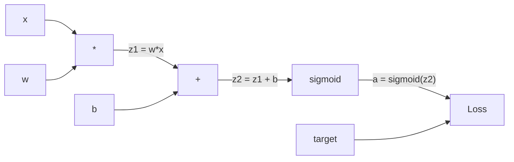
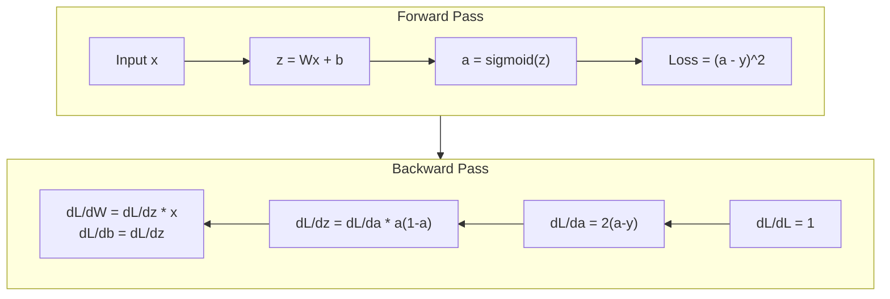
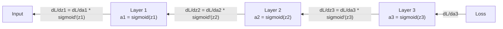

<!-- local-zh-machine-draft: English source is canonical; prose translated automatically, code/math preserved. -->

<a id="backpropagation-from-scratch"></a>

# Backpropagation 从头开始

> Backpropagation 是使学习成为可能的算法。没有它，神经网络只是昂贵的随机数生成器。

**类型：** 构建
**语言：** Python
**先决条件：** 第 03.02 课（多层网络）
**时间：** ~120 分钟

<a id="learning-objectives"></a>

## 学习目标

- 实现基于值的 autograd 引擎，构建计算图并通过拓扑排序计算 gradients
- 使用 chain rule 导出 backward pass 进行加法、乘法以及 sigmoid
- 仅使用从头开始的 backpropagation 引擎在 XOR 和圆分类上训练多层网络
- 识别深层 sigmoid 网络中消失的 gradient 问题，并解释为什么 gradients 呈指数级萎缩

<a id="the-problem"></a>

## 问题

您的网络有一个隐藏层，包含 768 个输入和 3072 个输出。那是 2,359,296 weights。它做出了错误的预测。哪个weights导致了错误？单独测试每个 weight 意味着 230 万个 forward passes。 Backpropagation 在单个 backward pass 中计算所有 230 万个 gradients。这不是一个优化。这就是可训练和不可训练之间的区别。

天真的方法：拿一个 weight，稍微推动它，再次运行 forward pass，测量损失是上升还是下降。这将为您提供 weight 的 gradient。现在对网络中的每个 weight 执行此操作。乘以数千个训练步骤和数百万个数据点。你需要地质时间来训练任何有用的东西。

Backpropagation 解决了这个问题。 1个forward pass，1个backward pass，全部计算为gradients。诀窍是来自微积分的 chain rule，系统地应用于计算图。这是使深度学习变得实用的算法。没有它，我们仍然会陷入玩具问题。

<a id="the-concept"></a>

## 概念

<a id="the-chain-rule-applied-to-networks"></a>

### Chain Rule，应用于网络

您在第 01 阶段第 05 课中看到了 chain rule。快速回顾一下：如果 y = f(g(x))，则 dy/dx = f'(g(x)) * g'(x)。你沿着链条乘以衍生品。

在神经网络中，“链”是从输入到损失的操作序列。每层应用 weights，添加偏差，通过激活。 loss function 将最终输出与目标进行比较。 Backpropagation traces 这条链向后，计算每个操作如何导致错误。

<a id="computational-graphs"></a>

### 计算图

每个 forward pass 都会构建一个图。每个节点都是一个运算（乘、加、sigmoid）。每条边向前携带一个值，向后携带一个 gradient。



Forward pass：值从左到右流动。 x 和 w 产生 z1 = w*x。添加 b 得到 z2。 Sigmoid 给出激活a。使用 loss function 将 a 与目标 y 进行比较。

Backward pass：gradients 从右到左流动。从 dL/da 开始（损耗如何随激活而变化）。乘以 da/dz2（sigmoid 导数）。得出 dL/dz2。分为 dL/db（等于 dL/dz2，因为 z2 = z1 + b）和 dL/dz1。那么 dL/dw = dL/dz1 * x 和 dL/dx = dL/dz1 * w。

图中的每个节点在 backward pass 期间都有一项工作：将来自上面的 gradient 乘以它的局部导数，然后将其传递下去。

<a id="forward-vs-backward"></a>

### 前进与后退



forward pass 存储每个中间值：z、a、每层的输入。 backward pass 需要这些存储值来计算 gradients。这是反向传播核心的内存计算权衡。您可以用内存（存储激活）来换取速度（一次而不是数百万次）。

<a id="gradient-flow-through-a-network"></a>

### Gradient 通过网络的流量

对于 3 层网络，gradients 链穿过每一层：



在每一层，gradient 都会乘以 sigmoid 导数。 sigmoid 导数是 * (1 - a)，其最大值为 0.25（当 a = 0.5 时）。三层深，gradient 最多乘以 0.25^3 = 0.0156。十层深：0.25^10 = 0.000001。

<a id="vanishing-gradients"></a>

### 消失 Gradients

这就是消失的 gradient 问题。 Sigmoid 将其输出压缩在 0 和 1 之间。其导数始终小于 0.25。堆叠足够的 sigmoid 层，并且 gradients 缩小到零。早期层几乎不学习，因为它们收到的 gradients 接近于零。

```
sigmoid(z):     Output range [0, 1]
sigmoid'(z):    Max value 0.25 (at z = 0)

After 5 layers:   gradient * 0.25^5 = 0.001x original
After 10 layers:  gradient * 0.25^10 = 0.000001x original
```

这就是为什么深度 sigmoid 网络几乎不可能训练。修复——ReLU 及其变体——是第 04 课的主题。现在，请了解反向传播完美地工作。问题在于它正在解决什么问题。

<a id="deriving-gradients-for-a-2-layer-network"></a>

### 为 2 层网络派生 Gradients

具有输入 x 的网络、具有 sigmoid 的隐藏层、具有 sigmoid 的输出层和 MSE 损失的网络的具体数学。

Forward pass:
```
z1 = W1 * x + b1
a1 = sigmoid(z1)
z2 = W2 * a1 + b2
a2 = sigmoid(z2)
L = (a2 - y)^2
```

Backward pass（逐步应用chain rule）：
```
dL/da2 = 2(a2 - y)
da2/dz2 = a2 * (1 - a2)
dL/dz2 = dL/da2 * da2/dz2 = 2(a2 - y) * a2 * (1 - a2)

dL/dW2 = dL/dz2 * a1
dL/db2 = dL/dz2

dL/da1 = dL/dz2 * W2
da1/dz1 = a1 * (1 - a1)
dL/dz1 = dL/da1 * da1/dz1

dL/dW1 = dL/dz1 * x
dL/db1 = dL/dz1
```

每一个gradient都是从损失中追溯的本地衍生品的产品。这就是 backpropagation 的全部内容。

```figure
backprop-vanishing
```

<a id="build-it"></a>

## 动手实现

<a id="step-1-the-value-node"></a>

### 第一步：价值节点

我们计算中的每个数字都成为一个值。它存储其数据、gradient 以及它的创建方式（因此它知道如何向后计算 gradients）。

```python
class Value:
    def __init__(self, data, children=(), op=''):
        self.data = data
        self.grad = 0.0
        self._backward = lambda: None
        self._children = set(children)
        self._op = op

    def __repr__(self):
        return f"Value(data={self.data:.4f}, grad={self.grad:.4f})"
```

还没有 gradient (0.0)。还没有向后功能（无操作）。 `_children` 跟踪哪个值产生了这个值，因此我们可以稍后对图进行拓扑排序。

<a id="step-2-operations-with-backward-functions"></a>

### 第 2 步：使用向后函数进行操作

每个操作都会创建一个新值并定义 gradients 如何向后流动。

```python
def __add__(self, other):
    other = other if isinstance(other, Value) else Value(other)
    out = Value(self.data + other.data, (self, other), '+')

    def _backward():
        self.grad += out.grad
        other.grad += out.grad

    out._backward = _backward
    return out

def __mul__(self, other):
    other = other if isinstance(other, Value) else Value(other)
    out = Value(self.data * other.data, (self, other), '*')

    def _backward():
        self.grad += other.data * out.grad
        other.grad += self.data * out.grad

    out._backward = _backward
    return out
```

对于加法：d(a+b)/da = 1，d(a+b)/db = 1。因此两个输入都直接获得输出的 gradient。

对于乘法：d(a*b)/da = b, d(a*b)/db = a。每个输入得到另一个输入的值乘以输出 gradient。

`+=` 至关重要。一个值可以在多个操作中使用。它的gradient是所有路径的gradients的总和。

<a id="step-3-sigmoid-and-loss"></a>

### 步骤3：Sigmoid和损失

```python
import math

def sigmoid(self):
    x = self.data
    x = max(-500, min(500, x))
    s = 1.0 / (1.0 + math.exp(-x))
    out = Value(s, (self,), 'sigmoid')

    def _backward():
        self.grad += (s * (1 - s)) * out.grad

    out._backward = _backward
    return out
```

Sigmoid 导数：sigmoid(x) * (1 - sigmoid(x))。我们在 forward pass 期间计算了 sigmoid(x) = s。重复使用它。无需额外工作。

```python
def mse_loss(predicted, target):
    diff = predicted + Value(-target)
    return diff * diff
```

单个输出的 MSE：（预测 - 目标）^2。我们将减法表示为带有负值的加法。

<a id="step-4-backward-pass"></a>

### 第四步：Backward Pass

拓扑排序确保我们以正确的顺序处理节点——节点的 gradient 在我们传播之前已完全累积。

```python
def backward(self):
    topo = []
    visited = set()

    def build_topo(v):
        if v not in visited:
            visited.add(v)
            for child in v._children:
                build_topo(child)
            topo.append(v)

    build_topo(self)
    self.grad = 1.0
    for v in reversed(topo):
        v._backward()
```

从损失开始（gradient = 1.0，因为 dL/dL = 1）。向后遍历已排序的图。每个节点的 `_backward` 将 gradients 推送给其子节点。

<a id="step-5-layer-and-network"></a>

### 第 5 步：层和网络

```python
import random

class Neuron:
    def __init__(self, n_inputs):
        scale = (2.0 / n_inputs) ** 0.5
        self.weights = [Value(random.uniform(-scale, scale)) for _ in range(n_inputs)]
        self.bias = Value(0.0)

    def __call__(self, x):
        act = sum((wi * xi for wi, xi in zip(self.weights, x)), self.bias)
        return act.sigmoid()

    def parameters(self):
        return self.weights + [self.bias]


class Layer:
    def __init__(self, n_inputs, n_outputs):
        self.neurons = [Neuron(n_inputs) for _ in range(n_outputs)]

    def __call__(self, x):
        out = [n(x) for n in self.neurons]
        return out[0] if len(out) == 1 else out

    def parameters(self):
        params = []
        for n in self.neurons:
            params.extend(n.parameters())
        return params


class Network:
    def __init__(self, sizes):
        self.layers = []
        for i in range(len(sizes) - 1):
            self.layers.append(Layer(sizes[i], sizes[i + 1]))

    def __call__(self, x):
        for layer in self.layers:
            x = layer(x)
            if not isinstance(x, list):
                x = [x]
        return x[0] if len(x) == 1 else x

    def parameters(self):
        params = []
        for layer in self.layers:
            params.extend(layer.parameters())
        return params

    def zero_grad(self):
        for p in self.parameters():
            p.grad = 0.0
```

神经元获取输入，计算加权和+偏差，并应用 sigmoid。 Weight 初始化按 sqrt(2/n_inputs) 缩放，以防止 sigmoid saturation 在更深的网络中。层是神经元的列表。网络是层的列表。 `parameters()` 方法收集所有可学习的值，以便我们可以更新它们。

<a id="step-6-train-on-xor"></a>

### 第 6 步：异或训练

```python
random.seed(42)
net = Network([2, 4, 1])

xor_data = [
    ([0.0, 0.0], 0.0),
    ([0.0, 1.0], 1.0),
    ([1.0, 0.0], 1.0),
    ([1.0, 1.0], 0.0),
]

learning_rate = 1.0

for epoch in range(1000):
    total_loss = Value(0.0)
    for inputs, target in xor_data:
        x = [Value(i) for i in inputs]
        pred = net(x)
        loss = mse_loss(pred, target)
        total_loss = total_loss + loss

    net.zero_grad()
    total_loss.backward()

    for p in net.parameters():
        p.data -= learning_rate * p.grad

    if epoch % 100 == 0:
        print(f"Epoch {epoch:4d} | Loss: {total_loss.data:.6f}")

print("\nXOR Results:")
for inputs, target in xor_data:
    x = [Value(i) for i in inputs]
    pred = net(x)
    print(f"  {inputs} -> {pred.data:.4f} (expected {target})")
```

观察损失减少。从随机预测到正确的 XOR 输出，完全由 backpropagation 计算 gradients 并将 weights 推向正确的方向驱动。

<a id="step-7-circle-classification"></a>

### 第7步：圆圈分类

在第 02 课中，您手动调整了 weights 以进行圆分类。现在让网络来学习它们。

```python
random.seed(7)

def generate_circle_data(n=100):
    data = []
    for _ in range(n):
        x1 = random.uniform(-1.5, 1.5)
        x2 = random.uniform(-1.5, 1.5)
        label = 1.0 if x1 * x1 + x2 * x2 < 1.0 else 0.0
        data.append(([x1, x2], label))
    return data

circle_data = generate_circle_data(80)

circle_net = Network([2, 8, 1])
learning_rate = 0.5

for epoch in range(2000):
    random.shuffle(circle_data)
    total_loss_val = 0.0
    for inputs, target in circle_data:
        x = [Value(i) for i in inputs]
        pred = circle_net(x)
        loss = mse_loss(pred, target)
        circle_net.zero_grad()
        loss.backward()
        for p in circle_net.parameters():
            p.data -= learning_rate * p.grad
        total_loss_val += loss.data

    if epoch % 200 == 0:
        correct = 0
        for inputs, target in circle_data:
            x = [Value(i) for i in inputs]
            pred = circle_net(x)
            predicted_class = 1.0 if pred.data > 0.5 else 0.0
            if predicted_class == target:
                correct += 1
        accuracy = correct / len(circle_data) * 100
        print(f"Epoch {epoch:4d} | Loss: {total_loss_val:.4f} | Accuracy: {accuracy:.1f}%")
```

我们在这里使用在线 SGD——在每个样本之后更新 weights，而不是累积整个批次。这会更快地打破对称性，并避免在完全损失情况下出现 sigmoid saturation。对每个 epoch 的数据进行打乱可以防止网络记住顺序。

无需手动调节。网络自行发现循环决策边界。这就是 backpropagation 的力量：您可以定义架构、loss function 和数据。该算法计算出 weights。

<a id="use-it"></a>

## 实际应用

PyTorch 只需几行即可完成上述所有操作。核心思想是相同的——autograd在forward pass和traces期间构建计算图，向后计算gradients。

```python
import torch
import torch.nn as nn

model = nn.Sequential(
    nn.Linear(2, 4),
    nn.Sigmoid(),
    nn.Linear(4, 1),
    nn.Sigmoid(),
)
optimizer = torch.optim.SGD(model.parameters(), lr=1.0)
criterion = nn.MSELoss()

X = torch.tensor([[0,0],[0,1],[1,0],[1,1]], dtype=torch.float32)
y = torch.tensor([[0],[1],[1],[0]], dtype=torch.float32)

for epoch in range(1000):
    pred = model(X)
    loss = criterion(pred, y)
    optimizer.zero_grad()
    loss.backward()
    optimizer.step()

print("PyTorch XOR Results:")
with torch.no_grad():
    for i in range(4):
        pred = model(X[i])
        print(f"  {X[i].tolist()} -> {pred.item():.4f} (expected {y[i].item()})")
```

`loss.backward()` 是您的 `total_loss.backward()`。 `optimizer.step()` 是您的手册 `p.data -= lr * p.grad`。 `optimizer.zero_grad()` 是您的 `net.zero_grad()`。相同的算法，工业强度的实施。 PyTorch 处理 GPU 加速、mixed precision、gradient 检查点和数百种图层类型。但 backward pass 与应用于相同计算图的 chain rule 相同。

训练运行 forward pass，然后运行 backward pass，然后更新 weights。 Inference 仅运行 forward pass。没有 gradients，没有更新。这种区别很重要，因为 inference 是生产中发生的情况。当您调用API（如Claude或GPT）时，您正在运行inference——您的prompt通过网络向前流动，而tokens从另一端出来。 weights 没有变化。了解反向传播很重要，因为它塑造了该网络中的每个 weight。

<a id="ship-it"></a>

## 交付成果

本课产生：
- `outputs/prompt-gradient-debugger.md`——可重复使用的prompt，用于诊断任何神经网络中的gradient问题（消失、爆炸、NaN）

<a id="exercises"></a>

## 练习

1. 将 `__sub__` 方法添加到 Value 类 (a - b = a + (-1 * b))。然后实现一个`__neg__`方法。通过与 (a - b)^2 等简单表达式的手动计算进行比较，验证 gradients 是否正确。

2. 将 `relu` 方法添加到 Value（输出 max(0, x)，如果 x > 0，则导数为 1，否则为 0）。将隐藏层中的 sigmoid 替换为 relu 并再次进行 XOR 训练。比较收敛速度。您应该看到更快的训练——这是第 04 课的预览。

3. 对整数幂的 Value 实现 `__pow__` 方法。使用它将 `mse_loss` 替换为正确的 `(predicted - target) ** 2` 表达式。验证 gradients 与原始实现是否匹配。

4. 将gradient clipping添加到训练循环中：调用`backward()`后，将所有gradients剪辑到[-1、1]。训练更深的网络（使用 sigmoid 的 4+ 层）并比较有和没有裁剪的损失曲线。这是您对 gradients 爆炸的第一道防御。

5. 构建可视化：在 XOR 训练后，打印网络中每个 parameter 的 gradient。确定哪一层的 gradients 最小。这演示了您在概念部分读到的消失的 gradient 问题。

<a id="key-terms"></a>

## 关键术语

| 术语 | 人们怎么说 | 它实际上意味着什么 |
|------|----------------|----------------------|
| Backpropagation | “网络学习” | 通过计算图向后应用 chain rule 来计算每个 weight 的 dL/dw 的算法 |
| 计算图 | 《网络结构》 | 有向无环图，其中节点是操作，边携带值（向前）和 gradients （向后） |
| Chain rule | “乘以导数” | 如果 y = f(g(x))，则 dy/dx = f'(g(x)) * g'(x) -- backpropagation 的数学基础 |
| Gradient | “最陡上升的方向” | 损失相对于 parameter 的偏导数 -- 告诉您如何更改 parameter 以减少损失 |
| 消失 gradient | “深度网络不会学习” | Gradients当它们通过具有饱和激活的层传播时呈指数收缩，例如sigmoid |
| Forward pass | 《运行网络》 | 通过顺序应用每一层的操作并存储中间值来计算输入的输出 |
| Backward pass | 《计算gradients》 | 反向遍历计算图，使用chain rule在每个节点累加gradients |
| Learning rate | “它学得有多快” | 控制更新 weights 时步长的标量： w_new = w_old - lr * gradient |
| 拓扑排序 | “正确的顺序” | 图节点的排序，其中每个节点出现在它所依赖的所有节点之后 - 确保 gradients 在传播之前完全累积 |
| Autograd | “自动微分” | 一个在正向计算期间构建计算图并自动计算 gradients 的系统——PyTorch 的引擎做什么 |

<a id="further-reading"></a>

## 进一步阅读

- Rumelhart、Hinton 和 Williams，“通过反向传播错误学习表示”（1986 年）——这篇论文使 backpropagation 成为主流并解锁了多层网络训练
- 3Blue1Brown，《神经网络》系列（https://www.youtube.com/playlist?list=PLZHQObOWTQDNU6R1_67000Dx_ZCJB-3pi ）——backpropagation和gradient流经网络的最佳视觉解释
