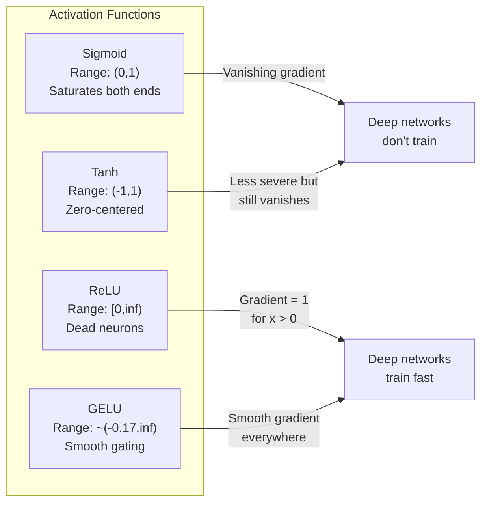
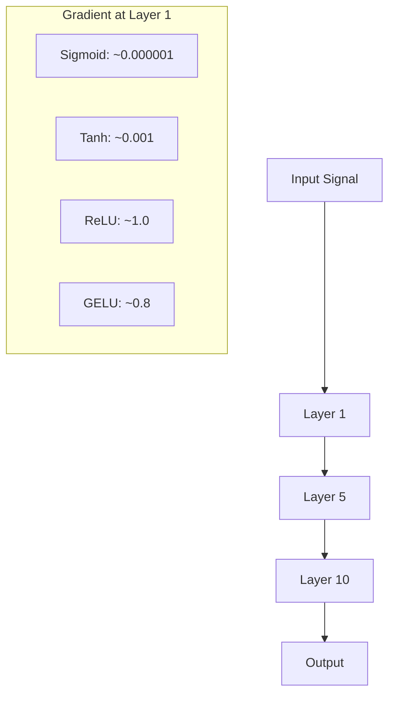
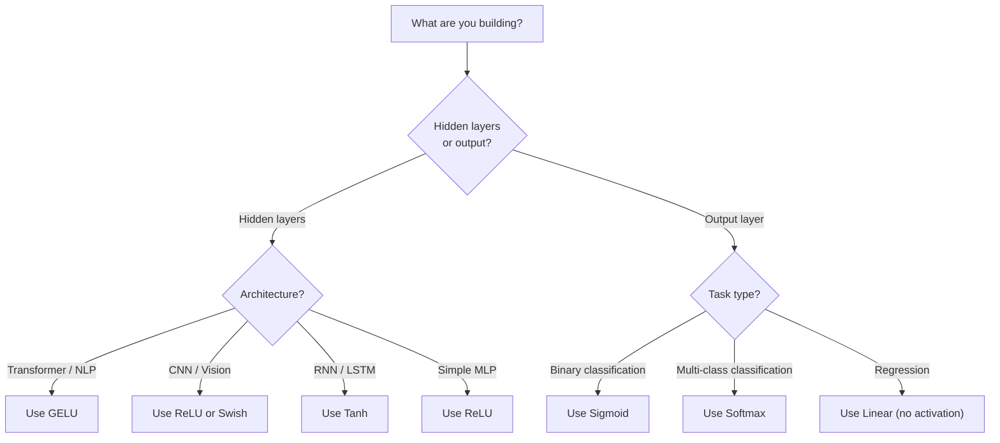

<!-- local-zh-machine-draft: English source is canonical; prose translated automatically, code/math preserved. -->

<a id="activation-functions"></a>

# Activation Functions

> 如果没有非线性，您的 100 层网络就是一个奇特的矩阵乘法。激活是让神经网络以曲线方式思考的大门。

**类型：** 构建
**语言：** Python
**先决条件：** 第 03.03 课 (Backpropagation)
**时间：** ~75分钟

<a id="learning-objectives"></a>

## 学习目标

- 从头开始实施 sigmoid、tanh、ReLU、Leaky ReLU、GELU、Swish 和 softmax 及其衍生产品
- 通过测量具有不同激活的 10 多个层的激活幅度来诊断消失的 gradient 问题
- 检测 ReLU 网络中的死亡神经元并解释为什么 GELU 可以避免这种故障模式
- 为给定架构选择正确的activation function（transformer、CNN、RNN，输出层）

<a id="the-problem"></a>

## 问题

堆叠两个线性变换：y = W2(W1x + b1) + b2。将其展开：y = W2W1x + W2b1 + b2。这只是 y = Ax + c——一个单一的线性变换。无论堆叠多少个线性层，结果都会折叠为一个矩阵乘法。您的 100 层网络具有与单层相同的表示能力。

这不是理论上的好奇心。这意味着深度线性网络实际上无法学习异或，无法对螺旋数据集进行分类，无法识别人脸。没有activation functions，深度就是一种幻觉。

Activation functions 打破线性。它们通过非线性函数扭曲每一层的输出，使网络能够弯曲决策边界、逼近任意函数并进行实际学习。但是选择错误的激活，你的 gradients 会消失为零（深度网络中的 sigmoid），爆炸到无穷大（没有仔细初始化的无界激活），或者你的神经元永久死亡（ReLU 具有较大的负偏差）。 activation function 的选择直接决定你的网络是否能够学习。

<a id="the-concept"></a>

## 概念

<a id="why-nonlinearity-is-necessary"></a>

### 为什么需要非线性

矩阵乘法是可组合的。将向量乘以矩阵 A，然后矩阵 B 与乘以 AB 相同。这意味着堆叠十个线性层在数学上相当于一个线性层和一个大矩阵。所有这些 parameters，所有的深度——都被浪费了。你需要一些东西来打破链条。这就是 activation functions 所做的。

这是证据。线性层计算 f(x) = Wx + b。堆栈二：

```
Layer 1: h = W1 * x + b1
Layer 2: y = W2 * h + b2
```

替补：

```
y = W2 * (W1 * x + b1) + b2
y = (W2 * W1) * x + (W2 * b1 + b2)
y = A * x + c
```

一层。在层之间插入非线性激活 g()：

```
h = g(W1 * x + b1)
y = W2 * h + b2
```

现在替换中断了。 W2 * g(W1 * x + b1) + b2 不能简化为单个线性变换。该网络可以表示非线性函数。每个具有激活的附加层都会增加表示能力。

<a id="sigmoid"></a>

### Sigmoid

原始的 activation function 用于神经网络。

```
sigmoid(x) = 1 / (1 + e^(-x))
```

输出范围：(0, 1)。平滑、可微，将任何实数映射到类似概率的值。

导数：

```
sigmoid'(x) = sigmoid(x) * (1 - sigmoid(x))
```

该导数的最大值为 0.25，发生在 x = 0 时。在 backpropagation 中，gradients 逐层相乘。十层 sigmoid 意味着 gradient 最多乘以 0.25 十倍：

```
0.25^10 = 0.000000953674
```

不到原始信号的百万分之一。这就是消失的 gradient 问题。早期层中的 Gradients 变得非常小，以至于 weights 几乎不更新。网络似乎在学习——后面层的损失减少——但第一层被冻结。深层 sigmoid 网络根本不进行训练。

附加问题： sigmoid 输出始终为正（0 到 1），这意味着 weights 上的 gradients 始终具有相同的符号。这会导致 gradient descent 期间出现锯齿状。

<a id="tanh"></a>

### 谭

sigmoid 的居中版本。

```
tanh(x) = (e^x - e^(-x)) / (e^x + e^(-x))
```

输出范围：(-1, 1)。以零为中心，消除了之字形问题。

导数：

```
tanh'(x) = 1 - tanh(x)^2
```

x = 0 时的最大导数为 1.0——比 sigmoid 好四倍。但消失的gradient问题仍然存在。对于大的正或负输入，导数接近于零。十层仍然压碎 gradient，只是不那么激进。

<a id="relu-the-breakthrough"></a>

### ReLU：突破

修正线性单元。 Nair 和 Hinton 于 2010 年因深度学习而普及（该函数本身可以追溯到 Fukushima 1969 年的工作），它改变了一切。

```
relu(x) = max(0, x)
```

输出范围：[0，无穷大）。导数非常简单：

```
relu'(x) = 1  if x > 0
            0  if x <= 0
```

对于正输入，gradient 不会消失。 gradient 正好是1，直接通过。这就是深度网络变得可训练的原因——ReLU 跨层保留了 gradient 的大小。

但有一个失败模式：死亡神经元问题。如果神经元的加权输入始终为负（由于较大的负偏差或不幸的 weight 初始化），则其输出始终为零，其 gradient 始终为零，并且永远不会更新。它已经永久死亡了。实际上，ReLU 网络中 10-40% 的神经元可能会在训练期间死亡。

<a id="leaky-relu"></a>

### 泄漏 ReLU

对死亡神经元最简单的修复。

```
leaky_relu(x) = x        if x > 0
                alpha * x if x <= 0
```

其中 alpha 是一个小常数，通常为 0.01。负侧的斜率很小而不是零，因此死亡的神经元仍然会收到 gradient 信号并且可以恢复。

<a id="gelu-the-modern-default"></a>

### GELU：现代默认值

高斯误差线性单元。由 Hendrycks 和 Gimpel 于 2016 年推出。在 BERT、GPT 和最现代的 transformers 中默认激活。

```
gelu(x) = x * Phi(x)
```

其中 Phi(x) 是标准正态分布的累积分布函数。实际中使用的近似值：

```
gelu(x) ~= 0.5 * x * (1 + tanh(sqrt(2/pi) * (x + 0.044715 * x^3)))
```

GELU 处处平滑，允许较小的负值（与硬剪辑为零的 ReLU 不同），并且具有概率解释：weights 每个输入在高斯分布下为正的可能性有多大。这种平滑的门控在 transformer 架构中优于 ReLU，因为它提供了更好的 gradient 流程并完全避免了死神经元问题。

<a id="swish--silu"></a>

### 嗖嗖 / SiLU

Ramachandran 等人发现的自门控激活。 2017年通过自动搜索。

```
swish(x) = x * sigmoid(x)
```

Swish 的正式名称为 x * sigmoid(x)。谷歌通过 activation function 空间（一个设计神经网络部分的神经网络）的自动搜索发现了它。

与 GELU 一样，它是平滑的、非单调的，并且允许小的负值。区别很微妙：Swish 使用 sigmoid 进行门控，而 GELU 使用高斯 CDF。实际上，性能几乎相同。 Swish 用于 EfficientNet 和一些视觉模型。 GELU 在语言模型中占据主导地位。

<a id="softmax-the-output-activation"></a>

### Softmax：输出激活

不用于隐藏层。 Softmax 将原始分数向量 (logits) 转换为概率分布。

```
softmax(x_i) = e^(x_i) / sum(e^(x_j) for all j)
```

每个输出都在 0 到 1 之间。所有输出总和为 1。这使其成为多类分类的标准最终激活。最大的 logit 获得最高的概率，但与 argmax 不同，softmax 是可微分的，并保留有关相对置信度的信息。

<a id="comparison-of-shapes"></a>

### 形状比较



<a id="gradient-flow-comparison"></a>

### Gradient 流量对比



<a id="which-activation-when"></a>

### 何时激活



```figure
softmax-temperature
```

<a id="build-it"></a>

## 动手实现

<a id="step-1-implement-all-activation-functions-with-derivatives"></a>

### 步骤1：用衍生品实现所有Activation Functions

每个函数接受一个浮点数并返回一个浮点数。每个导数函数采用相同的输入并返回 gradient。

```python
import math

def sigmoid(x):
    x = max(-500, min(500, x))
    return 1.0 / (1.0 + math.exp(-x))

def sigmoid_derivative(x):
    s = sigmoid(x)
    return s * (1 - s)

def tanh_act(x):
    return math.tanh(x)

def tanh_derivative(x):
    t = math.tanh(x)
    return 1 - t * t

def relu(x):
    return max(0.0, x)

def relu_derivative(x):
    return 1.0 if x > 0 else 0.0

def leaky_relu(x, alpha=0.01):
    return x if x > 0 else alpha * x

def leaky_relu_derivative(x, alpha=0.01):
    return 1.0 if x > 0 else alpha

def gelu(x):
    return 0.5 * x * (1 + math.tanh(math.sqrt(2 / math.pi) * (x + 0.044715 * x ** 3)))

def gelu_derivative(x):
    phi = 0.5 * (1 + math.erf(x / math.sqrt(2)))
    pdf = math.exp(-0.5 * x * x) / math.sqrt(2 * math.pi)
    return phi + x * pdf

def swish(x):
    return x * sigmoid(x)

def swish_derivative(x):
    s = sigmoid(x)
    return s + x * s * (1 - s)

def softmax(xs):
    max_x = max(xs)
    exps = [math.exp(x - max_x) for x in xs]
    total = sum(exps)
    return [e / total for e in exps]
```

<a id="step-2-visualize-where-gradients-die"></a>

### 第 2 步：可视化 Gradients 死亡的位置

计算 -5 到 5 之间 100 个均匀间隔点处的 gradient。打印文本直方图，显示每个激活的 gradient 接近于零的位置。

```python
def gradient_scan(name, derivative_fn, start=-5, end=5, n=100):
    step = (end - start) / n
    near_zero = 0
    healthy = 0
    for i in range(n):
        x = start + i * step
        g = derivative_fn(x)
        if abs(g) < 0.01:
            near_zero += 1
        else:
            healthy += 1
    pct_dead = near_zero / n * 100
    print(f"{name:15s}: {healthy:3d} healthy, {near_zero:3d} near-zero ({pct_dead:.0f}% dead zone)")

gradient_scan("Sigmoid", sigmoid_derivative)
gradient_scan("Tanh", tanh_derivative)
gradient_scan("ReLU", relu_derivative)
gradient_scan("Leaky ReLU", leaky_relu_derivative)
gradient_scan("GELU", gelu_derivative)
gradient_scan("Swish", swish_derivative)
```

<a id="step-3-vanishing-gradient-experiment"></a>

### 第三步：消失Gradient实验

使用 sigmoid 与 ReLU 将信号前向传递通过 N 层。测量激活幅度如何变化。

```python
import random

def vanishing_gradient_experiment(activation_fn, name, n_layers=10, n_inputs=5):
    random.seed(42)
    values = [random.gauss(0, 1) for _ in range(n_inputs)]

    print(f"\n{name} through {n_layers} layers:")
    for layer in range(n_layers):
        weights = [random.gauss(0, 1) for _ in range(n_inputs)]
        z = sum(w * v for w, v in zip(weights, values))
        activated = activation_fn(z)
        magnitude = abs(activated)
        bar = "#" * int(magnitude * 20)
        print(f"  Layer {layer+1:2d}: magnitude = {magnitude:.6f} {bar}")
        values = [activated] * n_inputs

vanishing_gradient_experiment(sigmoid, "Sigmoid")
vanishing_gradient_experiment(relu, "ReLU")
vanishing_gradient_experiment(gelu, "GELU")
```

<a id="step-4-dead-neuron-detector"></a>

### 第四步：死亡神经元检测器

创建一个 ReLU 网络，通过它传递随机输入，计算有多少神经元从未放电。

```python
def dead_neuron_detector(n_inputs=5, hidden_size=20, n_samples=1000):
    random.seed(0)
    weights = [[random.gauss(0, 1) for _ in range(n_inputs)] for _ in range(hidden_size)]
    biases = [random.gauss(0, 1) for _ in range(hidden_size)]

    fire_counts = [0] * hidden_size

    for _ in range(n_samples):
        inputs = [random.gauss(0, 1) for _ in range(n_inputs)]
        for neuron_idx in range(hidden_size):
            z = sum(w * x for w, x in zip(weights[neuron_idx], inputs)) + biases[neuron_idx]
            if relu(z) > 0:
                fire_counts[neuron_idx] += 1

    dead = sum(1 for c in fire_counts if c == 0)
    rarely_fire = sum(1 for c in fire_counts if 0 < c < n_samples * 0.05)
    healthy = hidden_size - dead - rarely_fire

    print(f"\nDead Neuron Report ({hidden_size} neurons, {n_samples} samples):")
    print(f"  Dead (never fired):     {dead}")
    print(f"  Barely alive (<5%):     {rarely_fire}")
    print(f"  Healthy:                {healthy}")
    print(f"  Dead neuron rate:       {dead/hidden_size*100:.1f}%")

    for i, c in enumerate(fire_counts):
        status = "DEAD" if c == 0 else "WEAK" if c < n_samples * 0.05 else "OK"
        bar = "#" * (c * 40 // n_samples)
        print(f"  Neuron {i:2d}: {c:4d}/{n_samples} fires [{status:4s}] {bar}")

dead_neuron_detector()
```

<a id="step-5-training-comparison----sigmoid-vs-relu-vs-gelu"></a>

### 第5步：训练比较——Sigmoid vs ReLU vs GELU

使用三种不同的激活在圆数据集上训练相同的两层网络（圆内的点 = 类 1，圆外的点 = 类 0）。比较收敛速度。

```python
def make_circle_data(n=200, seed=42):
    random.seed(seed)
    data = []
    for _ in range(n):
        x = random.uniform(-2, 2)
        y = random.uniform(-2, 2)
        label = 1.0 if x * x + y * y < 1.5 else 0.0
        data.append(([x, y], label))
    return data


class ActivationNetwork:
    def __init__(self, activation_fn, activation_deriv, hidden_size=8, lr=0.1):
        random.seed(0)
        self.act = activation_fn
        self.act_d = activation_deriv
        self.lr = lr
        self.hidden_size = hidden_size

        self.w1 = [[random.gauss(0, 0.5) for _ in range(2)] for _ in range(hidden_size)]
        self.b1 = [0.0] * hidden_size
        self.w2 = [random.gauss(0, 0.5) for _ in range(hidden_size)]
        self.b2 = 0.0

    def forward(self, x):
        self.x = x
        self.z1 = []
        self.h = []
        for i in range(self.hidden_size):
            z = self.w1[i][0] * x[0] + self.w1[i][1] * x[1] + self.b1[i]
            self.z1.append(z)
            self.h.append(self.act(z))

        self.z2 = sum(self.w2[i] * self.h[i] for i in range(self.hidden_size)) + self.b2
        self.out = sigmoid(self.z2)
        return self.out

    def backward(self, target):
        error = self.out - target
        d_out = error * self.out * (1 - self.out)

        for i in range(self.hidden_size):
            d_h = d_out * self.w2[i] * self.act_d(self.z1[i])
            self.w2[i] -= self.lr * d_out * self.h[i]
            for j in range(2):
                self.w1[i][j] -= self.lr * d_h * self.x[j]
            self.b1[i] -= self.lr * d_h
        self.b2 -= self.lr * d_out

    def train(self, data, epochs=200):
        losses = []
        for epoch in range(epochs):
            total_loss = 0
            correct = 0
            for x, y in data:
                pred = self.forward(x)
                self.backward(y)
                total_loss += (pred - y) ** 2
                if (pred >= 0.5) == (y >= 0.5):
                    correct += 1
            avg_loss = total_loss / len(data)
            accuracy = correct / len(data) * 100
            losses.append(avg_loss)
            if epoch % 50 == 0 or epoch == epochs - 1:
                print(f"    Epoch {epoch:3d}: loss={avg_loss:.4f}, accuracy={accuracy:.1f}%")
        return losses


data = make_circle_data()

configs = [
    ("Sigmoid", sigmoid, sigmoid_derivative),
    ("ReLU", relu, relu_derivative),
    ("GELU", gelu, gelu_derivative),
]

results = {}
for name, act_fn, act_d_fn in configs:
    print(f"\n=== Training with {name} ===")
    net = ActivationNetwork(act_fn, act_d_fn, hidden_size=8, lr=0.1)
    losses = net.train(data, epochs=200)
    results[name] = losses

print("\n=== Final Loss Comparison ===")
for name, losses in results.items():
    print(f"  {name:10s}: start={losses[0]:.4f} -> end={losses[-1]:.4f} (improvement: {(1 - losses[-1]/losses[0])*100:.1f}%)")
```

<a id="use-it"></a>

## 实际应用

PyTorch 以功能和模块形式提供所有这些：

```python
import torch
import torch.nn as nn
import torch.nn.functional as F

x = torch.randn(4, 10)

relu_out = F.relu(x)
gelu_out = F.gelu(x)
sigmoid_out = torch.sigmoid(x)
swish_out = F.silu(x)

logits = torch.randn(4, 5)
probs = F.softmax(logits, dim=1)

model = nn.Sequential(
    nn.Linear(10, 64),
    nn.GELU(),
    nn.Linear(64, 32),
    nn.GELU(),
    nn.Linear(32, 5),
)
```

transformer 中的隐藏层：GELU。 CNN 中的隐藏层：ReLU。分类输出层：softmax。回归输出层：无（线性）。概率输出层：sigmoid。就是这样。从这些默认值开始。仅当有证据时才更改它们。

RNNs 和 LSTM 使用 tanh 表示隐藏状态，使用 sigmoid 表示门，但如果您今天从头开始构建，则可能不会使用 RNNs。如果您的 ReLU 网络中的神经元正在死亡，请切换到 GELU。除非您有特定原因，否则不要使用 Leaky ReLU - GELU 解决了死亡神经元问题并提供了更好的 gradient 流程。

<a id="ship-it"></a>

## 交付成果

本课产生：
- `outputs/prompt-activation-selector.md`——可重复使用的prompt，帮助您为任何架构选择合适的activation function

<a id="exercises"></a>

## 练习

1. 实现参数化 ReLU (PReLU)，其中负斜率 alpha 是可学习的 parameter。在圆形数据集上对其进行训练，并与修复的 Leaky ReLU 进行比较。

2. 使用 50 层（而不是 10 层）运行消失的 gradient 实验。绘制 sigmoid、tanh、ReLU 和 GELU 每层的幅度。每个激活的信号在哪一层有效地达到零？

3. 实现 ELU（指数线性单元）：如果 x > 0，则 elu(x) = x；如果 x <= 0，则 alpha * (e^x - 1)。将其死神经元率与同一网络上的 ReLU 进行比较。

4. 构建一个在训练期间运行的“gradient 健康监视器”：在每个 epoch 处，计算每层的平均 gradient 幅度。当任何图层的 gradient 低于 0.001 或超过 100 时，打印警告。

5. 修改训练比较以使用第 01 课中的 XOR 数据集而不是圆圈。哪个激活在 XOR 上收敛得最快？为什么这与循环结果不同？

<a id="key-terms"></a>

## 关键术语

| 术语 | 人们怎么说 | 它实际上意味着什么 |
|------|----------------|----------------------|
| Activation function | 「非线性部分」 | 应用于每个神经元输出的打破线性的函数，使网络能够学习非线性映射 |
| 消失 gradient | “Gradients在深层网络中消失” | 当激活的导数小于 1 时，Gradients 通过层呈指数收缩，使得早期层无法训练 |
| 爆炸gradient | “Gradients炸毁” | Gradients 当有效乘数超过1时，逐层呈指数增长，导致训练不稳定 |
| 死亡神经元 | “停止学习的神经元” | 一个 ReLU 神经元，其输入永久为负，产生零输出和零 gradient |
| Sigmoid | “将值压缩为 0-1” | 逻辑函数 1/(1+e^-x)，历史上很重要，但会导致 gradients 在深度网络中消失 |
| ReLU | “将底片剪辑为零” | max(0, x)——通过保留 gradient 幅度使深度学习变得实用的激活 |
| GELU | “transformer激活” | 高斯误差线性单元，weights 按其为正的概率输入的平滑激活 |
| 嗖嗖/SiLU | “自门ReLU” | x * sigmoid(x)，通过自动搜索发现，用于EfficientNet |
| Softmax | “将分数转化为概率” | 将 logits 的向量标准化为概率分布，其中所有值都在 (0,1) 中且总和为 1 |
| 泄漏 ReLU | “ReLU 不会死” | max(alpha*x, x)，其中 alpha 很小 (0.01)，通过允许小的负值 gradients 来防止神经元死亡 |
| Saturation | “sigmoid 的平坦部分” | 激活导数接近零的区域，阻止 gradient 流 |
| 罗吉特 | “softmax之前的原始分数” | 应用 softmax 或 sigmoid 之前最后一层的非标准化输出 |

<a id="further-reading"></a>

## 进一步阅读

- Nair & Hinton，“整流线性单元改进受限玻尔兹曼机”(2010)——这篇论文介绍了 ReLU 并支持深度网络的训练
- Hendrycks 和 Gimpel，“高斯误差线性单位 (GELUs)”(2016) -- 介绍了 activation function，它成为 transformers 的默认值
- Ramachandran 等人，“Searching for Activation Functions”（2017）——使用自动搜索发现 Swish，表明激活设计可以自动化
- Glorot & Bengio，“理解训练深度前馈神经网络的难度”（2010）——诊断消失/爆炸 gradients 并提出 Xavier 初始化的论文
- Goodfellow，Bengio，Courville，《深度学习》第6.3章（https://www.deeplearningbook.org/ ）——隐藏单元的严格处理和activation functions
