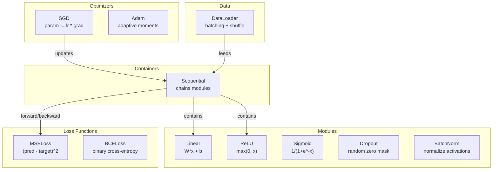
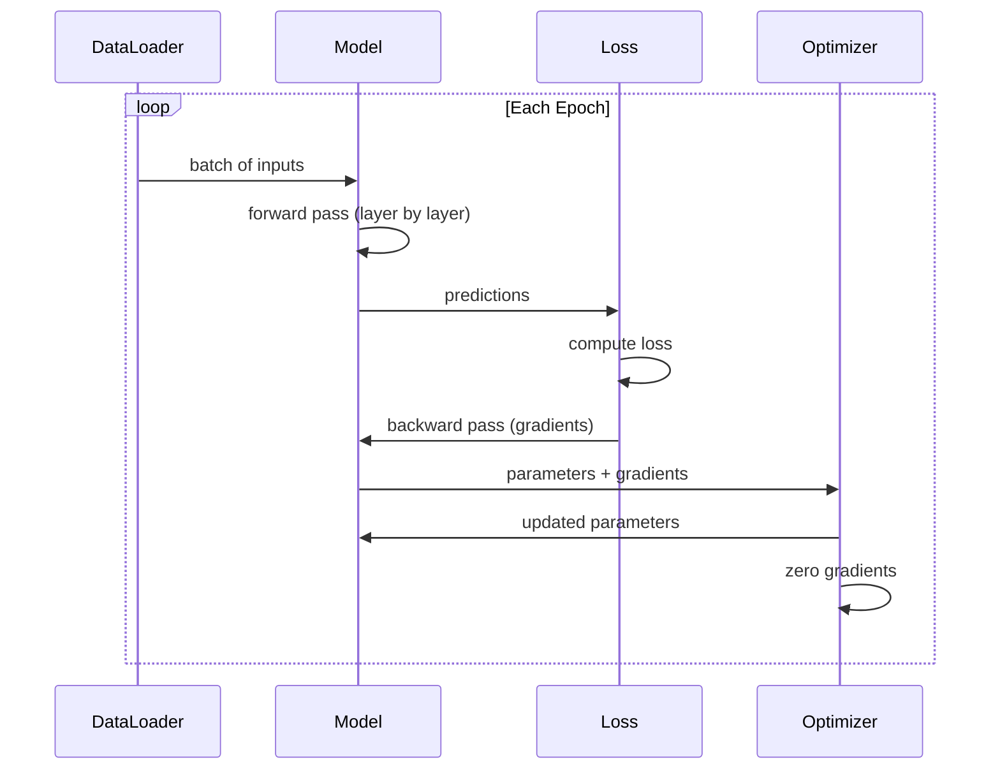
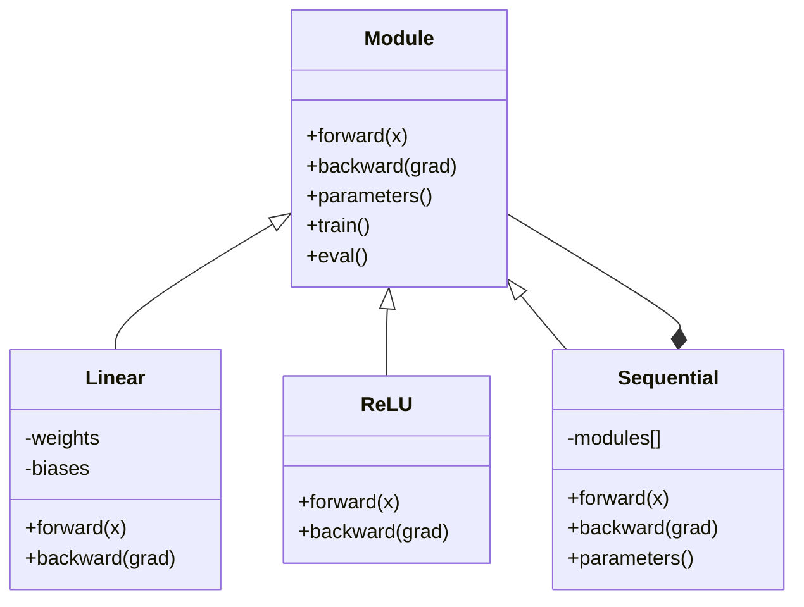

<!-- local-zh-machine-draft: English source is canonical; prose translated automatically, code/math preserved. -->

<a id="build-your-own-mini-framework"></a>

# 构建您自己的迷你框架

> 您已经构建了神经元、层、网络、反向传播、激活、loss functions、optimizers、正则化、初始化和 LR 调度。全部作为单独的部分。现在将它们连接到一个框架中。不是 PyTorch。不是 TensorFlow。你的。

**类型：** 构建
**语言：** Python
**先决条件：** 第 03 阶段的全部内容（第 01-09 课）
**时间：** ~120 分钟

<a id="learning-objectives"></a>

## 学习目标

- 使用 Module、Linear、ReLU、Sigmoid、Dropout、BatchNorm、Sequential、loss functions 构建完整的深度学习框架（约 500 行） optimizers和DataLoader
- 解释模块抽象（前向、后向、parameters）以及为什么需要进行训练/评估模式切换
- 将所有组件连接到一个工作训练循环中，该循环训练 4 层网络的圆形分类
- 将框架的每个组件映射到其 PyTorch 等效组件（nn.Module、nn.Sequential、optim.Adam、DataLoader）

<a id="the-problem"></a>

## 问题

您有十个关于构建块的课程，它们分散在不同的文件中。这里有一个 `Value` 类，那里有一个训练循环，weight 初始化在另一个文件中，learning rate schedules 在另一个文件中。为了训练网络，您需要复制粘贴五个不同的课程，然后手动将它们连接在一起。

这就是框架解决的问题。 PyTorch 为您提供 `nn.Module`、`nn.Sequential`、`optim.Adam`、`DataLoader` 以及将它们联系在一起的训练循环模式。 TensorFlow 为您提供 `keras.Layer`、`keras.Sequential`、`keras.optimizers.Adam`。这些不是魔法。它们是组织模式，使定义、训练和评估网络成为可能，而无需每次都重新发明管道。

您将在大约 500 行 Python 中构建相同的东西。没有 numpy。没有外部依赖。一个框架，可以定义任何前馈网络，使用 SGD 或 Adam 对其进行训练，批处理数据，应用 dropout 和批处理 normalization，使用任何激活，并调度 learning rate。

当你完成后，你就会明白当你在 PyTorch 中写入 `model = nn.Sequential(...)` 时会发生什么。您就会明白为什么 `model.train()` 和 `model.eval()` 存在。你就会明白为什么`optimizer.zero_grad()`是一个单独的调用。你会理解这一切，因为这一切都是你建造的。

<a id="the-concept"></a>

## 概念

<a id="the-module-abstraction"></a>

### 模块抽象

PyTorch中的每一层都继承自`nn.Module`。模块具有三个职责：

1. **forward()** -- 计算给定输入的输出
2. **parameters()** -- 返回所有可训练的 weights
3. **backward()** -- 计算 gradients （由 autograd 在 PyTorch 中处理，在我们的中是明确的）

线性层是一个模块。 ReLU 激活是一个模块。 dropout 层是一个模块。一个批次 normalization 层就是一个 Module。它们都有相同的界面。

<a id="sequential-container"></a>

### 顺序容器

`nn.Sequential` 链条模块。 Forward pass：通过模块 1、模块 2、模块 3 馈送数据。 Backward pass：反转链。容器本身是一个模块——它有forward()、parameters()和backward()。这就是复合模式：一系列模块本身就是一个模块。

<a id="training-vs-evaluation-mode"></a>

### 训练 vs Evaluation 模式

Dropout在训练期间随机将神经元归零，但在训练期间传递所有内容evaluation。 批normalization在训练期间使用批量统计数据，但在训练期间使用平均值evaluation。 这`train()`和`eval()`方法切换此行为。 每个模块都有一个`training`旗帜。

<a id="optimizer"></a>

### Optimizer

optimizer 使用其 gradients 更新 parameters。新元：`param -= lr * grad`。 Adam：维持动量和方差估计，然后更新。 optimizer 不了解网络架构——它只看到 parameters 及其 gradients 的平面列表。

<a id="dataloader"></a>

### 数据加载器

批处理很重要有两个原因。首先，对于大型问题，您无法将整个数据集放入内存中。其次，小批量 gradient descent 提供有助于逃避局部最小值的噪声。 DataLoader 将数据分成批次，并可选择在epoch之间进行洗牌。

<a id="framework-architecture"></a>

### 框架架构



<a id="training-loop"></a>

### 训练循环



<a id="module-hierarchy"></a>

### 模块层次结构



```figure
gradient-clipping
```

<a id="build-it"></a>

## 动手实现

<a id="step-1-module-base-class"></a>

### 第1步：模块基类

每层实现的抽象接口。

```python
class Module:
    def __init__(self):
        self.training = True

    def forward(self, x):
        raise NotImplementedError

    def backward(self, grad):
        raise NotImplementedError

    def parameters(self):
        return []

    def train(self):
        self.training = True

    def eval(self):
        self.training = False
```

<a id="step-2-linear-layer"></a>

### 第2步：线性层

基本构建块。存储 weights 和偏差，向前计算 Wx + b，向后计算 weight/输入 gradients。

```python
import math
import random


class Linear(Module):
    def __init__(self, fan_in, fan_out):
        super().__init__()
        std = math.sqrt(2.0 / fan_in)
        self.weights = [[random.gauss(0, std) for _ in range(fan_in)] for _ in range(fan_out)]
        self.biases = [0.0] * fan_out
        self.weight_grads = [[0.0] * fan_in for _ in range(fan_out)]
        self.bias_grads = [0.0] * fan_out
        self.fan_in = fan_in
        self.fan_out = fan_out
        self.input = None

    def forward(self, x):
        self.input = x
        output = []
        for i in range(self.fan_out):
            val = self.biases[i]
            for j in range(self.fan_in):
                val += self.weights[i][j] * x[j]
            output.append(val)
        return output

    def backward(self, grad):
        input_grad = [0.0] * self.fan_in
        for i in range(self.fan_out):
            self.bias_grads[i] += grad[i]
            for j in range(self.fan_in):
                self.weight_grads[i][j] += grad[i] * self.input[j]
                input_grad[j] += grad[i] * self.weights[i][j]
        return input_grad

    def parameters(self):
        params = []
        for i in range(self.fan_out):
            for j in range(self.fan_in):
                params.append((self.weights, i, j, self.weight_grads))
            params.append((self.biases, i, None, self.bias_grads))
        return params
```

<a id="step-3-activation-modules"></a>

### 第 3 步：激活模块

ReLU、Sigmoid 和 Tanh 作为模块。每个缓存 backward pass 所需的内容。

```python
class ReLU(Module):
    def __init__(self):
        super().__init__()
        self.mask = None

    def forward(self, x):
        self.mask = [1.0 if v > 0 else 0.0 for v in x]
        return [max(0.0, v) for v in x]

    def backward(self, grad):
        return [g * m for g, m in zip(grad, self.mask)]


class Sigmoid(Module):
    def __init__(self):
        super().__init__()
        self.output = None

    def forward(self, x):
        self.output = []
        for v in x:
            v = max(-500, min(500, v))
            self.output.append(1.0 / (1.0 + math.exp(-v)))
        return self.output

    def backward(self, grad):
        return [g * o * (1 - o) for g, o in zip(grad, self.output)]


class Tanh(Module):
    def __init__(self):
        super().__init__()
        self.output = None

    def forward(self, x):
        self.output = [math.tanh(v) for v in x]
        return self.output

    def backward(self, grad):
        return [g * (1 - o * o) for g, o in zip(grad, self.output)]
```

<a id="step-4-dropout-module"></a>

### 步骤4：Dropout模块

在训练期间随机将元素归零。将剩余元素缩放 1/(1-p)，以便预期值保持不变。在评估期间不执行任何操作。

```python
class Dropout(Module):
    def __init__(self, p=0.5):
        super().__init__()
        self.p = p
        self.mask = None

    def forward(self, x):
        if not self.training:
            return x
        self.mask = [0.0 if random.random() < self.p else 1.0 / (1 - self.p) for _ in x]
        return [v * m for v, m in zip(x, self.mask)]

    def backward(self, grad):
        if self.mask is None:
            return grad
        return [g * m for g, m in zip(grad, self.mask)]
```

<a id="step-5-batchnorm-module"></a>

### 步骤5：BatchNorm模块

将批处理中每个 feature 的激活标准化为零均值和单位方差。维护 eval 模式的运行统计信息。

```python
class BatchNorm(Module):
    def __init__(self, size, momentum=0.1, eps=1e-5):
        super().__init__()
        self.size = size
        self.gamma = [1.0] * size
        self.beta = [0.0] * size
        self.gamma_grads = [0.0] * size
        self.beta_grads = [0.0] * size
        self.running_mean = [0.0] * size
        self.running_var = [1.0] * size
        self.momentum = momentum
        self.eps = eps
        self.x_norm = None
        self.std_inv = None
        self.batch_input = None

    def forward_batch(self, batch):
        batch_size = len(batch)
        output_batch = []

        if self.training:
            mean = [0.0] * self.size
            for sample in batch:
                for j in range(self.size):
                    mean[j] += sample[j]
            mean = [m / batch_size for m in mean]

            var = [0.0] * self.size
            for sample in batch:
                for j in range(self.size):
                    var[j] += (sample[j] - mean[j]) ** 2
            var = [v / batch_size for v in var]

            self.std_inv = [1.0 / math.sqrt(v + self.eps) for v in var]

            self.x_norm = []
            self.batch_input = batch
            for sample in batch:
                normed = [(sample[j] - mean[j]) * self.std_inv[j] for j in range(self.size)]
                self.x_norm.append(normed)
                output = [self.gamma[j] * normed[j] + self.beta[j] for j in range(self.size)]
                output_batch.append(output)

            for j in range(self.size):
                self.running_mean[j] = (1 - self.momentum) * self.running_mean[j] + self.momentum * mean[j]
                self.running_var[j] = (1 - self.momentum) * self.running_var[j] + self.momentum * var[j]
        else:
            std_inv = [1.0 / math.sqrt(v + self.eps) for v in self.running_var]
            for sample in batch:
                normed = [(sample[j] - self.running_mean[j]) * std_inv[j] for j in range(self.size)]
                output = [self.gamma[j] * normed[j] + self.beta[j] for j in range(self.size)]
                output_batch.append(output)

        return output_batch

    def forward(self, x):
        result = self.forward_batch([x])
        return result[0]

    def backward(self, grad):
        if self.x_norm is None:
            return grad
        for j in range(self.size):
            self.gamma_grads[j] += self.x_norm[0][j] * grad[j]
            self.beta_grads[j] += grad[j]
        return [grad[j] * self.gamma[j] * self.std_inv[j] for j in range(self.size)]

    def parameters(self):
        params = []
        for j in range(self.size):
            params.append((self.gamma, j, None, self.gamma_grads))
            params.append((self.beta, j, None, self.beta_grads))
        return params
```

<a id="step-6-sequential-container"></a>

### 第 6 步：顺序容器

链模块。向前从左到右，向后从右到左。

```python
class Sequential(Module):
    def __init__(self, *modules):
        super().__init__()
        self.modules = list(modules)

    def forward(self, x):
        for module in self.modules:
            x = module.forward(x)
        return x

    def backward(self, grad):
        for module in reversed(self.modules):
            grad = module.backward(grad)
        return grad

    def parameters(self):
        params = []
        for module in self.modules:
            params.extend(module.parameters())
        return params

    def train(self):
        self.training = True
        for module in self.modules:
            module.train()

    def eval(self):
        self.training = False
        for module in self.modules:
            module.eval()
```

<a id="step-7-loss-functions"></a>

### 步骤7：Loss Functions

MSE 和二进制 Cross-Entropy。每个都返回损失值，并提供一个backward()，返回gradient。

```python
class MSELoss:
    def __call__(self, predicted, target):
        self.predicted = predicted
        self.target = target
        n = len(predicted)
        self.loss = sum((p - t) ** 2 for p, t in zip(predicted, target)) / n
        return self.loss

    def backward(self):
        n = len(self.predicted)
        return [2 * (p - t) / n for p, t in zip(self.predicted, self.target)]


class BCELoss:
    def __call__(self, predicted, target):
        self.predicted = predicted
        self.target = target
        eps = 1e-7
        n = len(predicted)
        self.loss = 0
        for p, t in zip(predicted, target):
            p = max(eps, min(1 - eps, p))
            self.loss += -(t * math.log(p) + (1 - t) * math.log(1 - p))
        self.loss /= n
        return self.loss

    def backward(self):
        eps = 1e-7
        n = len(self.predicted)
        grads = []
        for p, t in zip(self.predicted, self.target):
            p = max(eps, min(1 - eps, p))
            grads.append((-t / p + (1 - t) / (1 - p)) / n)
        return grads
```

<a id="step-8-sgd-and-adam-optimizers"></a>

### 步骤8：SGD和Adam Optimizers

两者都采用 parameter 列表并使用 gradients 更新 weights。

```python
class SGD:
    def __init__(self, parameters, lr=0.01):
        self.params = parameters
        self.lr = lr

    def step(self):
        for container, i, j, grad_container in self.params:
            if j is not None:
                container[i][j] -= self.lr * grad_container[i][j]
            else:
                container[i] -= self.lr * grad_container[i]

    def zero_grad(self):
        for container, i, j, grad_container in self.params:
            if j is not None:
                grad_container[i][j] = 0.0
            else:
                grad_container[i] = 0.0


class Adam:
    def __init__(self, parameters, lr=0.001, beta1=0.9, beta2=0.999, eps=1e-8):
        self.params = parameters
        self.lr = lr
        self.beta1 = beta1
        self.beta2 = beta2
        self.eps = eps
        self.t = 0
        self.m = [0.0] * len(parameters)
        self.v = [0.0] * len(parameters)

    def step(self):
        self.t += 1
        for idx, (container, i, j, grad_container) in enumerate(self.params):
            if j is not None:
                g = grad_container[i][j]
            else:
                g = grad_container[i]

            self.m[idx] = self.beta1 * self.m[idx] + (1 - self.beta1) * g
            self.v[idx] = self.beta2 * self.v[idx] + (1 - self.beta2) * g * g

            m_hat = self.m[idx] / (1 - self.beta1 ** self.t)
            v_hat = self.v[idx] / (1 - self.beta2 ** self.t)

            update = self.lr * m_hat / (math.sqrt(v_hat) + self.eps)

            if j is not None:
                container[i][j] -= update
            else:
                container[i] -= update

    def zero_grad(self):
        for container, i, j, grad_container in self.params:
            if j is not None:
                grad_container[i][j] = 0.0
            else:
                grad_container[i] = 0.0
```

<a id="step-9-dataloader"></a>

### 第9步：数据加载器

将数据分成批次，可选择对每个 epoch 进行混洗。

```python
class DataLoader:
    def __init__(self, data, batch_size=32, shuffle=True):
        self.data = data
        self.batch_size = batch_size
        self.shuffle = shuffle

    def __iter__(self):
        indices = list(range(len(self.data)))
        if self.shuffle:
            random.shuffle(indices)
        for start in range(0, len(indices), self.batch_size):
            batch_indices = indices[start:start + self.batch_size]
            batch = [self.data[i] for i in batch_indices]
            inputs = [item[0] for item in batch]
            targets = [item[1] for item in batch]
            yield inputs, targets

    def __len__(self):
        return (len(self.data) + self.batch_size - 1) // self.batch_size
```

<a id="step-10-train-a-4-layer-network-on-circle-classification"></a>

### 第 10 步：训练圆分类的 4 层网络

将所有东西连接在一起。定义一个模型，选择一个损失，选择一个 optimizer，运行训练循环。

```python
def make_circle_data(n=500, seed=42):
    random.seed(seed)
    data = []
    for _ in range(n):
        x = random.uniform(-2, 2)
        y = random.uniform(-2, 2)
        label = 1.0 if x * x + y * y < 1.5 else 0.0
        data.append(([x, y], [label]))
    return data


def train():
    random.seed(42)

    model = Sequential(
        Linear(2, 16),
        ReLU(),
        Linear(16, 16),
        ReLU(),
        Linear(16, 8),
        ReLU(),
        Linear(8, 1),
        Sigmoid(),
    )

    criterion = BCELoss()
    optimizer = Adam(model.parameters(), lr=0.01)

    data = make_circle_data(500)
    split = int(len(data) * 0.8)
    train_data = data[:split]
    test_data = data[split:]

    loader = DataLoader(train_data, batch_size=16, shuffle=True)

    model.train()

    for epoch in range(100):
        total_loss = 0
        total_correct = 0
        total_samples = 0

        for batch_inputs, batch_targets in loader:
            batch_loss = 0
            for x, t in zip(batch_inputs, batch_targets):
                pred = model.forward(x)
                loss = criterion(pred, t)
                batch_loss += loss

                optimizer.zero_grad()
                grad = criterion.backward()
                model.backward(grad)
                optimizer.step()

                predicted_class = 1.0 if pred[0] >= 0.5 else 0.0
                if predicted_class == t[0]:
                    total_correct += 1
                total_samples += 1

            total_loss += batch_loss

        avg_loss = total_loss / total_samples
        accuracy = total_correct / total_samples * 100

        if epoch % 10 == 0 or epoch == 99:
            print(f"Epoch {epoch:3d} | Loss: {avg_loss:.6f} | Train Accuracy: {accuracy:.1f}%")

    model.eval()
    correct = 0
    for x, t in test_data:
        pred = model.forward(x)
        predicted_class = 1.0 if pred[0] >= 0.5 else 0.0
        if predicted_class == t[0]:
            correct += 1
    test_accuracy = correct / len(test_data) * 100
    print(f"\nTest Accuracy: {test_accuracy:.1f}% ({correct}/{len(test_data)})")

    return model, test_accuracy
```

<a id="use-it"></a>

## 实际应用

这是与您刚刚构建的等效的 PyTorch：

```python
import torch
import torch.nn as nn
from torch.utils.data import DataLoader, TensorDataset

model = nn.Sequential(
    nn.Linear(2, 16),
    nn.ReLU(),
    nn.Linear(16, 16),
    nn.ReLU(),
    nn.Linear(16, 8),
    nn.ReLU(),
    nn.Linear(8, 1),
    nn.Sigmoid(),
)

criterion = nn.BCELoss()
optimizer = torch.optim.Adam(model.parameters(), lr=0.01)

for epoch in range(100):
    model.train()
    for inputs, targets in dataloader:
        optimizer.zero_grad()
        predictions = model(inputs)
        loss = criterion(predictions, targets)
        loss.backward()
        optimizer.step()

    model.eval()
    with torch.no_grad():
        test_predictions = model(test_inputs)
```

结构是相同的。 `Sequential`，`Linear`，`ReLU`，`Sigmoid`，`BCELoss`，`Adam`，`zero_grad`， `backward`、`step`、`train`、`eval`。每个概念都是一一对应的。不同的是PyTorch自动处理autograd（不需要在每个模块中实现backward()），运行在GPU上，并且已经优化了多年。但骨头是一样的。

现在，当您看到 PyTorch 代码时，您就可以确切地知道每一行发生了什么。这种理解就是重点。

<a id="ship-it"></a>

## 交付成果

本课产生：
- `outputs/prompt-framework-architect.md` -- 用于使用框架抽象设计神经网络架构的 prompt

<a id="exercises"></a>

## 练习

1. 添加 `SoftmaxCrossEntropyLoss` 类以进行多类分类。 Softmax 预测，计算 cross-entropy 损失，并处理组合的 backward pass。在 3 类螺旋数据集上进行测试。

2. 在 optimizer 中实现 learning rate 调度：添加 `set_lr()` 方法并连接到第 09 课中的余弦调度。使用 warmup + 余弦训练圆分类器并与常数 LR 进行比较。

3. 将 `save()` 和 `load()` 方法添加到 Sequential，将所有 weights 序列化到 JSON 文件并将它们加载回来。验证加载的模型是否产生与原始模型相同的预测。

4. 在Adam optimizer中实现weight decay（L2正则化）。添加 `weight_decay` parameter，每一步将 weights 缩小到零。比较衰减 = 0 和衰减 = 0.01 的训练。

5. 用适当的小批量 gradient accumulation 替换每个样本的训练循环：在一批中的所有样本上累加 gradients，然后除以 batch size 并采取一个 optimizer 步。测量这是否会改变收敛速度。

<a id="key-terms"></a>

## 关键术语

| 术语 | 人们怎么说 | 它实际上意味着什么 |
|------|----------------|----------------------|
| 模块 | “一层” | 框架中的基本抽象——任何带有forward()、backward()和parameters()的东西 |
| 顺序 | “按顺序堆叠层” | 一个链接模块的容器，按顺序应用它们用于前进，按顺序应用它们用于后退 |
| Forward pass | “运行网络” | 通过按顺序将输入传递给每个模块来计算输出 |
| Backward pass | “计算gradients” | 将损失 gradient 反向传播到每个模块，计算出 parameter gradients |
| Parameters | “可训练的weights” | optimizer 可以更新的网络中的所有值——weights 和偏差 |
| Optimizer | “更新weights的东西” | 使用gradients更新parameters的算法，实现SGD、Adam或其他规则 |
| 数据加载器 | “提供数据的东西” | 将数据集分割成批次的迭代器，可以选择在epoch之间进行洗牌 |
| 培训模式 | “模型.train()” | 启用随机行为的标志，例如 dropout 和带有批次统计信息的批次 normalization |
| Evaluation模式 | “模型.eval()” | 禁用 dropout 并使用批处理 normalization 的运行统计信息的标志 |
| 零等级 | “清除gradients” | 在计算下一批的 gradients 之前，将所有 parameter gradients 重置为零 |

<a id="further-reading"></a>

## 进一步阅读

- Paszke 等人，“PyTorch：一种命令式高性能深度学习库”（2019 年）——描述 PyTorch 设计决策的论文
- Chollet，“使用 Python 进行深度学习，第二版”（2021 年）——第 3 章介绍了具有相同模块/层抽象的 Keras 内部结构
- Johnson，“Tiny-DNN”(https://github.com/tiny-dnn/tiny-dnn )——一个用于理解框架内部结构的纯头文件 C++ 深度学习框架
