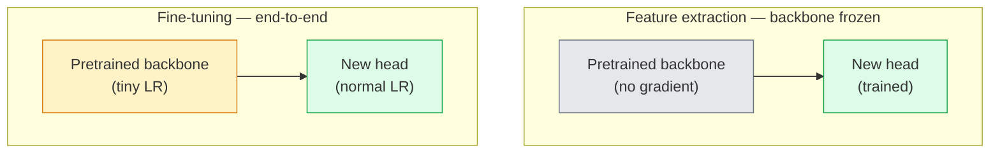

<!-- local-zh-machine-draft: English source is canonical; prose translated automatically, code/math preserved. -->

<a id="transfer-learning--fine-tuning"></a>

# Transfer Learning & Fine-Tuning

> 别人花了一百万GPU教授网络边缘、纹理和物体部分是什么样子的时间。 你应该借用那些features在训练自己之前。

**类型：** 构建
**语言：** Python
**先决条件：** 第 4 阶段第 03 课 (CNNs)、第 4 阶段第 04 课（图像分类）
**时间：** ~75分钟

<a id="learning-objectives"></a>

## 学习目标

- 区分 feature 提取和 fine-tuning 提取，并根据数据集大小、域距离和计算预算选择正确的提取
- 加载预训练的主干，替换其分类器头部，并仅将头部训练到 20 行以下的工作基线
- 使用判别性 learning rates 逐步解冻层，因此早期通用 features 获得的更新比后期特定于任务的更新要小
- 诊断三种常见故障：feature 在未冻结块上由于 LR 过高而发生漂移、BN 统计数据在微小数据集上崩溃以及灾难性遗忘

<a id="the-problem"></a>

## 问题

在 ImageNet 上训练 ResNet-50 大约需要 2,000 GPU 小时。很少有团队对他们交付的每项任务都有这样的预算。几乎每个团队实际上交付的是一个预训练的骨干网，其新的头部接受了数百或数千个特定任务图像的训练。

这不是捷径。任何 ImageNet 训练的 CNN 的第一个转换块都会学习边缘和类 Gabor 滤波器。接下来的几个块学习纹理和简单的图案。中间的块学习物体的部分。最后的块学习的组合开始看起来像 1,000 个 ImageNet 类别。该层次结构的前 90% 几乎不变地转移到医学成像、工业检查、卫星数据和所有其他视觉任务 - 因为大自然的边缘和纹理 vocabulary 是有限的。最后10%是你实际训练的。

正确进行传输会遇到三个错误：用太高的 learning rate 破坏预训练的 features，通过冻结太多信息使模型缺乏信息，并让 BatchNorm 的运行统计数据漂移到网络的 rest 从未从中学习的微小数据集。本课有目的地引导他们每个人。

<a id="the-concept"></a>

## 概念

<a id="feature-extraction-vs-fine-tuning"></a>

### Feature提取与fine-tuning

两种方案，根据您对预训练 features 的信任程度以及您拥有的数据量来选择。



经验法则：

| 数据集大小 | 域距离 | 食谱 |
|--------------|-----------------|--------|
| < 1k 图片 | 接近ImageNet | 冻结骨干，仅训练头部 |
| 1k-10k | 关闭 | 冻结前2-3级，微调rest |
| 10k-100k | 任何 | 使用判别式 LR 进行端到端微调 |
| 10万+ | 远 | 微调一切；如果域足够远，请考虑从头开始训练 |

“接近 ImageNet”大致是指具有类似对象内容的自然 RGB 照片。医学 CT 扫描、高空卫星图像和显微镜属于较远的领域 - features 仍然有帮助，但您需要让更多层适应。

<a id="why-freezing-works-at-all"></a>

### 为什么冷冻有作用

features 和 CNN 学习的 ImageNet 并不专门针对 1,000 个类别。它们专门用于自然图像的统计：特定方向的边缘、纹理、对比图案、形状基元。这些统计数据在人类可以命名的几乎所有视觉领域中都是稳定的。这就是为什么在 ImageNet 上训练并在 CIFAR-10 上评​​估 zero-shot 的模型仅使用一个新的线性头（没有主干的 fine-tuning）就达到了 80% 以上的准确度。头部正在学习已学习的 features 到 weight 中的哪一个来完成此任务。

<a id="discriminative-learning-rates"></a>

### 判别式 learning rates

当你解冻时，早期层的训练速度应该比后期层慢。早期层对您想要保留的通用 features 进行编码；后期层编码需要经常移动的特定于任务的结构。

```
Typical recipe:

  stage 0 (stem + first group): lr = base_lr / 100    (mostly fixed)
  stage 1:                       lr = base_lr / 10
  stage 2:                       lr = base_lr / 3
  stage 3 (last backbone group): lr = base_lr
  head:                          lr = base_lr  (or slightly higher)
```

在 PyTorch 中，这只是传递给 optimizer 的 parameter 组的列表。一种型号，五个learning rates，零多余码。

<a id="the-batchnorm-problem"></a>

### BatchNorm问题

BN 层保存在 ImageNet 上计算的 `running_mean` 和 `running_var` 缓冲区。如果您的任务具有不同的像素分布（不同的照明、不同的传感器、不同的色彩空间），那么这些缓冲区就是错误的。三个选项（按优先顺序排列）：

1. **在训练模式下与BN进行微调。** 让BN与其他所有内容一起更新其运行统计数据。当任务数据集为中等大小（>= 5k 示例）时的默认选择。
2. ** 在 eval 模式下冻结 BN。** 保留 ImageNet 统计数据并仅训练 weights。当您的数据集足够小以至于 BN 的移动平均值会产生噪音时，请进行更正。
3. ** 用 GroupNorm 替换 BN。** 完全消除移动平均问题。用于检测和分割主干，其中每个 GPU 的 batch size 很小。

默默地犯这个错误会使准确性降低 5-15%。

<a id="head-design"></a>

### 头部设计

分类器头为 1-3 个线性层加上可选的 dropout。每个 torchvision 主干网都附带一个可供您替换的默认头：

```
backbone.fc = nn.Linear(backbone.fc.in_features, num_classes)          # ResNet
backbone.classifier[1] = nn.Linear(..., num_classes)                    # EfficientNet, MobileNet
backbone.heads.head = nn.Linear(..., num_classes)                       # torchvision ViT
```

对于小型数据集，单个线性层通常就足够了。当任务分布远离骨干网的训练分布时，添加隐藏层（线性 -> ReLU -> Dropout -> 线性）会有所帮助。

<a id="layer-wise-lr-decay"></a>

### 逐层 LR 衰减

现代 fine-tuning 中使用的判别 LR 的更平滑版本（BEiT、DINOv2、ViT-B 微调）。不要将层分组为阶段，而是为每一层指定比其上面一层稍小的 LR：

```
lr_layer_k = base_lr * decay^(L - k)
```

衰减 = 0.75 且 L = 12transformer块，第一个块火车在`0.75^11 ≈ 0.04x`头部的LR。 更重要的是transformer微调比CNNs，其中阶段分组的 LR 通常就足够了。

<a id="what-to-evaluate"></a>

### 评估什么

迁移学习运行需要两个在临时运行中无法跟踪的数字：

- **仅预训练精度** — 脊柱冻结时头部的精度。这是你的楼层。
- **微调精度** — 端到端训练后的相同模型。这是你的天花板。

如果微调小于仅预训练，则存在学习率或 BN 错误。始终打印两者。

```figure
transfer-learning
```

<a id="build-it"></a>

## 动手实现

<a id="step-1-load-a-pretrained-backbone-and-inspect-it"></a>

### 第 1 步：加载预训练的主干并检查它

```python
import torch
import torch.nn as nn
from torchvision.models import resnet18, ResNet18_Weights

backbone = resnet18(weights=ResNet18_Weights.IMAGENET1K_V1)
print(backbone)
print()
print("classifier head:", backbone.fc)
print("feature dim:", backbone.fc.in_features)
```

`ResNet18` 有四个阶段 (`layer1..layer4`) 加上一个阀杆和一个 `fc` 头部。每个 torchvision 分类主干都有一个类似的结构。

<a id="step-2-feature-extraction--freeze-everything-replace-the-head"></a>

### 步骤 2：Feature 提取 — 冻结所有内容，更换头部

```python
def make_feature_extractor(num_classes=10):
    model = resnet18(weights=ResNet18_Weights.IMAGENET1K_V1)
    for p in model.parameters():
        p.requires_grad = False
    model.fc = nn.Linear(model.fc.in_features, num_classes)
    return model

model = make_feature_extractor(num_classes=10)
trainable = sum(p.numel() for p in model.parameters() if p.requires_grad)
frozen = sum(p.numel() for p in model.parameters() if not p.requires_grad)
print(f"trainable: {trainable:>10,}")
print(f"frozen:    {frozen:>10,}")
```

只有 `model.fc` 是可训练的。骨干是冷冻 feature 提取器。

<a id="step-3-discriminative-fine-tuning"></a>

### 步骤3：区分性fine-tuning

一个实用程序，可使用特定于阶段的 learning rates 构建 parameter 组。

```python
def discriminative_param_groups(model, base_lr=1e-3, decay=0.3):
    stages = [
        ["conv1", "bn1"],
        ["layer1"],
        ["layer2"],
        ["layer3"],
        ["layer4"],
        ["fc"],
    ]
    groups = []
    for i, names in enumerate(stages):
        lr = base_lr * (decay ** (len(stages) - 1 - i))
        params = [p for n, p in model.named_parameters()
                  if any(n.startswith(k) for k in names)]
        if params:
            groups.append({"params": params, "lr": lr, "name": "_".join(names)})
    return groups

model = resnet18(weights=ResNet18_Weights.IMAGENET1K_V1)
model.fc = nn.Linear(model.fc.in_features, 10)
for p in model.parameters():
    p.requires_grad = True

groups = discriminative_param_groups(model)
for g in groups:
    print(f"{g['name']:>10s}  lr={g['lr']:.2e}  params={sum(p.numel() for p in g['params']):>8,}")
```

`decay=0.3` 表示每个阶段以下一阶段的 30% 的速率进行训练。 `fc` 获取 `base_lr`，`layer4` 获取 `0.3 * base_lr`，`conv1` 获取 `0.3^5 * base_lr ≈ 0.00243 * base_lr`。听起来极端；从经验上看它是有效的。

<a id="step-4-batchnorm-handling"></a>

### 步骤4：BatchNorm处理

帮助冻结 BN 运行统计数据而不冻结其 weights。

```python
def freeze_bn_stats(model):
    for m in model.modules():
        if isinstance(m, (nn.BatchNorm1d, nn.BatchNorm2d, nn.BatchNorm3d)):
            m.eval()
            for p in m.parameters():
                p.requires_grad = False
    return model
```

在每个 epoch 的开头设置 `model.train()` 后调用它。 `model.train()` 将所有内容翻转为训练模式；这仅适用于 BN 层。

<a id="step-5-a-minimal-end-to-end-fine-tuning-loop"></a>

### 步骤 5：最小端到端 fine-tuning 循环

```python
from torch.optim import SGD
from torch.utils.data import DataLoader
from torch.optim.lr_scheduler import CosineAnnealingLR
import torch.nn.functional as F

def fine_tune(model, train_loader, val_loader, device, epochs=5, base_lr=1e-3, freeze_bn=False):
    model = model.to(device)
    groups = discriminative_param_groups(model, base_lr=base_lr)
    optimizer = SGD(groups, momentum=0.9, weight_decay=1e-4, nesterov=True)
    scheduler = CosineAnnealingLR(optimizer, T_max=epochs)

    for epoch in range(epochs):
        model.train()
        if freeze_bn:
            freeze_bn_stats(model)
        tr_loss, tr_correct, tr_total = 0.0, 0, 0
        for x, y in train_loader:
            x, y = x.to(device), y.to(device)
            logits = model(x)
            loss = F.cross_entropy(logits, y, label_smoothing=0.1)
            optimizer.zero_grad()
            loss.backward()
            optimizer.step()
            tr_loss += loss.item() * x.size(0)
            tr_total += x.size(0)
            tr_correct += (logits.argmax(-1) == y).sum().item()
        scheduler.step()

        model.eval()
        va_total, va_correct = 0, 0
        with torch.no_grad():
            for x, y in val_loader:
                x, y = x.to(device), y.to(device)
                pred = model(x).argmax(-1)
                va_total += x.size(0)
                va_correct += (pred == y).sum().item()
        print(f"epoch {epoch}  train {tr_loss/tr_total:.3f}/{tr_correct/tr_total:.3f}  "
              f"val {va_correct/va_total:.3f}")
    return model
```

在 CIFAR-10 上使用上述配方的五个周期将 `ResNet18-IMAGENET1K_V1` 从约 70% zero-shot 线性探针精度提高到约 93% 微调精度。仅头部就会稳定在 86% 左右，而不会触及脊椎。

<a id="step-6-progressive-unfreezing"></a>

### 第 6 步：渐进解冻

从末尾到开头解冻每个 epoch 的一个阶段的时间表。以一些额外的epoch为代价来缓解 feature 漂移。

```python
def progressive_unfreeze_schedule(model):
    stages = ["layer4", "layer3", "layer2", "layer1"]
    yielded = set()

    def start():
        for p in model.parameters():
            p.requires_grad = False
        for p in model.fc.parameters():
            p.requires_grad = True

    def unfreeze(epoch):
        if epoch < len(stages):
            name = stages[epoch]
            yielded.add(name)
            for n, p in model.named_parameters():
                if n.startswith(name):
                    p.requires_grad = True
            return name
        return None

    return start, unfreeze
```

在第一个 epoch 之前调用一次 `start()`。在每个 epoch 的开头调用 `unfreeze(epoch)`。每当可训练的 parameters 集合发生变化时，就重建 optimizer，否则冻结的参数仍然保存着使其混乱的缓存时刻。

<a id="use-it"></a>

## 实际应用

对于大多数实际任务，`torchvision.models` + 三行就足够了。当您遇到库默认值无法解决的问题时，上述较重的机制就很重要。

```python
from torchvision.models import resnet50, ResNet50_Weights

model = resnet50(weights=ResNet50_Weights.IMAGENET1K_V2)
model.fc = nn.Linear(model.fc.in_features, num_classes)
optimizer = torch.optim.AdamW(model.parameters(), lr=1e-4, weight_decay=1e-4)
```

另外两个生产级默认值：

- `timm` 提供约 800 个预训练视觉主干，具有一致的 API (`timm.create_model("resnet50", pretrained=True, num_classes=10)`)。对于 torchvision 动物园之外的任何微调，它都是标准。
- 对于 transformers，`transformers.AutoModelForImageClassification.from_pretrained(name, num_labels=N)` 为您提供 ViT / BEiT / DeiT ，其加载语义与文本模型相同。

<a id="ship-it"></a>

## 交付成果

本课产生：

- `outputs/prompt-fine-tune-planner.md` - prompt，根据数据集大小、域距离和计算预算选择 feature 提取、渐进式提取、端到端 fine-tuning。
- `outputs/skill-freeze-inspector.md` - 一项技能，给定 PyTorch 模型，报告哪些 parameters 是可训练的，哪些 BatchNorm 层处于评估模式，以及 optimizer 是否实际上正在被训练parameters。

<a id="exercises"></a>

## 练习

1. **(Easy)** 将 `ResNet18` 训练为线性探针（主干冻结）并作为同一合成 CIFAR 数据集上的完整微调。并列报告两个精度。解释哪个间隙告诉您 features 传输良好，哪个间隙告诉您它们没有。
2. **(中)** 故意引入一个错误：将 `base_lr = 1e-1` 设置在主干阶段而不是头部。显示训练损失爆炸，然后通过应用 `discriminative_param_groups` 帮助器恢复。记录每个阶段开始发散的 LR。
3. **(Hard)** 采用医学成像数据集（例如 CheXpert-small、PatchCamelyon 或 HAM10000）并比较三种方案：（a）ImageNet 预训练的冷冻骨干 + 线性头； (b) ImageNet 预训练端到端微调； (c) 从头开始​​训练。报告准确性并计算每个的成本。在多大的数据集大小下，从头训练变得有竞争力？

<a id="key-terms"></a>

## 关键术语

| 术语 | 人们怎么说 | 它实际上意味着什么 |
|------|----------------|----------------------|
| Feature提取 | “冻结并训练头” | 主干网 parameters 冻结，只有新的分类器头收到 gradient |
| Fine-tuning | “端到端重新训练” | 所有parameters均可训练，通常LR比scratch训练小得多 |
| 判别性LR | “早期层的较小 LR” | Optimizer parameter 早期 LR 是后期 LR 的一小部分的组 |
| 逐层 LR 衰减 | “平滑LR gradient” | 每层LR乘以衰减^(L - k)；常见于transformer微调 |
| 灾难性遗忘 | “模型丢失了 ImageNet” | 在学习新任务信号之前，过高的 LR 会覆盖预训练的 features |
| BN统计漂移 | “运行平均值是错误的” | BatchNorm running_mean/var 在与当前任务不同的分布上计算，默默地损害了准确性 |
| 线性探头 | “冰冻脊椎+线性头” | 预训练 Evaluation 的 features — 冻结表示之上的最佳线性分类器的准确性 |
| 灾难性的崩溃 | “一切都预示着一堂课” | 当 fine-tuning 的 LR 足够高，在 gradients 从头部稳定下来之前摧毁 features 时会发生 |

<a id="further-reading"></a>

## 进一步阅读

- [ features 在深度神经网络中的可转移性如何？ (Yosinski et al., 2014)](https://arxiv.org/abs/1411.1792) — 量化 feature 跨层可转移性的论文
- [通用语言模型Fine-tuning（ULMFiT，Howard & Ruder，2018）](https://arxiv.org/abs/1801.06146)——原始的判别式LR/渐进解冻配方；想法直接转化为愿景
- [timm 文档](https://huggingface.co/docs/timm) — 现代视觉主干的参考以及它们接受训练的精确微调默认值
- [A 线性探头简单框架 Evaluation（Kornblith 等人，2019）](https://arxiv.org/abs/1805.08974) — 为什么线性探头精度很重要以及如何正确报告它
