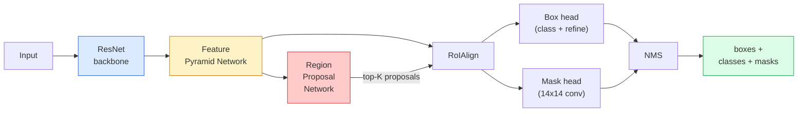

<!-- local-zh-machine-draft: English source is canonical; prose translated automatically, code/math preserved. -->

<a id="instance-segmentation--mask-r-cnn"></a>

# 实例分割——Mask R-CNN

> 将一个微小的掩码 branch 添加到 Faster R-CNN 检测器中，您就拥有了实例分割。最难的部分是RoIAlign，它比看起来更难。

**类型：** 构建 + 学习
**语言：** Python
**先决条件：** 第 4 阶段第 06 课 (YOLO)、第 4 阶段第 07 课 (U-Net)
**时间：** ~75分钟

<a id="learning-objectives"></a>

## 学习目标

- Trace Mask R-CNN架构端到端：backbone、FPN、RPN、RoIAlign、box头、mask头
- 从头开始实现 RoIAlign 并解释为什么不再使用 RoIPool
- 使用torchvision `maskrcnn_resnet50_fpn_v2`预训练模型进行生产质量实例掩码并正确读取其输出格式
- 通过更换盒子和掩模头并保持骨干冻结，在小型自定义数据集上微调掩模 R-CNN

<a id="the-problem"></a>

## 问题

语义分割为每个类别提供一个掩码。实例分割为每个对象提供一个掩码，即使两个对象共享一个类也是如此。计算个体、跨帧跟踪和测量事物（墙上每块砖的边界框、显微镜图像中的每个细胞）都需要实例分割。

Mask R-CNN（He et al., 2017）通过将实例分割重新定义为检测加掩码解决了这个问题。该设计非常简洁，以至于在接下来的五年中，几乎每一篇实例分割论文都是 Mask R-CNN 变体，并且 torchvision 实现仍然是中小型数据集的生产默认设置。

困难的工程问题是 sampling：如何从其角与像素边界不对齐的提案框中裁剪固定大小的 feature 区域？如果犯了这个错误，到处都会损失十分之一的地图点。 RoIAlign 就是答案。

<a id="the-concept"></a>

## 概念

<a id="the-architecture"></a>

### 架构



需要理解的五个部分：

1. **Backbone** - 在 ImageNet 上训练的 ResNet-50 或 ResNet-101。以步幅 4、8、16、32 生成 feature 地图的层次结构。
2. **FPN (Feature 金字塔网络)** — 自上而下+横向连接，为每个 C 级通道提供语义丰富的 features。检测查询与对象大小匹配的 FPN 级别。
3. **RPN（区域提议网络）** - 一个小卷积头，在每个锚点位置预测“这里有一个物体吗？”以及“如何完善盒子？”。每张图像生成约 1000 个提案。
4. **RoIAlign** — 从任何 FPN 级别上的任何框采样固定大小（例如 7x7）feature patch。双线性 sampling，无量化。
5. **Heads** - 两层盒子头，用于细化盒子并选择一个类，加上一个小转换头，为每个提案输出 `28x28` 二进制掩码。

<a id="why-roialign-not-roipool"></a>

### 为什么选择 RoIAlign，而不是 RoIPool

最初的Fast R-CNN使用RoIPool，它将提案框分割成网格，取每个单元格中的最大值feature，并将所有坐标四舍五入为整数。这种舍入使 feature 贴图与输入像素坐标错位，最多达到完整的 feature 贴图像素 — 在 224x224 图像上很小，当 feature 贴图步长为 32 时，这会造成灾难性的后果。

```
RoIPool:
  box (34.7, 51.3, 98.2, 142.9)
  round -> (34, 51, 98, 142)
  split grid -> round each cell boundary
  misalignment accumulates at every step

RoIAlign:
  box (34.7, 51.3, 98.2, 142.9)
  sample at exact float coordinates using bilinear interpolation
  no rounding anywhere
```

RoIAlign 在 COCO 上免费将面膜 AP 提升 3-4 点。现在每个关心定位的检测器都使用它——YOLOv7 seg、RT-DETR、Mask2Former 等。

<a id="the-rpn-in-one-paragraph"></a>

### 一段中的 RPN

在feature地图的每个位置，放置K个不同大小和形状的锚框。预测每个锚点的客观性得分和回归偏移，以将锚点变成更适合的框。按分数保留前 1,000 个框，以 IoU 0.7 应用 NMS，并将幸存者交给头部。 RPN 使用自己的微型损失进行训练——与第 6 课中的 YOLO 损失结构相同，只是有两个类（对象/无对象）。

<a id="the-mask-head"></a>

### 面具头

对于每个提案（在 RoIAlign 之后），掩模头是一个微小的 FCN：四个 3x3 卷积、一个 2x 反卷积、一个最终 1x1 卷积，以 `28x28` 分辨率产生 `num_classes` 输出通道。只保留预测类别对应的通道；其他的则被忽略。这将掩模预测与分类分离。

将 28x28 掩码上采样到提案的原始像素大小，以生成最终的二进制掩码。

<a id="losses"></a>

### 损失

掩模 R-CNN 有四个损耗加在一起：

```
L = L_rpn_cls + L_rpn_box + L_box_cls + L_box_reg + L_mask
```

- `L_rpn_cls`、`L_rpn_box` — RPN 提案的客观性 + 框回归。
- `L_box_cls` — cross-entropy 头部分类器上的 (C+1) 个类别（包括背景）。
- `L_box_reg` — 头部盒上的平滑 L1 细化。
- `L_mask` — 28x28 掩模输出上的每像素二进制 cross-entropy。

每个损失都有自己的默认weight； torchvision 实现将它们公开为构造函数参数。

<a id="output-format"></a>

### 输出格式

`torchvision.models.detection.maskrcnn_resnet50_fpn_v2` 返回一个字典列表，每个图像一个：

```
{
    "boxes":  (N, 4) in (x1, y1, x2, y2) pixel coordinates,
    "labels": (N,) class IDs, 0 = background so indices are 1-based,
    "scores": (N,) confidence scores,
    "masks":  (N, 1, H, W) float masks in [0, 1] — threshold at 0.5 for binary,
}
```

遮罩已经是全图像分辨率。 28x28 头输出已在内部进行上采样。

```figure
cv3-roialign-sampling
```

<a id="build-it"></a>

## 动手实现

<a id="step-1-roialign-from-scratch"></a>

### 第 1 步：从头开始 RoIAlign

这是 Mask R-CNN 的一个组成部分，作为代码比作为散文更容易理解。

```python
import torch
import torch.nn.functional as F

def roi_align_single(feature, box, output_size=7, spatial_scale=1 / 16.0):
    """
    feature: (C, H, W) single-image feature map
    box: (x1, y1, x2, y2) in original image pixel coordinates
    output_size: side of the output grid (7 for box head, 14 for mask head)
    spatial_scale: reciprocal of the feature map stride
    """
    C, H, W = feature.shape
    x1, y1, x2, y2 = [c * spatial_scale - 0.5 for c in box]
    bin_w = (x2 - x1) / output_size
    bin_h = (y2 - y1) / output_size

    grid_y = torch.linspace(y1 + bin_h / 2, y2 - bin_h / 2, output_size)
    grid_x = torch.linspace(x1 + bin_w / 2, x2 - bin_w / 2, output_size)
    yy, xx = torch.meshgrid(grid_y, grid_x, indexing="ij")

    gx = 2 * (xx + 0.5) / W - 1
    gy = 2 * (yy + 0.5) / H - 1
    grid = torch.stack([gx, gy], dim=-1).unsqueeze(0)
    sampled = F.grid_sample(feature.unsqueeze(0), grid, mode="bilinear",
                            align_corners=False)
    return sampled.squeeze(0)
```

每个数字都位于双线性采样位置。没有舍入，没有量化，没有丢弃gradients。

<a id="step-2-compare-to-torchvisions-roialign"></a>

### 第 2 步：与 torchvision 的 RoIAlign 进行比较

```python
from torchvision.ops import roi_align

feature = torch.randn(1, 16, 50, 50)
boxes = torch.tensor([[0, 10, 20, 100, 90]], dtype=torch.float32)  # (batch_idx, x1, y1, x2, y2)

ours = roi_align_single(feature[0], boxes[0, 1:].tolist(), output_size=7, spatial_scale=1/4)
theirs = roi_align(feature, boxes, output_size=(7, 7), spatial_scale=1/4, sampling_ratio=1, aligned=True)[0]

print(f"shape ours:   {tuple(ours.shape)}")
print(f"shape theirs: {tuple(theirs.shape)}")
print(f"max|diff|:    {(ours - theirs).abs().max().item():.3e}")
```

对于 `sampling_ratio=1` 和 `aligned=True`，两者在 `1e-5` 范围内匹配。

<a id="step-3-load-a-pretrained-mask-r-cnn"></a>

### 步骤 3：加载预训练掩模 R-CNN

```python
import torch
from torchvision.models.detection import maskrcnn_resnet50_fpn_v2, MaskRCNN_ResNet50_FPN_V2_Weights

model = maskrcnn_resnet50_fpn_v2(weights=MaskRCNN_ResNet50_FPN_V2_Weights.DEFAULT)
model.eval()
print(f"params: {sum(p.numel() for p in model.parameters()):,}")
print(f"classes (including background): {len(model.roi_heads.box_predictor.cls_score.out_features * [0])}")
```

46M parameters，91 类（COCO）。第一类（id 0）是背景；模型实际检测到的所有内容都从 id 1 开始。

<a id="step-4-run-inference"></a>

### 步骤4：运行inference

```python
with torch.no_grad():
    x = torch.randn(3, 400, 600)
    predictions = model([x])
p = predictions[0]
print(f"boxes:  {tuple(p['boxes'].shape)}")
print(f"labels: {tuple(p['labels'].shape)}")
print(f"scores: {tuple(p['scores'].shape)}")
print(f"masks:  {tuple(p['masks'].shape)}")
```

掩码 tensor 的形状为 `(N, 1, H, W)`。阈值为 0.5，以获得每个对象的二进制掩码：

```python
binary_masks = (p['masks'] > 0.5).squeeze(1)  # (N, H, W) boolean
```

<a id="step-5-swap-the-heads-for-a-custom-class-count"></a>

### 第 5 步：交换自定义类别计数的头部

常见的fine-tuning配方：复用backbone、FPN、RPN；更换两个分类器头。

```python
from torchvision.models.detection.faster_rcnn import FastRCNNPredictor
from torchvision.models.detection.mask_rcnn import MaskRCNNPredictor

def build_custom_maskrcnn(num_classes):
    model = maskrcnn_resnet50_fpn_v2(weights=MaskRCNN_ResNet50_FPN_V2_Weights.DEFAULT)
    in_features = model.roi_heads.box_predictor.cls_score.in_features
    model.roi_heads.box_predictor = FastRCNNPredictor(in_features, num_classes)
    in_features_mask = model.roi_heads.mask_predictor.conv5_mask.in_channels
    hidden_layer = 256
    model.roi_heads.mask_predictor = MaskRCNNPredictor(in_features_mask, hidden_layer, num_classes)
    return model

custom = build_custom_maskrcnn(num_classes=5)
print(f"custom cls_score.out_features: {custom.roi_heads.box_predictor.cls_score.out_features}")
```

`num_classes` 必须包含背景类，因此具有 4 个对象类的数据集使用 `num_classes=5`。

<a id="step-6-freeze-what-does-not-need-training"></a>

### 第 6 步：冻结不需要训练的内容

在小型数据集上，冻结主干网和 FPN。只有 RPN 对象性 + 回归和两个头学习。

```python
def freeze_backbone_and_fpn(model):
    # torchvision Mask R-CNN packs the FPN inside `model.backbone` (as
    # `model.backbone.fpn`), so iterating `model.backbone.parameters()` covers
    # both the ResNet feature layers and the FPN lateral/output convs.
    for p in model.backbone.parameters():
        p.requires_grad = False
    return model

custom = freeze_backbone_and_fpn(custom)
trainable = sum(p.numel() for p in custom.parameters() if p.requires_grad)
print(f"trainable after freeze: {trainable:,}")
```

在 500 个图像数据集上，这是收敛和 overfitting 之间的区别。

<a id="use-it"></a>

## 实际应用

torchvision 中 Mask R-CNN 的完整训练循环有 40 行，并且在任务之间不会发生有意义的变化 - 交换数据集并继续。

```python
def train_step(model, images, targets, optimizer):
    model.train()
    loss_dict = model(images, targets)
    losses = sum(loss for loss in loss_dict.values())
    optimizer.zero_grad()
    losses.backward()
    optimizer.step()
    return {k: v.item() for k, v in loss_dict.items()}
```

`targets` 列表必须具有 `boxes`、`labels` 和 `masks` 的每个图像字典（作为 `(num_instances, H, W)` 二进制 tensors）。该模型在训练期间返回四个损失的字典，在评估期间返回一个预测列表，以 `model.training` 为键。

`pycocotools` 评估器为框和掩模生成 mAP@IoU=0.5:0.95；您需要这两个数字才能知道盒头或掩模头是否是瓶颈。

<a id="ship-it"></a>

## 交付成果

本课产生：

- `outputs/prompt-instance-vs-semantic-router.md` - 一个 prompt，它提出三个问题并选择实例、语义、全景以及开始的确切模型。
- `outputs/skill-mask-rcnn-head-swapper.md` — 一种生成 10 行代码的技能，用于在任何 torchvision 检测模型上交换头部（考虑到新的 `num_classes`）。

<a id="exercises"></a>

## 练习

1. **（简单）** 在 100 个随机盒子上对照 `torchvision.ops.roi_align` 验证您的 RoIAlign。报告最大绝对差值。还运行 RoIPool（2017 年之前的行为）并显示它在边界附近的框上偏离 ~1-2 feature 映射像素。
2. **（中）** 在 50 个图像的自定义数据集（任意两个类：气球、鱼、坑洼、徽标）上微调 `maskrcnn_resnet50_fpn_v2`。冻结骨干网，训练 20 个 epoch，报告 mask AP@0.5。
3. **(硬)** 将 Mask R-CNN 的掩模头替换为预测为 56x56 而不是 28x28 的掩模头。前后测量mAP@IoU=0.75。解释为什么增益（或缺乏增益）与预期的边界精度/内存权衡相匹配。

<a id="key-terms"></a>

## 关键术语

| 术语 | 人们怎么说 | 它实际上意味着什么 |
|------|----------------|----------------------|
| 面膜R-CNN | “检测+口罩” | 更快的 R-CNN + 一个小型 FCN 头，可预测每个类的每个提案的 28x28 掩码 |
| FPN | “Feature金字塔” | 自上而下+横向连接，为每一步提供语义丰富的C级通道 features |
| RPN | “区域提议者” | 一个小型转换头，每张图像生成约 1000 个对象/无对象建议 |
| 旋转对齐 | “无圆角作物” | 从任何浮动坐标框中双线性采样固定大小的 feature 网格 |
| 网池 | “2017年前作物” | 与 RoIAlign 用途相同，但四舍五入框坐标；过时的 |
| 面膜AP | “实例映射” | 使用mask IoU而不是box IoU计算平均精度； COCO 实例分割指标 |
| 二元掩模头 | “每班面具” | 为每个提案的每个类预测一个二进制掩码；仅保留预测类别的频道 |
| 背景类 | “0级” | 包罗万象的“无对象”类；真实类别的索引从 1 开始 |

<a id="further-reading"></a>

## 进一步阅读

- [Mask R-CNN（He et al., 2017）](https://arxiv.org/abs/1703.06870) — 论文；关于 RoIAlign 的第 3 节是重要读物
- [FPN：Feature 金字塔网络（Lin 等人，2017）](https://arxiv.org/abs/1612.03144) — FPN 论文；每个现代探测器都使用它
- [torchvision Mask R-CNN 教程](https://pytorch.org/tutorials/intermediate/torchvision_tutorial.html) — fine-tuning 循环的参考
- [Detectron2模型zoo](https://github.com/facebookresearch/detectron2/blob/main/MODEL_ZOO.md) - 使用训练有素的weights进行生产实现，几乎适用于所有检测和分割变体
