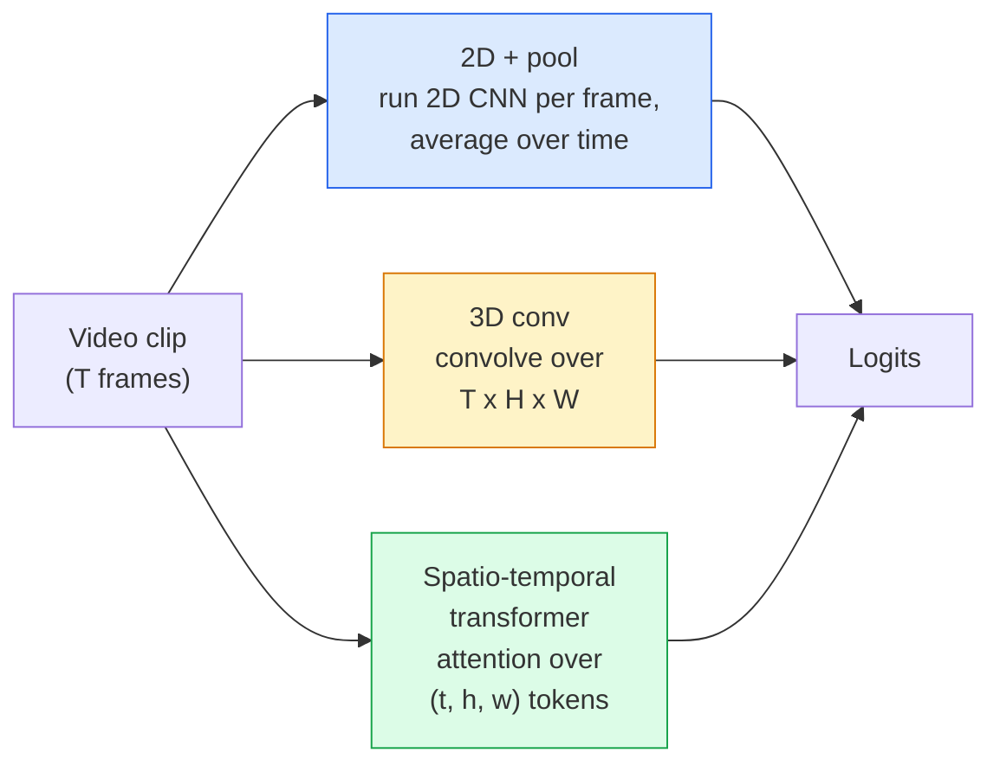

<!-- local-zh-machine-draft: English source is canonical; prose translated automatically, code/math preserved. -->

<a id="video-understanding--temporal-modeling"></a>

# 视频理解——时间建模

> 视频是一系列图像加上连接它们的物理原理。每个视频模型要么将时间视为额外的轴（3D 转换）、要参与的序列（transformer），要么将 feature 来提取一次并池化（2D+池化）。

**类型：** 学习 + 构建
**语言：** Python
**先决条件：** 第 4 阶段第 03 课 (CNNs)、第 4 阶段第 04 课（图像分类）
**时间：** ~45分钟

<a id="learning-objectives"></a>

## 学习目标

- 区分三种主要视频建模方法（2D+池、3D 转换、时空 transformer）并预测它们的成本和准确性权衡
- 在PyTorch中实现框架sampling、时间池化和2D+池化基线分类器
- 解释为什么 I3D 的“膨胀”3D 内核能够很好地从 ImageNet weights 迁移，以及因式分解 (2+1)D 卷积有何不同
- 阅读标准动作识别数据集和指标：Kinetics-400/600、UCF101、Something-Something V2；剪辑和视频级别的 top-1 准确度

<a id="the-problem"></a>

## 问题

30 fps 的 30 秒视频包含 900 个图像。简单地说，视频分类就是运行 900 次的图像分类，然后进行某种聚合。当动作几乎在每一帧（运动、烹饪、锻炼视频）中都可见时，这种方法有效；而当动作由运动本身定义时，这种方法就会严重失败：“从左向右推动某物”在每一帧中看起来就像两个静止的物体。

每个视频架构的核心问题是：时间结构何时建模以及如何建模？答案决定了其他一切——计算成本、pretraining 策略、是否可以重用 ImageNet weights、模型训练的数据集。

本课程故意比静态图像课程短。核心图像机制已经就位，视频理解主要是关于时间故事：sampling、建模和聚合。

<a id="the-concept"></a>

## 概念

<a id="the-three-architectural-families"></a>

### 三大建筑家族



<a id="2d--pool"></a>

### 2D+台球

采用 2D CNN（ResNet、EfficientNet、ViT）。在每个采样帧上独立运行它。平均（或最大池，或 attention-pool）每帧 embeddings。将合并的向量输入分类器。

优点：
- ImageNet pretraining 直接传输。
- 实施起来最简单。
- 便宜：T架*单图inference成本。

缺点：
- 无法模拟运动。行动=表象的聚合。
- 时间池是顺序不变的； “开门”和“关门”看起来是一样的。

何时使用：外观密集型任务、小型视频数据集上的 transfer learning、初始基线。

<a id="3d-convolutions"></a>

### 3D 卷积

将 2D (H, W) 内核替换为 3D (T, H, W) 内核。该网络在空间和时间上进行卷积。早期系列：C3D、I3D、SlowFast。

I3D 技巧：采用预训练的 2D ImageNet 模型，通过沿新的时间轴复制每个 2D 内核来“膨胀”每个 2D 内核。 3x3 2D 转换变为 3x3x3 3D 转换。这为 3D 模型提供了强大的预训练 weights，而不是从头开始训练。

优点：
- 直接模拟运动。
- I3D通胀免费赠送transfer learning。

缺点：
- 比 2D 对应的 FLOP 多 T/8（对于 3 个堆叠 3 次的时间内核）。
- 时间核很小；长距离运动需要金字塔或双流方法。

何时使用：动作识别，其中运动是信号（Something-Something V2，具有运动密集类的动力学）。

<a id="spatio-temporal-transformers"></a>

### 时空transformers

将视频标记为时空网格 patches 并参与所有时空网格。 TimeSformer、ViViT、Video Swin、VideoMAE。

Attention 重要的模式：
- **Joint** — 一大 attention 超过 (t, h, w)。 `T*H*W` 中的二次；昂贵的。
- **Divided** — 每个区块两个 attentions：一个随时间变化，一个随空间变化。线性缩放。
- **Factorized** — 时间 attention 与空间 attention 跨块交替。

优点：
- 每个主要基准的 SOTA 准确性。
- 通过 patch 通货膨胀从图像 transformers (ViT) 转移。
- 通过稀疏 attention 支持长上下文视频。

缺点：
- 计算量大。
- 需要仔细选择 attention 模式或运行时气球。

何时使用：大型数据集、高保真视频理解、多模式视频+文本任务。

<a id="frame-sampling"></a>

### 车架 sampling

30 fps 的 10 秒剪辑为 300 帧；将所有 300 个数据喂入任何模型都是浪费。标准策略：

- **Uniform sampling** — 在剪辑上均匀地选取 T 形框架。默认为 2D+池。
- **Dense sampling** — 随机连续 T 型框架窗口。对于 3D 卷积很常见，因为运动需要相邻帧。
- **Multi-clip** — 从同一视频中采样多个 T 帧窗口，对每个窗口进行分类，在测试时平均预测。

T 通常为 8、16、32 或 64。 T 越高 = 计算量越大，时间信号越多。

<a id="evaluation"></a>

### Evaluation

两个层次：
- **剪辑级别精度** — 模型看到一个 T 型框架剪辑，报告 top-k。
- **视频级精度** — 每个视频多个剪辑的平均剪辑级预测；更高更稳定。

始终报告两者。剪辑得分为 78%、视频得分为 82% 的模型严重依赖于测试时间平均；得分为 80% / 81% 的每个剪辑更加稳健。

<a id="datasets-you-will-meet"></a>

### 您将遇到的数据集

- **Kinetics-400 / 600 / 700** — 通用动作数据集。 400k 剪辑； YouTube 网址（许多现已失效）。
- **Something-Something V2** — 运动定义的动作（“从左向右移动 X”）。 2D+pool无法解决。
- **UCF-101**、**HMDB-51** — 较旧、较小，仍报告。
- **AVA** — 空间和时间上的动作 *localization*；比分类更难。

```figure
v4-video-temporal
```

<a id="build-it"></a>

## 动手实现

<a id="step-1-frame-sampler"></a>

### 第 1 步：帧采样器

适用于帧列表（或视频 tensor）的均匀且密集的采样器。

```python
import numpy as np

def sample_uniform(num_frames_total, T):
    if num_frames_total <= T:
        return list(range(num_frames_total)) + [num_frames_total - 1] * (T - num_frames_total)
    step = num_frames_total / T
    return [int(i * step) for i in range(T)]


def sample_dense(num_frames_total, T, rng=None):
    rng = rng or np.random.default_rng()
    if num_frames_total <= T:
        return list(range(num_frames_total)) + [num_frames_total - 1] * (T - num_frames_total)
    start = int(rng.integers(0, num_frames_total - T + 1))
    return list(range(start, start + T))
```

两者都返回 `T` 索引，用于对视频 tensor 进行切片。

<a id="step-2-a-2dpool-baseline"></a>

### 第 2 步：2D+池基线

在每一帧上运行 2D ResNet-18，平均池 features，进行分类。

```python
import torch
import torch.nn as nn
from torchvision.models import resnet18, ResNet18_Weights

class FramePool(nn.Module):
    def __init__(self, num_classes=400, pretrained=True):
        super().__init__()
        weights = ResNet18_Weights.IMAGENET1K_V1 if pretrained else None
        backbone = resnet18(weights=weights)
        self.features = nn.Sequential(*(list(backbone.children())[:-1]))  # global avg pool kept
        self.head = nn.Linear(512, num_classes)

    def forward(self, x):
        # x: (N, T, 3, H, W)
        N, T = x.shape[:2]
        x = x.view(N * T, *x.shape[2:])
        feats = self.features(x).view(N, T, -1)
        pooled = feats.mean(dim=1)
        return self.head(pooled)

model = FramePool(num_classes=10)
x = torch.randn(2, 8, 3, 224, 224)
print(f"output: {model(x).shape}")
print(f"params: {sum(p.numel() for p in model.parameters()):,}")
```

一千一百万 parameters，ImageNet 预训练，每帧运行，平均，分类。在外观繁重的任务中，该基线通常与正确的 3D 模型相差 5-10 个点——有时更好，因为它重用了更强大的 ImageNet 主干。

<a id="step-3-an-i3d-style-inflated-3d-conv"></a>

### 第 3 步：I3D 风格的膨胀 3D 转换

通过沿新时间轴重复 weights 将单个 2D 转换为 3D 转换。

```python
def inflate_2d_to_3d(conv2d, time_kernel=3):
    out_c, in_c, kh, kw = conv2d.weight.shape
    weight_3d = conv2d.weight.data.unsqueeze(2)  # (out, in, 1, kh, kw)
    weight_3d = weight_3d.repeat(1, 1, time_kernel, 1, 1) / time_kernel
    conv3d = nn.Conv3d(in_c, out_c, kernel_size=(time_kernel, kh, kw),
                        padding=(time_kernel // 2, conv2d.padding[0], conv2d.padding[1]),
                        stride=(1, conv2d.stride[0], conv2d.stride[1]),
                        bias=False)
    conv3d.weight.data = weight_3d
    return conv3d

conv2d = nn.Conv2d(3, 64, kernel_size=3, padding=1, bias=False)
conv3d = inflate_2d_to_3d(conv2d, time_kernel=3)
print(f"2D weight shape:  {tuple(conv2d.weight.shape)}")
print(f"3D weight shape:  {tuple(conv3d.weight.shape)}")
x = torch.randn(1, 3, 8, 56, 56)
print(f"3D output shape:  {tuple(conv3d(x).shape)}")
```

除以 `time_kernel` 可以使激活幅度大致保持恒定——这对于在第一次传递时不破坏批量规范统计非常重要。

<a id="step-4-factorised-21d-conv"></a>

### 步骤 4：因式分解 (2+1)D 转换

将 3D 卷积拆分为 2D（空间）和 1D（时间）卷积。相同的感受野，更少的 parameters，在某些基准上的准确性更高。

```python
class Conv2Plus1D(nn.Module):
    def __init__(self, in_c, out_c, kernel_size=3):
        super().__init__()
        mid_c = (in_c * out_c * kernel_size * kernel_size * kernel_size) \
                // (in_c * kernel_size * kernel_size + out_c * kernel_size)
        self.spatial = nn.Conv3d(in_c, mid_c, kernel_size=(1, kernel_size, kernel_size),
                                 padding=(0, kernel_size // 2, kernel_size // 2), bias=False)
        self.bn = nn.BatchNorm3d(mid_c)
        self.act = nn.ReLU(inplace=True)
        self.temporal = nn.Conv3d(mid_c, out_c, kernel_size=(kernel_size, 1, 1),
                                  padding=(kernel_size // 2, 0, 0), bias=False)

    def forward(self, x):
        return self.temporal(self.act(self.bn(self.spatial(x))))

c = Conv2Plus1D(3, 64)
x = torch.randn(1, 3, 8, 56, 56)
print(f"(2+1)D output: {tuple(c(x).shape)}")
```

完整的 R(2+1)D 网络与 ResNet-18 相同，其中每个 3x3 转换被 `Conv2Plus1D` 替换。

<a id="use-it"></a>

## 实际应用

两个库涵盖制作视频作品：

- `torchvision.models.video` — R(2+1)D、MViT、Swin3D，具有预训练动力学 weights。与图像模型相同的 API。
- `pytorchvideo`（元）- 模型动物园，动力学/SSv2/AVA 的数据加载器，标准转换。

对于 Vision-Language 视频模型（视频字幕、视频 QA），请使用 `transformers`（`VideoMAE`、`VideoLLaMA`、`InternVideo`）。

<a id="ship-it"></a>

## 交付成果

本课产生：

- `outputs/prompt-video-architecture-picker.md` — prompt，根据外观与运动、数据集大小和计算预算选择 2D+pool / I3D / (2+1)D / transformer。
- `outputs/skill-frame-sampler-auditor.md` — 一项检查视频管道采样器并标记常见错误的技能：离一索引、`num_frames < T` 时 sampling 不均匀、缺少纵横比保留裁剪等。

<a id="exercises"></a>

## 练习

1. **(Easy)** 计算 T=8 的 FramePool 与 T=8 的 I3D 样式 3D ResNet 的 FLOP（近似值）。证明为什么 2D+pool 便宜 3-5 倍。
2. **(Medium)** 生成合成视频数据集：随机球沿随机方向移动，按运动方向标记（“从左到右”、“从右到左”、“对角线向上”）。在其上训练 FramePool。证明它达到了近乎偶然的精度，证明仅靠外观不足以完成运动任务。
3. **（硬）** 通过用 `Conv2Plus1D` 替换 ResNet-18 中的每个 Conv2d 来构建 R(2+1)D-18。从 ImageNet 预训练的 ResNet-18 中扩充第一个卷积的 weights。使用练习 2 中的运动数据集进行训练并击败 FramePool。

<a id="key-terms"></a>

## 关键术语

| 术语 | 人们怎么说 | 它实际上意味着什么 |
|------|----------------|----------------------|
| 2D+台球 | “每帧分类器” | 在每个采样帧上运行 2D CNN，跨时间平均池 features，分类 |
| 3D卷积 | “时空内核” | 卷积 (T, H, W) 的内核；可以本地模拟运动 |
| 通货膨胀 | “将 2D weights 提升到 3D” | 通过沿新时间轴重复 2D 转换的 weights 来初始化 3D 转换 weights，然后除以 kernel_T 以保留激活比例 |
| (2+1)D | “因式分解转化” | 将3D分割成2D空间+1D时间；更少的 parameters，之间额外的非线性 |
| 已分attention | “先是时间，后是空间” | Transformer 每层有两个 attentions 的块：同一帧上 tokens 上一个，同一位置上 tokens 上一个 |
| 剪辑 | “T型窗” | T 帧的采样子序列；视频模型消耗的单位 |
| 剪辑与视频准确性 | “两个评估设置” | 剪辑 = 每个视频一个样本，视频 = 多个采样剪辑的平均值 |
| 动力学 | “视频的 ImageNet” | 400-700个动作类，300k+ YouTube剪辑，标准视频pretraining语料库 |

<a id="further-reading"></a>

## 进一步阅读

- [I3D：Quo Vadis，动作识别（Carreira & Zisserman，2017）](https://arxiv.org/abs/1705.07750) — 介绍通货膨胀和动力学数据集
- [R(2+1)D：仔细观察时空卷积（Tran et al., 2018）](https://arxiv.org/abs/1711.11248) - 因式分解卷积，仍然是一个强大的基线
- [TimeSformer：时空 Attention 就是您所需要的吗？ （Bertasius 等人，2021）](https://arxiv.org/abs/2102.05095) — 第一个强力视频 transformer
- [VideoMAE (Tong et al., 2022)](https://arxiv.org/abs/2203.12602) — 用于视频的屏蔽自动编码器 pretraining；目前占主导地位的pretraining配方
