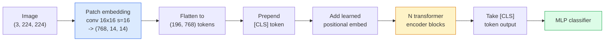

<!-- local-zh-machine-draft: English source is canonical; prose translated automatically, code/math preserved. -->

<a id="vision-transformers-vit"></a>

# Vision Transformers (ViT)

> 将图像切割成patches，将每个patch视为一个单词，运行一个标准的transformer。别回头。

**类型：** 构建
**语言：** Python
**先决条件：** 第 7 阶段第 02 课 (Self-Attention)、第 4 阶段第 04 课（图像分类）
**时间：** ~45分钟

<a id="learning-objectives"></a>

## 学习目标

- 实现 patch embedding，学习位置 embedding、类 token 和 transformer encoder 从头开始构建最小的 ViT
- 解释为什么 ViT 被认为需要大量 pretraining 数据，直到 DeiT 和 MAE 证明并非如此
- 比较 ViT、Swin 和 ConvNeXt 的架构先验（无、本地窗口 attention、Conv 主干）
- 使用 `timm` 和标准线性探针/微调配方在小型数据集上微调预训练的 ViT

<a id="the-problem"></a>

## 问题

十年来，卷积一直是计算机视觉的代名词。 CNNs 具有强大的 inductive biases — 局部性、翻译等价性 — 没有人认为您可以取代它。然后是多索维茨基等人。 （2020）表明，应用于平坦图像 patches 的普通 transformer（根本没有卷积机制）可以在规模上匹配或击败最好的 CNNs。

捕获量是“大规模的”。 ViT 在 ImageNet-1k 上输给了 ResNet。 ViT 在 ImageNet-21k 或 JFT-300M 上预训练，然后在 ImageNet-1k 上进行微调，击败了它。结论是 transformers 缺乏有用的先验，但可以从足够的数据中学习它们。随后的工作（DeiT、MAE、DINO）表明，通过正确的训练方法——强增强、自监督 pretraining、蒸馏——ViTs 在小数据上也能很好地训练。

到 2026 年，纯 CNNs 在边缘设备上仍然具有竞争力（ConvNeXt 最强），但 transformers 主导其他一切：分割（Mask2Former、SegFormer）、检测（DETR、RT-DETR）、多模态（CLIP、SigLIP）、视频（VideoMAE、VJEPA）。 ViT 块结构是需要了解的。

<a id="the-concept"></a>

## 概念

<a id="the-pipeline"></a>

### 管道



七步。 Patches -> tokens -> attention -> 分类器。每个变体（DeiT、Swin、ConvNeXt、MAE pretraining）都会更改七个变体中的一两个，而仅保留 rest。

<a id="patch-embedding"></a>

### Patch embedding

第一次会议是秘密。内核大小 16，步长 16，因此 224x224 图像变成 16x16 patches 的 14x14 网格，每个网格投影到 768 维的 embedding。该单个转换既可以修补又可以线性投影。

```
Input:  (3, 224, 224)
Conv (3 -> 768, k=16, s=16, no padding):
Output: (768, 14, 14)
Flatten spatial: (196, 768)
```

196patches= 196tokens。 每个token的feature维度为 768 (ViT-B), 1024 (ViT-L), 或 1280 (ViT-H）。

<a id="class-token"></a>

### token 类

序列前面添加一个学习向量：

```
tokens = [CLS; patch_1; patch_2; ...; patch_196]   shape (197, 768)
```

在 N 个 transformer 块之后，`[CLS]` 输出是全局图像表示。分类头只读取这一个向量。

<a id="positional-embedding"></a>

### 位置 embedding

Transformers 没有内置的空间位置概念。向每个 token 添加一个学习向量：

```
tokens = tokens + learned_pos_embedding   (also shape (197, 768))
```

embedding是该型号的parameter；基于gradient的训练使其适应2D图像结构。正弦二维替代方案存在，但在实践中很少使用。

<a id="transformer-encoder-block"></a>

### Transformer encoder 块

标准。多头self-attention，MLP，剩余连接，预LayerNorm。

```
x = x + MSA(LN(x))
x = x + MLP(LN(x))

MLP is two-layer with GELU: Linear(d -> 4d) -> GELU -> Linear(4d -> d)
```

ViT-B/16堆叠了12个这样的块，每个块有12个attention头，总共86M parameters。

<a id="why-pre-ln"></a>

### 为什么预 LN

早期的 transformers 使用后 LN (`x = LN(x + sublayer(x))`)，并且在没有 warmup 的情况下很难训练超过 6-8 层。 Pre-LN（`x = x + sublayer(LN(x))`）无需warmup即可稳定训练更深的网络。每个 ViT 和每个现代 LLM 都使用 pre-LN。

<a id="patch-size-trade-off"></a>

### Patch 尺寸权衡

- 16x16 patches -> 196 tokens，标准。
- 32x32 patches -> 49 tokens，速度更快，但分辨率较低。
- 8x8 patches -> 784 tokens，更精细，但 O(n^2) attention 成本扩展严重。

更大的 patches = 更少的 tokens = 更快但空间细节更少。 SwinV2 在分层窗口中使用 4x4 patches。

<a id="deits-recipe-for-training-vit-on-imagenet-1k"></a>

### DeiT 在 ImageNet-1k 上训练 ViT 的秘诀

原来的ViT需要JFT-300M才能击败CNNs。 DeiT（Touvron 等人，2020）仅在 ImageNet-1k 上将 ViT-B 训练为 81.8% top-1，并进行了四项更改：

1. 重度增强：RandAugment、Mixup、CutMix、随机擦除。
2. 随机深度（在训练期间随机丢弃整个块）。
3. 重复增强（每批对同一图像采样 3 次）。
4. 来自 CNN 教师的蒸馏（可选，进一步提高准确性）。

每个现代 ViT 训练配方都源自 DeiT。

<a id="swin-vs-convnext"></a>

### Swin 与 ConvNeXt

- **Swin**（Liu 等人，2021）——基于窗口的 attention。每个块都在本地窗口内参与；交替的块移动窗口以混合窗口之间的信息。在保留 attention 运算符的同时，先恢复类似 CNN 的局部性。
- **ConvNeXt** (Liu et al., 2022) — 重新设计的 CNN 与 Swin 的架构选择相匹配（深度方向转换、LayerNorm、GELU、反向瓶颈）。表明差距不是“attention vs 卷积”而是“现代训练配方+架构”。

2026年，ConvNeXt-V2和Swin-V2均达到生产级；正确的选择取决于您的 inference 堆栈（ConvNeXt 编译效果更好）和 pretraining 语料库。

<a id="mae-pretraining"></a>

### MAE pretraining

屏蔽自动编码器（He et al., 2022）：屏蔽 75%patches随机训练encoder仅处理可见的 25%，训练一小部分decoder重建蒙版patches从encoder的输出。 后pretraining，丢弃decoder并微调encoder。

MAE 使 ViT 可以单独在 ImageNet-1k 上进行训练，达到 SOTA，并且是当前默认的自我监督配方。

```figure
batchnorm-inference
```

<a id="build-it"></a>

## 动手实现

<a id="step-1-patch-embedding"></a>

### 步骤一：Patch embedding

```python
import torch
import torch.nn as nn

class PatchEmbedding(nn.Module):
    def __init__(self, in_channels=3, patch_size=16, dim=192, image_size=64):
        super().__init__()
        assert image_size % patch_size == 0
        self.proj = nn.Conv2d(in_channels, dim, kernel_size=patch_size, stride=patch_size)
        num_patches = (image_size // patch_size) ** 2
        self.num_patches = num_patches

    def forward(self, x):
        x = self.proj(x)
        return x.flatten(2).transpose(1, 2)
```

一种转换，一种压平，一种转置。这就是整个图像到 tokens 的步骤。

<a id="step-2-transformer-block"></a>

### 步骤2：Transformer区块

Pre-LN，多头 self-attention，带 GELU 的 MLP，剩余连接。

```python
class Block(nn.Module):
    def __init__(self, dim, num_heads, mlp_ratio=4, dropout=0.0):
        super().__init__()
        self.ln1 = nn.LayerNorm(dim)
        self.attn = nn.MultiheadAttention(dim, num_heads, dropout=dropout, batch_first=True)
        self.ln2 = nn.LayerNorm(dim)
        self.mlp = nn.Sequential(
            nn.Linear(dim, dim * mlp_ratio),
            nn.GELU(),
            nn.Dropout(dropout),
            nn.Linear(dim * mlp_ratio, dim),
            nn.Dropout(dropout),
        )

    def forward(self, x):
        a, _ = self.attn(self.ln1(x), self.ln1(x), self.ln1(x), need_weights=False)
        x = x + a
        x = x + self.mlp(self.ln2(x))
        return x
```

`nn.MultiheadAttention` 处理头部分割、缩放点积和输出投影。 `batch_first=True` 因此形状为 `(N, seq, dim)`。

<a id="step-3-the-vit"></a>

### 步骤3：ViT

```python
class ViT(nn.Module):
    def __init__(self, image_size=64, patch_size=16, in_channels=3,
                 num_classes=10, dim=192, depth=6, num_heads=3, mlp_ratio=4):
        super().__init__()
        self.patch = PatchEmbedding(in_channels, patch_size, dim, image_size)
        num_patches = self.patch.num_patches
        self.cls_token = nn.Parameter(torch.zeros(1, 1, dim))
        self.pos_embed = nn.Parameter(torch.zeros(1, num_patches + 1, dim))
        self.blocks = nn.ModuleList([
            Block(dim, num_heads, mlp_ratio) for _ in range(depth)
        ])
        self.ln = nn.LayerNorm(dim)
        self.head = nn.Linear(dim, num_classes)
        nn.init.trunc_normal_(self.pos_embed, std=0.02)
        nn.init.trunc_normal_(self.cls_token, std=0.02)

    def forward(self, x):
        x = self.patch(x)
        cls = self.cls_token.expand(x.size(0), -1, -1)
        x = torch.cat([cls, x], dim=1)
        x = x + self.pos_embed
        for blk in self.blocks:
            x = blk(x)
        x = self.ln(x[:, 0])
        return self.head(x)

vit = ViT(image_size=64, patch_size=16, num_classes=10, dim=192, depth=6, num_heads=3)
x = torch.randn(2, 3, 64, 64)
print(f"output: {vit(x).shape}")
print(f"params: {sum(p.numel() for p in vit.parameters()):,}")
```

大约 280 万个 parameters — CPU 上的一个小型 ViT。真实ViT-B为86M；与 `dim=768, depth=12, num_heads=12` 相同的类定义。

<a id="step-4-sanity-check--single-image-inference"></a>

### 第 4 步：完整性检查 — 单张图像 inference

```python
logits = vit(torch.randn(1, 3, 64, 64))
print(f"logits: {logits}")
print(f"probs:  {logits.softmax(-1)}")
```

运行应该没有错误。概率总和为 1。

<a id="use-it"></a>

## 实际应用

`timm` 附带 ImageNet 预训练的 weights 的每个 ViT 变体。一行：

```python
import timm

model = timm.create_model("vit_base_patch16_224", pretrained=True, num_classes=10)
```

`timm` 是 vision transformers 2026 年的生产默认值。支持 ViT、DeiT、Swin、Swin-V2、ConvNeXt、ConvNeXt-V2、MaxViT、MViT、EfficientFormer 以及相同条件下的数十个其他版本API。

对于多模式工作（图像+文本），`transformers` 提供 CLIP、SigLIP、BLIP-2、LLaVA。所有这些中的图像 encoder 都是 ViT 变体。

<a id="ship-it"></a>

## 交付成果

本课产生：

- `outputs/prompt-vit-vs-cnn-picker.md` — prompt，根据数据集大小、计算和 inference 堆栈在 ViT、ConvNeXt 或 Swin 之间进行选择。
- `outputs/skill-vit-patch-and-pos-embed-inspector.md` - 验证 ViT 的 patch embedding 和位置 embedding 形状是否与模型的预期序列长度匹配的技能，捕获最常见的移植错误。

<a id="exercises"></a>

## 练习

1. **(简单)** 通过上面的小ViT打印出每个中间tensor的形状为forward pass。确认：输入 `(N, 3, 64, 64)` -> patches `(N, 16, 192)` -> 带有 CLS `(N, 17, 192)` -> 分类器输入 `(N, 192)` -> 输出 `(N, num_classes)`。
2. **(Medium)** 在第 4 课的合成 CIFAR 数据集上微调预训练的 `timm` ViT-S/16。与 ResNet-18 fine-tuning 进行比较数据。报告训练时间和最终准确性。
3. **（硬）** 为小型 ViT 实施 MAE pretraining：掩码 patches 的 75%，训练 encoder + 小型decoder 重建屏蔽的 patches。评估 pretraining 前后合成数据的线性探针精度。

<a id="key-terms"></a>

## 关键术语

| 术语 | 人们怎么说 | 它实际上意味着什么 |
|------|----------------|----------------------|
| Patch embedding | “第一次会议” | 内核大小 = stride = patch 大小的卷积；将图像变成 token embeddings 的网格 |
| token 类 | “[CLS]” | token 序列前面的学习向量；它的最终输出是全局图像表示 |
| 位置 embedding | 《学到了POS》 | 添加到每个 token 的学习向量，以便 transformer 知道每个 patch 来自哪里 |
| 预LN | “子层之前的 LayerNorm” | 稳定的transformer变体：`x + sublayer(LN(x))`而不是`LN(x + sublayer(x))` |
| 多头 attention | “并行attention” | 标准 transformer attention 拆分为 num_heads 个独立子空间，然后连接 |
| ViT-B/16 | “底座，patch 16” | 规范尺寸：dim=768，深度=12，heads=12，patch_size=16，image=224； ~86M 参数 |
| 德伊特 | “数据高效 ViT” | ViT 单独在 ImageNet-1k 上进行训练，具有很强的增强功能；事实证明，并不严格需要大型 pretraining 数据集 |
| MAE | “屏蔽自动编码器” | 自监督pretraining：掩码patches的75%，重建；占主导地位的 ViT pretraining 配方 |

<a id="further-reading"></a>

## 进一步阅读

- [An Image is Worth 16x16 Words (Dosovitskiy et al., 2020)](https://arxiv.org/abs/2010.11929) — ViT 论文
- [DeiT：数据高效图像 Transformers（Touvron 等人，2020）](https://arxiv.org/abs/2012.12877) — 如何单独在 ImageNet-1k 上训练 ViT
- [Masked Autoencoders 是可扩展的视觉学习器（He et al., 2022）](https://arxiv.org/abs/2111.06377) — MAE pretraining
- [timm 文档](https://huggingface.co/docs/timm) — 您将在生产中使用的每个 vision transformer 的参考
