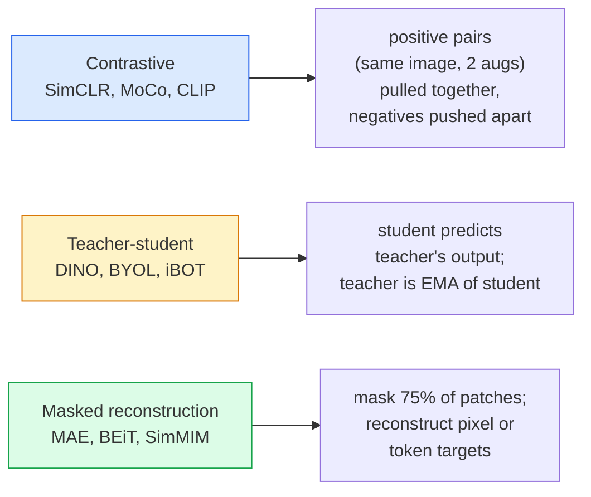

<!-- local-zh-machine-draft: English source is canonical; prose translated automatically, code/math preserved. -->

<a id="self-supervised-vision--simclr-dino-mae"></a>

# 自监督视觉 — SimCLR、DINO、MAE

> 标签是监督视觉的瓶颈。自监督 pretraining 删除了它们：从 100M 未标记图像中学习视觉 features，在 10k 标记图像上进行微调。

**类型：** 学习 + 构建
**语言：** Python
**先决条件：** 第 4 阶段第 04 课（图像分类）、第 4 阶段第 14 课 (ViT)
**时间：** ~75分钟

<a id="learning-objectives"></a>

## 学习目标

- Trace 三个主要的自监督系列——对比（SimCLR）、师生（DINO）、掩模重建（MAE）——并说明每个系列的优化内容
- 从头开始实现 InfoNCE 损失并解释为什么一批 512 有效但一批 32 失败
- 解释为什么 MAE 的 75% 屏蔽率不是任意的，以及它与 BERT 的 15% 文本屏蔽率有何不同
- 使用 DINOv2 或 MAE ImageNet checkpoints 进行线性探测和 zero-shot 检索

<a id="the-problem"></a>

## 问题

Supervised ImageNet 有 130 万张标记图像，注释成本估计为 1000 万美元。医疗和工业数据集较小，标记成本甚至更高。每个视觉团队都会问：我们能否对廉价的未标记数据（YouTube 帧、网络爬行、网络摄像头片段、卫星扫描）进行预训练，然后在小型标记集上进行微调？

自我监督学习就是答案。在 LAION 或 JFT 上训练的现代自监督 ViT 在微调后达到或超过了监督 ImageNet 的准确性。与有监督的 pretraining 相比，它还可以更好地传输到下游任务（检测、分割、深度）。 DINOv2（Meta，2023）和 MAE（Meta，2022）是可转移视觉 features 当前的生产默认值。

概念上的转变是，借口任务（模型被训练要做的事情）不一定是下游任务。重要的是它迫使模型学习有用的 features。预测灰度图像的颜色、旋转图像并要求模型对旋转进行分类、屏蔽 patches 并重建它们 - 所有这些都有效。三种可扩展的方法是 contrastive learning、师生蒸馏和掩模重建。

<a id="the-concept"></a>

## 概念

<a id="three-families"></a>

### 三个家庭



<a id="contrastive-learning-simclr"></a>

### Contrastive learning (SimCLR)

拍摄一张图像，应用两次随机增强，获得两个视图。通过相同的 encoder 和投影头进行馈送。最小化“这两个 embeddings 应该接近”和“这个 embedding 应该远离批次中所有其他图像的 embeddings”的损失。

```
Loss for positive pair (z_i, z_j) among 2N views per batch:

   L_ij = -log( exp(sim(z_i, z_j) / tau) / sum_k in batch \ {i} exp(sim(z_i, z_k) / tau) )

sim = cosine similarity
tau = temperature (0.1 standard)
```

这就是 InfoNCE 损失。每个正数都需要许多负数，因此 batch size 很重要 — SimCLR 需要 512-8192。 MoCo 引入了过去批次的动量队列，以将负计数与 batch size 解耦。

<a id="teacher-student-dino"></a>

### 师生（恐龙）

具有相同架构的两个网络：学生和教师。老师是学生weights的指数移动平均线（EMA）。两者都看到图像的增强视图。学生的输出经过训练以匹配老师的输出——没有明确的否定。

```
loss = CE( student_output(view_1),  teacher_output(view_2) )
     + CE( student_output(view_2),  teacher_output(view_1) )

teacher_weights = m * teacher_weights + (1 - m) * student_weights   (m ≈ 0.996)
```

为什么它不会崩溃以“预测常数”：教师的输出是中心化的（减去每个维度的平均值）并锐化的（除以小temperature）。居中可防止某一维度占主导地位；锐化可防止输出崩溃至均匀。

DINO 是 DINOv2 在 1.42 亿张精选图像上进行放大的结果。生成的 features 是 zero-shot 视觉检索和密集预测的当前 SOTA。

<a id="masked-reconstruction-mae"></a>

### 掩模重建（MAE）

屏蔽 ViT 输入的 patches 的 75%。仅通过 encoder 传递可见的 25%。一个小的 decoder 接收 encoder 的输出以及掩码位置处的掩码 tokens，并被训练以重建掩码 patches 的像素。

```
Encoder:  visible 25% of patches -> features
Decoder:  features + mask tokens at masked positions -> reconstructed pixels
Loss:     MSE between reconstructed and original pixels on masked patches only
```

使 MAE 发挥作用的关键设计选择：

- **75%掩膜比** — 高。强制encoder学习语义features；重建 25% 几乎是微不足道的（相邻像素的相关性如此之高，CNN 就可以解决）。
- **A对称 encoder/decoder** — 大 ViT encoder 只看到可见的 patches；一个小的 decoder（8 层，512 维）负责重建。 pretraining 比 naive BEiT 快 3 倍。
- **像素空间重建目标**——比BEiT的标记化目标更简单，并且在ViT上效果更好。

pretraining之后，丢弃decoder。 encoder 是 feature 提取器。

<a id="why-75-and-not-15"></a>

### 为什么是 75% 而不是 15%

BERT 掩盖了 tokens 的 15%。 MAE 掩蔽 75%。区别在于信息密度。

- 根据 token，自然语言具有很高的熵。预测 tokens 的 15% 仍然很困难，因为每个掩码位置都有许多看似合理的完成。
- 图像 patches 具有低熵 - 未屏蔽的邻域通常几乎准确地确定屏蔽 patch 的像素。为了进行需要语义理解的预测，你必须积极地进行屏蔽。

75% 已经足够高，简单的空间外推法无法解决该任务； encoder 必须代表图像内容。

<a id="linear-probe-evaluation"></a>

### 线性探头 evaluation

自监督pretraining后，标准evaluation是**线性探针**：冻结encoder，在ImageNet标签上训练单个线性分类器。报告 top-1 准确度。

- SimCLR ResNet-50：~71% (2020)
- 迪诺 ViT-S/16：~77% (2021)
- MAE ViT-L/16：~76% (2022)
- DINOv2 ViT-g/14：~86% (2023)

线性探头是feature品质的纯粹衡量标准； fine-tuning 通常会增加 2-5 点，但也会混合头部再训练的效果。

```figure
data-augmentation
```

<a id="build-it"></a>

## 动手实现

<a id="step-1-two-view-augmentation-pipeline"></a>

### 第 1 步：双视图增强管道

```python
import torch
import torchvision.transforms as T

two_view_train = lambda: T.Compose([
    T.RandomResizedCrop(96, scale=(0.2, 1.0)),
    T.RandomHorizontalFlip(),
    T.ColorJitter(0.4, 0.4, 0.4, 0.1),
    T.RandomGrayscale(p=0.2),
    T.ToTensor(),
])


class TwoViewDataset(torch.utils.data.Dataset):
    def __init__(self, base):
        self.base = base
        self.aug = two_view_train()

    def __len__(self):
        return len(self.base)

    def __getitem__(self, i):
        img, _ = self.base[i]
        v1 = self.aug(img)
        v2 = self.aug(img)
        return v1, v2
```

每个 __getitem__ 返回同一图像的两个增强视图；不需要标签。

<a id="step-2-infonce-loss"></a>

### 第 2 步：InfoNCE 损失

```python
import torch.nn.functional as F

def info_nce(z1, z2, tau=0.1):
    """
    z1, z2: (N, D) L2-normalised embeddings of paired views
    """
    N, D = z1.shape
    z = torch.cat([z1, z2], dim=0)  # (2N, D)
    sim = z @ z.T / tau              # (2N, 2N)

    mask = torch.eye(2 * N, dtype=torch.bool, device=z.device)
    sim = sim.masked_fill(mask, float("-inf"))

    targets = torch.cat([torch.arange(N, 2 * N), torch.arange(0, N)]).to(z.device)
    return F.cross_entropy(sim, targets)
```

调用前 L2-归一化 embeddings。 `tau=0.1` 是 SimCLR 默认值；越低，损失就越严重，并且需要更多的负值。

<a id="step-3-sanity-check-infonce"></a>

### 第 3 步：健全性检查 InfoNCE

```python
z1 = F.normalize(torch.randn(16, 32), dim=-1)
z2 = z1.clone()
loss_same = info_nce(z1, z2, tau=0.1).item()
z2_random = F.normalize(torch.randn(16, 32), dim=-1)
loss_random = info_nce(z1, z2_random, tau=0.1).item()
print(f"InfoNCE with identical pairs:  {loss_same:.3f}")
print(f"InfoNCE with random pairs:     {loss_random:.3f}")
```

相同的对应该给出低损耗（对于大批量和冷 temperature 接近 0）。对于 16 对批次，随机对应给出 log(2N-1) = ~log(31) = ~3.4。

<a id="step-4-mae-style-masking"></a>

### 第 4 步：MAE 式掩蔽

```python
def random_mask_indices(num_patches, mask_ratio=0.75, seed=0):
    g = torch.Generator().manual_seed(seed)
    n_keep = int(num_patches * (1 - mask_ratio))
    perm = torch.randperm(num_patches, generator=g)
    visible = perm[:n_keep]
    masked = perm[n_keep:]
    return visible.sort().values, masked.sort().values


num_patches = 196
visible, masked = random_mask_indices(num_patches, mask_ratio=0.75)
print(f"visible: {len(visible)} / {num_patches}")
print(f"masked:  {len(masked)} / {num_patches}")
```

对于给定的种子来说简单、快速且确定。真正的 MAE 实现对此进行批处理并保留每个样本的掩模。

<a id="use-it"></a>

## 实际应用

DINOv2是2026年的生产标准：

```python
import torch
from transformers import AutoImageProcessor, AutoModel

processor = AutoImageProcessor.from_pretrained("facebook/dinov2-base")
model = AutoModel.from_pretrained("facebook/dinov2-base")
model.eval()

# Per-image embeddings for zero-shot retrieval
with torch.no_grad():
    inputs = processor(images=[pil_image], return_tensors="pt")
    outputs = model(**inputs)
    embedding = outputs.last_hidden_state[:, 0]  # CLS token
```

由此产生的 768 维 embedding 是现代图像检索、密集对应和 zero-shot 传输管道的支柱。 Fine-tuning 下游任务很少需要比线性头更多的东西。

对于图像文本 embeddings，SigLIP 或 OpenCLIP 是等效的；对于 MAE 样式的 fine-tuning，`timm` 存储库运送每个 MAE checkpoint。

<a id="ship-it"></a>

## 交付成果

本课产生：

- `outputs/prompt-ssl-pretraining-picker.md` — 一个 prompt，根据给定的数据集大小、计算和下游任务选择 SimCLR / MAE / DINOv2。
- `outputs/skill-linear-probe-runner.md` — 为任何冻结的 encoder + 标记数据集编写线性探针 evaluation 的技能。

<a id="exercises"></a>

## 练习

1. **(Easy)** 验证当您减少 temperature 时，InfoNCE 损失会下降（对于良好对齐的 embeddings），当您减少 temperature 时，InfoNCE 损失会上升（对于随机） embeddings。绘制 `tau in [0.05, 0.1, 0.2, 0.5]` 与损失的关系图。
2. **(Medium)** 实现 DINO 风格的中心缓冲区。证明如果没有中心化，学生会在几个时期内崩溃到一个常数向量。
3. **(硬)** 使用第 10 课中的 TinyUNet 作为骨干在 CIFAR-100 上训练 MAE。报告 10、50 和 200 epoch 时的线性探针精度。证明 MAE 预训练的线性探针在相同的 1,000 个图像子集上击败了从头开始的监督线性探针。

<a id="key-terms"></a>

## 关键术语

| 术语 | 人们怎么说 | 它实际上意味着什么 |
|------|----------------|----------------------|
| 自我监督 | “无标签” | 从未标记的数据生成有用表示的借口任务 |
| 借口任务 | 《假任务》 | SSL期间使用的目标（重建patches，匹配视图）； pretraining后丢弃 |
| 线性探头 | 《冰冻encoder+线性头》 | 标准 SSL evaluation：仅在冻结的 features 之上训练线性分类器 |
| 信息NCE | “对比损失” | softmax 超过 cosine similarities；正对是目标类，所有其他都是负类 |
| EMA老师 | 《移动平均线老师》 | 老师的 weights 是学生的指数移动平均值；由 BYOL、MoCo、DINO 使用 |
| 掩模比 | “patches 的%已隐藏” | MAE 期间屏蔽的 patches 的分数； 75% 用于视觉，15% 用于文本 |
| 代表性崩溃 | “持续输出” | SSL 故障，encoder 为所有输入输出恒定向量；通过居中、锐化或负片来防止 |
| 恐龙v2 | “生产 SSL 主干网” | Meta的2023年自监督ViT； 2026年最强通用镜像features |

<a id="further-reading"></a>

## 进一步阅读

- [SimCLR（Chen 等人，2020）](https://arxiv.org/abs/2002.05709) — contrastive learning 参考
- [DINO (Caron et al., 2021)](https://arxiv.org/abs/2104.14294) — 具有动力、居中、锐化的师生
- [MAE（He et al., 2022）](https://arxiv.org/abs/2111.06377) — ViT 的屏蔽自动编码器 pretraining
- [DINOv2（Oquab 等人，2023）](https://arxiv.org/abs/2304.07193) — 将自监督 ViT 扩展到生产 features
