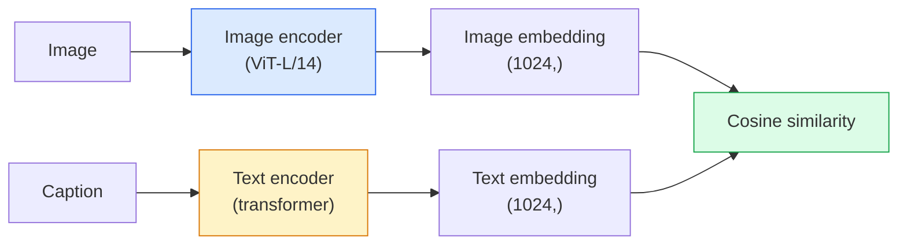

<!-- local-zh-machine-draft: English source is canonical; prose translated automatically, code/math preserved. -->

<a id="open-vocabulary-vision--clip"></a>

# 开放词表（Open-Vocabulary）视觉——CLIP

> 一起训练图像 encoder 和文本 encoder ，以便匹配的（图像，标题）对落在共享空间中的同一点。这就是整个技巧。

**类型：** 构建 + 使用
**语言：** Python
**先决条件：** 第 4 阶段第 14 课 (ViT)、第 4 阶段第 17 课（自我监督）
**时间：** ~45分钟

<a id="learning-objectives"></a>

## 学习目标

- 解释CLIP的两塔架构和对比训练目标
- 使用预训练的 CLIP（或 SigLIP）进行 zero-shot 分类，无需任何特定于任务的训练
- 从头开始实现 zero-shot 分类：编码类 prompts，计算 cosine similarity，取 argmax
- 区分 CLIP、SigLIP、OpenCLIP 和 LLaVA/LLaMA-vision 模型 — 每个模型在 2026 年的用途

<a id="the-problem"></a>

## 问题

传统分类器是封闭的-vocabulary：1000类ImageNet模型只能预测1000个标签。每个新类别都需要标记数据和重新训练的头脑。

CLIP（Radford 等人，OpenAI 2021）表明，对从网络上抓取的 4 亿（图像、标题）对进行训练会生成一个模型，该模型可以分类为 inference 中的任何类别集，并纯粹用自然语言描述。你可以通过写一个句子来给它一个新的类。

这种能力（zero-shot 传输）就是为什么每个现代视觉系统都从 CLIP 系列 checkpoint 开始。检测（Grounding DINO、OWL-ViT）、分割（CLIPSeg、SAM）、检索、内容审核、VLM 和文本到图像生成均基于 CLIP 样式联合 embeddings 构建。

<a id="the-concept"></a>

## 概念

<a id="two-towers"></a>

### 两座塔



两个 encoders 均以相同 embedding 尺寸的线性投影结束（CLIP-B/32 为 512，CLIP-L/14 为 1024）。 L2 归一化并计算 cosine similarity。

<a id="the-objective"></a>

### 目标

给定一批 N（图像、标题）对，构建 NxN 相似度矩阵。训练两个 encoders ，使对角线（匹配对）具有高相似性，非对角线（不匹配）具有低相似性。

```
sim_matrix = image_embeddings @ text_embeddings.T / tau

loss_i2t = cross_entropy(sim_matrix,       targets=arange(N))
loss_t2i = cross_entropy(sim_matrix.T,     targets=arange(N))
loss = (loss_i2t + loss_t2i) / 2
```

对称是因为图像到文本和文本到图像检索都应该有效。 `tau` (temperature) 通常被学习为标量 parameter，初始化为 0.07。

<a id="siglip-a-better-loss"></a>

### SigLIP：更好的损失

SigLIP（Zhai 等人，2023）用每对 sigmoid 替换了 softmax：

```
loss = mean over pairs of log(1 + exp(-y_ij * sim_ij))
y_ij = +1 if matching, -1 otherwise
```

每对丢失消除了 CLIP 所需的批量级标准化。 SigLIP 在小 batch sizes 上训练得更好，并且在相同数据下匹配或超过 CLIP。

<a id="zero-shot-classification"></a>

### Zero-shot分类

给定一个训练有素的 CLIP：

1. 对于每个班级，编写一个 prompt：“{class} 的照片”。
2. 使用文本 encoder -> `T` 形状（C，d）对所有类 prompts 进行编码。
3. 对测试图像进行编码 -> `I` 形状 (1, d)。
4. 相似度 = `I @ T.T` 形状 (1, C)。
5. Argmax -> 预测类别。

Prompt engineering 很重要。 OpenAI 发布了 80 个用于 ImageNet 的 prompt 模板（“{} 的照片”、“{} 的模糊照片”、“{} 的草图”，...）。平均每个类所有模板的 embeddings，以获得额外 1-3% 的 top-1 准确度。

<a id="where-clip-style-models-are-used-in-2026"></a>

### 2026 年使用 CLIP 式模型的地方

- **Zero-shot分类**—直接使用。
- **图像检索** — 对所有图像进行一次编码，在inference处嵌入查询。
- **文本条件检测** — Grounding DINO、OWL-ViT 将 CLIP 文本塔包裹在检测器周围。
- ** 文本条件分割** — CLIPSeg; SAM 通过 CLIP 使用文本 prompt 输入。
- **VLMs** — LLaVA、Qwen-VL、InternVL 将 CLIP 系列视觉 encoder 连接到 LLM。
- ** 文本到图像 gen** — CLIP 文本 embeddings 上的稳定扩散、DALL-E 3 条件。

一旦你有了 shared embedding space，每个视觉+语言任务就变成了距离计算。

```figure
clip-contrastive
```

<a id="build-it"></a>

## 动手实现

<a id="step-1-a-tiny-two-tower-model"></a>

### 第 1 步：微型两塔模型

真正的CLIP是ViT + transformer。在本课中，塔是预先提取的 features 上的小型 MLP，因此训练信号在 CPU 上可见。

```python
import torch
import torch.nn as nn
import torch.nn.functional as F


class TwoTower(nn.Module):
    def __init__(self, img_in=128, txt_in=64, emb=64):
        super().__init__()
        self.image_proj = nn.Sequential(nn.Linear(img_in, 128), nn.ReLU(), nn.Linear(128, emb))
        self.text_proj = nn.Sequential(nn.Linear(txt_in, 128), nn.ReLU(), nn.Linear(128, emb))
        self.logit_scale = nn.Parameter(torch.ones([]) * 2.6592)  # ln(1/0.07)

    def forward(self, img_feats, txt_feats):
        i = F.normalize(self.image_proj(img_feats), dim=-1)
        t = F.normalize(self.text_proj(txt_feats), dim=-1)
        return i, t, self.logit_scale.exp()
```

两个投影，shared-dim输出，学习了temperature。与真实 CLIP API 形状相同。

<a id="step-2-contrastive-loss"></a>

### 步骤2：对比损失

```python
def clip_loss(image_emb, text_emb, logit_scale):
    N = image_emb.size(0)
    sim = logit_scale * image_emb @ text_emb.T
    targets = torch.arange(N, device=sim.device)
    l_i = F.cross_entropy(sim, targets)
    l_t = F.cross_entropy(sim.T, targets)
    return (l_i + l_t) / 2
```

对称。较高的 logit_scale = 更锐利的 softmax = 更有信心，但存在不稳定风险。

<a id="step-3-zero-shot-classifier"></a>

### 步骤3：Zero-shot分类器

```python
@torch.no_grad()
def zero_shot_classify(model, image_feats, class_text_feats, class_names):
    """
    image_feats:      (N, img_in)
    class_text_feats: (C, txt_in)   one averaged embedding per class
    """
    i = F.normalize(model.image_proj(image_feats), dim=-1)
    t = F.normalize(model.text_proj(class_text_feats), dim=-1)
    sim = i @ t.T
    pred = sim.argmax(dim=-1)
    return [class_names[p] for p in pred.tolist()]
```

每一步一行。这正是与生产 CLIP checkpoint 一起使用的 zero-shot 过程。

<a id="step-4-sanity-check"></a>

### 第 4 步：健全性检查

```python
torch.manual_seed(0)
model = TwoTower()

img = torch.randn(8, 128)
txt = torch.randn(8, 64)
i, t, scale = model(img, txt)
loss = clip_loss(i, t, scale)
print(f"batch size: {i.size(0)}   loss: {loss.item():.3f}")
```

对于随机初始化的模型，损失应该接近 `log(N) = log(8) = 2.08`——尚未学习结构时的对称 cross-entropy 目标。

<a id="use-it"></a>

## 实际应用

OpenCLIP 是 2026 年社区默认的：

```python
import open_clip
import torch
from PIL import Image

model, _, preprocess = open_clip.create_model_and_transforms("ViT-B-32", pretrained="laion2b_s34b_b79k")
tokenizer = open_clip.get_tokenizer("ViT-B-32")

image = preprocess(Image.open("dog.jpg")).unsqueeze(0)
text = tokenizer(["a photo of a dog", "a photo of a cat", "a photo of a car"])

with torch.no_grad():
    image_features = model.encode_image(image)
    text_features = model.encode_text(text)
    image_features = image_features / image_features.norm(dim=-1, keepdim=True)
    text_features = text_features / text_features.norm(dim=-1, keepdim=True)
    probs = (100.0 * image_features @ text_features.T).softmax(dim=-1)

print(probs)
```

SigLIP 较新，在小规模下训练得更好，并且是新工作的首选：`google/siglip-base-patch16-224`。 Hugging Face 两者都包含。

<a id="ship-it"></a>

## 交付成果

本课产生：

- `outputs/prompt-zero-shot-class-picker.md` — 一个 prompt，它为给定类列表和域的 zero-shot CLIP 设计类模板。
- `outputs/skill-image-text-retriever.md` — 使用任意 CLIP checkpoint 构建图像 embedding 索引的技能，支持按文本查询和按图像查询。

<a id="exercises"></a>

## 练习

1. **(Easy)** 使用预训练的 OpenCLIP ViT-B/32 并使用 80 个模板 prompt 集在 CIFAR-10 上执行 zero-shot 分类。报告 top-1 准确率；应该在85-90%左右。
2. **（中）** 在同一 CIFAR-10 任务上比较单模板（“{} 的照片”）与 80 个模板的平均 embeddings。量化差距并解释为什么模板有帮助。
3. **(Hard)** 构建zero-shot图像检索索引：使用CLIP嵌入1000张图像，构建FAISS索引，使用自然语言描述进行查询。针对您手写的 20 个保留查询报告检索召回@5。

<a id="key-terms"></a>

## 关键术语

| 术语 | 人们怎么说 | 它实际上意味着什么 |
|------|----------------|----------------------|
| 两塔式 | “双encoder” | 分离图像和文本 encoders 以共享暗淡投影头结尾 |
| Zero-shot | “没有针对特定任务的培训” | 分类为仅通过文字描述的类别，inference；没有触及任何标签 |
| Temperature / logit_scale | “头” | softmax 之前缩放相似度矩阵的学习标量 |
| Prompt模板 | “一张 {} 的照片” | 类名的自然语言包装；对许多模板进行平均可以提高 zero-shot 的准确性 |
| 剪辑 | “图像+文字模型” | 2021款OpenAI型号； 2026年该领域的vocabulary |
| 西格利普 | “Sigmoid 剪辑” | 将 softmax 交换为每对 sigmoid；小批量训练效果更好 |
| 开放式剪辑 | “开放复制” | LAION 上社区训练的 CLIP 变体；开源管道的生产默认值 |
| 视觉语言管理 | "Vision-language model" | CLIP 系列 encoder 加上 LLM，经过训练可以回答有关图像的问题 |

<a id="further-reading"></a>

## 进一步阅读

- [CLIP：从自然语言监督中学习可迁移的视觉模型（Radford 等人，2021）](https://arxiv.org/abs/2103.00020)
- [SigLIP：Sigmoid 语言图像预训练损失（Zhai et al., 2023）](https://arxiv.org/abs/2303.15343)
- [OpenCLIP](https://github.com/mlfoundations/open_clip) — 社区代码库
- [Oquab 等人。 （2023）。 DINOv2：在没有监督的情况下学习鲁棒视觉 Features](https://arxiv.org/abs/2304.07193) — 论文，其中 feature 针对 CLIP 风格和 MAE 风格模型进行基准测试
