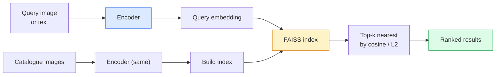

<!-- local-zh-machine-draft: English source is canonical; prose translated automatically, code/math preserved. -->

<a id="image-retrieval--metric-learning"></a>

# 图像检索和度量学习

> 检索系统在 embedding 空间中按距离对候选者进行排名。度量学习是塑造空间的学科，因此距离意味着你想要的。

**类型：** 构建
**语言：** Python
**先决条件：** 第 4 阶段第 14 课 (ViT)、第 4 阶段第 18 课 (CLIP)
**时间：** ~45分钟

<a id="learning-objectives"></a>

## 学习目标

- 解释三元组、对比和基于代理的度量学习损失，并为给定的数据集选择正确的损失
- 正确实施 L2 标准化和 cosine similarity 并审核“相同项目”和“相同类别”检索之间的差异
- 构建 FAISS 索引，通过文本和图像查询，并针对保留的查询集报告 recall@K
- 使用 DINOv2、CLIP 和 SigLIP 作为现成的 embedding 主干网并了解各自何时获胜

<a id="the-problem"></a>

## 问题

检索在生产视觉中无处不在：重复检测、反向图像搜索、视觉搜索（“查找相似产品”）、人脸重新识别、用于监控的人员重新识别、电子商务的实例级匹配。产品问题始终相同：“给定此查询图像，对我的目录进行排名。”

两个设计决策塑造了整个系统。 embedding — 什么模型产生向量。索引——如何大规模查找最近邻居。两者都将在 2026 年成为商品（DINOv2 代表 embedding，FAISS 代表指数），这提高了标准：困难的部分是为您的应用定义 * 算作相似的 *，然后塑造 embedding 空间，使距离匹配。

这种塑造就是度量学习。这是一个规模虽小但影响力很大的学科。

<a id="the-concept"></a>

## 概念

<a id="retrieval-at-a-glance"></a>

### 检索一目了然



<a id="the-four-loss-families"></a>

### 四个失去亲人的家庭

| 损失 | 需要 | 优点 | 缺点 |
|------|----------|------|------|
| **对比** | （锚点，正）+ 负 | 简单，适用于任何配对标签 | 收敛速度慢，没有太多负面影响 |
| **三元组** | （锚点、正向、负向） | 直观；直接保证金控制 | 硬三重态挖矿成本高昂 |
| **NT-Xent / InfoNCE** | 成对 + 批量挖掘底片 | 可扩展到大批量 | 需要大批量或动量队列 |
| **基于代理（ProxyNCA）** | 仅类别标签 | 快速、稳定、免挖矿 | 可能会过度拟合小数据集上的代理 |

对于大多数生产用例，从预训练的主干网开始，并且仅在现成的 embeddings 在测试集上表现不佳时才添加度量学习微调。

<a id="triplet-loss-formally"></a>

### 正式的三重态损失

```
L = max(0, ||f(a) - f(p)||^2 - ||f(a) - f(n)||^2 + margin)
```

将锚`a`拉近正`p`，将其推离负`n`，并用`margin`确保间隙。三图像结构可推广到任何相似性排序。

挖矿很重要：简单的三元组（`n` 已经远离 `a`）贡献零损失；只有困难的三元组才能教授网络。半硬挖矿（`n` 比 `p` 更进一步，但在余量范围内）是 2016 年 FaceNet 的秘诀，并且仍然占据主导地位。

<a id="cosine-similarity-vs-l2"></a>

### Cosine similarity vs L2

两个指标，两个约定：

- **Cosine**：向量之间的角度。需要 L2 归一化 embeddings。
- **L2**：欧几里德距离。适用于原始或标准化 embeddings，但通常与 L2 标准化 + 平方 L2 配对。

对于大多数现代网络来说，两者是等效的：`||a - b||^2 = 2 - 2 cos(a, b)` 和 `||a|| = ||b|| = 1`。选择与您的 embedding 训练相匹配的约定；默默地混合它们会改变“最近”的含义。

<a id="recallk"></a>

### Recall@K

标准检索指标：

```
recall@K = fraction of queries where at least one correct match is in the top K results
```

并排报告召回@1、@5、@10。 recall@10 高于 0.95，recall@1 低于 0.5 意味着 embedding 空间具有正确的结构，但排名有噪音 - 尝试更长的微调或重新排名步骤。

对于重复检测， precision@K 更重要，因为每个误报都是用户可见的错误。对于视觉搜索，recall@K 是产品信号。

<a id="faiss-in-one-paragraph"></a>

### FAISS 在一段话中

Facebook 人工智能相似性搜索。用于最近邻搜索的事实上的库。三个索引选择：

- `IndexFlatIP` / `IndexFlatL2` — 蛮力，精确，无需训练。使用最多约 1M 个向量。
- `IndexIVFFlat` — 划分为 K 个单元格，仅搜索最近的几个单元格。近似、快速、需要训练数据。
- `IndexHNSW` — 基于图形，对于许多查询来说速度最快，索引大小较大。

对于 100k 个向量，您可能需要 cosine similarity 上的 `IndexFlatIP`。对于 10M，您需要 `IndexIVFFlat`。对于 100M+ 与乘积量化相结合 (`IndexIVFPQ`)。

<a id="instance-level-vs-category-level-retrieval"></a>

### 实例级检索与类别级检索

两个截然不同的同名问题：

- **类别级别** —“在我的目录中查找猫。”类条件相似性；现成的 CLIP / DINOv2 embeddings 效果很好。
- **实例级** —“在我的目录中找到*这个确切的产品*。”需要对同一类别的视觉上相似的对象进行细粒度的区分；现货 embeddings 表现不佳； fine-tuning 与度量学习很重要。

在选择模型之前，请务必询问您正在解决哪个问题。

```figure
metric-embedding
```

<a id="build-it"></a>

## 动手实现

<a id="step-1-triplet-loss"></a>

### 第 1 步：三重态损失

```python
import torch
import torch.nn.functional as F

def triplet_loss(anchor, positive, negative, margin=0.2):
    d_ap = F.pairwise_distance(anchor, positive, p=2)
    d_an = F.pairwise_distance(anchor, negative, p=2)
    return F.relu(d_ap - d_an + margin).mean()
```

一行。适用于 L2 标准化或原始 embeddings。

<a id="step-2-semi-hard-mining"></a>

### 第二步：半硬挖矿

给定一批 embeddings 和标签，找到每个锚点最难的半难负样本。

```python
def semi_hard_negatives(emb, labels, margin=0.2):
    dist = torch.cdist(emb, emb)
    same_class = labels[:, None] == labels[None, :]
    diff_class = ~same_class
    N = emb.size(0)

    positives = dist.clone()
    positives[~same_class] = float("-inf")
    positives.fill_diagonal_(float("-inf"))
    pos_idx = positives.argmax(dim=1)

    semi_hard = dist.clone()
    semi_hard[same_class] = float("inf")
    d_ap = dist[torch.arange(N), pos_idx].unsqueeze(1)
    semi_hard[dist <= d_ap] = float("inf")
    neg_idx = semi_hard.argmin(dim=1)

    fallback_mask = semi_hard[torch.arange(N), neg_idx] == float("inf")
    if fallback_mask.any():
        hardest = dist.clone()
        hardest[same_class] = float("inf")
        neg_idx = torch.where(fallback_mask, hardest.argmin(dim=1), neg_idx)
    return pos_idx, neg_idx
```

每个锚点都获得类中最困难的正值和比正值更远但在裕度范围内的半困难负值。

<a id="step-3-recallk"></a>

### 步骤3：Recall@K

```python
def recall_at_k(query_emb, gallery_emb, query_labels, gallery_labels, k=1):
    sim = query_emb @ gallery_emb.T
    _, top_k = sim.topk(k, dim=-1)
    matches = (gallery_labels[top_k] == query_labels[:, None]).any(dim=-1)
    return matches.float().mean().item()
```

L2 归一化 embeddings 上的内积的 Top-k 等于余弦的 top-k。报告至少有一个正确邻居的查询的平均比例。

<a id="step-4-putting-it-together"></a>

### 第 4 步：将其放在一起

```python
import torch
import torch.nn as nn
from torch.optim import Adam

class Encoder(nn.Module):
    def __init__(self, in_dim=128, emb_dim=64):
        super().__init__()
        self.net = nn.Sequential(
            nn.Linear(in_dim, 128), nn.ReLU(),
            nn.Linear(128, emb_dim),
        )

    def forward(self, x):
        return F.normalize(self.net(x), dim=-1)

torch.manual_seed(0)
num_classes = 6
protos = F.normalize(torch.randn(num_classes, 128), dim=-1)

def sample_batch(bs=32):
    labels = torch.randint(0, num_classes, (bs,))
    x = protos[labels] + 0.15 * torch.randn(bs, 128)
    return x, labels

enc = Encoder()
opt = Adam(enc.parameters(), lr=3e-3)

for step in range(200):
    x, y = sample_batch(32)
    emb = enc(x)
    pos_idx, neg_idx = semi_hard_negatives(emb, y)
    loss = triplet_loss(emb, emb[pos_idx], emb[neg_idx])
    opt.zero_grad(); loss.backward(); opt.step()
```

经过几百步后，embedding 簇形成每个类一个簇。

<a id="use-it"></a>

## 实际应用

2026 年生产堆栈：

- **DINOv2 + FAISS** — 通用视觉检索。现成可用。
- **CLIP + FAISS** — 当查询为文本时。
- **微调 DINOv2 + FAISS** — 实例级检索、人脸重新 ID、时尚、电子商务。
- **Milvus / Weaviate / Qdrant** — 围绕 FAISS 或 HNSW 的托管矢量数据库包装器。

对于 SOTA 实例检索，配方是：DINOv2 主干，添加 embedding 头，在实例标记对上使用三元组或 InfoNCE 损失进行微调，在 FAISS 中建立索引。

<a id="ship-it"></a>

## 交付成果

本课产生：

- `outputs/prompt-retrieval-loss-picker.md` — 一个 prompt，为给定的检索问题选择三元组/InfoNCE/ProxyNCA。
- `outputs/skill-recall-at-k-runner.md` — 一种为 recall@K 编写干净的 evaluation harness 的技能，具有训练/验证/画廊分割和适当的数据契约。

<a id="exercises"></a>

## 练习

1. **(Easy)** 运行上面的玩具示例。在训练前后使用 PCA 绘制 embeddings 的图，以查看六个簇的形式。
2. **（中）** 添加 ProxyNCA 损失实现：每个类一个学习的“代理”，cosine similarity 上的标准 cross-entropy。比较玩具数据上的收敛速度与三重态损失。
3. **（硬）** 获取 1,000 张 ImageNet 验证图像，通过 HuggingFace 嵌入 DINOv2，构建 FAISS 平面索引，并针对与查询相同的图像（应为 1.0）以及针对以 ImageNet 标签作为基本事实的保留分割报告recall@{1, 5, 10}。

<a id="key-terms"></a>

## 关键术语

| 术语 | 人们怎么说 | 它实际上意味着什么 |
|------|----------------|----------------------|
| 度量学习 | “塑造空间” | 训练 encoder，使其输出空间中的距离反映目标相似度 |
| 三重态损失 | “拉和推” | L = max(0, d(a, p) - d(a, n) + 边距);典型的度量学习损失 |
| 半硬采矿 | “有用的负面影响” | 负数距离锚点比正数更远，但在边际内；经验上最有信息性 |
| 基于代理的损失 | “类原型” | 每类一个学习代理； cross-entropy 与代理相似度；无配对挖矿 |
| Recall@K | 「Top-K 命中率」 | 前 K 个中至少有一个正确结果的查询所占的比例 |
| 实例检索 | “找到这个确切的东西” | 细粒度匹配；现成的 features 通常表现不佳 |
| FAISS | “NN图书馆” | Facebook 的最近邻库；支持精确和近似索引 |
| HNSW | “图表索引” | 分层可航行小世界；具有较小内存开销的快速近似神经网络 |

<a id="further-reading"></a>

## 进一步阅读

- [FaceNet：用于人脸识别的统一 Embedding (Schroff et al., 2015)](https://arxiv.org/abs/1503.03832) — 三重态损失/半硬挖掘论文
- [捍卫人员重新识别的三联体丢失（Hermans et al., 2017）](https://arxiv.org/abs/1703.07737) — 三联体实用指南 fine-tuning
- [FAISS 文档](https://github.com/facebookresearch/faiss/wiki) — 每个索引，每个权衡
- [SMoT：度量学习分类法（Kim 等人，2021）](https://arxiv.org/abs/2010.06927) — 现代损失及其联系的调查
