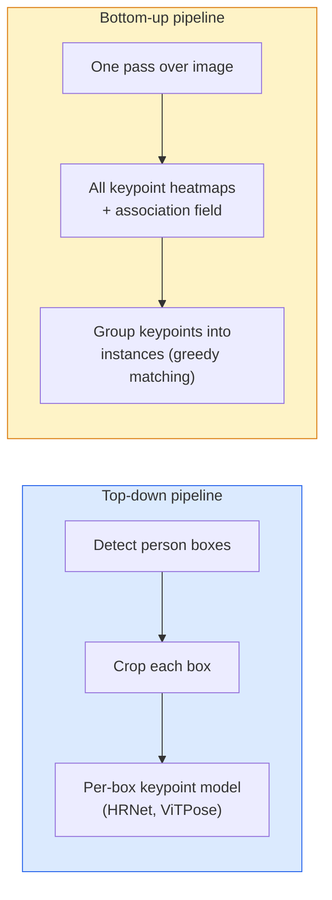

<!-- local-zh-machine-draft: English source is canonical; prose translated automatically, code/math preserved. -->

<a id="keypoint-detection--pose-estimation"></a>

# 关键点检测和姿势估计

> 姿势是一组有序的关键点。关键点检测器是热图回归器。其他一切都是簿记。

**类型：** 构建
**语言：** Python
**先决条件：** 第 4 阶段第 06 课（检测）、第 4 阶段第 07 课（U-Net）
**时间：** ~45分钟

<a id="learning-objectives"></a>

## 学习目标

- 区分自上而下和自下而上的姿态估计以及各自使用时的状态
- 使用每个关键点高斯目标回归 K 个关键点的热图，并在 inference 处提取关键点坐标
- 解释零件关联字段 (PAF) 以及自下而上的管道如何将关键点关联到实例中
- 使用 MediaPipe Pose 或 MMPose 进行生产关键点估计并了解其输出格式

<a id="the-problem"></a>

## 问题

关键点任务隐藏在许多名称中：人体姿势（17 个身体关节）、面部标志（68 或 478 点）、手（21 点）、动物姿势、机器人物体姿势、医学解剖标志。它们中的每一个都具有相同的结构：检测物体上的 K 个离散点并输出它们的 (x, y) 坐标。

姿势估计是动作捕捉、健身应用程序、运动分析、手势控制、动画、AR 试戴和机器人抓取的基础。 2D案例成熟； 3D 位姿（从单个相机估计世界坐标中的关节位置）是当前的研究前沿。

工程问题是规模。单图像、单人姿势是一个 20 毫秒的问题。对于不同的架构，以 30 fps 的速度在人群中摆出多人姿势是一个不同的问题。

<a id="the-concept"></a>

## 概念

<a id="top-down-vs-bottom-up"></a>

### 自上而下与自下而上



- **Top-down** — 首先检测人物，然后在每种作物上运行每人关键点模型。最高的准确度；与人数呈线性比例。
- **Bottom-up** — 一个 forward pass 预测所有关键点加上关联字段；将他们分组。无论人群大小如何，时间都是恒定的。

自上而下（HRNet、ViTPose）是准确性领先者；自下而上（OpenPose、HigherHRNet）是拥挤场景的吞吐量领先者。

<a id="heatmap-regression"></a>

### 热图回归

不要直接回归 `(x, y)`，而是使用以真实位置为中心的高斯斑点预测每个关键点的 `H x W` 热图。

```
target[k, y, x] = exp(-((x - cx_k)^2 + (y - cy_k)^2) / (2 sigma^2))
```

在inference，每个热图的argmax是预测的关键点位置。

为什么热图比直接回归效果更好：网络的空间结构（转换 feature 地图）与空间输出自然对齐。高斯目标也会正则化——小的定位误差会产生小的损失，而不是零。

<a id="sub-pixel-localisation"></a>

### 亚像素定位

Argmax 给出整数坐标。对于子像素精度，通过将抛物线拟合到 argmax 及其邻居来进行细化，或使用众所周知的偏移 `(dx, dy) = 0.25 * (heatmap[y, x+1] - heatmap[y, x-1], ...)` 方向。

<a id="part-affinity-fields-pafs"></a>

### 零件关联字段 (PAF)

OpenPose 自下而上关联的技巧。对于每对连接的关键点（例如，左肩到左肘），预测一个 2 通道字段，该字段编码从一个指向另一个的单位向量。要将肩部与其肘部关联起来，请沿着连接候选对的线整合 PAF；积分最高的对被匹配。

```
For each connection (limb):
  PAF channels: 2 (unit vector x, y)
  Line integral: sum over sample points of (PAF . line_direction)
  Higher integral = stronger match
```

优雅且可适应任意人群规模，无需按人裁剪。

<a id="coco-keypoints"></a>

### COCO要点

标准身体姿势数据集：每人 17 个关键点，PCK（正确关键点百分比）和 OKS（对象关键点相似度）作为指标。 OKS 是 IoU 的关键点类似物，也是 COCO mAP@OKS 报告的内容。

<a id="2d-vs-3d"></a>

### 2D 与 3D

- **2D 姿态** — 图像坐标；解决了生产质量问题（MediaPipe、HRNet、ViTPose）。
- **3D 姿势** — 世界/相机坐标；仍在积极研究。常见方法：
  - 使用小型 MLP (VideoPose3D) 将 2D 预测提升为 3D。
  - 图像的直接 3D 回归（PyMAF、MHFormer）。
  - 用于地面实况的多视图设置（CMU Panoptic）。

```figure
cv3-pose-heatmap
```

<a id="build-it"></a>

## 动手实现

<a id="step-1-gaussian-heatmap-target"></a>

### 第 1 步：高斯热图目标

```python
import numpy as np
import torch

def gaussian_heatmap(size, cx, cy, sigma=2.0):
    yy, xx = np.meshgrid(np.arange(size), np.arange(size), indexing="ij")
    return np.exp(-((xx - cx) ** 2 + (yy - cy) ** 2) / (2 * sigma ** 2)).astype(np.float32)

hm = gaussian_heatmap(64, 32, 32, sigma=2.0)
print(f"peak: {hm.max():.3f} at ({hm.argmax() % 64}, {hm.argmax() // 64})")
```

沿通道轴堆叠的每个关键点热图给出了完整的目标 tensor。

<a id="step-2-tiny-keypoint-head"></a>

### 第2步：微小的关键点头

输出 K 个热图通道的 U-Net 式模型。

```python
import torch.nn as nn
import torch.nn.functional as F

class TinyKeypointNet(nn.Module):
    def __init__(self, num_keypoints=4, base=16):
        super().__init__()
        self.down1 = nn.Sequential(nn.Conv2d(3, base, 3, 2, 1), nn.ReLU(inplace=True))
        self.down2 = nn.Sequential(nn.Conv2d(base, base * 2, 3, 2, 1), nn.ReLU(inplace=True))
        self.mid = nn.Sequential(nn.Conv2d(base * 2, base * 2, 3, 1, 1), nn.ReLU(inplace=True))
        self.up1 = nn.ConvTranspose2d(base * 2, base, 2, 2)
        self.up2 = nn.ConvTranspose2d(base, num_keypoints, 2, 2)

    def forward(self, x):
        h1 = self.down1(x)
        h2 = self.down2(h1)
        h3 = self.mid(h2)
        u1 = self.up1(h3)
        return self.up2(u1)
```

输入`(N, 3, H, W)`，输出`(N, K, H, W)`。损失是针对高斯目标的每像素 MSE。

<a id="step-3-inference--extract-keypoint-coordinates"></a>

### 步骤3：Inference——提取关键点坐标

```python
def heatmap_to_coords(heatmaps):
    """
    heatmaps: (N, K, H, W)
    returns:  (N, K, 2) float coordinates in image pixels
    """
    N, K, H, W = heatmaps.shape
    hm = heatmaps.reshape(N, K, -1)
    idx = hm.argmax(dim=-1)
    ys = (idx // W).float()
    xs = (idx % W).float()
    return torch.stack([xs, ys], dim=-1)

coords = heatmap_to_coords(torch.randn(2, 4, 32, 32))
print(f"coords: {coords.shape}")  # (2, 4, 2)
```

一条线 inference。对于子像素细化，在 argmax 周围进行插值。

<a id="step-4-synthetic-keypoint-dataset"></a>

### 步骤 4：合成关键点数据集

简单：在白色画布上画四个点并学习预测它们。

```python
def make_synthetic_sample(size=64):
    img = np.ones((3, size, size), dtype=np.float32)
    rng = np.random.default_rng()
    kps = rng.integers(8, size - 8, size=(4, 2))
    for cx, cy in kps:
        img[:, cy - 2:cy + 2, cx - 2:cx + 2] = 0.0
    hms = np.stack([gaussian_heatmap(size, cx, cy) for cx, cy in kps])
    return img, hms, kps
```

非常简单，一个小模型一分钟就能学会。

<a id="step-5-training"></a>

### 第五步：培训

```python
model = TinyKeypointNet(num_keypoints=4)
opt = torch.optim.Adam(model.parameters(), lr=3e-3)

for step in range(200):
    batch = [make_synthetic_sample() for _ in range(16)]
    imgs = torch.from_numpy(np.stack([b[0] for b in batch]))
    hms = torch.from_numpy(np.stack([b[1] for b in batch]))
    pred = model(imgs)
    # Upsample pred to full resolution
    pred = F.interpolate(pred, size=hms.shape[-2:], mode="bilinear", align_corners=False)
    loss = F.mse_loss(pred, hms)
    opt.zero_grad(); loss.backward(); opt.step()
```

<a id="use-it"></a>

## 实际应用

- **MediaPipe Pose** — Google 的生产姿势估计器；提供 WebGL + 移动运行时，延迟低于 10 毫秒。
- **MMPose** (OpenMMLab) — 综合研究代码库；每个 SOTA 架构都经过预训练 weights。
- **YOLOv8-pose** — 使用单个 forward pass 实现最快的实时多人姿势。
- **transformers HumanDPT / PoseAnything** — 用于开放 vocabulary 姿势（任何对象、任何关键点集）的更新视觉语言方法。

<a id="ship-it"></a>

## 交付成果

本课产生：

- `outputs/prompt-pose-stack-picker.md` — 一个 prompt，根据延迟、人群规模和 2D 与 3D 需求选择 MediaPipe / YOLOv8-pose / HRNet / ViTPose。
- `outputs/skill-heatmap-to-coords.md` - 一种编写每个生产姿势模型使用的子像素热图到坐标例程的技能。

<a id="exercises"></a>

## 练习

1. **(Easy)** 在合成 4 点数据集上训练微小关键点模型。报告 200 步后预测关键点与真实关键点之间的平均 L2 误差。
2. **(Medium)** 添加子像素细化：给定 argmax 位置，从相邻像素沿 x 和 y 拟合一维抛物线。报告精度增益与整数 argmax 的关系。
3. **（硬）** 构建一个 2 人合成数据集，其中每个图像显示 4 关键点模式的两个实例。使用 PAF 训练自下而上的管道，预测哪个关键点属于哪个实例，并评估 OKS。

<a id="key-terms"></a>

## 关键术语

| 术语 | 人们怎么说 | 它实际上意味着什么 |
|------|----------------|----------------------|
| 关键点 | “一个里程碑” | 对象上的特定有序点（关节、角、feature） |
| 姿势 | “骷髅” | 属于一个实例的一组有序关键点 |
| 自上而下 | “检测然后摆姿势” | 两级流程：人员检测器+每作物关键点模型；最高准确度 |
| 自下而上 | “先摆姿势，后分组” | 单通道全关键点预测+分组；人群规模恒定的时间 |
| 热图 | “高斯目标” | 每个关键点的高 x 宽 tensor，峰值位于真实位置；首选回归目标 |
| PAF | “部分亲和力场” | 2通道单位矢量场编码肢体方向；用于将关键点分组到实例中 |
| 奥克斯 | “关键点借条” | 对象关键点相似度；姿势的 COCO 度量 |
| 人力资源网 | 《高分辨率网络》 | 占主导地位的自顶向下关键点架构；始终保留高分辨率 features |

<a id="further-reading"></a>

## 进一步阅读

- [OpenPose (Cao et al., 2017)](https://arxiv.org/abs/1812.08008) — 使用 PAF 自下而上；仍然是该方法的最佳文章
- [HRNet（Sun 等人，2019）](https://arxiv.org/abs/1902.09212) — 自上而下的参考架构
- [ViTPose (Xu et al., 2022)](https://arxiv.org/abs/2204.12484) — 普通 ViT 作为姿势主干；当前在许多基准上的 SOTA
- [MediaPipe Pose](https://developers.google.com/mediapipe/solutions/vision/pose_landmarker) — 生产实时姿势； 2026 年部署速度最快的堆栈
