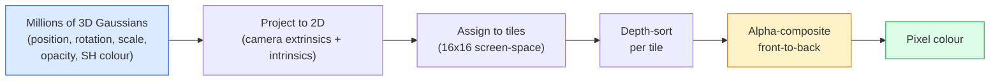

<!-- local-zh-machine-draft: English source is canonical; prose translated automatically, code/math preserved. -->

<a id="3d-gaussian-splatting-from-scratch"></a>

# 从零实现 3D Gaussian Splatting

> 场景是数百万个 3D 高斯的云。每个都有位置、方向、比例、不透明度以及取决于观察方向的颜色。对它们进行栅格化，通过栅格化进行反向传播，完成。

**类型：** 构建
**语言：** Python
**先决条件：** 第 4 阶段第 13 课（3D Vision 和 NeRF）、第 1 阶段第 12 课（Tensor 操作）、第 4 阶段第 10 课（扩散基础知识可选）
**时间：** ~90 分钟

<a id="learning-objectives"></a>

## 学习目标

- 解释为什么 3D 高斯溅射取代 NeRF 作为 2026 年逼真 3D 重建的生产默认设置
- 说明六个每高斯 parameters（位置、旋转四元数、比例、不透明度、球谐颜色、可选 feature）以及每个贡献多少个浮点数
- 使用 `alpha` 合成从头开始实现 2D 高斯溅射光栅器，然后展示 3D 案例如何投影到同一循环
- 使用 `nerfstudio`、`gsplat` 或 `SuperSplat` 从 20-50 张照片重建场景并导出到 `KHR_gaussian_splatting` glTF 扩展或 OpenUSD 26.03 `UsdVolParticleField3DGaussianSplat` 模式

<a id="the-problem"></a>

## 问题

NeRF 将场景存储为 MLP 的 weights。每个渲染的像素都是沿着一条射线的数百个 MLP 查询。训练需要几个小时，渲染需要几秒钟，并且 weights 无法编辑 - 如果您想在场景中移动椅子，则必须重新训练。

3D 高斯溅射（Kerbl、Kopanas、Leimkühler、Drettakis、SIGGRAPH 2023）取代了所有这些。场景是一组显式的 3D 高斯函数。渲染为 GPU 光栅化，帧速率超过 100 fps。训练需要几分钟。编辑是直接的：翻译高斯的子集，然后你就移动了椅子。到 2026 年，Khronos Group 已批准高斯 splats 的 glTF 扩展，OpenUSD 26.03 提供高斯 splat 模式，Zillow 和 Apartments.com 使用它们渲染房地产，并且大多数关于 3D 重建的新研究论文都是核心 3DGS 思想的变体。

心智模型很简单，数学有足够多的活动部分，大多数介绍都是从光栅化开始，跳过投影和球谐函数。本课程将构建整个内容 - 首先是 2D 版本，然后是 3D 扩展。

<a id="the-concept"></a>

## 概念

<a id="what-a-gaussian-carries"></a>

### 高斯携带什么

一个 3D 高斯是空间中的参数化斑点，具有以下属性：

```
position         mu         (3,)    centre in world coordinates
rotation         q          (4,)    unit quaternion encoding orientation
scale            s          (3,)    log-scales per axis (exponentiated at render time)
opacity          alpha      (1,)    post-sigmoid opacity [0, 1]
SH coefficients  c_lm       (3 * (L+1)^2,)   view-dependent colour
```

旋转+缩放构建3x3协方差：`Sigma = R S S^T R^T`。这就是 3D 中高斯的形状。球谐函数让颜色随着观看方向的变化而变化——镜面高光、微妙的光泽、依赖于视图的发光——而不存储每个视图的纹理。使用 SH 度 3，每个颜色通道可以获得 16 个系数，仅颜色每个高斯就有 48 个浮点。

场景通常有 1-5 百万高斯。每个存储大约 60 个浮点数（3 + 4 + 3 + 1 + 48 + 杂项）。对于 500 万高斯场景来说，这是 240 MB，远小于具有每点纹理的等效点云，并且比以高分辨率重新渲染的 NeRF MLP weights 小一个数量级。

<a id="rasterisation-not-ray-marching"></a>

### 光栅化，而不是光线行进



五个步骤，全部 GPU 友好。每个像素没有 MLP 查询。单个 RTX 3080 Ti 以 147 fps 渲染 600 万个画面。

<a id="the-projection-step"></a>

### 投影步骤

具有 3D 协方差 `Sigma` 的世界位置 `mu` 处的 3D 高斯投影到具有 2D 协方差 `Sigma'` 的屏幕位置 `mu'` 处的 2D 高斯：

```
mu' = project(mu)
Sigma' = J W Sigma W^T J^T          (2 x 2)

W = viewing transform (rotation + translation of camera)
J = Jacobian of the perspective projection at mu'
```

2D 高斯的足迹是一个椭圆，其轴是 eigenvectors 或 `Sigma'`。该椭圆内的每个像素都会接收高斯贡献，并按 `exp(-0.5 * (p - mu')^T Sigma'^-1 (p - mu'))` 加权。

<a id="the-alpha-compositing-rule"></a>

### alpha 合成规则

对于一个像素，覆盖它的高斯从后到前排序（或者等效地使用倒置公式从前到后排序）。颜色的合成公式与 20 世纪 80 年代以来的每个半透明光栅器相同：

```
C_pixel = sum_i alpha_i * T_i * c_i

T_i = prod_{j < i} (1 - alpha_j)       transmittance up to i
alpha_i = opacity_i * exp(-0.5 * d^T Sigma'^-1 d)   local contribution
c_i = eval_SH(SH_i, view_direction)    view-dependent colour
```

这是 **，与 NeRF 的体积渲染 ** 相同的方程，只是在显式稀疏高斯集上，而不是沿射线的密集样本上。这一特性就是渲染质量与 NeRF 相匹配的原因——两者都集成了相同的辐射场方程。

<a id="why-this-is-differentiable"></a>

### 为什么这是可微的

每一步——投影、图块分配、alpha 合成、SH evaluation——相对于高斯 parameters 都是可微分的。给定真实图像，计算渲染像素损失，通过光栅化器反向传播，通过 gradient descent 更新所有 `(mu, q, s, alpha, c_lm)`。经过约 30,000 次迭代，高斯找到了正确的位置、比例和颜色。

<a id="densification-and-pruning"></a>

### 致密化和修剪

一组固定的高斯函数无法覆盖复杂的场景。训练包括两种自适应机制：

- **Clone** 当其 gradient 幅度较高但尺度较小时，其当前位置的高斯分布 — 此处重建需要更多细节。
- **Split** 当 gradient 较高时，将一个大尺度高斯分成两个较小的高斯 - 一个大高斯太平滑而无法适应该区域。
- **Prune** 不透明度降至阈值以下的高斯函数 - 它们没有贡献。

致密化每 N 次迭代运行一次。场景通常从约 100k 初始高斯（从 SfM 点播种）增长到训练结束时的 1-5M。

<a id="spherical-harmonics-in-one-paragraph"></a>

### 一段中的球谐函数

与视图相关的颜色是单位球体上的函数 `c(direction)`。球谐函数是球体的傅立叶基。以 `L` 度截断，您将获得每个通道的 `(L+1)^2` 基函数。评估新视图的颜色是学习的 SH 系数与在观看方向评估的基础之间的点积。 0 度 = 一个系数 = 恒定颜色。 3 阶 = 16 个系数 = 足以捕捉朗伯阴影、镜面反射和轻微反射。 SD Gaussian Splatting 论文默认使用 3 级。

<a id="the-2026-production-stack"></a>

### 2026年生产堆栈

```
1. Capture         smartphone / DJI drone / handheld scanner
2. SfM / MVS       COLMAP or GLOMAP derives camera poses + sparse points
3. Train 3DGS      nerfstudio / gsplat / inria official / PostShot (~10-30 min on RTX 4090)
4. Edit            SuperSplat / SplatForge (clean floaters, segment)
5. Export          .ply -> glTF KHR_gaussian_splatting or .usd (OpenUSD 26.03)
6. View            Cesium / Unreal / Babylon.js / Three.js / Vision Pro
```

<a id="4d-and-generative-variants"></a>

### 4D 和生成变体

- **4D 高斯分布** — 高斯是时间的函数；用于体积视频（Superman 2026、A$AP Rocky 的“Helicopter”）。
- **生成 splats** — 文本到 splat 模型（World Labs 的 Marble），可以产生整个场景的幻觉。
- **3D 高斯无味变换** — NVIDIA NuRec 用于自动驾驶模拟的变体。

```figure
cv3-gaussian-splat
```

<a id="build-it"></a>

## 动手实现

<a id="step-1-a-2d-gaussian"></a>

### 第 1 步：二维高斯

我们首先构建一个 2D 光栅化器。 3D情况在投影后缩小到它。

```python
import torch
import torch.nn as nn
import torch.nn.functional as F


def eval_2d_gaussian(means, covs, points):
    """
    means:  (G, 2)      centres
    covs:   (G, 2, 2)   covariance matrices
    points: (H, W, 2)   pixel coordinates
    returns: (G, H, W)  density at every pixel for every Gaussian
    """
    G = means.size(0)
    H, W, _ = points.shape
    flat = points.view(-1, 2)
    inv = torch.linalg.inv(covs)
    diff = flat[None, :, :] - means[:, None, :]
    d = torch.einsum("gpi,gij,gpj->gp", diff, inv, diff)
    density = torch.exp(-0.5 * d)
    return density.view(G, H, W)
```

`einsum` 对每个（高斯，像素）对执行二次形式 `diff^T Sigma^-1 diff`。

<a id="step-2-2d-splatting-rasteriser"></a>

### 步骤 2：2D 溅射光栅化器

从前到后 Alpha 合成。 2D 中的深度没有意义，因此我们使用学习的每高斯标量来排序。

```python
def rasterise_2d(means, covs, colours, opacities, depths, image_size):
    """
    means:     (G, 2)
    covs:      (G, 2, 2)
    colours:   (G, 3)
    opacities: (G,)     in [0, 1]
    depths:    (G,)     per-Gaussian scalar used for ordering
    image_size: (H, W)
    returns:   (H, W, 3) rendered image
    """
    H, W = image_size
    yy, xx = torch.meshgrid(
        torch.arange(H, dtype=torch.float32, device=means.device),
        torch.arange(W, dtype=torch.float32, device=means.device),
        indexing="ij",
    )
    points = torch.stack([xx, yy], dim=-1)

    densities = eval_2d_gaussian(means, covs, points)
    alphas = opacities[:, None, None] * densities
    alphas = alphas.clamp(0.0, 0.99)

    order = torch.argsort(depths)
    alphas = alphas[order]
    colours_sorted = colours[order]

    T = torch.ones(H, W, device=means.device)
    out = torch.zeros(H, W, 3, device=means.device)
    for i in range(means.size(0)):
        a = alphas[i]
        out += (T * a)[..., None] * colours_sorted[i][None, None, :]
        T = T * (1.0 - a)
    return out
```

速度不快——真正的实现使用基于图块的 CUDA 内核——但数学完全正确并且完全可微分。

<a id="step-3-a-trainable-2d-splat-scene"></a>

### 第 3 步：可训练的 2D splat 场景

```python
class Splats2D(nn.Module):
    def __init__(self, num_splats=128, image_size=64, seed=0):
        super().__init__()
        g = torch.Generator().manual_seed(seed)
        H, W = image_size, image_size
        self.means = nn.Parameter(torch.rand(num_splats, 2, generator=g) * torch.tensor([W, H]))
        self.log_scale = nn.Parameter(torch.ones(num_splats, 2) * math.log(2.0))
        self.rot = nn.Parameter(torch.zeros(num_splats))  # single angle in 2D
        self.colour_logits = nn.Parameter(torch.randn(num_splats, 3, generator=g) * 0.5)
        self.opacity_logit = nn.Parameter(torch.zeros(num_splats))
        self.depth = nn.Parameter(torch.rand(num_splats, generator=g))

    def covs(self):
        s = torch.exp(self.log_scale)
        c, si = torch.cos(self.rot), torch.sin(self.rot)
        R = torch.stack([
            torch.stack([c, -si], dim=-1),
            torch.stack([si, c], dim=-1),
        ], dim=-2)
        S = torch.diag_embed(s ** 2)
        return R @ S @ R.transpose(-1, -2)

    def forward(self, image_size):
        covs = self.covs()
        colours = torch.sigmoid(self.colour_logits)
        opacities = torch.sigmoid(self.opacity_logit)
        return rasterise_2d(self.means, covs, colours, opacities, self.depth, image_size)
```

`log_scale`、`opacity_logit` 和 `colour_logits` 都是在渲染时通过正确激活映射的不受约束的 parameters。这是每个 3DGS 实施的标准模式。

<a id="step-4-fit-2d-gaussians-to-a-target-image"></a>

### 步骤 4：将 2D 高斯拟合到目标图像

```python
import math
import numpy as np

def make_target(size=64):
    yy, xx = np.meshgrid(np.arange(size), np.arange(size), indexing="ij")
    img = np.zeros((size, size, 3), dtype=np.float32)
    # Red circle
    mask = (xx - 20) ** 2 + (yy - 20) ** 2 < 10 ** 2
    img[mask] = [1.0, 0.2, 0.2]
    # Blue square
    mask = (np.abs(xx - 45) < 8) & (np.abs(yy - 40) < 8)
    img[mask] = [0.2, 0.3, 1.0]
    return torch.from_numpy(img)


target = make_target(64)
model = Splats2D(num_splats=64, image_size=64)
opt = torch.optim.Adam(model.parameters(), lr=0.05)

for step in range(200):
    pred = model((64, 64))
    loss = F.mse_loss(pred, target)
    opt.zero_grad(); loss.backward(); opt.step()
    if step % 40 == 0:
        print(f"step {step:3d}  mse {loss.item():.4f}")
```

超过 200 个步长，64 个高斯分布成两种形状。这就是整个想法——gradient-显式几何基元的下降。

<a id="step-5-from-2d-to-3d"></a>

### 第 5 步：从 2D 到 3D

3D 扩展保持相同的循环。补充内容：

1. 按高斯旋转是四元数而不是单个角度。
2. 协方差为 `R S S^T R^T`，其中 `R` 由四元数和 `S = diag(exp(log_scale))` 构建。
3. 投影 `(mu, Sigma) -> (mu', Sigma')` 使用相机外参和 `mu` 的透视投影的 Jacobian。
4. 颜色变成球谐函数展开；在观察方向评估它。
5. 深度排序来自实际的相机空间 z 而不是学习的标量。

每个生产实现（`gsplat`、`inria/gaussian-splatting`、`nerfstudio`）都在带有基于图块的 CUDA 内核的 GPU 上执行此操作。

<a id="step-6-spherical-harmonics-evaluation"></a>

### 步骤 6：球谐函数 evaluation

高达 3 级的 SH 基每个通道有 16 个项。 Evaluation：

```python
def eval_sh_degree_3(sh_coeffs, dirs):
    """
    sh_coeffs: (..., 16, 3)   last dim is RGB channels
    dirs:      (..., 3)       unit vectors
    returns:   (..., 3)
    """
    C0 = 0.282094791773878
    C1 = 0.488602511902920
    C2 = [1.092548430592079, 1.092548430592079,
          0.315391565252520, 1.092548430592079,
          0.546274215296039]
    x, y, z = dirs[..., 0], dirs[..., 1], dirs[..., 2]
    x2, y2, z2 = x * x, y * y, z * z
    xy, yz, xz = x * y, y * z, x * z

    result = C0 * sh_coeffs[..., 0, :]
    result = result - C1 * y[..., None] * sh_coeffs[..., 1, :]
    result = result + C1 * z[..., None] * sh_coeffs[..., 2, :]
    result = result - C1 * x[..., None] * sh_coeffs[..., 3, :]

    result = result + C2[0] * xy[..., None] * sh_coeffs[..., 4, :]
    result = result + C2[1] * yz[..., None] * sh_coeffs[..., 5, :]
    result = result + C2[2] * (2.0 * z2 - x2 - y2)[..., None] * sh_coeffs[..., 6, :]
    result = result + C2[3] * xz[..., None] * sh_coeffs[..., 7, :]
    result = result + C2[4] * (x2 - y2)[..., None] * sh_coeffs[..., 8, :]

    # degree 3 terms omitted here for brevity; full 16-coefficient version in the code file
    return result
```

了解到 `sh_coeffs` 存储该高斯的“各个方向的颜色”。在渲染时，您根据当前视图方向进行评估并获得 3 向量 RGB。

<a id="use-it"></a>

## 实际应用

对于真正的 3DGS 工作，请使用 `gsplat` （元）或 `nerfstudio`：

```bash
pip install nerfstudio gsplat
ns-download-data example
ns-train splatfacto --data path/to/data
```

`splatfacto` 是 nerfstudio 的 3DGS 训练器。对于典型场景，在 RTX 4090 上运行需要 10-30 分钟。

2026 年重要的出口选项：

- `.ply` — 原始高斯云（便携式、最大文件）。
- `.splat` — PlayCanvas / SuperSplat 量化格式。
- glTF `KHR_gaussian_splatting` — Khronos 标准，可跨查看器移植（2026 年 2 月 RC）。
- OpenUSD `UsdVolParticleField3DGaussianSplat` — USD 原生，用于 NVIDIA Omniverse 和 Vision Pro 管道。

对于 4D/动态场景，`4DGS` 和 `Deformable-3DGS` 以随时间变化的方式和不透明度扩展相同的机械。

<a id="ship-it"></a>

## 交付成果

本课产生：

- `outputs/prompt-3dgs-capture-planner.md` — 一个 prompt，为给定的场景类型规划捕获会话（照片数量、相机路径、照明）。
- `outputs/skill-3dgs-export-router.md` — 一种根据下游查看器或引擎选择正确导出格式 (`.ply` / `.splat` / glTF / USD) 的技能。

<a id="exercises"></a>

## 练习

1. **（简单）** 在不同的合成图像上运行上面的 2D splat 训练器。改变 `[16, 64, 256]` 中的 `num_splats` 并绘制每个的 MSE 与步长。确定收益递减点。
2. **（中）** 扩展 2D 光栅器以支持通过 2 次谐波依赖于标量“视角”的每高斯 RGB 颜色。在一对目标图像上进行训练并验证模型是否能够重建这两个图像。
3. **（硬）** 克隆 `nerfstudio` 并在您拥有的任何场景（桌子、植物、脸部、房间）的 20 张照片捕捉上训练 `splatfacto`。导出到 glTF `KHR_gaussian_splatting` 并在查看器中打开它（Three.js `GaussianSplats3D`、SuperSplat、Babylon.js V9）。报告训练时间、高斯数和渲染的 fps。

<a id="key-terms"></a>

## 关键术语

| 术语 | 人们怎么说 | 它实际上意味着什么 |
|------|----------------|----------------------|
| 3DGS | “高斯斑点” | 显式场景表示为数百万个 3D 高斯，具有每高斯位置、旋转、比例、不透明度、SH 颜色 |
| 协方差 | 《高斯的形状》 | `Sigma = R S S^T R^T`;一个高斯的方向和各向异性尺度 |
| 阿尔法合成 | “从后到前的混合” | 与 NeRF 体积渲染相同的方程，现在在显式稀疏集上 |
| 致密化 | “克隆与分裂” | 在重建不合适的情况下自适应添加新的高斯函数 |
| 修剪 | “删除低不透明度” | 删除训练期间不透明度接近于零的高斯函数 |
| 球谐函数 | “依赖于视图的颜色” | 球面的傅立叶基；将颜色存储为观察方向的函数 |
| 斯普拉特事实 | “nerfstudio 的 3DGS” | 2026 年训练 3DGS 的最简单途径 |
| `KHR_gaussian_splatting` | “GLTF标准” | Khronos 2026 扩展使 3DGS 可以在查看器和引擎之间移植 |

<a id="further-reading"></a>

## 进一步阅读

- [3D Gaussian Splatting for Real-Time Radiance Field Rendering（Kerbl 等人，SIGGRAPH 2023）](https://repo-sam.inria.fr/fungraph/3d-gaussian-splatting/) — 原始论文
- [gsplat (Meta/nerfstudio)](https://github.com/nerfstudio-project/gsplat) — 生产质量 CUDA 光栅器
- [nerfstudio Splatfacto](https://docs.nerf.studio/nerfology/methods/splat.html) — 参考训练配方
- [Khronos KHR_gaussian_splatting 扩展](https://github.com/KhronosGroup/glTF/blob/main/extensions/2.0/Khronos/KHR_gaussian_splatting/README.md) — 2026 便携式格式
- [OpenUSD 26.03 发行说明](https://openusd.org/release/) — `UsdVolParticleField3DGaussianSplat` 架构
- [THE FUTURE 3D 高斯溅射状态 2026](https://www.thefuture3d.com/blog-0/2026/4/4/state-of-gaussian-splatting-2026) — 行业概述
